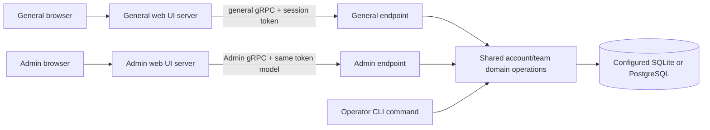
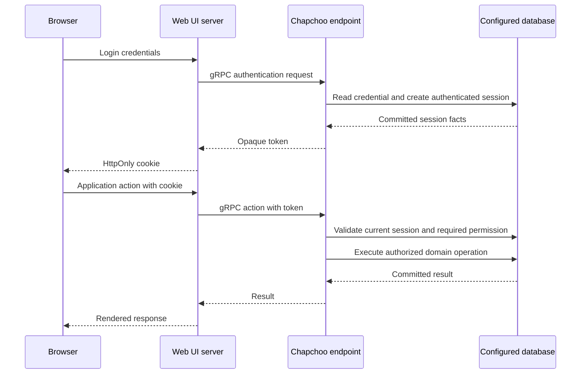
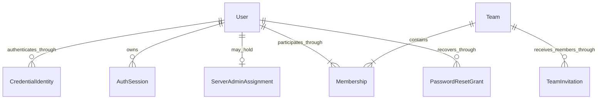

# Server Account and Team Onboarding Design

- Snapshot: `accounts-261029`
- Revision: `37`
- State: approved revision36 plus requester-approved deployment clarification D38;
  revision37 implementation requested on2026-10-30, live validation pending.
- Authority: [Requirements](../requirements/accounts-261029-server-team-onboarding.md)
  and [accepted decisions through D37](../adr/accounts-261029-server-team-onboarding.md).

This revision consolidates agreed boundaries and maps required operations to the
two protocol surfaces. It defines request data, state transitions, and relational
acceptance mechanisms with Diesel and the shared Rust foundation selected in
D28-D29. It now includes fixed-key storage, writable web renewal and dual-controller
deployment preparation, local loopback HTTP access and proxy-terminated external
gRPC TLS. The final authority/feasibility review is recorded below.
Assembled-product verification belongs to implementation rather than being
claimed by this proposal.

## Current Behavior and Gap

### Reference Alignment and Scope

Under D27, reference-aligned details follow verified Azents implementation within
the confirmed feature scope. Previously approved Chapchoo differences remain
authoritative. Resolve those details by source inspection rather than repeating
individual policy questions. Continue asking about genuinely unresolved product
behavior, permissions, and user journeys; this is not blanket delegation of
product decisions.

The proposed 5-failures/15-minute password restriction and an administrator
unlock workflow were not accepted and are excluded. Password blocklists, new
lockout modes, or other additional security/product features require existing
reference evidence within scope or explicit requester authority; a recommendation
alone does not authorize them.

The inspected reference authentication route/service/repository files do not
establish such a policy. This is bounded evidence, not a finding that every
deployment middleware layer lacks limits. Complete reference mapping before
claiming parity, and do not substitute proposed defaults for missing evidence.
Continue independent design work while surfacing material product questions
with their actual context and consequences.

The checkout contains only development tooling and a Next.js Hello World app.
The backend, Admin UI, protobuf definitions, database models, migrations, and Helm
chart do not exist. There are no implemented product contracts or existing user
records to migrate. Existing Python/Swift/proto/infra folders are reserved layout,
not a decision to implement this backend in those languages or reuse Azents code.

## Architecture and Ownership

### Accepted Rust Foundation

D29 selects explicit composition rather than a runtime DI container. The
executable builds configuration, repositories/pools, external clients and
services, then injects services into protocol handlers. Application code does
not discover dependencies through global lookups.

Runtime calls keep the adapter/service/repository sequence. Compile-time
dependencies may use application-owned capability ports implemented by the
persistence layer, so the protocol crate cannot import DB implementation types.
Keep domain contracts and validation independent of Tonic request wrappers and
Diesel rows. Exact crate count is a local detail; dependency direction, visibility,
and complete repository-owned transactions are enforceable contracts.

Tokio owns async execution. Tonic/Prost generate and serve the two gRPC surfaces.
Tasks and children have explicit owners, cancellation/drain paths, and joined
results. Bcrypt executes as bounded blocking work outside DB locks; a started
blocking task is not assumed abortable.

Use typed domain errors and source-preserving infrastructure reports. Capture
backtraces explicitly at the infrastructure adapter/report boundary as needed;
this does not reconstruct frames already unwound inside a dependency. tracing
emits structured fields and spans, with one handling/logging boundary and
secret-safe public status conversion. Ordinary domain rejections do not become
success-shaped infrastructure failures.

CI must run pinned-toolchain compilation, targeted Clippy with warnings treated
as errors, rustfmt checking, generated-contract consistency and the required
tests. Workspace members inherit lint policy; graph checks and negative compile
cases verify forbidden dependencies/types. A Rust backend does not replace
the retained TypeScript/infra/QA conventions.

- General and Admin web applications are independently runnable/deployable (D1).
- Backend roles and operator commands are selected from one binary (D2, D5).
- General/Admin endpoints use separate ports even in combined execution (D3).
- Backend roles use common domain rules and the same database, not forwarding
  Admin mutations to a general server process (D4, D13). Routine local development
  uses SQLite; deployment/QA can select PostgreSQL in this cycle.
- Web applications read browser cookies, call the appropriate protocol using the
  current user's token, and render results. They never own account/team authority
  or access the business database directly (D4, D11).
- User identity and server-administrator authority are separate from team
  ownership/manager membership. Tokens authenticate; current permissions
  authorize (D8-D10).
- No shared web-session mapping store, permanent connection identity, generic
  task engine, mutation result ledger, or cross-service event bus is introduced.

### Combined and Independent Execution

The backend can run either endpoint alone or both. Unified installation adds built
web artifacts and the required web runtime behind the central PATH command (D6).
This does not require all components to share one process. Independent Docker/Helm
components remain possible.

The general endpoint must not be a hidden network prerequisite merely to execute
Admin domain operations. Authentication needed by an independently operated Admin
surface uses the shared domain implementation, not a mandatory call through the
general server. Register the common login, renewal, logout and current-identity
RPC group on both listeners, backed by the same services. Keep general
onboarding/team operations and Admin issuance/bootstrap groups on their designated
listeners. Admin business operations and Admin web admission still require
current administrator status; this is not a new Admin-only session type.

### Backend gRPC Transport and Exposure

D37 resolves D7's transport-exposure decision independently of D36's browser
cookie policy. External gRPC clients connect through a TLS-terminating
HTTP/2-capable Ingress/reverse proxy managed by the operator. The Node gRPC client
validates the remote certificate/hostname and never falls back silently to an
insecure connection on TLS failure.

Rust listens on distinct plaintext general/Admin HTTP/2 endpoints. The local CLI
binds those endpoints to loopback. Kubernetes uses internal ClusterIP Services;
no public NodePort/LoadBalancer or direct host exposure is supplied for these
plaintext listeners. Web-to-backend calls may use those private endpoints within
the explicitly trusted deployment network. Calls crossing that boundary use the
TLS edge; a private IP alone does not prove the entire path is trusted.

The deployment proxy preserves HTTP/2 gRPC framing, authorization metadata,
status/trailers, cancellation and deadlines. General/Admin routing stays
separate, and the operator can leave Admin routing unexposed. All calls retain
backend session authentication and current permission checks; the proxy is not
an alternate identity authority.

The backend hop is not encrypted by public TLS. Network access controls and
trusted-workload placement are explicit deployment prerequisites. Native backend
TLS, certificate issuance/renewal, mTLS and a service mesh are outside this
cycle. Do not log bearer metadata or rely on untrusted forwarding headers to
change configured transport or authentication policy.

### Shared Product UI and Web Adapters

Under D31 both independent apps use Next.js/React/TypeScript/Mantine, with shared
product presentation components and app-owned routing/authentication adapters.
Admin uses the main product's look and feel without Refine.

The current general app already defines its Mantine theme, semantic CSS variables,
component defaults and color-scheme provider. Extract these existing definitions
into a shared workspace UI package when implementing this design; preserve their
behavior instead of introducing a second Admin theme. Reusable buttons, fields,
dialogs, feedback states and layout primitives belong to that same source as
they are needed by the approved account/team flows. Package names and equivalent
module layouts are local details.

General and Admin applications own their navigation, page containers, current
identity/permission queries, login callbacks and backend endpoints. Shared
components receive typed presentation data and callbacks rather than importing
an application's router, token store, generated server client or environment.
Shared branding does not erase the administrator context or expose privileged
actions to ordinary users.

Browser requests go to the owning Next.js Node runtime through tRPC, with
TanStack Query for client request state. Node handlers call generated gRPC
clients for the selected general/Admin backend; there is no browser-direct
gRPC or business-DB access. Reusable channel connections carry no mutable global
user credential: metadata is constructed for each request from that app's
HttpOnly cookie. Backend statuses map to typed web outcomes; mutations do not
automatically retry after ambiguous completion.

Only a writable HTTP response boundary publishes committed token renewal through
Set-Cookie. Server-rendered reads authenticate without rotating the credential;
the writable web-handler coordination below owns renewal and cookie delivery.

Shared component stories/tests cover keyboard behavior, responsive overflow and
loading/empty/error/disabled states. Both assembled apps verify the same theme
and shared controls while retaining their distinct navigation and permission
behavior. Package standalone output must include shared package assets in each
independently deployable app.

## Protocol Responsibilities

### Configuration Ownership

Configuration is composed once at the executable/web boundary into typed
component-specific inputs. Equivalent field/command names are implementation
details; the following ownership and failure contracts are fixed:

| Consumer | Required configuration and authority | Failure behavior |
| --- | --- | --- |
| Backend roles | Selected role/listener, selected SQLite path or PostgreSQL connection, fixed installation root, session validity/rotation/overlap defaults and optional absolute cap | Invalid configuration or failed read-only schema/key checks prevent readiness/admission |
| Initial preparation/migration CLI | Same database/root and embedded migration set | Serialize before changes; preserve existing binding; reject wrong key and partial prerequisites |
| Operator admin-grant CLI | Existing-user selector and same database/root | Verify installation authority; change only the existing user's server-admin assignment |
| General/Admin web | Own public base URL/listener, corresponding backend endpoint and external TLS trust where needed | Reject incompatible origin/bind policy and invalid remote certificate; never infer authority from forwarded headers |
| Mail adapter | Optional configured sender, region/endpoint and SDK credentials, general web URL for links | Missing mail is an explicit mail-flow failure; credentials never enter web clients or logs |
| Bootstrap handler | Explicit installation proof from operator-controlled configuration and empty-server/setup state | Missing/invalid proof cannot create the first admin; configuration alone cannot reopen consumed setup |
| Deployment proxy/controller | Existing DB/Secret prerequisites, public TLS endpoint and trusted internal route | Hook/readiness failure blocks new rollout; no key generation, DB rollback promise or automatic public plaintext fallback |

Local CLI child environments obey the allowlist described below. Independently
deployed web images likewise receive no DB, installation-root, bootstrap or mail
provider credentials. Public browser configuration contains only public URLs
and safe presentation settings. Secret values are excluded from repr/debug
output, errors, tracing attributes and command-line examples.

The lists below are conceptual operation groups, not finalized service names,
protobuf packages, endpoint identifiers, or separate microservices. Interface
names/grouping can be refined without changing privileges or introducing features.

### General Client Surface

| Operation group | Required operations | Admission and scope | Authority |
| --- | --- | --- | --- |
| Authentication | Password login; configured email-code send/verify; current identity/session; logout | Public credential exchange, then current authenticated user; no account creation by login alone | REQ-2, REQ-3; D8-D10 |
| Signup | Inspect usable link; redeem email-bound link; request signup email when configured | Link/credential proof; no unrestricted email/password registration | REQ-2, REQ-3 |
| Password recovery | Inspect reset link; redeem it to choose a new password | Reset-link proof; never issue a reset link as an ordinary team action | REQ-10 |
| Personal/team context | Read current personal space and accessible teams; create collaborative team; read team settings | Authenticated user and applicable membership; implicit personal space | REQ-4, REQ-5 |
| Team management | Update settings; delete collaborative team; transfer ownership | Settings: owner/manager; delete/transfer: owner only | REQ-6, REQ-8 |
| Membership | List team members; remove ordinary member; appoint/demote manager; leave team | Owner/manager according to REQ-6; owner transfer before leave | REQ-6, REQ-8 |
| Invitations | Create invitation; list team invitations needed for management; list own received invitations; accept/decline | Authorized inviter; acceptance/decline restricted to intended recipient | REQ-6, REQ-7 |

Personal spaces are not a team-management loophole: they cannot gain additional
members or lose their only owner through these operations. Team ownership changes
are not arbitrary role edits that can create an ownerless team. No generic
server-wide user list or account deletion is inferred from these read operations.

### Admin Client Surface

| Operation group | Required operations | Admission and scope | Authority |
| --- | --- | --- | --- |
| Initial setup | Read whether initialization is available; consume installation token to create first admin | Minimal setup availability information; valid setup proof and empty-server state for mutation | REQ-1 |
| Admin session admission | Authenticate using the common mechanism as necessary; validate current administrator identity; logout | Same server token model; current system-admin role for protected access | REQ-9; D9-D10 |
| Signup links | Issue, inspect/list administration metadata, revoke | Current server administrator; plaintext link returned only through required issuance/delivery | REQ-2, REQ-9 |
| Recovery links | Issue password-reset link for an existing user | Current server administrator; recipient chooses new password through general recovery flow | REQ-9, REQ-10 |

Initial setup is a deliberately bounded pre-user operation, not anonymous access
to protected Admin methods. Team managers do not qualify for these methods.
Administrative list/inspection here is limited to operating the accepted link
features; it does not expand into unrestricted server account/team CRUD.

### Operator Commands

The shared binary's recovery command resolves an existing user and grants server
administrator authority through the common domain/database path (REQ-12, D5).
It creates no user, does not choose or expose passwords, and does not depend on a
working network Admin session. Command names and configuration are not selected.

## Authentication and Authorization Flow

### Request and Response Contract

The following shapes map existing requirements to protocol data. They are
field-level design notation, not compiled protobuf definitions. Exact field
numbers, package/service names, and generated-code tooling remain implementation
details subject to the selected Rust/gRPC stack. Lifetimes are selected above
and below; they are not unspecified protocol defaults.

| Operation | Request data needed | Response data needed | Server-derived authority |
| --- | --- | --- | --- |
| Password login | Email and password | Session token, expiration information, current User summary | Credential validation resolves User; caller cannot supply a privileged user ID |
| Current identity | Authenticated call context | User summary and current server-admin status | Current session and role lookup; response is not a reusable privilege claim |
| Logout | Authenticated call context | Completion | Revoke that authenticated session, not an arbitrary client-supplied user's sessions |
| Redeem signup | Signup proof, bound email, chosen password | Authenticated session result and created User/personal context | Grant eligibility and atomic User/personal-space/session creation |
| Create team | Name and unique handle | Created Team and effective membership | Creator/owner comes from the session, not a request-supplied owner role |
| List accessible teams | Authenticated context and bounded list parameters | Personal context and accessible collaborative Team summaries | Membership-scoped result, not a global team directory |
| Invite member | Target Team, recipient email | Pending invitation summary | Session actor's current target-team permission; no manager invitation through a free-form role field |
| Accept/decline invitation | Invitation identifier | Processed invitation outcome; membership on acceptance | Recipient identity comes from authenticated User and email association |
| Change member role | Target Team and member, permitted manager/member transition | Updated effective member summary | Current owner authority; no arbitrary OWNER assignment through this operation |
| Transfer ownership | Target Team and existing recipient member | Updated owner/effective membership summary, including former owner's MANAGER role | Current owner authority and recipient membership checked in the mutation |
| Leave team | Target Team | Completion | Current actor is the leaving member; owner-leave restriction applies |
| Issue signup link (Admin) | Recipient email | Newly issued link/proof and management metadata | Current server-admin authority |
| Issue reset link (Admin) | Existing-user lookup | Newly issued reset link/proof and management metadata | Server-admin authority and resolved existing User |
| Redeem reset link | Recovery proof and chosen password | Completion only | Intended User from grant; consume, mutate password, revoke sessions atomically |

Required team-setting/removal/deletion and link-management operations follow the
same target identifier, authenticated actor, and outcome pattern. This list does
not add a global user-search feature to support existing-user recovery lookup.

Read models expose effective owner/manager/member roles regardless of the eventual
physical owner representation. They omit credential verifiers, raw session
tokens, and grant proofs except in their required issuance/authentication flows.
Requests do not accept authoritative actor IDs, server-admin flags, or arbitrary
permission arrays supplied by a client.

Protected RPCs carry `authorization: Bearer <opaque-token>` metadata per call.
Authentication creation/renewal calls carry their submitted credential in their
dedicated request, not in domain objects. A reusable channel has no global user
identity. Redact authorization metadata and credential request fields from logs.

Use opaque string IDs and Protobuf timestamps for instants. Read summaries use
explicit fields rather than arbitrary JSON. Team changes use optional `name` and
`handle` fields: omission leaves the value unchanged; present empty/invalid
values fail validation. They are not nullable properties and no `null`-as-omit
adapter is introduced. Empty patch requests have no effective change.

### Additional Contract Shapes

Names here identify domain operations, not a finalized `.proto` filename layout.
Client-supplied actor identity, inviter identity, and server-admin assignment
remain absent from mutation requests.

| Operation | Request | Result |
| --- | --- | --- |
| Initial setup status | No credential | Only initialization availability |
| Initial setup | Installation proof, email, password | Common session result and initialized administrator summary |
| Preview signup/reset | Submitted proof | Usable flag; only when usable, masked email hint and expiry; unusable proof returns no recipient detail |
| Request signup email | Email | Delivery accepted, or delivery-unavailable failure; no proof returned publicly |
| Send login code | Email | Challenge binding value and expiry, never the code |
| Verify login code | Email, challenge binding, entered code | Common session result for an existing registered User; no unrestricted signup |
| Renew session | Current or eligible immediately previous opaque token | The committed current token and its actual expiry; original creation/absolute-cap facts as needed by the client |
| Read/update team | Team ID; optional update name/handle | Membership-scoped Team summary with canonical owner ID and effective caller role |
| List members | Team ID | Membership summaries with stable member/User IDs and effective OWNER/MANAGER/MEMBER role |
| Remove member | Team ID and target member ID | Completion under the current ordinary-member removal rules |
| Delete team | Team ID | Completion; no account or personal-context deletion |
| List received invitations | Authenticated context | Owned pending invitations with Team ID/name/handle, recipient and status |
| List team invitations | Team ID | Invitations visible under team-management authority, not a server-wide directory |
| Inspect/revoke signup grants | Grant ID or administration list parameters | Non-secret issuance/expiry/consumption/revocation metadata or revoke completion |

Common session results contain the opaque credential and actual server expiry;
they do not introduce separate access/refresh credentials. Password login and
signup bootstrap use the same session authority. Identity reads never return
the token. Admin web login retains cookies only after current server-admin
admission. New sessions are not issued by password-reset completion.

Team settings are name/unique handle, following the reference account/team
surface. Handle changes do not change stable Team IDs or membership authority.
List fields preserve the reference shapes: team/member/invitation collections
return items; grant administration uses offset/limit plus items/total. Do not
introduce cursor histories, change feeds, or a server-wide directory as pagination
infrastructure. Concrete input limits and sorting tie-breakers are local contract
details to keep bounded and deterministic.

### Reference-Aligned State Transitions

The following behavior is derived under D27, not a new product-feature proposal:

- Signup and first-admin initialization return an authenticated session, matching
  the reference flow. User, password, personal context, applicable server-admin
  assignment, proof consumption, and initial session commit together. A lost
  response does not justify replaying signup; the created user can sign in.
- An email-code attempt is bound to its issued email/challenge. Validate and
  consume a successful challenge once. Then resolve an already registered User
  and issue the common session. It cannot bypass the signup-link requirement.
  Do not log the code or offer a no-mail code-retrieval fallback.
- Invitation acceptance creates one MEMBER membership and processes the pending
  invitation atomically. Decline only processes that invitation; it does not
  create membership. Signup never auto-accepts. A wrong recipient sees an
  unavailable invitation, and repeated processing reports already processed.
- Email sending occurs after the relevant database work commits. Mail failure
  does not compensate account, grant, or invitation state. A committed invitation
  can still be pending when its email fails. Return failure/uncertainty honestly;
  clients refresh state rather than replaying mutations automatically.
- Without configured email, manual signup/reset links remain available and team
  invitations stay pending without issuing signup links. Mail-only login and
  public signup-email requests report unavailable. No email queue, outbox,
  scheduler, delivery-status service, or automatic resend subsystem is added.

Reference mechanisms outside the confirmed scope remain outside it: invitation
role selection cannot grant a manager through a free-form field, join-request
autoapproval is not imported, and server-wide account management is not inferred.
Reinvitation/cancellation UI is not silently added by implementing invitation
creation.

The diagram describes logical responsibilities, not a mandate to hold a database
transaction over network calls or an exhaustive transaction count. Admin browser
login must validate administrator authority before retaining the login. A native
client with an existing valid session does not log in again solely for Admin use.

Authentication is not a property of a reusable gRPC channel alone: each protected
call must carry an authenticated user context. The same transport connection may
serve different web users; user tokens must not leak through global mutable client
state. The authorization metadata contract is defined above; client pooling
APIs follow the selected Rust/TypeScript libraries.

Cookie confidentiality, HTTPS, origin/CSRF protections, session revocation, and
current team/server authority checks must be covered by the final Design. Cookie
names/domains are not server-side role scopes. Shared-token revocation affects
both protocol surfaces using that session.

### Password Input Policy

REQ-3 and D26 require 8 through 64 printable ASCII characters inclusive
(U+0020 through U+007E) and at least three of four classes, using one domain
validator for bootstrap, signup, and reset:

- Uppercase: ASCII `A-Z`.
- Lowercase: ASCII `a-z`.
- Digit: ASCII `0-9`.
- Special: a character from `!@#$%^&*()_+-=[]{};':"\|,.<>/?`.

Every accepted character is one UTF-8 byte. Printable ASCII characters outside
these classes, including space, count toward length without automatically
satisfying a class. Reject non-ASCII and control characters.
Any three-class combination is valid, as is all four.
The UI may explain the rule but backend validation is authoritative.

Do not use email case folding, silently trim whitespace, truncate input, or
compare a prefix. Use bcrypt with a fresh random per-password salt and store
its encoded verifier, including its cost. All policy-valid inputs fit within
64 bytes and are verified in full. Reject invalid setup/signup/reset input
without consuming the proof or mutating credentials.

D26 replaces the original D25 input-range policy before implementation. Use the
bcrypt crate's non-truncating hash/verify APIs after domain validation, initially
at cost 12. Release-build samples at costs 10/11/12 took approximately 40/81/160 ms
on one host. Validate sizing on supported deployment targets; tuning retains the
approved minimum cost of 10 and is not a new password policy.

Bound active and queued blocking hash work independently of async request count,
and acquire that admission before spawning the blocking operation. A caller
timeout does not cancel a running hash: its owned permit is released only when
the work ends. Capacity exhaustion is an infrastructure overload result, not an
account lockout or a persisted failed-attempt counter. Hash outside DB locks.
No preliminary password hash, additional pepper secret or legacy-verifier
fallback is added.

### Session Continuity Policy

REQ-3 and D20 select a default 180-day validity window and no default absolute
lifetime cap. Initial session creation sets the window; eligible renewal
advances expiry from the server's renewal time using the configured window.
An optional configured absolute cap limits both initial and renewed expiry
relative to original session creation. General and Admin surfaces share these
server-side session validity rules under D10.

Renewal must reject expired or revoked sessions before extending them. It is
not a way to recover an expired login or undo logout/password-reset revocation.
Authorization still uses current team/server role assignments, not the roles
that existed at initial login.

The DB state, not a browser cookie's expiry, determines whether a session is
valid. Writable web request boundaries perform dedicated authentication renewal
before forwarding authenticated business operations and coordinate the cookie
with the resulting authoritative expiry. D21 selects rotation/overlap, D22
selects latest-token recovery, and D33 fixes the installation key. This does not
revive an invalid session or run a background renewal timer.

Without a configured absolute cap, successful renewal can retain a login
indefinitely. This is the accepted continuity trade-off, not a claim that bearer
credential theft is harmless. Credential protection, invalidation, and final
renewal mechanics remain security-critical.

### Opaque Token Rotation and Overlap

D21 applies rotation to the single opaque token selected in D8. It does not
introduce a JWT access token or a distinct refresh-token credential.

- With a current token, a renewal request before 10 minutes from last
  issuance/rotation returns current session state without rotation or extension.
- At or after that interval, an eligible current-token renewal atomically
  replaces the token, moves the former value into the previous-value slot, and
  extends expiry using D20, clamped to any configured absolute cap.
- The immediately previous token is accepted for 5 minutes from rotation.
  Using it does not rotate again, extend session expiry, or slide that overlap.
- Values older than the immediately previous one, or a previous value beyond
  its overlap, are invalid. Expired/revoked session state always wins over a
  token match; current team/server permissions are still required.

There is no timer that mutates idle sessions. Concurrent current-token renewals
must converge on one authoritative transition rather than issuing branches of
valid tokens. Database synchronization with logout/reset remains required on
SQLite and PostgreSQL.

An in-flight response can be lost after rotation commits, or an older response
can arrive after a newer cookie update. D22's latest-token recovery and the
writable web coordination below address these races only within D21's fixed
overlap. They do not replay business mutations or guarantee recovery from
arbitrarily delayed responses.

### Protected Latest-Token Recovery

Under D22, session matching uses stored current/previous token hashes and the
backend retains an authenticated-encrypted copy of the latest random token.
Rotation updates these facts, the fixed overlap boundary, and expiry together.
The encryption key is separate from business DB data, shared by general/Admin
backend roles, and preserved across their restarts. It is not given to web UI
servers or browser code.

An eligible previous-token renewal during the overlap validates the authoritative
session state and returns the one committed latest token. It does not create a
new token branch, extend expiry/overlap, or re-execute an application action.
Expired/revoked sessions fail even if a decryptable copy exists.

Protected recovery is part of authentication renewal, not a generic persisted
business-request result ledger. Ordinary identity/session reads return neither
token hashes nor ciphertext. Plaintext values are limited to required credential
issuance/renewal delivery and must not appear in logs.

Key loss or mismatch prevents decrypting the recovery copy. Existing current-token
hash validation does not depend on decrypting that copy; losing this key is not
deletion of user/team/password data. D33 fixes the installation key and rejects
replacement in this cycle. Startup therefore checks the installation binding
even though individual token-hash matching does not itself require decryption.
The construction below binds ciphertext to the session/current-token hash;
isolated primitive checks passed, while assembled storage and secret-delivery
verification remain implementation obligations.

### Common Cryptographic Construction

Implement D22/D33/D34 through one injected backend cryptographic boundary.
Operators supply one OS-random 32-byte installation root encoded as URL-safe
base64; validate decoding/length before use. Do not interpret an arbitrary human
password as an encryption key or expose the root to web processes.

Use HKDF-SHA-256 with fixed purpose labels to derive separate internal encryption,
email-code-verification and installation-key-check keys from that root. These
are deterministic in-memory subkeys, not additional operator secrets, persisted
key versions or a rotation mechanism.

- High-entropy opaque session tokens and one-shot bearer proofs use 32 random
  bytes and URL-safe encoding. Their matching records contain SHA-256 digests.
  Passwords retain bcrypt; do not apply fast unkeyed hashing to low-entropy codes.
- The recoverable current-token copy uses RustCrypto XChaCha20Poly1305, the
  derived encryption key, a fresh OS-random 24-byte nonce for every encryption,
  and the full library authentication tag. Associated data includes a fixed
  purpose, a length-delimited session ID and the committed current-token hash.
  Verify the recovered token against that hash before returning it.
- Email-code verification uses HMAC-SHA-256 with its derived purpose key over
  unambiguously length-delimited canonical email, challenge binding and normalized
  code. Store only the verifier and required non-secret metadata.
- The installation binding stores a MAC of a fixed binding context using its
  derived check key. Verify through the library's constant-time MAC API. This
  record does not reveal the root and is never updated to accept a different key.

Use fallible OS-random generation and typed failures. Malformed nonce/ciphertext,
authentication-tag failure, key mismatch or recovered-hash mismatch never yields
plaintext or a successful renewal. Log only sanitized operation/error context.
Enable supported zeroization and secret-safe types without claiming that every
copy in libraries or the OS can be proven erased.

The internal stored representation is fixed for this snapshot. Do not add
algorithm negotiation, key identifiers, a key ring or fallback decryption.
These details implement the accepted confidentiality/verification properties;
they do not broaden key-change support or require Azents ciphertext compatibility.
Primitive references: [HKDF](https://www.rfc-editor.org/rfc/rfc5869),
[RustCrypto XChaCha20Poly1305](https://docs.rs/chacha20poly1305/0.11.0/chacha20poly1305/type.XChaCha20Poly1305.html),
and [bcrypt non-truncating APIs](https://docs.rs/bcrypt/0.19.3/bcrypt/).

### Web Cookie and Key Delivery Boundaries

Keep server validity distinct from browser persistence. The inspected reference
general/Admin web clients issue a 30-day persistent login credential cookie,
while backend session renewal has the 180-day default selected in D20. Follow
that web persistence behavior, capped by actual server expiry. A committed
renewal can refresh the cookie; its presence is not authorization.

Store the opaque token in HttpOnly cookies under D11. General and Admin use
distinct names/path boundaries, without cross-domain copying, JavaScript token
storage, or another mapping database. Public HTTPS uses Secure cookies; D36's
loopback-only HTTP uses HttpOnly, SameSite=Lax and non-Secure local cookie names,
independently of Node's production build mode.
Reference general web uses host-only root-path cookies and its production
SameSite policy; Admin uses SameSite=Lax and its public-base path. Runtime-service
embedding and legacy-test cookie modes are not Chapchoo features.

Both web applications validate the exact browser Origin at mutation/authentication
boundaries. The reference main-web tRPC handler rejects non-GET requests through
its origin guard before dispatch; Admin performs the corresponding check against
its configured public origin. Chapchoo uses each web application's configured
public origin as the trust boundary rather than treating arbitrary forwarded
headers as independently trusted configuration. Missing/mismatched origins fail
before a mutation is forwarded. Do not claim HttpOnly or SameSite alone supplies
this protection. Verify the assembled handlers with their final framework.

A delayed response may restore the immediately previous token to a browser.
Within the fixed overlap, D22's next renewal recovers the current credential.
After overlap or expiry, reauthentication may be needed. Do not promise unbounded
recovery or add a browser-wide token-version registry. Cookie updates come from
committed authentication results, never domain read responses.

### Writable Web Renewal Coordination

Use the reference's web request-context ownership with Chapchoo's single opaque
token. An authenticated browser operation enters a Node handler that can write
response cookies. The handler verifies the configured public Origin, performs
the dedicated renewal RPC, and uses the resulting current token only in its
server-side request context when forwarding the requested operation.

For the auth-renewing tRPC handler, use POST for both query and mutation
procedures through the supported HTTP-link method override. The handler admits
POST only and checks Origin before renewal; a GET must not rotate a credential
as a side effect of fetching a query. A tRPC read remains a read-only domain
operation even though its web transport uses POST. Separate public/read-only
routes do not implicitly enter this renewing context.

After successful renewal, prepare this app's HttpOnly cookie from the returned
credential and actual expiry, retaining the selected 30-day browser persistence
cap. Do not put raw login-session credentials into tRPC result objects, React props, query
caches, browser storage or log fields. Session-bound responses are private and
not shared-cacheable; logout/account changes clear identity-bound client caches.

The cookie disposition follows authentication, not generic response success:

- A subsequent permission/validation/business failure retains the successful
  renewal cookie: that failure cannot undo the committed auth transition.
- An invalid/revoked/expired session clears the matching app cookie and prevents
  initial business dispatch. If revocation is detected by the business RPC after
  renewal, clear the cookie instead of publishing the candidate renewed value.
- Authentication infrastructure failure does not falsely report invalid
  credentials or clear a potentially valid cookie. Do not dispatch business work
  after an unsuccessful auth precondition.
- Neither auth renewal nor response-cookie handling authorizes replay of an
  ambiguous business mutation. Request-local state must survive typed error
  conversion sufficiently to produce the correct outgoing cookie.

Server Components and other contexts unable to write cookies use read-only
session authentication and never rotate/discard a credential. The hydrated
application's ordinary authenticated request through the writable boundary
performs renewal. There is no independent web session authority, cross-tab
credential registry or idle background renewal job.

Concurrent request contexts converge through the backend's transactional renewal
rules. HTTP responses themselves have no global monotonic ordering: an older
successful response can overwrite a newer cookie, and a delayed invalid-session
response can clear a newer cookie. A previous token is recoverable only during
the fixed overlap; later arrival may require fresh login. A delayed cookie never
un-revokes the corresponding database session. Preserve this bounded behavior
rather than claiming client-side response ordering that HttpOnly cookies do not
provide.

Verify context isolation, successful renewal followed by a domain error,
post-renewal revocation, auth infrastructure failure, server-rendered reads, and
controlled browser response loss/reordering within and outside the overlap.
Framework-adapter tests establish header handling, not browser-network ordering.

The encryption key is a separately supplied persistent installation secret used
through the common backend cryptographic boundary, including token recovery.
It is shared across general/Admin processes, not independently generated on startup. Package
and chart configuration document it as a prerequisite. Never put it in web assets,
business tables, logs, or image layers. Missing key material is a visible
configuration failure without automatic replacement. Wrong keys fail decryption
without automatically deleting account/session data. The configured key must
have the cipher's required decoded size; the persisted installation binding
additionally verifies that this is the originally configured key.

### Fixed Installation Key and Current Storage Principle

D33 supersedes D32. This cycle has one fixed installation encryption key and no
key-replacement or key-change session-invalidation command. All backend roles and
operator writes verify the same installation/key binding before using product
state. Record a non-secret, domain-separated check of the high-entropy key in
installation metadata during explicit first-time schema/installation preparation.
Serialize the first binding with the installation singleton: concurrent initial
attempts cannot accept different keys. Do not persist the key itself.

Existing-installation startup only reads and verifies this record. Missing,
malformed or mismatched configuration fails readiness and prevents admission,
without changing the binding, deleting ciphertext, expiring sessions or resetting
passwords. A missing binding on an existing populated installation is an integrity
failure, not permission to adopt whichever key happens to be configured. Schema
migrations preserve and verify the binding rather than rewriting it. This
readiness check must not use schema-mutating migration-status helpers.

Backup/restore instructions require securely retaining the original key with the
restorable data. This is an operator prerequisite, not an automated backup
feature or a promise to recover ciphertext after key loss. An attacker with
database-write/host authority can bypass application-level configuration checks;
the binding prevents accidental replacement, not an already compromised operator.

D34 applies the common storage principle now:

- Use a one-way verifier for a value held by the user/client when the backend
  only verifies submissions. Passwords retain D26's bcrypt policy. One-shot
  externally presented proofs and token matching use suitable protected
  verification material; low-entropy inputs need offline-guessing resistance.
- Use authenticated recoverable storage when an authorized backend operation
  must reuse or return the original value. The latest opaque session token
  requires this for D22's bounded previous-token recovery.
- A raw value may exist transiently for initial issuance/delivery. The storage
  boundary must not retain an additional plaintext copy merely because that
  value passed through a handler, mail adapter or loggable object.

Future common recovery distinguishes unreconstructable one-way verifiers, which
may require reset/re-entry/re-registration, from reversible ciphertext, which
can be re-encrypted while preserving the original value. Key-independent hashes
are not automatically invalidated. Compromise response also considers whether
the original credential was exposed; re-encryption does not revoke such a
credential. These are deferred improvement directions, not current commands,
new account flows, a key ring or a version registry.

## Signup, Personal Space, and Invitation Flow

1. A server administrator issues a signup link for an email. The link can be
   delivered manually without mail configuration.
2. The recipient opens the general web signup experience, validates the link,
   supplies the bound email and password, and redeems it.
3. Successful account creation provides the personal space without a separate
   organization/team setup step. Failure must not consume a link while leaving
   an unusable partial account. Its common authenticated session is created in
   the same transaction, matching the reference signup result.
4. The new user enters their personal context. Team invitations remain separate
   from successful signup and require explicit acceptance.
5. With configured mail, a team invitation to an unregistered email includes an
   email-bound signup link. Without mail, it leaves a pending invitation but does
   not automatically create that signup link; administrator issuance is separate.
6. The authenticated recipient accepts or declines their own pending invitation.
   Acceptance creates membership once; a processed invitation is not pending.

There is no join-request approval workflow. Re-invitation/cancellation details not
already required are not silently inherited from unrelated Azents features.

## Signup, Recovery, and Login-Code Expiry

REQ-2, REQ-3, REQ-10, and D23 select fixed windows from server issuance time:
7 days for signup links, 24 hours for password-reset links, and 10 minutes for
email login codes. These proofs are independent of the renewable login session.
Preview, navigation, or failed attempts do not advance their expiry.

Redemption checks current expiry, revocation/consumption state, and intended
recipient inside the acceptance transaction. Proofs at or beyond expiry cannot
authorize a new account, password change, or login. Successful signup and reset
consume their respective links atomically with the required outcome.

After expiry, a signup/reset flow needs a newly authorized issuance; email login
requires a new code request and configured mail delivery. Do not silently issue
a new proof merely because a user opens an expired link.
Post-commit delivery-failure handling follows the contract above.

### Reference-Aligned Email Code and Delivery Contract

The inspected generator issues six characters from uppercase ASCII A-Z and
digits, not a numeric-only code despite some reference descriptions. Compare
the normalized uppercase code with the correct email/challenge binding.
Incorrect code, missing binding, expiration or prior consumption cannot create
a session. An incorrect attempt neither extends validity nor consumes a valid
challenge solely because the attempt failed.

A correct code is consumed as email-verification proof. If that email has no
registered account, return the reference-aligned registration-required outcome
without creating an account or issuing a session. Treat that as a committed
verification outcome rather than pretending the valid code was never consumed.
Registered-account login must not allow a second concurrent challenge success.

A new request cleans expired/consumed records for that email, not every other
unexpired challenge. Multiple outstanding requests remain distinguished by their
independent high-entropy binding values. The investigated verification path has
no failed-attempt counter or lockout policy; do not invent one. One-time
acceptance remains conditional/atomic under the transaction mapping.

Use the reference's optional Amazon SES delivery boundary through its supported
Rust SDK, with configured sender, region/endpoint and ordinary credential
resolution. Provider credentials stay out of public/client configuration.
Production has no fake-mail or code-in-log fallback. Missing mail configuration
rejects mail-only flows, while manual signup/reset-link delivery remains available
under the accepted requirements. CI uses an injected capture adapter for required
mail journeys; it is not a production bypass or an external-mail success claim.

Code plaintext exists transiently for issuance/delivery, then only its protected
verifier remains in ordinary persistence. A delivery error does not extend
expiry, roll back committed unrelated data or guarantee that no email was sent.
No durable outbox/automatic replay service is introduced.

## Member and Role Rules

- Team settings and ordinary-member invitation/removal: owner or manager.
- Manager appointment/demotion, ownership transfer, team deletion: owner.
- Member/manager leave: current member; no owner approval needed.
- Owner leave: requires ownership transfer first, or a separate team deletion.
- Ownership transfer retains the former owner as MANAGER; the new owner alone
  holds the effective OWNER role (REQ-8, D19).
- Neither server-admin role nor membership in another team implicitly grants team
  mutation authority. Explicit server-admin management is limited to accepted scope.
- All permission checks are server-side and scoped to the operation's target.
- Validate role transitions and relevant domain state within the transaction that
  accepts the mutation; a stale UI read is not mutation authority. Use the
  per-engine serialization mapping in Acceptance-Critical Concurrency.

## Failures, Retry, and Response Handling

Use ordinary request/response contracts. Current account/team operations need no
new persistent task/status system. Do not auto-replay potentially executed
mutations after response loss; a transport timeout does not prove rollback (D12).
Clients can refresh existing state where appropriate and report an unconfirmed
result where it cannot be resolved. No generic mutation-result lookup API is added.

gRPC mappings for the required domain outcomes:

- Missing/invalid/expired authentication: UNAUTHENTICATED.
- Valid identity without required permission: PERMISSION_DENIED.
- Invalid input: INVALID_ARGUMENT.
- Absent/inaccessible object where existence must be hidden: NOT_FOUND.
- Duplicate identity or equivalent unique resource conflict: ALREADY_EXISTS.
- Invalid current transition, such as owner leave without transfer:
  FAILED_PRECONDITION.
- Infrastructure/transport failure: appropriate INTERNAL/UNAVAILABLE or deadline
  result, not a fabricated business success or guaranteed rollback.

UI copy maps stable machine-readable outcomes to localized user messages. Do not
send SQL text, stack traces, credentials, tokens, or internal connection details
as ordinary user errors. Shared transport status codes do not replace domain
validation. All mutation groups must retain atomicity without external mail or
response delivery being held inside a database transaction.

Generate a shared domain-reason enum with the Protobuf contract and map its
canonical names into a dedicated ASCII gRPC trailing-metadata field. Node clients
validate that field before mapping to typed tRPC outcomes. Missing/unknown
reasons retain a generic failure under the transport status, never success.
Domain metadata contains no credential, rejected secret value or internal stack.
Service/message/file names are local identifiers; they do not introduce a
protocol-version scheme. Validate request presence and enum membership at every
ingress, including decoded TypeScript clients and Rust handlers.

Use typed domain reasons alongside the transport status, including invalid
credentials, invalid verification code, invalid/unusable proof, email mismatch,
email already registered, weak password, already member, already processed,
owner transfer required, and handle conflict. Map credential/session rejection
to UNAUTHENTICATED, invalid proof/input/password to INVALID_ARGUMENT, duplicate
email/member/handle to ALREADY_EXISTS, and an already processed invitation or
owner-leave attempt to FAILED_PRECONDITION. A different invitation recipient
receives NOT_FOUND. Usable-proof previews expose masked hints only; they are not
proof redemption or reservations.

No newly invented account-lockout reason or administrator-unlock method is
added. Infrastructure failure after commit is not reported as guaranteed
rollback, and mail acceptance is not proof of mailbox delivery.

## State and Persistence Responsibilities

### Logical Model

These are logical concepts and relationships, not finalized table names, ORM
entities, column types, or a mandate for one table per concept.

The diagram covers established accounts/teams, not intermediate rows inside an
uncommitted creation transaction. Signup grants target an email before a User
exists, so they are not modeled as requiring a pre-existing User foreign key.

| Logical concept | Purpose and relationships | Core invariant | Authority |
| --- | --- | --- | --- |
| User | Stable account identity within one server installation | Identity is not a team membership, provider token, or Admin-only account kind | REQ-3, REQ-9 |
| CredentialIdentity | Associates a login method with a User; current password/email authentication and later external identities resolve to User | Credentials establish identity; external provider credentials are not Chapchoo sessions | REQ-3; D8 |
| AuthSession | A User's authenticated session represented by an opaque bearer token | Server state governs validity; same valid session works at both protocol surfaces subject to current permissions | D8, D10 |
| ServerAdminAssignment | Server-wide administrator authority associated with User | Neither team ownership nor team administration implies this authority | REQ-9 |
| Team | Personal or collaborative ownership context | Every established User has exactly one implicit personal context; collaborative teams have the agreed owner/manager/member behavior | REQ-4 through REQ-6 |
| Membership | Association between User and Team, with the applicable role | A User has at most one membership in a given Team; owner is also a member | REQ-6, REQ-8 |
| SignupGrant | Email-bound signup link and its usability state | Can exist before User; redemption cannot create an account for another email | REQ-2 |
| PasswordResetGrant | Recovery link associated with an existing User | Changes only the intended user's password; issuer is authorized; not ordinary public signup | REQ-10 |
| EmailLoginChallenge | Temporary proof for configured email-code authentication | Proves the intended authentication exchange, not permission to auto-register an uninvited account | REQ-2, REQ-3 |
| TeamInvitation | Team and intended email recipient, pending/accepted/declined state | Can exist before recipient registration; only the recipient may process a pending invitation | REQ-7 |
| InitialSetupState | Installation proof availability/consumption for first administrator creation | A server with existing users does not reopen initial administrator creation | REQ-1 |
| InstallationKeyBinding | Non-secret check of the fixed installation encryption key | Established once; mismatched keys cannot admit backend or operator work | REQ-11; ADR-D33 |

Credential identity is a separation of concerns, not a decision to build a
plugin framework now. This cycle implements only its required methods.
External identity linking, same-email auto-merging, multiple editable addresses,
and provider-specific data are not added as current product behavior.

### Identity and Ownership Boundaries

- A User can have multiple sessions and collaborative memberships. A token,
  display label, or current email is not the permanent account identifier.
- Signup, login, recovery lookup, and team invitations share D24's email key:
  trim outer whitespace and fold case across the whole address. Display/delivery
  spelling is stored separately. Do not assume a later external provider's
  matching email alone is authority to merge existing accounts.
- The personal context is logically a Team with personal-use restrictions, not
  a shared public team containing every server user. It has only its owner and
  exposes no invitation, leave, or owner-removal operation.
- A collaborative Team has exactly one owner at operation boundaries, plus zero
  or more managers/members. Ownership transfer changes that one authority
  atomically rather than independently adding/removing owner flags.
- Team's owner reference is the canonical ownership representation (D18).
  Membership stores MANAGER/MEMBER; effective OWNER is derived from that reference.
  Do not introduce a second independently writable ownership fact.
- Removing/leaving/deleting a collaborative Team must not delete User, credentials,
  sessions, or the user's personal context. No broad account-deletion feature is
  inferred from team deletion.
- An invitation to an unknown email is independent of User creation. Neither
  merely issuing it nor subsequently redeeming a signup link implies acceptance.
- A manually delivered signup link can authorize account creation without an
  outbound email challenge. Do not label its issuance as evidence that email
  delivery or mailbox ownership verification actually occurred.

### Transaction Outcome Groups

The following atomic outcomes follow from required behavior and the selected
single authoritative database. They are not separate network operations or a
durable orchestration engine:

1. **Signup:** check/consume the signup grant and create User, initial credentials,
   personal context, and owner membership together. A failure leaves no consumed
   grant with a partially usable account. The initial authenticated session is
   included in that same transaction under the reference-aligned signup contract.
2. **Initial setup:** revalidate empty-server/setup authority, create the first
   User and its personal context/credentials, grant server-admin authority, and
   consume setup authority together. Separate setup attempts cannot both win.
3. **Collaborative team creation:** create Team and its creator-owner membership
   together. Do not commit a Team without its owner.
4. **Invitation acceptance:** revalidate recipient ownership and pending state,
   create the one membership, and mark the invitation accepted together. Failed
   or concurrent processing must not leave membership without accepted state.
5. **Ownership transfer/leave:** verify current actor/target membership and
   replace ownership together with setting the former owner's membership role
   to MANAGER atomically (D19). A concurrent leave/removal must not leave a
   missing owner or a transferred owner outside the team.
6. **Password reset:** validate and consume the recovery grant with the intended
   credential mutation and revoke every prior authentication session for that
   User in the same transaction (D14). Return completion without issuing a new
   login session; require a new login. General/Admin sessions are the same
   authentication model and both obey this revocation.

Password reset coordinates with credential-based session creation using the
User-first/PostgreSQL and immediate-write/SQLite ordering specified below, so a
login using the superseded password cannot leave a surviving session after reset.
Session revocation is not retroactive cancellation of committed/in-flight work.

Preparation such as password hashing and random token generation can occur
outside DB transactions; acceptance-critical eligibility is rechecked inside the
mutation boundary. Mail, gRPC response delivery, and browser navigation occur
after the database operation, not while holding its transaction open.

### Credential and Referential Integrity

The design must protect passwords and bearer-link/session secrets in storage
and logs. Plaintext passwords or a retrievable inventory of raw bearer secrets
are not normal application data. D26 selects bcrypt; D22 selects hash verification
and encrypted current-session-token recovery. The common cryptographic
construction above defines encodings, purpose separation and matching behavior.
Ordinary list/read projections omit credentials and token proof material.

Foreign keys and uniqueness constraints must enforce applicable relationships on
both backends; application checks alone are insufficient for concurrent duplicate
membership/account creation. Owner cardinality and atomic consumption still need
transaction-level validation in addition to simple foreign keys.

SQLite foreign-key enforcement must be explicitly enabled/verified for each
pooled connection before transactions, not assumed from the DDL. Its single-writer
transaction behavior differs from PostgreSQL row-lock/concurrency behavior.
The per-engine acceptance transaction mapping is specified below. The selected
official pool adapters were probed independently; assembled repository tests
must verify the same ownership and constraints in product code.

Primary references:
[SQLite foreign-key enforcement](https://www.sqlite.org/foreignkeys.html#fk_enable),
[SQLite transactions](https://www.sqlite.org/lang_transaction.html),
[PostgreSQL foreign keys](https://www.postgresql.org/docs/current/ddl-constraints.html#DDL-CONSTRAINTS-FK).

All authoritative product state belongs to the backend database. Browser cookies
retain an authentication bearer value, not authoritative roles or team data.
The cryptographic, web-renewal and migration mechanisms are specified in their
respective sections. Production sizing and their integrated acceptance tests
remain implementation work. SQLite local server storage
is in scope now; native app storage and trusted Mac Standalone behavior remain
outside implementation scope.

### Supported Database Backends

SQLite serves routine local development without a separate DB server.
PostgreSQL remains available for deployment and actual QA. General/Admin roles,
operator commands, account/team state, and opaque sessions use one configured
data authority per installation.

Required business behavior must remain the same across supported engines.
DDL changes, database types, unique constraints, and concurrency mechanisms must
be validated for each engine rather than assuming query-library portability
proves equivalent behavior. D28 selects Diesel with explicit backend-specific
schema/query mappings behind common domain contracts.

### Diesel Repository and Connection Ownership

Use diesel-async's PostgreSQL connection and SQLite sync-connection wrapper
for async-facing repository operations. Retain actual backend capabilities:
PostgreSQL row locks/native enums and SQLite immediate write transactions and
equivalent constrained role values. Do not assume the synchronous
MultiConnection derive automatically unifies these async connection types.

The composition root supplies the configured repository implementation and
pool. Each operation acquires its connection lease inside its own future,
executes a complete DB-only transaction, and returns detached typed results.
Cancelling that entire operation drops both its transaction future and its
lease. The official adapter's broken-state checks reject an open non-test
transaction for reuse; do not retain an externally borrowed connection and
continue using it after cancelling only its transaction future.

The tested baseline is diesel-async with its official bb8 adapter. It discarded
a cancelled PostgreSQL transaction's connection and supplied a different backend
PID on the next checkout, with zero committed cancelled rows. Ordinary error
rollback remains library-owned. No detached cleanup task, hand-written pool,
or new supervisor is required solely for this behavior.

A file-backed SQLite follow-up also passed: cancelling the operation-owned
immediate transaction replaced the connection (its temporary-table marker was
absent), left zero committed cancelled rows, and allowed the next insert.
These tests cover cancellation after an insert completed and before commit.

If a commit response is lost, report unknown outcome rather than infer rollback
or automatically replay a mutation. Verify pool retirement and cancellation
at BEGIN, active query, transaction body, and COMMIT boundaries on both engines.
Connection replacement can consume resources under frequent cancellation;
bound pool acquisition and measure behavior without inventing new product
lockout policies. The selected embedded migration harness and locking boundary
are specified in Schema Preparation and Migration.

No dual writes, cross-engine replication, or automatic data-conversion mechanism
is introduced. SQLite files are not assumed to be a safe shared storage service
for independently hosted Pods. Selecting local SQLite does not select the future
no-login Standalone mode.

### Schema Data Inventory Draft

The following inventory specifies the data and constraints needed by the logical
model without selecting ORM entities or engine-native SQL types. Physical table
splits can differ provided there is one authority for each fact.

| Record concept | Required stored data | Required relationship or constraint |
| --- | --- | --- |
| User | Stable ID and account creation facts | Referenced by credentials, sessions, server roles, and memberships |
| Login email association | User reference, canonical email lookup key, trimmed display/delivery address | Unique canonical key; case-only variants cannot resolve to two users |
| Password credential | User reference and protected password verifier | One current password credential for the User; no plaintext password |
| Auth session | Session identity, protected token verification material, User reference, validity/revocation facts | Token resolves one session; no general/Admin purpose split |
| Server administrator assignment | User reference and server-admin assignment | No dependency on team role; duplicate assignment is not extra authority |
| Team | Stable ID, personal/collaborative kind, display settings, canonical owner reference | Exactly one owner who belongs to that Team; one personal context per User |
| Membership | Team reference, User reference, MANAGER/MEMBER role data | Unique Team/User pair; effective OWNER derived from Team owner reference |
| Signup grant | Protected proof, recipient email, issuing/validity/consumption facts | Must not require an existing recipient User; email-bound redemption |
| Recovery grant | Protected proof, intended existing User, issuing/validity/consumption facts | Password recovery cannot target another User or become public signup |
| Invitation | Team reference, recipient email, inviter identity, processing state | Recipient may be unregistered; pending processing and membership creation are coordinated |
| Email login challenge | Intended email/exchange, protected verification material, validity/consumption facts | Does not bypass signup requirements |
| Initial setup state | Protected installation proof and availability/consumption facts | Empty-server admission and first-admin creation share serialized acceptance |
| Installation key binding | Singleton non-secret key check | Bound once by explicit preparation, verified read-only at startup, preserved across migration/restore |

Under D24, one shared routine computes the whole-address case-insensitive lookup
key after outer-whitespace trimming, independent of PostgreSQL/SQLite default
collations. Signup grants, login challenges, invitation recipients, and recovery
lookup use the same identity key. Display/mail delivery uses the separately
preserved trimmed spelling.

Dots and plus tags remain significant; case-only differences do not. This
application identity policy intentionally does not support separate accounts for
SMTP mailboxes distinguished only by local-part case. The current cycle does
not introduce multi-address editing or auto-linking external accounts.
User/account summaries remain independent of credential storage layout. The
validated email grammar and normalization implementation must agree across all
entrypoints and both database fixtures.

Foreign keys protect User/Team references; unique constraints protect login
lookup, token lookup, and Team/User membership identity. Higher-order rules such
as exactly one owner or grant consumption plus account creation are not satisfied
merely by having foreign keys. They retain the transaction groups above.

The logical constraint mapping below is verified at probe level. Final
migration files and library-generated engine types are not implemented.

### Relational Constraint Mapping

This is a portable logical schema contract, not a mandate for identical DDL on
both engines:

| Relation | Keys and enforcement |
| --- | --- |
| User | Stable primary key; personal context created in the same account-creation outcome |
| Login identity | Unique canonical email key referencing User; display/delivery spelling separate |
| Password credential | Unique User reference; bcrypt verifier only |
| Session | Stable session ID and User reference; unique current-token hash; indexed previous-token lookup; encrypted current-token copy, rotation/overlap/expiry/revocation facts |
| Server-admin assignment | Unique User reference independent of membership |
| Team | Stable ID, unique handle, non-null owner User reference, personal/collaborative kind |
| Membership | Unique `(team_id, user_id)` pair; Team/User foreign keys; stored role restricted to MANAGER/MEMBER |
| Personal context association | Unique User association to its personal Team, coordinated with its owner membership; ordinary team-management commands cannot mutate that association |
| Signup/recovery proof | Unique secret hash; target email key or existing User, issuance/expiry and consumption/revocation facts |
| Invitation | Team reference and canonical recipient email; processing state; no required existing recipient User |
| Login challenge | Email key and request-binding identity; expiry and consumption facts; no stored plaintext code in ordinary projections |

Team ownership uses a composite foreign key from `(Team.id, Team.owner_user_id)`
to the unique `(Membership.team_id, Membership.user_id)` pair. Make that owner
constraint `DEFERRABLE INITIALLY DEFERRED`, with deferred NO ACTION semantics
rather than immediate RESTRICT behavior. The non-null owner reference identifies
one owner and cannot commit pointing to a member of another Team.

Create Team and its first Membership in one explicit transaction. The Team row
may temporarily refer to a not-yet-inserted membership inside that transaction,
but commit must reject it if the membership is still missing. Transfer changes
the reference and the former owner's stored role in the same transaction.

Membership's Team FK cascades on Team deletion; the reverse owner-membership
constraint is checked at commit after the owning Team row is removed. Team
deletion removes its memberships/invitations, not User, credentials, sessions,
server-admin assignments, or personal Teams. Ordinary membership removal cannot
cascade-delete the Team through the owner reference.

DDL ordering differs by engine. SQLite can declare the owner reference before
the Membership table exists. PostgreSQL must create both tables first and add
the owner constraint afterward. Do this inside explicit schema preparation,
not normal service startup. SQLite foreign keys must be enabled per connection.

An isolated feasibility probe exercised seven cases on SQLite 3.46.1 and
PostgreSQL 17.11: reject ownerless commit, create Team plus owner membership,
reject owner-membership deletion, reject a nonmember transfer target, transfer
with former-owner MANAGER update, reject duplicate membership, and delete Team
while preserving Users. All seven passed on each engine. The first PostgreSQL
DDL attempt failed because it referenced a not-yet-created table; adding the
constraint after both tables resolved that creation-order difference.

These are relational feasibility results, not product integration, concurrent
transaction, migration-library, or deployment acceptance. Personal-context
cardinality, complete proof/session constraints, and race tests still require
implementation-level verification.

### Acceptance-Critical Concurrency

Keep expensive bcrypt work and network delivery outside database lock lifetimes.
Read a credential snapshot, verify it outside the transaction, then revalidate
the identical stored verifier while accepting session creation. Reset must
serialize with this acceptance boundary. No credential version field or
cross-system versioning mechanism is required for that comparison.

- **PostgreSQL credential/session operations:** lock the User row before
  credential replacement or accepting a newly verified-password session.
  Re-read the credential under that lock. Session renewal/logout use the same
  User-first, then Session lock order. Reset updates the credential and revokes
  all existing sessions before releasing the User lock.
- **SQLite credential/session operations:** acquire the write transaction using
  `BEGIN IMMEDIATE` before acceptance-critical reads and conditional changes.
  A busy/failed transaction is an error, not permission to validate against a
  stale snapshot. No bcrypt computation or mail call holds the writer lock.
- **Team membership operations:** serialize ownership transfer, owner leave,
  membership removal, and role changes on the target Team. PostgreSQL locks
  that Team row before relevant membership rows; SQLite uses the write
  transaction. Validate actor and target roles inside it, not from a prior UI
  read. Recheck the personal-Team restrictions at the same boundary.
- **One-time proofs:** validate current target/state and claim consumption
  conditionally in the transaction that creates the authorized outcome.
  A zero-row claim cannot produce an account, reset, membership, or second
  challenge success. Initial setup uses its singleton state to serialize the
  empty-server check and first User/admin creation.

Thus, old-password login either commits before reset and has its session
revoked by reset, or sees the changed verifier and cannot issue an old-credential
session afterward. Renewal either precedes revocation or observes it; it cannot
resurrect a revoked session. Work already authorized before revocation retains
D14's in-flight-operation semantics.

Do not swallow commit failures. Roll back the complete owned transaction and
release it before returning. A transport failure after a successful commit does
not justify replaying the application operation. Required integration tests
must exercise these orderings with explicit barriers on each actual engine.

### Canonical Ownership Source of Truth

Under D18 and the terminology clarification in D19, Team stores the one owner
reference and membership stores MANAGER/MEMBER.
Client projections and permission evaluation return effective OWNER for the
referenced member without persisting that derived role independently.

The owner reference must resolve to membership in the same Team, not merely to
any existing User. Team creation and its initial membership remain one committed
outcome under the composite deferred foreign-key mapping above.
Transfer checks both memberships, changes the owner
reference, and sets the former owner's stored role to MANAGER in one transaction.
Leave/removal must not invalidate the owner reference.

This physical choice does not change the three effective product roles or allow
personal ownership transfer. The former owner remains a MANAGER after a
collaborative transfer regardless of their previous stored role (REQ-8, D19).
The transfer does not change server-administrator assignments or automatically
remove the former member.

## Deployment and Operational Work Still Required

Docker images, Helm packaging, selectable external PostgreSQL configuration,
SQLite local development, and real local-cluster verification are required.
No namespace, ingress hostname, storage class, secret source, or cluster write is
selected by this document.

The unified package targets Linux x86-64 and ARM64 in this cycle (REQ-13, D30).
Each architecture-specific distribution includes the backend executable,
general/Admin built web artifacts, and matching Node runtime, and runs without
target-host pnpm/Turbo/Node setup. macOS packages follow in the next step;
Windows packages are outside this cycle. Source development on other systems is
not prohibited. The future Mac desktop application remains a separate scope.

Release verification must cover installation, standalone web assets, native
runtime dependencies, startup/readiness and owned shutdown on both Linux
architectures, recording the tested runtime prerequisites. Startup/readiness,
shutdown/drain ownership and migration integration are specified below.

### CLI-Launched Web: Local HTTP and Public HTTPS

The existing Next.js standalone output sets `NODE_ENV=production`. The reference
cookie policy uses Secure production cookies and a different local development
policy. D36 makes configured public origin and actual listener binding the
authority for local HTTP rather than copying the Node-environment test.

Allow local HTTP only when the configured public host is localhost or a parsed
loopback IP and the web process listens on loopback. Resolve localhost for binding
to loopback; do not accept arbitrary DNS names just because one resolution
happened to return a private address. Do not substitute a private LAN address
for loopback. Reject wildcard/non-loopback binds with local-HTTP public origins.

Local cookies remain HttpOnly and host-only, use SameSite=Lax, omit Secure and
have names without a `__Host-` prefix. General/Admin names remain distinct:
ports are not cookie isolation boundaries. Match deletion attributes to issuance.
HTTPS cookies retain Secure and the selected per-app host/path/SameSite policies.
Keep exact configured-origin checks on writable auth and mutation boundaries
in both cases; HTTP local access does not disable those checks.

Remote public origins must be HTTPS. TLS may terminate at the operator's
Ingress/reverse proxy; internal Node listening can remain HTTP in that deployment.
The public origin is explicit trusted configuration, never inferred solely from
untrusted Host/Forwarded headers. This design supplies no TLS certificate
issuance service or public insecure-HTTP fallback.

### Foreground Component Ownership

The CLI keeps its service invocation in the foreground and owns the components
that invocation started (D16). An ordinary termination request triggers coordinated
shutdown of those components. It does not intentionally detach them or terminate
unrelated existing processes.

There is no application-owned background daemon, instance registry, management
IPC, or automatic restart supervisor in this cycle. Docker/Kubernetes/OS service
management can host/restart the foreground command.

Combined execution is one failure unit (D17). If a selected long-running component
fails startup or exits unexpectedly, stop the other components started by that
invocation and return an error. Do not retry/restart it inside the CLI or leave
a partial selection reported as successful. Independently running commands and
deployments are outside this cleanup boundary.

Start components with explicit owned task/process handles. Backend startup checks
configuration, DB connectivity, and required schema before admission. Readiness
is false while these checks fail or shutdown has begun; binding a socket is not
startup success. Web health confirms the web process, not a successful product
journey or universal backend availability.

On termination, withdraw readiness/new admissions, request orderly backend drain
and owned web-child termination, then enforce a finite cleanup deadline. Escalate
only for remaining children owned by this invocation and reap their exits.
Use task/process ownership, not global process-name/port scans. No transaction
spans cleanup. Partial startup failure cleans up components already started.
For the supported Linux package, handle SIGINT/SIGTERM as coordinated shutdown.
Create owned process groups for web children and track handles from creation;
signal only those owned groups/children and reap their exits. Do not discover
targets by global process-name or port scans. Keep Rust tasks in owned join sets.

The initial operational defaults are a 60-second selected-component startup
budget, a 20-second graceful shutdown budget and a further 5-second forced
cleanup/reap budget. These are local sizing parameters, not a product latency
SLA. Container orchestration termination grace must exceed the internal cleanup
budget; use at least 30 seconds for that default profile. A cleanup timeout or
unexpected component exit produces failure, not a claim that all work rolled back.
Started blocking work is not assumed abortable.

Construct web-child environments from an explicit allowlist. Pass only the
selected public-origin/listener/backend-client configuration and necessary Node
runtime settings. Exclude the installation encryption key, DB credentials,
bootstrap proof and backend-only mail credentials; ordinary environment
inheritance must not leak them into either Next.js child.

Backend readiness checks configured DB reachability, expected schema and fixed-key
binding without mutating them. Health handling distinguishes process liveness
from readiness so a DB outage is not falsely described as a healthy application
or automatically treated as a dead process. New business admission stops before
drain. Web readiness establishes that its process is serving; an independently
deployed web does not become a hidden startup owner of a remote backend.

Expected completion of migration/recovery is not a service failure. Cleanup
cannot compensate or roll back already committed database operations.

### Schema Preparation and Migration

Use a dedicated command of the central binary for initial schema creation and
later migration (D15). Apply this boundary to both SQLite and PostgreSQL; the
ordinary general/Admin server startup path checks required schema readiness and
does not perform automatic DDL/migration.

An operator or deployment step runs the command before starting code that requires
the resulting schema. Local development instructions include it. D35 selects the
same command in a pre-deployment Job for Helm and Argo CD as specified below.
A successful schema migration is not a successful first-admin setup;
the installation-token flow remains separate.

Hold exclusive migration admission for the whole preparation invocation, not
only one migration transaction. A contender reports that another preparation is
running and exits before modifying schema or key binding.

- PostgreSQL: own a dedicated, non-pooled connection and a session-level advisory
  lock in the installation database. Use a stable application migration-lock
  namespace. The lock survives individual migration commits and is explicitly
  released before closing the connection. Session termination releases it at the
  server; a broken network connection is not proof of immediate server cleanup.
- Local Linux SQLite: own a non-truncating open handle and an exclusive advisory
  file lock on the actual database file throughout preparation. Use the supported
  standard-library file-lock API and keep the handle alive while Diesel performs
  its ordinary SQLite transactions. Locking the database file avoids distinct
  sidecar locks for alternate path names to the same file. Unsupported filesystems
  or locking failures reject preparation; no stale lockfile registry is added.

The locks coordinate cooperating preparation commands, not arbitrary manual SQL
or incompatible running application code. They preserve Diesel's per-migration
transaction behavior rather than implying a whole-release rollback. Future
platform support must verify its file-lock/SQLite interaction independently.

Use diesel_migrations with separate embedded
SQLite/PostgreSQL migration sources. Its default per-migration transactions
preserve a prior successful migration when a later migration fails, while
rolling back that failing migration and its history insertion. This behavior
was exercised with actual DDL on both databases; it is not a promise that all
DDL is transactional or that a whole release rolls back.

Normal server startup must read existing schema/history without invoking
MigrationHarness status helpers that perform database setup. The probe confirmed
has_pending_migration can create the history table on an empty database. Missing
metadata therefore means a visible unprepared-schema error at server startup;
it is initialized by the explicit CLI migration command.

### Deployment Ordering and Verification Boundary

The ordering is explicit DB/secret configuration, successful schema preparation,
backend/web startup, readiness verification, then installation-token Admin setup.
An existing Admin login is not a schema/recovery prerequisite. Separate and
combined roles must share the same configured installation database.

Chart units expose distinct general/Admin protocol Services/ports and independent
web deployments. Do not share a SQLite file among independently hosted replicas.
Use PostgreSQL when separate backend replicas require shared data authority.

### One Schema Job for Helm and Argo CD

The same Job template invokes the preparation command from the backend image,
with an explicit fixed name and both controllers' native annotations:

| Purpose | Direct Helm | Argo CD |
| --- | --- | --- |
| Run before dependent resources | `helm.sh/hook: pre-install,pre-upgrade` | `argocd.argoproj.io/hook: PreSync` |
| Deterministic preparation ordering | `helm.sh/hook-weight: "-10"` | `argocd.argoproj.io/sync-wave: "-10"` |
| Fresh Job on a later run; remove success | `helm.sh/hook-delete-policy: before-hook-creation,hook-succeeded` | `argocd.argoproj.io/hook-delete-policy: BeforeHookCreation,HookSucceeded` |

Argo CD uses the explicit native annotations, not a second execution of the Helm
annotations. Its lifecycle is sync, not distinct install/upgrade events. Keep
one idempotent command and one Job, without controller-specific schema logic.
Preserve failed Job evidence until deliberate cleanup or the next run's
before-creation cleanup; do not automatically remove a failed Job immediately.

The schema preparation hook can run before ordinary release resources exist. It therefore uses
already available external PostgreSQL and existing Secret references, renders
non-secret required command configuration directly, and does not rely on a
ConfigMap/ServiceAccount created later by the chart. It needs no Kubernetes API
access; disable service-account-token automount. Any required image-pull secret,
database TLS material and namespace network access must also be available first.

For Argo CD, an ordinary Secret or ExternalSecret in the same application's Sync
phase cannot satisfy a PreSync dependency merely by having a smaller sync wave:
phase ordering takes precedence. Complete prerequisite provisioning first, for
example through a separate managed prerequisite application, then sync Chapchoo.
This does not select a secret provider or authorize provisioning a real cluster.

The schema preparation Job exits successfully only after required migrations and first-time
installation binding preparation/checks succeed. Set bounded Job execution and
no pod restart loop; a failed invocation is visible to Helm/Argo CD. A later
controller/operator retry starts a fresh invocation that checks migration
history under the database serialization boundary. It cannot replace a bound
key, recreate users or repeat first-admin initialization.

Use a full Argo CD application sync for deployment. Hooks do not run during
selective sync. Normal backend readiness rejects missing schema or a wrong key
even when the deployment controller's preparation path was bypassed. This is a
safety check, not a substitute for running the required Job.

The preparation hook gates new application-resource application but does not
terminate already running replicas. Do not claim zero-downtime safety for an
arbitrary future schema change. The initial migration set must fit its actual
application compatibility boundary, and future incompatible changes require an
explicit maintenance/migration design rather than silently changing this hook.

First-party lifecycle references:
[Helm chart hooks](https://helm.sh/docs/topics/charts_hooks/),
[Argo CD Helm hook semantics](https://argo-cd.readthedocs.io/en/stable/user-guide/helm/#helm-hooks),
and [Argo CD sync phases](https://argo-cd.readthedocs.io/en/stable/user-guide/sync-waves/#how-phases-work).

Image rollback is distinct from DB rollback. Require schema-compatible code and
never automatically drop data or promise reversal of committed migrations.
Live verification remains gated on the agreed cluster/namespace/exposure/data
scope, and separately reports chart checks, infrastructure health, and the
representative authenticated account/team journeys.

## Removal and Replacement

| Existing surface | Authority | Replacement/preservation | Boundary and verification |
| --- | --- | --- | --- |
| Hello World home screen and demonstration stories/messages | REQ-2 through REQ-11 | Account/team UI; retain requested frontend framework, theme, localization and tooling | During UI implementation, inspect imports/routes/stories and verify no production route remains a scaffold placeholder |
| General-app-local theme and reusable presentation definitions | REQ-9 and frontend fixed constraints; ADR-D31 | One shared UI package consumed by both apps; retain existing visual behavior | Migrate consumers and stories, remove superseded duplicate definitions, verify standalone assets and both apps' shared states |
| Reserved empty layout placeholders | REQ-11, REQ-13 and Rust backend constraint | Replace only placeholders occupied by designed implementation | Check tracked paths and instruction references; no blanket removal of unrelated tooling |
| Existing product data/protocols | None exist in current checkout | No Azents data migration or legacy protocol fallback | Reconfirm before implementation; source checkout remains independent |

Existing frontend instruction/README claims must be updated as implementation is
added. Do not rewrite implemented upstream historical documents or copy upstream
service state.

## Test Strategy

Keep E2E to representative assembled-product journeys; exhaustive authorization,
input, transition, and transport-error matrices belong in unit/integration tests.

### Minimal E2E journeys

1. Operator initializes an empty server; issues signup link through Admin Web;
   recipient signs up and reaches personal context without team setup.
2. User creates collaborative team, invites a registered user, recipient accepts;
   owner/manager/member actions and owner-transfer-before-leave are exercised with
   representative positive/negative checks.
3. Administrator issues password-reset link; user sets a new password and signs
   in again. Check representative old sessions are rejected and reset does not
   issue a login token. Verify ordinary team roles cannot administer server recovery.

Reuse those journeys on the real Helm deployment for acceptance rather than
inventing another broad scenario matrix. Additional focused deployment smoke checks
verify separate/combined backend role execution, isolated web deployment, common
session use across authorized surfaces, and bundled-runtime CLI startup.

### Lower-level tests and fixtures

- Unit tests: domain input/role/transition rules, message/error mapping, and cookie
  request protection behavior.
- Password-policy tests cover lengths 7/8/64/65, rejection of non-ASCII/control characters,
  all four combinations of three classes, all four classes, and fewer than three.
  Verify case-sensitive full-value matching without trimming/truncation and
  policy rejection without proof consumption across bootstrap/signup/reset.
  Hash verification must include differences at the final accepted byte, a fresh
  salt per password, and correct full-value bcrypt verification at length 64.
- SQLite and PostgreSQL integration tests: account/personal-space/link atomicity, invitation
  ownership and consumption, role changes, sessions, setup serialization, and CLI
  grant behavior. Use explicit synchronization rather than timing sleeps.
- Include targeted concurrent attempts for duplicate signup/membership, setup,
  invitation acceptance, and ownership-transfer versus leave/removal; verify
  rollback footprints on each engine rather than only checking returned errors.
- Ownership-transfer tests verify the former owner becomes MANAGER atomically,
  keeps team-management permissions but loses owner-only permissions, and can
  subsequently leave. Verify the same outcome for either previous stored role
  and preservation of server-administrator assignments.
- Password reset coverage includes all-user-session revocation across both
  protocol surfaces, rollback preserving the old state, and concurrent
  old-password login versus reset on each database engine.
- Link/code expiry tests use an explicit clock for the selected default windows,
  rejection at expiry, and no extension on previews or failed attempts. A valid
  preview followed by expiry must not authorize redemption. Signup/reset
  consumption remains atomic under concurrent attempts on both databases.
- Email identity tests cover mixed-case/outer-whitespace login and invitation
  matching, case-only duplicate signup races, preserved display/delivery spelling,
  and distinct dot/plus-tag addresses. Run the same invariant cases on SQLite
  and PostgreSQL without relying on their default collations.
- Session-continuity tests use an explicit clock to verify the default 180-day
  window, successful extension, rejection at expiry, optional absolute-cap
  clamping, and no default absolute cap across successive renewals. Renewal
  versus logout/reset must not resurrect a revoked session on either database.
- Rotation tests cover the 10-minute eligibility boundary, 5-minute fixed
  overlap, rejection of older values, no expiry extension on unchanged returns,
  and one committed current-token transition under concurrent renewal.
  Lost/reordered response tests follow the selected recovery/cookie contract;
  business mutations must not be automatically replayed.
- Recovery tests verify that concurrent/response-loss holders using the previous
  token obtain the same latest value only while eligible; reset/logout/expiry
  block recovery. Verify ciphertext tampering or an incorrect key fails closed,
  a DB-only fixture contains no plaintext session tokens, and recovery continues
  across backend restart with the same separately supplied key. Current-token
  hash validation and user/team data must not be deleted by recovery-key failure.
- Fixed-key tests cover same-key restart, concurrent first binding, wrong/missing
  key rejection before admission, missing-binding integrity failure on existing
  data, preserved binding through migration/restore, and no data mutation on
  failed readiness. Storage-boundary tests distinguish one-way verification from
  explicitly required recoverable material and reject plaintext persistence/logging.
- Database setup coverage verifies explicit schema preparation on each engine,
  visible failure on unsuccessful migration, and server startup behavior when
  required schema prerequisites are absent. Concrete upgrade tests follow the
  actual migration set; no generic migration rollback promise is assumed.
- Independently exercise direct Helm and Argo CD full-sync paths: initial
  preparation, repeat no-op, deliberately failing Job before application apply,
  missing preexisting Secret, wrong fixed key, named-Job recreation and
  successful/failed cleanup behavior. Verify that later application failure does
  not imply a database rollback. Selective sync is not a supported substitute.
- Protocol tests: independent endpoints, shared token validation, current Admin
  role checks, transport failure without automatic mutation replay.
- External gRPC deployment checks verify TLS certificate/hostname validation,
  no silent insecure fallback, HTTP/2 proxy forwarding, preserved metadata and
  status/trailers, private backend Service exposure and distinct Admin routing.
  Local loopback tests and plaintext fixture success are not remote TLS evidence.
- Local-web policy tests cover localhost and IPv4/IPv6 loopback, non-loopback
  HTTP/wildcard-bind rejection, same-host different-port cookie names, explicit
  HTTPS proxy configuration, exact Origin checking and clearing cookies using
  the same attributes used to issue them. Add browser-level cookie acceptance
  checks to the assembled local-CLI smoke test.
- Fixture support is needed for temporary SQLite files and disposable
  PostgreSQL/schema setup, installation
  tokens and test identities. It is prerequisite support, not a substitute for
  the few representative E2E journeys or a copy of Azents test infrastructure.
- Keep targeted domain/invariant coverage on each engine; do not multiply the
  full browser permutation matrix. Run real PostgreSQL checks for PostgreSQL
  acceptance rather than treating SQLite success as equivalent evidence.
- Configured-email branch uses a controlled test sender; real mail delivery is not
  required for default CI. Default no-mail onboarding/recovery is required coverage.

Required evidence records exact commit, environment/configuration excluding
secrets, commands, test results, and deployment/chart identity. Required scenarios
must fail rather than be reported as passed when prerequisites are absent. Live
cluster execution requires the agreed target; unavailable cluster access is
reported explicitly, never counted as executed. D29 selects the common compiler,
lint, formatting and runtime direction; exact compatible tool versions and CI
commands follow implementation verification.

## Design Authority

- Design revision: `36`.
- Only the mechanisms below are represented as authorized in this draft.

| ID | Material mechanism | Authority | Classification |
| --- | --- | --- | --- |
| M1 | Separate web apps; one backend binary with selectable roles and separate ports | ADR-D1, ADR-D2, ADR-D3 | decided |
| M2 | Common domain implementation and one configured data authority; no web business-DB access | ADR-D4, ADR-D13 | decided |
| M3 | Opaque common session, current Admin authorization, HttpOnly web token storage | ADR-D8, ADR-D9, ADR-D10, ADR-D11 | decided |
| M4 | Required signup, personal-space, team, invitation and recovery operations within reference-aligned scope and approved differences | REQ-1 through REQ-10; ADR-D27 | required |
| M5 | Operator administrator grant without network login through same binary | REQ-12; ADR-D5 | decided |
| M6 | General/Admin gRPC contracts without generic mutation replay | ADR-D7, ADR-D12 | decided |
| M7 | Central installed CLI with bundled web/runtime artifacts and independent images | REQ-13; ADR-D6 | decided |
| M8 | Auth needed by independently operated Admin surface uses shared domain implementation | REQ-9; ADR-D2, ADR-D4, ADR-D9, ADR-D10 | derived |
| M9 | Docker/Helm deliverables and real agreed local-cluster verification | REQ-11 | required |
| M10 | SQLite local development and selectable PostgreSQL deployment/QA in this cycle | REQ-11, REQ-13; ADR-D13 | decided |
| M11 | Logical identity, personal/team membership, grant and session relationships with required atomic outcomes | REQ-1 through REQ-10; ADR-D4, ADR-D8, ADR-D10, ADR-D12, ADR-D13 | derived |
| M12 | Atomic password recovery with all prior sessions revoked and fresh login required | REQ-10; ADR-D14 | decided |
| M13 | Explicit schema initialization/migration through central CLI; normal server startup checks without schema mutation | REQ-11, REQ-13; ADR-D15 | decided |
| M14 | Foreground CLI ownership of started components; persistent hosting/restart delegated externally | REQ-13; ADR-D16 | decided |
| M15 | Startup/unexpected component failure ends the owning combined invocation with cleanup and error | REQ-13; ADR-D17 | decided |
| M16 | Team owner reference is canonical; effective OWNER derived from membership plus that reference | REQ-4 through REQ-6, REQ-8; ADR-D18 | decided |
| M17 | Collaborative transfer atomically retains the former owner as MANAGER with unchanged server-administrator assignments | REQ-6, REQ-8; ADR-D18, ADR-D19 | decided |
| M18 | Default 180-day renewable session validity with no default absolute cap, optional configured cap, and no revival of expired/revoked sessions | REQ-3, REQ-9, REQ-10; ADR-D8, ADR-D10, ADR-D14, ADR-D20 | decided |
| M19 | Request-driven opaque-token rotation after 10 minutes with a fixed 5-minute immediately previous-token overlap | REQ-3, REQ-9, REQ-10; ADR-D8, ADR-D10, ADR-D12, ADR-D14, ADR-D20, ADR-D21 | decided |
| M20 | Hash-based session matching plus authenticated-encrypted latest-token recovery using a separate persistent backend key | REQ-3, REQ-9, REQ-10; ADR-D8, ADR-D10, ADR-D11, ADR-D12, ADR-D14, ADR-D21, ADR-D22 | decided |
| M21 | Fixed issuance-based signup/reset/code default validity of 7 days/24 hours/10 minutes without preview/attempt extension | REQ-2, REQ-3, REQ-10; ADR-D14, ADR-D23 | decided |
| M22 | One whole-address case-insensitive email lookup key, trimmed outer whitespace, separate display/delivery spelling, and distinct provider aliases | REQ-2, REQ-3, REQ-7, REQ-10; ADR-D4, ADR-D13, ADR-D24 | decided |
| M23 | Shared 8-to-64-printable-ASCII password policy requiring any three of four character classes and full-value verification | REQ-1, REQ-2, REQ-3, REQ-10; ADR-D26 replacing ADR-D25 input range | decided |
| M24 | bcrypt password hashing with a fresh per-password random salt, full-input verification, and cost at least 10 | REQ-1, REQ-2, REQ-3, REQ-10; ADR-D26 | decided |
| M25 | Reference-aligned authenticated signup/bootstrap, bound email-code verification, typed RPC outcomes, and post-commit email behavior within the approved scope | REQ-1 through REQ-3, REQ-6, REQ-7, REQ-9, REQ-10; ADR-D4, ADR-D7, ADR-D8, ADR-D12, ADR-D14, ADR-D27 | derived |
| M26 | Same-Team deferred owner-membership constraint and per-engine serialization of credential/session/proof/team acceptance | REQ-1 through REQ-8, REQ-10; ADR-D4, ADR-D13, ADR-D14, ADR-D18, ADR-D19, ADR-D21, ADR-D22 | derived |
| M27 | Separate reference web-cookie persistence and committed recovery using an explicitly supplied shared backend key | REQ-3, REQ-9, REQ-10, REQ-11; ADR-D8 through ADR-D11, ADR-D20 through ADR-D22, ADR-D27 | derived |
| M28 | Owned finite component cleanup, readiness admission, and schema/configuration-before-service ordering | REQ-11 through REQ-13; ADR-D3, ADR-D6, ADR-D13, ADR-D15 through ADR-D17 | derived |
| M29 | Diesel SQLite/PostgreSQL repository implementations with async integration, operation-owned pooled connections and official broken-transaction retirement | REQ-11, REQ-13; ADR-D4, ADR-D13, ADR-D28; whole-convention foundation constraints | decided |
| M30 | Explicit composition, compiler-visible adapter/service/repository capabilities and typed ingress/domain outcomes | Whole-convention foundation constraints; ADR-D4, ADR-D28, ADR-D29 | decided |
| M31 | Tokio-owned execution and Tonic/Prost generated general/Admin gRPC boundaries | REQ-9, REQ-11, REQ-13; ADR-D7, ADR-D16, ADR-D17, ADR-D29 | decided |
| M32 | Source-preserving structured failure reporting and required compiler/Clippy/rustfmt/locked-generation-test gates | Whole-convention foundation constraints; ADR-D29 | decided |
| M33 | Linux x86-64 and ARM64 unified CLI distributions with architecture-matched runtimes and package/lifecycle verification | REQ-13; ADR-D6, ADR-D30 | decided |
| M34 | Shared Next.js/React/Mantine product UI with independently owned general/Admin routing and authentication, browser tRPC and Node-to-backend generated gRPC | REQ-3, REQ-9, REQ-11, REQ-13 and frontend fixed constraints; ADR-D1, ADR-D4, ADR-D7, ADR-D11, ADR-D31 | decided |
| M36 | Fixed common installation encryption key, one-time non-secret binding and read-only mismatch rejection; replacement unsupported | REQ-11, REQ-13 and current non-goals; ADR-D15, ADR-D22, ADR-D33 | decided |
| M37 | Common one-way verifier versus recoverable-secret storage boundary applied in this cycle | One-way storage fixed constraint; ADR-D8, ADR-D22, ADR-D26, ADR-D34 | decided |
| M38 | Writable request-local auth-before-business renewal, authenticated cookie/error delivery and non-renewing server-rendered reads with bounded previous-token recovery | REQ-3, REQ-9; ADR-D8 through ADR-D12, ADR-D20 through ADR-D22, ADR-D27, ADR-D31 | derived |
| M39 | One explicit schema-preparation Job with native Helm pre-install/pre-upgrade and Argo CD PreSync semantics, prerequisite ordering and failure gating | REQ-11, REQ-13; ADR-D15, ADR-D28, ADR-D33, ADR-D35 | decided |
| M40 | Whole-invocation migration admission using a dedicated PostgreSQL session advisory lock or owned local Linux SQLite database-file lock | REQ-11, REQ-13; ADR-D13, ADR-D15, ADR-D28, ADR-D30, ADR-D33, ADR-D35 | derived |
| M41 | One fixed root with purpose-separated internal crypto keys, entropy-appropriate verifiers and authenticated current-token recovery | One-way storage fixed constraint; ADR-D8, ADR-D22, ADR-D26, ADR-D29, ADR-D33, ADR-D34 | derived |
| M42 | CLI-launched loopback HTTP with local HttpOnly cookie policy; public HTTPS with explicit origin and listener validation | REQ-11, REQ-13; ADR-D6, ADR-D11, ADR-D30, ADR-D31, ADR-D36 | decided |
| M43 | External gRPC TLS termination at an operator-managed HTTP/2 proxy, with plaintext backend traffic restricted to loopback or an explicit trusted internal network | REQ-9, REQ-11, REQ-13; ADR-D3, ADR-D7, ADR-D31, ADR-D35, ADR-D37 | decided |

All references are within `accounts-261029`. Unfinished mechanisms are not
implicitly authorized by these IDs.
M35 is retired by D33 and must not be implemented or reused; D32 remains only
as superseded decision history.

## Feasibility and Open Work

### Rust Foundation Gate

The requester requires parity with the complete convention baseline and treats
long-term adoption/community sustainability as major selection criteria.
The [supporting foundation review](accounts-rust-foundation-convention-review.md)
maps all 99 convention-area Markdown files and records first-party Rust evidence.

DI, layering, types, async, lint and formatting are examples, not the scope limit.
Include failure/backtrace/cancellation handling, transaction ownership, schema
constraints, configuration/secrets, observability, generation, testing, dependency
management, frontend boundaries, and delivery in stack evaluation.

The requester selected SQLite/PostgreSQL with Diesel under D28. Earlier
SQLx-first and SeaORM-first recommendations are superseded by that decision.
The common foundation is accepted under D29; its integrated implementation must
pass this gate before final delivery. This does not
authorize a DI framework, trait-per-class scheme, or custom linter. PostgreSQL
uses native enum mappings and SQLite uses constrained representations for the
same domain variants. The earlier TEXT-CHECK probe verified owner-FK feasibility
rather than defining the production PostgreSQL enum representation.
Additional library probes exercised native PostgreSQL ENUM and constrained
SQLite roles through all three candidates. A raw diesel-async connection retained
an open transaction after callback cancellation; the later operation-owned
official bb8 pool test retired that PostgreSQL connection correctly. The raw
connection case is not evidence of a pool failure. These are bounded findings,
not full product cancellation/concurrency proof.

### Current evidence and remaining work

The requirement-level mechanism inventory is below. It establishes traceability,
not implementation success or final Design approval:

| Requirement | Primary mechanisms | Remaining acceptance boundary |
| --- | --- | --- |
| REQ-1 first administrator | M4, M11, M25, M26, M29 | Real empty-server serialization and installation proof flow |
| REQ-2 signup links | M4, M11, M21, M22, M25 | Actual UI/email/manual delivery and concurrent redemption |
| REQ-3 authentication | M3, M18-M24, M27, M29-M32, M36-M38, M41 | Real credential/session storage, cryptographic configuration and web integration |
| REQ-4 personal space | M4, M11, M16, M26 | Exactly-one personal context and forbidden member-management operations |
| REQ-5 collaborative creation | M4, M11, M16, M26 | Product creation flow and migrated constraints |
| REQ-6 roles | M4, M16, M17, M26 | Current permission checks for every role-changing operation |
| REQ-7 invitations | M4, M11, M22, M25, M26 | Recipient ownership, no-mail branch and post-commit delivery behavior |
| REQ-8 leave/delete | M4, M16, M17, M26 | Transfer/leave/remove races and personal/account preservation |
| REQ-9 Admin boundary | M1, M3, M6, M8, M25, M31, M34, M43 | Shared UI consistency across independent apps and real-session role enforcement |
| REQ-10 recovery | M12, M18-M24, M26, M29, M37, M41 | Real reset/login/renewal races and all-session revocation |
| REQ-11 deployment/DBs | M9, M10, M13, M26-M29, M36, M39, M40, M43 | Migrated both-engine tests, fixed-key admission, Helm/Argo CD execution and agreed live-cluster QA |
| REQ-12 operator recovery | M5, M29, M30 | CLI on existing account without network Admin login |
| REQ-13 unified package | M7, M14, M15, M28, M31, M33, M42 | Complete bundled artifacts, local HTTP behavior and verified owned lifecycle on both Linux architectures |

The local HTTP/HTTPS boundary is decided in D36 and backend gRPC TLS/exposure
in D37. The final design-time audit below found no remaining material decision
or unowned product outcome within this snapshot.
Existing probes reduce feasibility uncertainty but
do not replace implementation, full product tests or deployment acceptance.

- Static architecture mapping: the required operations fit the agreed two client
  surfaces and shared domain authority without adding product scope.
- Existing Next.js build confirms standalone web output exists. The unified
  package, backend endpoints, database model, and deployment do not yet exist.
- Design-time feasibility is **feasible**, with explicit implementation
  acceptance gates and deployment prerequisites. No known blocker contradicts
  the confirmed requirements or accepted decisions. Assembled-product,
  native-package and live-cluster checks remain mandatory before delivery;
  this assessment is not a claim that product code already exists.
- Isolated relational probes passed seven cases each on SQLite 3.46.1 and
  PostgreSQL 17.11. No product-runtime/concurrency tests or cluster deployment
  were executed; the probes do not replace that acceptance evidence.
- Diesel embedded-migration probes passed first application, no-op reapplication,
  failed-migration rollback/history preservation and migrated owner constraints
  on both engines. Readiness-helper mutation was explicitly reproduced.
- An isolated generated Tonic/Prost integration check exercised separate
  general/Admin listeners, shared fixture credentials, current role rejection,
  presence/enum validation, and graceful joined shutdown. It did not test real
  authentication, TLS or the product deployment.
- A subsequent isolated TypeScript/Rust integration probe used ts-proto 2.18.3,
  grpc-js 1.14.6, tRPC server 11.22.1 and TypeScript 6.0.3 against the generated
  Tonic 0.14.8 fixture server. Twenty concurrent alternating synthetic identities
  retained request-local metadata and matching renewal response cookies.
  Optional-field absence versus empty input, unknown enum rejection, separate
  Admin permission rejection, origin rejection and no cookie on authentication
  failure also passed. TypeScript strict checking and Rust all-target Clippy
  passed. An initial tRPC route named `apply` was rejected as a reserved name;
  renaming the local web route resolved the probe without changing the gRPC
  method. Check generated/web route names when assembling contracts.
  These results prove a bounded generated-client and writable-response adapter
  path, not real authentication, browser cookie ordering, a production Next.js
  build, TLS, or a deployable product. The renewal metadata was a synthetic
  fixture rather than a selected wire contract.
- Explicit adapter-boundary backtrace capture, typed source propagation and
  one-time structured error reporting were verified separately. Full production
  reporting/privacy still require integrated design and verification; D29
  accepts the common-stack direction.
- An isolated chacha20poly1305 0.11.0 construction probe passed authenticated
  roundtrip and rejection of changed ciphertext, associated session/hash, key,
  nonce and truncated input. This is bounded primitive/API feasibility evidence,
  not a product security audit.
  bcrypt 0.19.3 non-truncating APIs verified the full 64-byte password, rejected a
  changed final byte and oversized library input, and generated fresh salts.
  Single release-build samples at costs 10/11/12 took about 40/81/160 ms on one
  host; they are not deployment capacity measurements or evidence that the
  initial cost-12 setting fits every target without sizing validation.
- An isolated fixed-key binding probe passed on SQLite and PostgreSQL: exactly
  one of two different-key initial binding attempts succeeded, the same key was
  recognized through a read-only connection/transaction, a different key was
  rejected by the comparison, fixture data remained unchanged, and missing
  metadata was observed without creating it. This used a singleton constraint
  with SQLite write admission and PostgreSQL conflict-safe insertion. It is raw
  SQL feasibility evidence, not the assembled Diesel schema, application startup,
  secret-provider integration or backup/restore verification.
- A web-adapter lifecycle probe exercised a typed tRPC HTTP client and real
  fetch adapter with stubbed auth/domain RPCs. POST query override, successful
  renewal on a later domain-error response, clear-on-revocation precedence,
  no cookie clearing on auth infrastructure failure, pre-renewal GET/Origin
  rejection, twenty isolated contexts and token-free JSON results passed.
  It passed source checking with the repository's existing bundler/strict/
  skipLibCheck configuration. The additional all-library-declaration check
  (`skipLibCheck=false`) failed on tRPC's WebSocket namespace declarations for
  both 11.22.1 and the reference 11.18.0 with @types/ws 8.18.2; installing ws
  8.22.0 did not resolve that declaration mismatch. No product compiler setting
  was changed and no WebSocket feature was introduced. Keep this limitation
  visible in dependency selection; it does not prove a runtime HTTP failure.
  This probe is not a production Next build, real authentication, database
  renewal concurrency or an assembled-browser cookie-ordering test.
- Isolated Diesel migration-lock probes passed on local Linux SQLite and
  PostgreSQL: a competing owner was rejected, embedded migration and no-op
  reapplication succeeded while the lock was held, and the lock survived migration
  commits until explicit release or owner-handle/session drop. The SQLite
  standard-library file lock coexisted with Diesel/SQLite file access on the
  tested Linux filesystem. Rustfmt and targeted Clippy with warnings denied
  passed. This does not establish behavior on every filesystem or under every
  network partition/process-crash ordering.
- A non-deployed Helm 4.2.4 fixture passed lint and install/upgrade rendering with
  one identical Job, both controllers' explicit hook/cleanup annotations,
  preexisting Secret references and no later chart ServiceAccount dependency.
  Missing prerequisite Secret names failed rendering. Argo CD lifecycle
  compatibility is grounded in the cited official hook/sync documentation, not
  an executed reconciliation. No Helm hook, Argo CD sync or cluster apply was
  executed by this fixture; live verification remains an implementation gate.
- A subsequent common-root storage probe passed HKDF-SHA-256 purpose separation,
  same-root deterministic derivation, changed-root mismatch, email/challenge/code
  HMAC binding, ASCII case normalization, constant-time MAC verification APIs and
  wrong-purpose decryption rejection. Fallible OS-random generation and
  URL-safe root decoding were exercised. Rustfmt and all-target Clippy with
  warnings denied passed. This is isolated construction evidence, not a complete
  backend configuration, persisted-secret migration or side-channel audit.
- An isolated D36 URL/listener policy fixture passed localhost and IPv4/IPv6
  loopback HTTP cases, wildcard/non-loopback HTTP rejection, explicit HTTPS
  reverse-proxy policy, local cookie attributes, distinct app cookie names and
  default-port normalization. It did not launch a browser, establish actual
  listener exposure or verify cookies in an assembled Next application.

### Final Authority and Feasibility Audit

Reviewed on 2026-10-29 KST against the current greenfield checkout, confirmed
REQ-1 through REQ-13, accepted D1 through D37 and the bounded evidence above.

| Audit direction | Finding |
| --- | --- |
| Requirements to mechanisms | All thirteen requirements have a mechanism mapping above, explicit acceptance outcomes and a test boundary. Personal-space and collaborative-team restrictions remain separate from server-admin authority. |
| Mechanisms to authority | Active IDs are M1-M34 and M36-M43. Each cites confirmed Requirements, accepted ADRs or the explicit whole-convention constraint. M35 is retired and D32 is superseded by D33; neither remains current implementation scope. |
| Derived mechanisms | Shared listener authentication, relational atomicity, web renewal, finite ownership, migration admission and crypto construction compose accepted boundaries without adding another state authority, key-change mode, mutation replay system or product workflow. |
| Secret and transport boundaries | Backend-only root/DB/bootstrap/mail material stays out of Node/browser environments. Session credentials cross only the approved browser/web/backend boundaries. Public TLS ends at the proxy; the trusted internal hop may be plaintext under D37. |
| State and failure semantics | Reset/session races have per-engine ordering; response loss is not rollback; previous-token recovery is bounded; fixed-key mismatch does not erase data; schema migration is distinct from first-admin initialization and application rollback. |
| Removal and replacement | Current checkout is a Hello World app with reserved backend/proto/chart paths. Only the listed scaffold and app-local shared-theme definitions are replaced/extracted. There is no legacy account data/protocol conversion. |
| Feasibility evidence | Both-engine constraints/migrations/pool ownership, generated TS/Rust RPC, cookie adapter lifecycle, crypto primitives, fixed-key binding, migration locks and chart rendering have bounded evidence. The real-product acceptance gates remain explicit. |
| Scope exclusions | No account deletion/general CRUD expansion, native app, Refine layer, runtime DI container, custom linter, key replacement/re-encryption, background daemon, generic task/replay system or unrequested cluster operation is introduced. |

No additional material choice is proposed by this audit. The requester must
still approve this exact revision and active mechanism set. Approval does not
silently execute implementation or deployment.

### Non-Blocking Risks and Delivery Gates

- A trusted internal network can observe plaintext backend traffic. The operator
  owns its access boundary; this is not end-to-end encryption or workload isolation.
- Lost installation-root material cannot be repaired by changing the configured
  key. Preserve the original key with the restorable installation data.
- Delayed/lost browser responses outside the overlap can require fresh login;
  cookie races cannot revive revoked server sessions.
- SQLite is a local-file backend with bounded write concurrency, not shared
  multi-host storage. Validate filesystem locking and native dependencies on
  both supported Linux architectures.
- Per-migration commits may survive a failed release, and old replicas can still
  be running during a pre-deployment hook. Validate the concrete schema/code
  compatibility boundary rather than claiming arbitrary zero-downtime upgrades.
- The additional tRPC whole-library declaration check has the documented
  WebSocket typing issue. Current project source checks and the isolated HTTP
  adapter pass; do not weaken product checks or claim the extra check passed.
- No actual browser-cookie ordering test, public gRPC proxy/TLS deployment,
  ARM64 package execution or live Helm/Argo CD reconciliation has been performed.
  These are required implementation tests, not optional success claims.

Agent-owned implementation details include equivalent module/command identifiers,
final generated-file layout, compatible patch versions, bounded sizing within
approved constraints and fixture composition. They do not authorize new user
flows, key-change modes, authentication stores, generic replay systems or
additional operational services.

Implementation acceptance still requires real migrations and concurrency tests
on both databases; assembled auth/web cookie behavior; Linux x86-64/ARM64 package
and child-process lifecycle verification; UI consistency; and agreed Helm/Argo CD
deployment checks. Those tests must be executed after implementation is requested
and cannot be reported as passed from these design-only probes.

## Design Approval

- Mode: Collaborative.
- Decision owner: requester.
- Approved on: 2026-10-29 KST.
- Approval: explicitly granted by the requester for Design revision 36, followed
  by an explicit implementation request.
- Approved Design revision: `36`.
- Approved authority IDs: M1-M34 and M36-M43 (exact active set; M35 retired).
- Approved scope: account/team onboarding, shared-identity Admin, Rust/Diesel
  dual-engine backend, shared web UI, foreground Linux distribution and
  Helm/Argo CD deployment as defined in this revision.
- Implementation: requested; delivery validation and deployment remain separate.

The complete design-time authority/feasibility review above does not substitute
for revision-bound requester approval or subsequent implementation verification.

## Revision37 — Secret configuration feedback

The requester approved the consolidated feedback and explicitly requested its
implementation on2026-10-30. Revision37 preserves M1–M34/M36–M43 and adds M44,
authorized by the deployment clarification and ADR-D38. The previous blanket
chart-no-secret-creation constraint is refined only for first-admin proof.

| ID | Mechanism | Authority |
| --- | --- | --- |
| M44 | Single PASSWORD external origin, `SECRET_KEY` naming and one-time chart setup-proof creation/preservation | Deployment clarification, ADR-D38; existing M36/M40 |

Backend CLI, tests and deployment configuration use `CHAPCHOO_SECRET_KEY` without
the previous name fallback. No storage migration, re-encryption or key generation
is performed by this rename. Home derives the URI from PASSWORD using escaped
userinfo and references the same generated Secret for backend and preparation.

Default chart bootstrap: named hook SA/Role/Binding at weight/wave-30; a separate
finite, no-retry bootstrap Job at-20; existing schema prepare remains-10.
Bootstrap receives only namespace and Secret name, not DB/key/setup credentials.
The backend image includes pinned official kubectl; shell generation uses
`/dev/urandom`, base64 and URL-safe alphabet without printing the proof. Private
temporary files hold values; get/validate/create-never-overwrite handles existing
and concurrent creation. A generated Secret has no hook/release owner reference.
Invalid existing material or denied API access fails closed. The existing
explicit setup Secret setting remains supported and disables generation.

Validation includes rendered order, narrow RBAC/token separation, no random data
in manifests, existing Secret reuse, invalid material failure, create-conflict
validation, CLI rename/new-name-only checks, URL special-character escaping,
both DB RPC gates, actual native image startup/prefix/cleanup and exact-head CI.
No live Secret read/write or first deployment is claimed by offline evidence.
