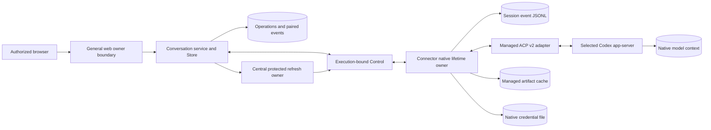

# Codex Text Conversation Implementation Design

Requirements: [chat-261108/REQ](../requirements/chat-261108-text-conversation.md),
review revision 24. Decisions:
[chat-261108/ADR](../adr/chat-261108-text-conversation.md), D1 through D33.

This collaborative Design was approved by the requester for the exact revision
and authority set recorded below. Its conditional implementation acceptance
gates remain in force. Design approval is not a request to implement, a
current-system Spec or evidence of successful native execution.

## Current Behavior and Gap

Agent Chat currently owns local input/messages and sample activity; Send/Stop do
not dispatch Codex work. Existing account/Team, private Agent, authentication
catalogue, Computer lifecycle and execution-bound Control admission are real
reusable boundaries. They do not provide conversation history, native-session
binding, prompt acceptance or model authentication.

Control has short connection-local call correlation. Time spent queued consumes
the original deadline, and possible forwarding followed by lost response is
uncertain. It must not become a long-lived prompt waiter or durable transcript.
The Connector connection loop also exits on ordinary operational-key refresh;
placing the native owner inside it would violate D1.

The implementation adds the conversation domain, persisted product operations and
paired captured events, native preparation/session ownership, and real UI reads
and mutations. It preserves existing owner/Team/authentication/Computer authority.

## Design Authority

- Design revision: `9`
- Authority audit: complete for this revision; no pending policy choice is
  introduced by the implementation acceptance conditions below.
- Feasibility: source-grounded, with explicit conditional integration/runtime
  gates; not a completed execution or performance report.

| ID | Material design mechanism | Authority | Classification |
| --- | --- | --- | --- |
| M01 | Private Agent/current Team admission and independent credential scope | REQ-1, existing Agent/authentication Specs | required |
| M02 | Connector-lifetime native owner, stream replacement survival, no predecessor adoption/overlap | ADR-D1, REQ-11/12 | decided |
| M03 | Compatible managed release resolution, official digest verification and eligible transient-failure cache | ADR-D2–D7 | decided |
| M04 | Existing explicit CLI selection and trusted owner installation | ADR-D8/9/15, REQ-14 | decided |
| M05 | Saved supply authority, next-start application, input-triggered start and no idle retirement | ADR-D10–D13, REQ-1/15 | decided |
| M06 | Bounded cooperative retirement/drain, escalation and truthful uncertain scope | ADR-D1/14 | decided |
| M07 | Local incoming-session-event JSONL, first-load native replay and assigned missing occurrence IDs | ADR-D17, REQ-11/12 | decided |
| M08 | Snapshot/event Connector catch-up and server raw/normalized pairs | ADR-D18, REQ-16 | decided |
| M09 | Complete session conversation-data replacement on unavailable snapshot | ADR-D19, REQ-16 | decided |
| M10 | Recent/older normalized reads, live screen updates and current-region reread on reconnect | ADR-D20, REQ-3/6/11 | decided |
| M11 | Short persisted product acceptance with separate native processing evidence | ADR-D21, REQ-2 | decided |
| M12 | Evidence-limited recovery without a separate local persistent outgoing journal | ADR-D22, REQ-10/12 | decided |
| M13 | Local recording-failure handling only through small error/shutdown reuse, otherwise omitted | ADR-D23, REQ-12 | decided |
| M14 | Central ChatGPT refresh authority and short-lived native token delivery through a supported public OAuth SDK operation | ADR-D24, REQ-17, existing SDK convention | decided |
| M15 | Saved authentication changes apply at next actual start | ADR-D25, REQ-1 | decided |
| M16 | Same-record replacement updates only the native credential file | ADR-D26, REQ-18 | decided |
| M17 | Native credential files on existing saved volume/PVC with explicit plaintext-residue limits | ADR-D27, REQ-18 | decided |
| M18 | Faithful typed utterances/activity/requests, still-valid single responses and separate current-work Stop | REQ-3–10 | required |
| M19 | Supported Codex steering path with only explicit no-consumption transition to prompt | REQ-4, inspected producer contract | derived |
| M20 | Preserving both-dialect schema changes and explicit preparation | existing account storage/transaction Specs | existing |
| M21 | Execution credential delivery on the existing trusted internal HTTP route, without a confidentiality claim or new public distribution API | ADR-D28, REQ-18 | decided |
| M22 | Retain all current-snapshot JSONL events through server ACK until source replacement/authorized deletion; no automatic pruning/rotation | ADR-D29, REQ-16 | decided |
| M23 | Clear old session data before refill, with ordinary conversation loading/error UI and no staged swap dataset | ADR-D30, REQ-16 | decided |
| M24 | Managed supply for an absent saved selection, without UI-read startup or silent fallback from explicit existing CLI | ADR-D31, REQ-14/15 | decided |
| M25 | Collect only inactive superseded owned installation cache after complete replacement; protect active/preparing/latest and shared artifacts | ADR-D32, REQ-1 | decided |
| M26 | Preserve saved-reference deletion protection without runtime-only blocking; deny deleted/out-of-scope renewal and delivery without an immediate-revocation claim | ADR-D33, REQ-1/17/18 | decided |

M19 implements the fixed steering outcome using the inspected producer rather
than adding future-task queuing. It does not grant arbitrary producer extensions
or uncertain-effect retry. Equivalent names, helper decomposition, row layouts
and fixture organization are local details, not independent authorities.

## Architecture and Ownership

- The server owns product acceptance, paired stored observations and owner reads.
- The Computer owns saved native model context; transcript text is not replayed
  as prompts to manufacture restoration.
- The Connector owns the adapter/native scope, active requests, bounded command
  state, event capture and current native observations across stream replacement.
- Providers own Computer substrate/reservations/saved storage, not conversation
  acceptance or model-credential authority.
- Current native observations establish present work/request validity. Retained
  historical events alone do not establish live authority.
- Browser state is a read cache; it is neither a transcript authority nor a
  dispatch/response integrity fence.

Keep Agent, product conversation, Computer, Computer execution, Connector session,
stream connection, native process, native session, product operation, native
entity and captured-event occurrence identities distinct.

## State and Persistence

Use repository-issued identities and current Store-owned complete transactions.
The following are logical responsibilities, not a generic event-sourcing platform:

1. **Conversation/binding:** owning Agent; native session/context association;
   current source snapshot; latest fully ingested source cursor. One initial
   ongoing conversation does not impose a permanent unique-conversation product
   rule on every future Agent.
2. **Product operations:** purpose, exact target, original typed input/answer,
   admission identity and known preparation/dispatch/native-result facts.
3. **Captured event pairs:** source snapshot/event occurrence, retained source
   order, raw session-event representation and corresponding normalized payload.
4. **Read state:** faithful current utterance/activity/request views derived from
   admitted input and normalized events. This state is rebuildable, not a second
   source with independent replacement authority.
5. **Saved versus applied configuration:** server-owned supply/auth selection and
   execution-applied identity, without copying credentials into ordinary DTOs.

Persist an incoming event pair and the cursor that claims it in one complete DB
publication. A cursor never advances over a missing or partially stored pair.
Re-delivery of an already-stored occurrence in the same snapshot has no second
normalization effect. The same ID with incompatible source content is not a new
occurrence. Event IDs are not assumed sortable; source order is retained explicitly.
Do not use UUID time, native message IDs or wall-clock timestamps as event order.

PostgreSQL's existing transaction helper does not guarantee that two SELECTs
share one read snapshot. Any read requiring consistent multiple content values
must use a scoped coherent statement/read boundary, preserving existing
lock-then-session-revalidation semantics. Do not change global isolation.

Migrations preserve current account/Agent/Computer/authentication identities in
SQLite and PostgreSQL. Add conversation state without rewriting historical
creation fingerprints or converting absent authentication into an ambient login.
Downgrade must reject nonempty new-state destruction unless a separately approved
migration boundary exists.

### Logical Interface Shapes

Use operation-specific typed payloads at ingress, not a generic JSON command
bag. Proto remains public/wire authority; generated Rust/Node clients are rebuilt
from it. Names below describe responsibilities, not handwritten generated APIs.

| Boundary | Request facts | Result facts |
| --- | --- | --- |
| Owner region read | Agent/conversation, recent or older anchor, bounded count/bytes | Normalized records, body/detail continuation, current operation/request observations, unavailable or rebuilding state |
| Owner text/Stop/response | Application operation ID, conversation/source target, typed payload and exact native request/work target where applicable | Retained product acceptance/result reference or typed rejection/conflict |
| Owner operation lookup | Same accepted operation and target scope | Known preparation/delivery/native facts or truthful unknown/source-replaced outcome; never performs the effect |
| Connector catch-up | Exact execution/session source plus server snapshot/event cursor, or no prior cursor | Captured ordered events or explicit snapshot unavailable |
| Incoming event transfer | Source binding, snapshot, occurrence identity and ordered bounded pieces | Stored raw/normalized pair and committed progress; a partial transfer is not acknowledged completion |
| Connector operation | Current execution/connection authority, application operation identity, exact target and typed purpose | Short local admission plus separately observed result; no long Control waiter |
| Credential publication | Exact eligible execution and applied record, admitted current credential mutation, protected credential payload | File publication result only, not native auth/model success |
| Native observation | Current harness/session binding and requested inspection | Actual foreground/request readiness evidence, distinct from saved history/connectivity |

Every effect-bearing retry retains its original source/target. After D19 source
replacement, an old request cannot be reinterpreted against the new snapshot.
For first input before any native source exists, bind admission to the exact
not-started conversation and its ensuing authorized setup, not an arbitrary
native session discovered later.

Large event/body transfer is byte-bounded and correlated to one owned read or
capture, with assembly completion separate from individual frame receipt.
Existing 64-KiB Control/owner frames cannot carry an arbitrarily large raw event
as one protobuf. Native content must not be silently truncated to satisfy that
bound. Cancelled/incomplete assembly does not advance source progress or expose
a partial body as the complete answer.

## Preparation, Start and Retirement

### Supply

Resolve an absent saved supply selection to managed preparation at the server
under D31. The owner need not save an explicit choice before first use. This is
not ambient executable discovery or a persisted owner change. Actual input in an
available authorized Computer triggers preparation when a new harness is needed;
reads do not start preparation/harnesses or power on a Computer. Explicit existing
CLI mode remains selected even when that installation is missing or ineligible.

Managed preparation resolves a complete eligible combination of Node runtime,
ACP adapter and native Codex/platform payload or the selected existing CLI.
Interpret package ecosystem ranges correctly; a stable CLI's platform alias is
not rejected merely because its native-package version has a platform suffix.

Download from approved official HTTPS distribution metadata, verify required
archive digests, extract into a non-executable staging boundary with traversal
and escape protection, validate the supported layout and publish only complete
results. No package lifecycle script gains arbitrary installation authority.
Cache records identify exact components, source/digest, platform and completeness.
A nearby mutable manifest is not an independent same-UID tamper boundary.

At each genuine new start, check/prepare the current eligible managed combination.
A transient freshness lookup/download failure can use only a complete eligible
cache and must report the freshness failure. Integrity/layout/compatibility
failure is not that fallback. Live artifacts remain bound until retirement;
cleanup never deletes active/preparing entries or native context/credentials.

Under D32, after complete eligible replacement publication, collect only inactive
superseded entries in the Connector-owned installation cache. Protect the latest
complete eligible combination and every active/preparing combination's required
components, including shared files. Preparation/start binding and collection must
share the same protection boundary; retirement, not task completion or link loss,
releases live usage. A partial replacement cannot displace the previous protected
complete combination. Constrain deletion to owned cache paths and reject escapes
or ambiguous ownership. External CLI, JSONL sources, native context, credentials
and workspace are separate storage classes. Cleanup introduces neither numeric
quotas nor a general storage manager; reacquisition may be required later.

Existing CLI mode uses the explicit absolute path inside the Computer and checks
usability/compatibility. It does not overwrite/update that CLI or silently switch
supply source. An executable's existence is not readiness or publisher attestation.

### Native Owner

Create the native owner outside `connected()` and retain it through operational
key refresh and ordinary server-link loss. Native process handles, stdout/stderr
readers, pending request responders and bounded command state belong to it, not
to a short Control waiter or browser RPC.

Set explicit cwd, native HOME/state/TMP and child environment inside existing
allowed saved storage. Do not inherit Connector/server/provider credentials or
ambient account/provider config. Keep read-only rootfs/non-root/capability-drop.
The managed runtime must satisfy actual ELF/ABI/sandbox prerequisites; missing
libraries are image feasibility work, not permission to widen privileges.
The current base installs CA certificates and `libgcc-s1`; the Computer image
implementation must supply the selected managed runtime's actual ABI libraries
while retaining the same restricted profile. Downloaded Node alone is not proof
that those libraries exist.

A real authorized user text submission starts preparation if needed in an
available Computer. Reads/connectivity alone do not start the harness or power
on a Computer. Distinguish preparation, process alive, ACP initialization,
authentication application and native session readiness. Resume the bound native
context; fail truthfully rather than create fresh context on restore failure.
Normal task completion retains the harness and does not apply saved changes.

### Stop and Lifetime Shutdown

Current-work Stop targets actual current native work without a confirmation,
changing Computer power or permanently closing the harness. Pending Stop is not
confirmed stopping. Preserve the separate existing Computer-power confirmation
dialog and its tests; that dialog is not the current-work Stop.

Actual lifetime shutdown closes new native admission, attempts supported
cooperation/output drain, then escalates within the outer Computer stop budget.
Direct-child wait or pipe close does not prove detached descendants retired.
Verify the supported Linux Connector/PID1/private namespace condition before
using namespace-init death as whole-scope enforcement. Reject or report ambiguous
profiles rather than claim process-group containment of every descendant.
Validate the actual non-shared namespace/Connector-init scope before native
admission; intended provider configuration alone is insufficient. The Kubernetes
profile admission must reject a shared process namespace for this guarantee.
Normal controlled retirement also needs scope-wide escalation and quiescence/
reaping evidence while the Connector survives; owner-death kernel teardown is
not proof that an ordinary child shutdown already retired detached descendants.
A successor never overlaps an unconfirmed predecessor. Adapter-internal native
replacement must obey the same non-overlap rule. No persistent adoption broker
or automatic Computer restart is introduced.

## Native Capture and Connector Catch-up

A session's captured-copy lifetime has a current snapshot identity and append-only
JSONL occurrences. On first native load for that captured copy, request retained
history from `start`; record subsequent live events. With an existing copy,
Connector or server-link replacement does not request native history again.
Missing/corrupt local source must not silently become native-gap repair.

Preserve actual occurrence IDs when provided; assign one otherwise. Never reuse
message/entity IDs or JSON-RPC correlation IDs as generic occurrence identity.
Append/whole-content replacement semantics, including replay primers, are applied
according to ACP. Do not classify all updates before a resume response as history:
live updates can arrive before that response.

The Connector reads its existing copy after the server's exact snapshot/event
cursor. A missing snapshot fails explicitly. A retained cursor's event position
is resolved in that snapshot's ordered copy, not numerically compared across IDs.
Replaying captured observations is not dispatching prompts/answers/Stop again.
Keep reading native output while a server connection is unavailable.

Bound one catch-up pass to a captured complete-record boundary in that same local
snapshot. Transfer records after the requested cursor through that boundary in
source order, then report catch-up completion for that boundary. Later appended
events follow the same ordered path. This is an internal captured-copy handoff,
not an ACP replay/live classifier, partial-native-replay API or new durable
browser cursor. The server can claim completion only after it has stored the
corresponding pairs/progress.

No-prior-cursor initial binding is distinct from an unavailable prior snapshot.
The initial accepted input that caused harness setup must survive that first
binding; do not run D19's destructive replacement merely because a brand-new
conversation had no source cursor yet.

D17 excludes upstream missed-event detection/recovery and independently launched
external harness activity. Local occurrence IDs do not create upstream completeness
or deduplication proof across regenerated native replay.

The conceptual reload replaces the local copy from a new full replay and new
snapshot identity. There is no initial user-facing reload UI/API or automatic
native-repair trigger. D29 retains the full current snapshot, including
server-acknowledged events, until actual source replacement or authorized storage
deletion. Do not add prefix pruning, rotation, compression or age-based expiry.
The copy is limited by existing storage capacity and can encounter D23 failures;
it is not unlimited disk, guaranteed crash flush or native-gap repair.

## Complete Server Rebuild

On unavailable source snapshot, rebuild the entire affected server conversation
data from the available snapshot, under exact current source/Agent authority.
Replacement includes old raw/normalized pairs, read state, accepted inputs,
original form/permission answers and delivery evidence. Facts absent from the
new source have no hidden preservation exception. Do not text-match old records
back into the new snapshot.

Agent/account/authentication/supply/Computer identities are outside that deletion
boundary. Missing old dispatch evidence does not prove non-delivery or authorize
replay. Reconstructed historical requests do not become valid response targets.

Expose incomplete reconstruction truthfully; an empty partial import is not a
confirmed empty conversation. Late events from a replaced source cannot update
the active snapshot or current request slot. D30 selects clear-and-refill without
retaining an undisclosed old archive.

Use one DB-only source-replacement operation
to clear the old session conversation data and mark the new source as rebuilding,
then bounded pair-ingestion transactions. A captured-copy catch-up boundary
provides a finite completion point while live append continues. Failure leaves
rebuilding/incomplete evidence and resumes captured-event transfer from retained
progress, not native commands. Refuse new effect-bearing input/responses until
the replacement is complete; exact known Stop/shutdown remains separate.
Internal reconstruction terminology is not normal user-facing status copy.
The Store operation admitting input/answers rechecks the same current source
and complete-readiness boundary that source replacement changes. Forwarding
still carries the exact native/source target. Clearing old records does not
retroactively undo work already forwarded or make that work safe to replay.

## Product Commands and Result Evidence

### Text Acceptance

1. Revalidate current owner/Team/Agent/target admission and retain typed input
   with an application operation identity.
2. Return short product acceptance/reference; do not wait for preparation,
   native insertion or completion.
3. The server's operation owner retains work beyond a cancelled browser waiter.
   Record the boundary at which native delivery may have occurred before allowing
   an effect-bearing command to cross it. Server restart after possible delivery
   leaves uncertainty unless existing evidence proves an outcome.
4. Exact execution-bound Connector admission routes the operation to its native
   owner. Keep preparation/accepted/insertion/execution/result facts independent.
5. Publish actual observed results. A transport ACK, local UI append or output
   chunk alone is not native consumption or work completion.

This is not an indefinite future-job queue. Running input uses the actual Codex
steering extension with `idleBehavior: promptRequired`. Only an explicit
`noRunningTurn`/non-consumption result permits transition to ordinary prompt.
Timeout/response loss does not. Preserve injected-versus-inserted uncertainty;
steering responses do not generically supply a native user-message ID.

### Duplicate and Failure Boundaries

Application operation identity is separate from transient Control call identity.
Repeated admission of one operation cannot grant another effective native
response. Changed payload under an accepted operation is a conflict, not retry.
Never infer native correlation from equal text or approximate timestamp.

The live Connector preserves bounded processing facts across server-link changes.
No separate persistent local outgoing dispatch journal is added. After Connector
replacement, use server/captured/currently provable evidence; otherwise retain
uncertainty. Missing temporary state is not fresh dispatch permission.

Explicitly proven not-admitted/not-dispatched outcomes can permit an explicit new
attempt under current authority. Browser/server timeout, cancellation or a lost
Control response after possible forwarding cannot establish that outcome.

Keep native user-message observations distinct from product input receipts.
Normal prompt insertion may supply an exact native message ID; steering does not
generically do so. Do not turn a receipt and an uncorrelated native echo into two
proven distinct submissions, or silently join them by text/order. Preserve the
original input and its delivery evidence as an operation until a real correlation
exists. Renderer fixtures must cover identical repeated input and delayed native
echo without inventing native consumption or losing the original input.

### Forms and Permissions

Decode session requests into typed supported flat-form or permission records.
Retain original question/options and submitted typed values. Optional omission,
false, valid empty values, decline and cancel remain distinct. Unsupported required
fields are request errors, not simulated user refusal. No ordinary credential
collection, URL consent fallback or default allow is introduced.

The Connector owns each pending native responder. Server response admission
atomically fences a single effective answer under current source/request/Agent
scope; the Connector rechecks actual native request validity before delivering.
Late/closed/superseded targets fail without restarting work. A stale rendered
question is not permission. Preserve cancellation/closure evidence without adding
product response deadlines.

## Server and Browser Read Contracts

Owner APIs provide bounded recent/older records, body/details, current operation
and native observation state, text submission, Stop, typed response and saved
supply settings. All reads/continuations recheck current private ownership and
Team admission. Raw event/debug data is not a normal browser DTO.

Normalize native utterances by their typed entity identity within the source
snapshot. Chunks append to the same utterance, complete content replaces it;
distinct assistant utterances remain separate. Tool/thought/plan/request records
are activity, not assistant prose. Preserve native formal content updates.

SSR renders recent primary data and hydrates that same data. Older history is
keyset-paged with reading-anchor preservation. A page key is not a mutation
cursor. Count bounds alone do not satisfy the existing 64-KiB RPC frame limit:
large bodies/events need bounded byte/chunk transfer preserving complete content.
Do not solve size by silent truncation or ellipsized submitted answers.
Bind body chunks and final assembly to the same source/body identity. A source
change during continuation fails that read rather than assembling mixed history.

The browser receives live normalized state, not a durable event feed. Reconnection
re-reads the currently viewed region and current operation/request state from the
server. It does not request native replay or erase server history. A late older
page or response from another Agent cannot overwrite the active newer view.
For the initial implementation, reuse the existing unary owner-read and web query
path for active-view updates instead of adding a durable browser event feed,
message broker or long-lived authentication context. One bounded current-region
read is in flight at a time; subsequent active reads coalesce to latest normalized
state on a short implementation cadence. This delivers current streaming content,
not a guarantee to render every intermediate transport frame.

Each read uses the existing request-owned session renewal/cookie response and
backend owner/Team admission. It does not keep a memoized RequestSession/token
alive across an indefinite response. SSR hydration does not issue a duplicate
mount read; active updates start after hydration. D20 explicitly requires a
fresh current-region read on reconnection.

Serialize replacements for one read region. Older-page results add previously
unloaded records rather than overwriting already-present newer records, then the
active current-region read covers the newly viewed region. Agent/anchor changes
use distinct query ownership and discard late responses from the old view.
This requires no durable revision, epoch or global browser cursor. Component
and assembled tests must prove visible update latency and bounded load under the
supported profile; tune read cadence as an implementation budget, not a product
response deadline. A future push optimization must preserve this same authority
and reread contract rather than introduce hidden replay state.

UI preserves Agent navigation, main composer Send during execution, separate
activity Stop, current plan only when present, navigable full history and inline
questions/permission choices. Keep expanded original choices/typed answers visible
after response. Maintain mobile layout, keyboard labels/focus and truthful
unavailable/pending/completed/failed/uncertain states.

Use ordinary conversation loading/error affordances for source loading. Internal
terms such as reconstruction, snapshot or source cursor belong to diagnostics,
not a new product status badge. If status text is needed, describe the user's
task, for example \"Loading conversation...\", with appropriate localization.
Prefer state-aware controls and a read-only retry action to implementation
explanations. A read retry never resubmits user input or native effects. These
copy/affordance rules implement D30's selected clear-and-refill boundary.

## Authentication and Secret Boundaries

Apply the source-grounded paths in
[native file authentication feasibility](../notes/chat-261108-native-auth-feasibility.md).

- API keys use explicit admitted ACP login metadata at initial application with
  controlled file-store configuration; avoid secret-bearing default-auth env.
- ChatGPT refresh credentials/bundle remain protected server authority. Coordinate
  renewal at authentication-record scope and deliver only required short-lived
  tokens to current eligible executions. No one-active-Agent restriction.
- A stock file-seeded external-token mode has a startup and same-account
  unauthorized-reload source path. Do not install the unsupported ACP callback
  bridge or force native reload to hide publication/adoption delay.
- Store native credential files on existing saved storage with restricted access;
  acknowledge plaintext and crash/power-off residue. Do not export refresh tokens,
  adopt ambient files, erase saved model context or claim same-UID isolation.
- Saved authentication selection changes affect next actual start only. Live
  applied authentication remains distinct. Same-record key/reauth changes replace
  that record's file without termination/restart/re-login/forced reload.
- Fence stale delivery and refresh publication against newer owner replacement,
  actual applied-record identity and current execution/credential authority.
- Follow existing Team/Agent terminal cleanup and Connector revocation. Catalogue
  deletion is not an external provider revoke or proof of immediate offline kill.
- Keep secrets out of session JSONL, raw/normalized history, command diagnostics,
  argv and routine SDK/wire logs. Decode only session-event data into the capture
  pipeline; credential traffic is a separate protected path.

The existing component endpoint is an explicit trusted-network boundary, not a
public secret-distribution API. D28 retains that HTTP boundary for model
credential delivery under current exact-session/execution admission. Add no
TLS/envelope/relay mechanism for this initial integration. A bearer is not
transport encryption; network observers remain inside the selected trust
boundary. Current-source and secret-safe delivery acceptance is still required.
Use the supported public OAuth refresh operation described below. The existing
device-only direct-HTTP exception is not permission for a new direct refresh call.

An old applied record may no longer be the saved selection under D25. Under D33,
retain existing saved-reference deletion checks without a runtime-only `InUse`
block. A still-existing authorized applied record remains eligible for D24/D26
renewal/file publication to the exact execution. After deletion or scope loss,
deny new renewal/delivery and reject late publication rather than recreating the
record or switching the live harness to its newly saved selection. Current
record/attempt admission, result publication and delivery each revalidate their
own authority. Already-forwarded credentials are not retroactively revoked;
existing Team terminal cleanup remains a separate execution-withdrawal path.

### Central Refresh Owner

Use a supported OAuth SDK public refresh-grant API, concretely supported by
`oauth2`'s `Client::exchange_refresh_token` and public `AsyncHttpClient`. The SDK
owns grant construction/response parsing; an HTTP transport applies the existing
verified-TLS, fixed-endpoint, no-redirect/no-automatic-retry and bounded-body
restrictions before SDK parsing. Sanitize body-bearing SDK errors before they
reach public responses, logs or ordinary error source chains. Do not call native
private OAuth modules or hand-write a JSON refresh as an unapproved fallback.

The public SDK uses standard form encoding; the pinned native private helper
uses JSON. Existing device code exchange already uses form at the fixed route,
but exact refresh/response compatibility still requires the existing
device-acquired credential acceptance gate. Use the current fixed issuer/client
flow, not a newly discovered route, client registration or additional scopes.
If the supported SDK cannot satisfy the confirmed contract, return the concrete
gap for a scoped decision; no new direct-provider exception is approved here.

The server owns one admitted refresh attempt for a given current credential
source. Its typed provider call runs outside DB transactions and browser waiter
lifetime. Coalesce concurrent eligible consumers onto that attempt instead of
allowing independent refresh-token rotation. Current credential/attempt admission
and result publication are complete Store operations.

Bind the attempt to the actual current authentication source and account. Publish
renewed protected tokens only while that source/attempt and authority remain
current; a manual key replacement or reauthentication fences a late result.
Use the repository's existing source/request identity patterns rather than a
general new credential-version product.

Provider rejection, definite preparation failure and unknown transport outcome
remain distinct. If the server loses the result of a possibly performed token
exchange, do not automatically repeat the external refresh or treat missing
process ownership as proof it never happened. Retain truthful uncertainty and a
supported explicit reauthentication path. This server-owned refresh state is not
D22's rejected local native-command dispatch journal.

Consumers obtain the latest admitted short-lived payload under current execution
and applied-record authority. Delivery cannot turn a saved future selection into
the live identity or claim native adoption. Actual expiry/account metadata must
come from supported source credentials; missing expiry is not invented.
An unreachable server cannot promise renewal or immediate offline revocation.
Serialize file publication per native owner and coalesce superseded updates to
the latest admitted source. Recheck that source and execution at handoff; an old
stream/owner result cannot overwrite the new owner's credentials. A malformed or
unpublishable response after a possibly consumed refresh is uncertain, not
permission to repeat the old refresh token. Preserve a valid unchanged refresh
credential when a successful standard response omits its replacement.

## Failure, Capacity and Operations

Failures retain different safe next actions: input not admitted, confirmed
non-dispatch, possible dispatch/uncertain result, preparation failure, missing
native context, source snapshot unavailable, credential publication/adoption
failure and retirement uncertainty are not collapsed into one retry button.

For local JSONL errors, D23 permits a small connection from ordinary error/admission
handling to D14 controlled shutdown while retaining Stop. If that coupling itself
requires substantial work, omit specialized handling. Do not build disk monitoring,
a storage recovery subsystem or a new supervisor for this edge case. Ordinary
errors remain truthful. Server-link loss alone is not this recording-failure case.

Bound active operations, pending responders, native pipes and transfer assembly
by the actual owning resource budget. Saturation rejects new admission before a
success receipt where required; it cannot silently drop accepted facts and then
claim completeness. Exact numeric budgets/retention are not invented as already
approved. Keep active context, user workspace, applied credentials and artifacts
separate in cleanup authority.

Use secret-safe structured diagnostics containing operation/source/context IDs
and outcome categories rather than credential bytes or raw frames. Operational
health distinguishes connectivity, source catch-up, harness readiness, native
state, refresh/publication and retirement evidence. No proactive notification
product is added.

### Resolved Policy Boundaries

Trusted internal HTTP credential delivery is no longer a proposal: D28 selects
that boundary with its explicit lack of network confidentiality.
Current-snapshot full JSONL retention is also selected under D29, not a pending
artifact-cache or generic storage-management policy.
Clear-and-refill with ordinary conversation loading/error UI is selected under
D30, not a proposal for a reconstruction label or another staging/swap subsystem.
Managed preparation for an absent saved supply selection is selected under D31;
inactive superseded managed-artifact cleanup is selected separately under D32.
Applied-only authentication use does not block otherwise-eligible catalogue
deletion under D33; deleted/out-of-scope records receive no new renewal/delivery.

Central refresh uses the fixed official provider boundary and a supported public
OAuth SDK operation. There is no configurable issuer/redirect/bypass, native
private-SDK dependency or approved direct-call fallback.

## Requirement Traceability

| Requirement | Mechanisms and acceptance focus |
| --- | --- |
| REQ-1 | M01/02/05/14–17/25/26; owner admission, truthful readiness, saved/applied split, protected cache cleanup and authentication deletion |
| REQ-2 | M11/12; retained short acceptance, native-result separation, no uncertain retry |
| REQ-3 | M07/08/10/18; same utterance update, distinct utterances and formal replacement |
| REQ-4 | M11/12/19; actual producer steering, no implicit future queue |
| REQ-5 | M06/18; exact current-work Stop, not Computer power or accepted-click success |
| REQ-6 | M08/10/18; activity/history navigation, bounded full-body reads |
| REQ-7 | M18; supported typed flat forms and correct omission/error handling |
| REQ-8 | M08/18; inline original choices/typed answers, no hidden submitted result |
| REQ-9 | M18; actual native choices/scope and no preselected allow |
| REQ-10 | M01/11/12/18; server/native validity and duplicate/late response fences |
| REQ-11 | M02/07–10/15; Computer-off reads, reentry and native context continuity |
| REQ-12 | M06/09/11–13; truthful uncertainty and accepted snapshot-replacement limits |
| REQ-13 | M10/18; responsive accessible truthful real states |
| REQ-14 | M03/04/24; actual compatible existing CLI and no supply fallback |
| REQ-15 | M05/24; managed default, owner settings, saved/active difference and next-start supply application |
| REQ-16 | M07–09/22/23; snapshot/event catch-up, paired storage, full source retention and clear-and-refill |
| REQ-17 | M14/17/26; central refresh, no native refresh token, shared consumers and current-record eligibility |
| REQ-18 | M15–17/21/26; file-only updates, explicit disk residue, trusted-network delivery and denied deleted-record distribution |

## Removal and Replacement

| Existing unit or behavior | Removal authority | Replacement or remaining authority | Removal boundary | Absence verification |
| --- | --- | --- | --- | --- |
| Local-only Chat message append and simulated Stop/activity | REQ-2–6 | M10/11/18 real owner APIs and observations | Production chat container wiring | No production Send/Stop local-success path or sample-ready state |
| Production sample conversation/activity as runtime evidence | REQ-3/6/13 | Native normalized read state; isolated story fixtures may remain | Production render entrypoints | Production default cannot render sample output as actual work |
| Chat types assuming only local text and idle/working/stopped | REQ-2–12 | Typed utterance/request/activity/operation/read-state model | Chat boundary and consumers | No accepted native flow mapped into fabricated terminal state |
| Assumption that current Control waiter is conversation durability | ADR-D21/22 | Separate product operation owner and event pairs | New conversation command path only | Timeouts/reconnect do not reconstruct replay permission |
| Previously proposed local persistent outgoing journal | ADR-D22 | Lifetime-local command facts plus retained server/captured evidence | Design/proposal cleanup; no implemented journal exists | No required pre-effect local WAL or hidden command archive |
| Previously proposed permanent browser change feed | ADR-D20 | Current-state reconnect reread | Design/proposal cleanup; no implemented feed exists | No browser durable change cursor/retention platform |
| Agent-only Chat route/`loadAgents` initial content | REQ-3/6/11, existing SSR rules | Server-loaded conversation data plus existing Agent admission | Chat route loader and typed initial props | SSR and hydration share actual conversation data, not sample content |
| Local-only `Chat.stories.tsx` props and sample-content assertions | REQ-2–13 | Typed static renderer fixtures and executable component assertions | Story fixtures and owning app component tests | Sample text is fixture-only; actual Computer-power confirmation tests remain |
| Proto/generated clients without conversation contracts | REQ-1–18 | Typed owner and exact-execution conversation APIs | Proto authority, generated Rust/Node surfaces and callers | Regenerate using project tooling; no handwritten generated variants |
| Inactive superseded managed installation cache | ADR-D32, REQ-1 | Complete eligible replacement, protected active/preparing/latest components | Connector-owned artifact cache only, after complete publication | Deterministic cleanup preserves shared/protected files and every non-cache storage class |

Retain existing account/authentication/Computer lifecycle APIs, their historical
receipts, separate Computer power, exact native cleanup and private admission.
There is no authorization to delete user workspace/native context as a feature
reset or rewrite historical schema identities.

## Test Strategy

### E2E Primary Boundary

Use a short representative assembled journey in the existing General app:
authorized Agent → admitted text → distinct streaming assistant utterances with
same-message update → one actual inline request/typed answer/retained result →
navigate/reenter retained data. Use an execution-owned protocol fixture and
actual product backend/browser, not a component-only mock or SQL-only transcript.
Keep E2E at the existing minimal core-flow level rather than growing a long
restart/permission/failure matrix. This constrains scenario scope, not a fixed
number of test functions. Schema, permission and response-race combinations
remain lower-layer proofs.

### Deterministic Lower-Layer Matrix

- Both DB dialects: preserving migrations, owner/Team isolation, operation replay
  conflicts, event-pair/cursor atomicity, same-ID content conflict, source replace,
  old-source rejection, preserving first accepted input on no-cursor initial
  binding, captured-copy handoff during continuous append and coherent reads
  under concurrent writers.
- Protocol/native owner: stdout/stderr and cancellation ownership, repeated stream
  refresh, initial/no-history resume, replay/live ordering, content/chunk semantics,
  exact responder validity, duplicate answers, steering no-consumption fallback,
  uncertain response loss and no automatic native command replay.
- Process/profile: direct and detached descendants, ignored cooperative signals,
  owner death, incompatible PID namespace, delayed drain and unconfirmed retirement.
- Supply: dependency closure, aliases/ranges, partial publication, archive escape,
  digest/layout/platform mismatch, eligible transient cache, active/preparing/latest
  protection, shared artifacts and concurrent start/cleanup safety.
- Authentication: isolated seed/config, same-account file reread, key-cache limits,
  shared central renewal, stale replacement/delivery, no native refresh token,
  persisted-file residue, saved-reference versus applied-only deletion, denied
  post-deletion/late publication and synthetic secret-marker non-disclosure.
- Browser/components: SSR hydration, live/older-read ordering, Agent navigation,
  reconnect current-region reread, long-body transport, focus/labels/mobile layout,
  expanded retained form answers and exact permission choices.

Use explicit barriers and observable states rather than sleeps. Test owned
contracts, not dependency internals or copied infrastructure declarations.

### Fixture and Prerequisite Support

The existing testenv may compose the real backend/Connector and a deterministic
ACP v2 subprocess fixture; browser scenarios remain in the E2E app. Fixtures
control insertion/output/requests/stream loss/crash with explicit signals.
Seed through owned product APIs where available; no ambient auth or hidden retry.

Live acceptance is separate: exact artifact digests, architecture, ABI, restricted
Computer profile, isolated explicitly provided authentication, account identity,
model/tool entitlement, native new/resume/steering/requests and whole-tree shutdown.
No actual model/auth/provisioning is authorized merely by this Design draft.
Optional live checks must explicitly skip without prerequisites; a selected
supported profile failing acceptance is a failure, not a silent skip or weaker
security profile.

### Evidence and CI Policy

Record exact commit/profile, fixture/live distinction, commands, deterministic
state/result evidence and failed prerequisites. Never retain secret values or raw
credential traffic. Metadata-validator success is not runtime acceptance. Run
existing relevant Rust, generated RPC/Node, web component and minimum E2E checks
on the final implementation SHA; retain actual remote CI results before claiming
shipping readiness.

## Authority and Feasibility Audit

All REQ-1–18 have mechanisms in the traceability table; M01–M26 map to confirmed
Requirements, accepted D1–D33, unchanged current contracts or project constraints.
The removal table states each deletion/replacement boundary. No pending
alternative is implementation authority. Equivalent names, helper/row layout,
supported SDK selection and fixture decomposition remain agent-owned details;
they cannot add a mode, fallback, authority source or product behavior.

The [final source review](../notes/chat-261108-final-feasibility.md) records
current paths, source evidence, exact limits and test obligations. Its conclusions
are not runtime test passes:

| Area | Source-level conclusion | Required implementation acceptance |
| --- | --- | --- |
| M10 browser reads | Existing POST/unary request session, response cookie and no-store boundary fit the selected design | Hydration/reconnect/navigation/old-page ordering, session overlap and measured visible latency/load |
| M14/16/21/26 refresh and delivery | Public OAuth SDK refresh operation and existing owned-work/Store fences provide a credible integration path | Exact existing device-token flow with SDK form/response contract, account/expiry/rotation, deletion/reauth races and secret-safe errors |
| M02–06/19 native runtime | Restricted profile, dedicated namespace/Connector ownership and pinned producer paths provide a conditional launch/retirement/steering path | Image ABI, actual PID1/non-shared scope, detached descendants, normal and crash retirement, native steering and file-token adoption |
| M07–09/11/12/22/23 source/data | Initial binding, paired atomic publication, finite catch-up and source-bound clear/refill have a coherent Store/Control plan | Both-dialect replacement/admission/body-read races, continuous append completion, no late old-source publication or uncertain effect replay |

The requester approval below binds this revision and exact authority set.
Before shipping the affected implementation, the listed deterministic and
supported-runtime gates must have actual evidence. Conditional paths are not
certified features, optional skips for a selected supported profile or permission
to weaken security. If an acceptance failure requires a new mode, SDK exception,
authority source or changed product behavior, stop that lane and return the
concrete conflict to design instead of silently choosing a fallback.

## Delivery Shape After Approval

Implementation requires a separate requester instruction. Use reviewable phases
with the same approved mechanisms rather than new design authority in a shipping
plan:

1. Conversation domain, preserving migrations, owner/Connector proto and
   generated clients, typed fixture contracts and exact authority checks.
2. Connector native owner, preparation/cache/existing-CLI path, isolated
   environment, actual process-scope retirement and native session binding.
3. JSONL capture, raw/normalized ingestion, cursor catch-up, complete source
   replacement and operation/result/response fences.
4. Central refresh/credential publication and exact file-only application under
   the chosen transport/trust boundary, with synthetic secret tests first.
5. Real SSR/read/composer/activity/request UI wiring and minimum assembled
   conversation coverage; remove production samples/local-success behavior.
6. Exact supported-runtime acceptance, final authority/coverage review, current
   Spec updates and final-SHA CI. Do not merge/deploy without separate authority.

Each phase verifies its narrow owned contracts. Native/live prerequisites are
reported independently rather than allowing a fixture pass to certify all
platforms, credentials, tools or model entitlement.

## Design Approval

- Mode: Collaborative.
- Decision owner: requester.
- Approved on: 2026-11-09 (KST).
- Approved Design revision: `9`.
- Approved authority IDs: M01, M02, M03, M04, M05, M06, M07, M08, M09,
  M10, M11, M12, M13, M14, M15, M16, M17, M18, M19, M20, M21, M22,
  M23, M24, M25, M26.
- Approved scope: the complete initial Codex/ACP v2 text-conversation Design,
  tracing Requirements review revision 24 (REQ-1–18) and accepted ADR D1–D33
  through the material mechanisms above. Includes supply/cache and execution
  lifetime, source/data ownership and replacement, command uncertainty, current
  browser reads, authentication/deletion/delivery, preserving migrations,
  removal obligations, minimal assembled E2E and conditional implementation gates.

Approval covers the complete disclosed Design, not implementation, merge,
deployment or successful live/native acceptance. A material change to revision
or authority set requires renewed audit and approval. Do not mark this snapshot
implemented or treat it as a merged current-system Spec before verified delivery.

## References

- [Requirements](../requirements/chat-261108-text-conversation.md)
- [ADR](../adr/chat-261108-text-conversation.md)
- [Execution and retirement grounding](../notes/chat-261108-execution-lifetime.md)
- [Native file authentication feasibility](../notes/chat-261108-native-auth-feasibility.md)
- [Final source review and conditional acceptance](../notes/chat-261108-final-feasibility.md)
- [Private Agent authority](../spec/domain/agent-ownership.md)
- [Control call lifetime](../spec/domain/computer-control-rpc.md)
- [Connector lifecycle](../spec/domain/connector-process.md)
- [Backend authentication](../spec/domain/backend-authentication.md)
- [Primary web rendering](../spec/domain/web-rendering.md)
- [Account storage](../spec/domain/account-storage.md)
