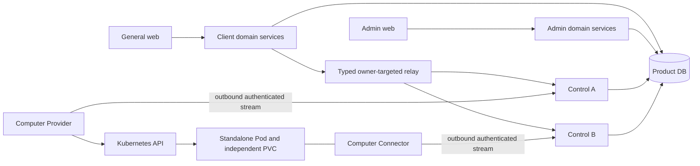
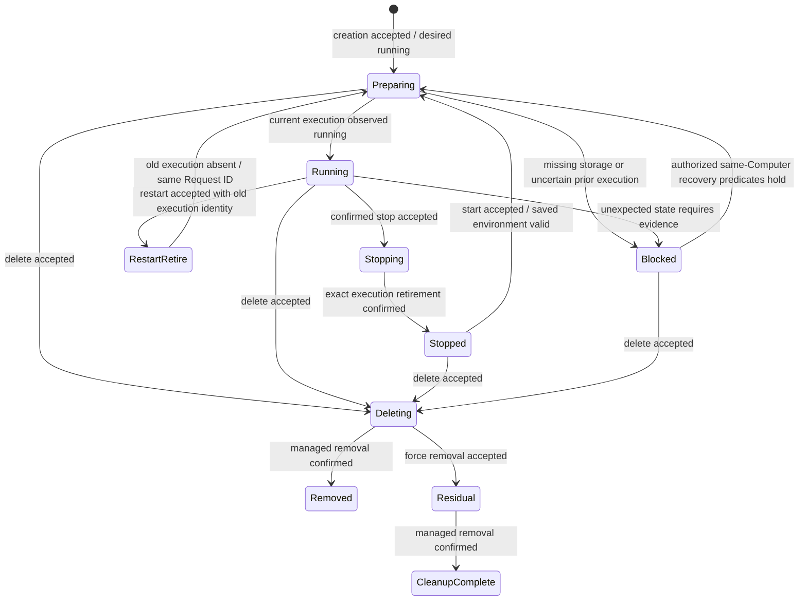

# Standalone and Distributed Agent Computer System Design

- Design revision: `2` (approved implementation baseline).
- Requirements: [computer-261102/REQ](../requirements/computer-261102-agent-computer-foundation.md), revision 4.
- Decisions: [computer-261102/ADR](../adr/computer-261102-agent-computer-foundation.md), D1-D26 accepted.
- Mode: Collaborative; the requester owns material choices and final Design approval.
- This document describes intended implementation, not implemented behavior.
- The direct implementation request accepts the complete reviewed Design,
  including the unchanged browser-observation and system-owner recommendations.
  Revision 2 promotes those reviewed candidates to M21/M22.

## Scope and Completion Boundary

Design the common Agent/Computer backend, managed Kubernetes Computer lifecycle,
component authentication, current-connection ownership, transient request delivery,
user/admin observation, reusable distribution and migration/verification work.
The same domain operations support selectable Client/Admin/Control service groups
and memory/network gRPC. Keep SQLite and PostgreSQL support.

The future Mac itself can be a Computer shared by multiple same-owner Agents.
Preserve that model and the common in-process transport boundary now. Concrete Mac
enrollment/authentication, local execution implementation, app UI and packaging
are deferred. No Mac executable or Mac runtime smoke test is a completion gate.
Cloud Agent/Computer dedication is permanently 1:1. Do not introduce harness,
conversation, filesystem-management UI, Team Agents or an execution sandbox here.

The direct implementation request authorizes implementation against this approved
baseline. It does not authorize PR merge, deployment, production credential
provisioning or a cluster change.

## Current Behavior and Evidence

Source baseline: `5b1b723979aa1f3bad13283a98680c234656a6bf`.

| Evidence | Current implementation | Required change |
| --- | --- | --- |
| `proto/chapchoo/accounts.proto` | 37 RPCs in broad Auth, General and Admin services | D22 domain contracts and new Computer surfaces |
| `rust/crates/rpc/src/adapter.rs` | One RpcService over AccountsService; bounded decoding | Scoped domain adapters with shared underlying rules |
| `rust/apps/chapchoo/src/runtime.rs` and `config.rs` | General/Admin/Both roles, distinct role sockets, admission and owned shutdown | Runtime group composition, shared-service deduplication, separate peer listener |
| `rust/crates/persistence/src/store.rs`, `models.rs` | SQLite/PG pools; transaction-scoped auth revalidation | New domain records and exact-ID conditional operations |
| `rust/crates/persistence/src/preparation.rs` | Explicit prepare; exact two-migration readiness; existing-product checks before root binding | Both-dialect migration and expanded readiness/integrity guards |
| `rust/crates/crypto/src/root.rs`, `token.rs`; `persistence/src/sessions.rs` | Random bearer, constant-time digest verification, protected latest recovery result | Reuse primitives, not user-session authority, for components |
| `typescript/packages/web-core/src/rpc.ts` | grpc-js unary calls; request-local bearer; retries disabled; 15s deadline; one URL for broad clients | Per-group configuration and new generated domain clients |
| `rust/crates/protocol/build.rs`, `scripts/generate-rpc-clients.sh` | Account-only generated contracts with redacted message Debug | Extend generated domains/exports/redaction together |
| `infra/charts/chapchoo/` | Account backend/web, ingress, prepare job and externally supplied Secrets | Group-aware backend, Control connectivity, Provider resources and network policy |
| `typescript/apps/e2e/src/accounts.spec.ts` and `fixture.ts` | Existing account acceptance fixture | Focused new Computer user journey and lower-layer protocol fixtures |

Current [account RPC](../spec/domain/account-rpc.md),
[storage](../spec/domain/account-storage.md),
[web](../spec/domain/account-web.md) and
[delivery](../spec/domain/account-delivery.md) contracts remain authoritative for
unchanged behavior. Browser RPC currently uses POST tRPC/TanStack Query, rejects
streaming formats/batches, and disables automatic request/mutation retries.
Preserve current account identity/cache, Origin, cookie and authorization rules.

There is no implemented Agent/Computer lifecycle or system-owner authenticator
in these inspected sources. D13 establishes the system-owner authentication
boundary; it is not evidence that such an adapter already exists. The concrete
proposal is explicitly isolated below. Provider/Connector implementation and
multi-Control safety must be built and tested, not reported as already verified.

## Design Authority

- Design revision: `2`.
- Accepted mechanism set: `M1` through `M22` inclusive.
- Revision 2 promotes reviewed C1/C2 to M21/M22 without substantive change.

| ID | Material mechanism | Authority | Classification |
| --- | --- | --- | --- |
| M1 | Common domain operations, selectable service groups and same-handler memory/network gRPC | REQ-14/15; ADR-D2/D3/D17/D22 | decided |
| M2 | Separate client-facing/peer listeners and restricted-network internal trust | REQ-16; ADR-D4/D5 | decided |
| M3 | Distinct Provider and Connector ownership and execution-bound component sessions | REQ-1/4/10/12; ADR-D1/D13/D14 | decided |
| M4 | DB directory, exact instance/connection identities and conditional immediate replacement | REQ-12/17; ADR-D6/D7/D23 | decided |
| M5 | Per-call typed delivery, bounded queues, remaining deadlines and scoped cancellation | REQ-17/18; ADR-D8/D21/D24 | decided |
| M6 | Connector-owned reconciler plus Provider-owner management path when no Connector is usable | REQ-5/8/12; ADR-D9/D18/D23 | derived |
| M7 | Personal Agent authority, permanent cloud 1:1 and future same-owner local sharing | REQ-3/6/8/10/14; ADR-D20; REQ revision 4 | required |
| M8 | Atomic creation receipt and initial intent; owner-lifetime creation deduplication | REQ-3/7/18; ADR-D12 | decided |
| M9 | Persistent current intent and minimum lifecycle phase/evidence, separate from transient calls | REQ-4/7/12/18; ADR-D7/D9/D18 | derived |
| M10 | Explicit restart retirement and guarded execution restoration | REQ-5/6/7/13; ADR-D9/D10 | decided |
| M11 | Standalone Kubernetes Pod and independent dedicated PVC | REQ-5/6/8/13; ADR-D10/D19 | decided |
| M12 | Confirmed normal removal, immediate force removal and independent residual inventory | REQ-8/9/11; ADR-D11/D20 | decided |
| M13 | Owner-authorized Provider key management | REQ-1/2/10; ADR-D13 | decided |
| M14 | Bootstrap exchange, operational key refresh/revocation and protected current recovery | REQ-7/10/12; ADR-D14/D15/D16 | decided |
| M15 | One server-derived state/action projection with separate evidence freshness and connectivity | REQ-2/4/5/7/10/11/12; ADR-D9/D11 | required |
| M16 | Shared domain rules with scoped Client/Admin/component API contracts | REQ-2/10/15; ADR-D2/D22 | decided |
| M17 | Explicit preparation, preserved account data/root binding and both database dialects | REQ-14 and fixed constraints; current account-storage Spec | existing |
| M18 | Configurable community Helm defaults within administrator-owned policy | REQ-14/16 and fixed constraints; ADR-D5/D19 | decided |
| M19 | Finite liveness/credential/lifecycle defaults, no expiry-as-execution-proof | REQ-4/7/10/12; ADR-D16/D23 | decided |
| M20 | Preserve current account/web auth, presentation and request boundaries during refactor | REQ-10/15; ADR-D22; account RPC/storage/web Specs | existing |
| M21 | Bounded visible-view unary projection reads through existing tRPC/TanStack Query | REQ-2/4/7/10/11/12; ADR-D25 | decided |
| M22 | Deployment-provisioned scoped system-owner bearer adapter | REQ-1/10; ADR-D13/D26 | decided |

M6 does not invent a second authoritative desired-state controller: Connector
reconciliation handles its live Computer, while the owner of the Provider
connection performs Provider-required management for disconnected/pre-connection
Computers. Both use the same current-intent transaction and Provider command
admission. External effects must not execute inside either DB transaction.

## Requirement Traceability

| Requirement | Mechanisms | Observable verification |
| --- | --- | --- |
| REQ-1 | M3/M13/M16/M18 | Configured authenticated Provider appears once after reconnect; registration allocates nothing |
| REQ-2 | M15/M16 | Authorized read-only inventory and available Provider choices; management disconnect is not empty/stopped |
| REQ-3 | M7/M8/M15/M16 | Personal creation reaches same Agent detail; other users cannot discover/control it |
| REQ-4 | M5/M9/M15/M19 | Acceptance, power, management, Connector and browser-read failures remain distinct |
| REQ-5 | M6/M9/M10/M15 | Confirmed power commands, no submission on cancelled confirmation; Connector-down management works |
| REQ-6 | M7/M10/M11 | Identity and PVC content survive stop/start/restart; root/live state is not promised |
| REQ-7 | M4/M5/M8/M9/M10/M14 | Duplicate/conflicting requests and lost responses do not create duplicate effects |
| REQ-8 | M11/M12/M15 | Dedicated managed resources confirmed removed before normal Agent removal |
| REQ-9 | M12 | Force removal hides Agent immediately, retains residual terminal intent, late report cannot restore |
| REQ-10 | M2/M3/M7/M13/M14/M16/M20 | Auth/isolation, redaction, presentation and accessible confirmations |
| REQ-11 | M12/M15/M16 | Read-only independent inventory; completed details expire after 24h, unresolved do not |
| REQ-12 | M4/M6/M9/M15 | Reconnect rebuilds from desired state; old owners cannot update current authority |
| REQ-13 | M9/M10/M11 | Only confirmed absence + saved environment + ownership + no conflict allow restoration |
| REQ-14 | M1/M7/M17/M18 | Common local composition and SQLite/PG; future Mac boundary review, no Mac app gate |
| REQ-15 | M1/M16/M20 | Combined/separate groups, deduplicated registration and independent explicit client targets |
| REQ-16 | M2/M18 | Peer methods unavailable on client-facing listener; untrusted cluster source denied |
| REQ-17 | M4/M5/M6 | Different Provider/Connector owners, same-request safe reroute, uncertain dispatch not replayed |
| REQ-18 | M5/M8/M9/M12 | Transient calls not archived; durable product-specific records survive as required |

## Architecture and Ownership

Arrows for component connections show initiation, not an ongoing Provider relay
for Connector traffic. Control A/B are illustrative instances. Groups may share
one process/listener; internal peer methods use a separate listener whenever
network peer routing is needed. A single local composition uses the same generated
client/handler over memory IO and does not expose an unnecessary peer socket.

Ownership authorities:

- Product DB: account permissions, Agent/Computer relationships, desired intent,
  current lifecycle evidence, component credentials and current connection routing.
- Computer Provider: authenticated substrate observations and scoped Kubernetes
  effects; it cannot manufacture ownership through a reported resource name.
- Computer Connector: independently authenticated execution connection and its
  authorized observations; it cannot claim successful PVC deletion or power-off.
- Current Control: live stream dispatch and connection-scoped reconciliation;
  durable ownership must be revalidated, not inferred from a local task object.
- Browser: confirmation and display of server projections; never a lifecycle
  scheduler, offline command queue or source of truth for power/cleanup.
- Operator: reachable endpoints, infrastructure credentials, storage and cluster
  policy. Kubernetes APIs do not become product discovery/identity authority.

The implementation extends domain/service/persistence/rpc layers rather than
embedding Kubernetes operations in transport adapters. A Provider-specific
Kubernetes adapter translates typed operations to the official supported client.
Library choice within that adapter is implementation work; do not issue raw HTTP
or create a new general plugin platform merely to support this Provider.

## Service Composition and Contract Replacement

D22's complete group map is the contract authority:

| Surface | Services and responsibilities |
| --- | --- |
| Shared Client/Admin | Authentication; PersonalPreferences |
| Client | AccountLifecycle; Teams; Invitations; Agents; Computers; ProviderCatalog |
| Admin | Installation; AccountGrants; DisplayDefaults; read-only ProviderInventory |
| Control client-facing | ProviderAuthentication; ConnectorAuthentication; ProviderConnection; ConnectorConnection |
| Internal peer only | PeerRelay |

Authentication includes existing login/renew/identity/logout. PersonalPreferences
includes display-default read and current-user display update. Installation keeps
setup/initialization; no broad user-admin service is introduced. ProviderCatalog
projects authorized creation choices, not operator secrets/internals. Inventory
excludes private Agent data and cleanup/adoption controls.

Each listener composes the union of selected services, deduplicating common
service names. Group dependencies are validated at startup; a missing endpoint
or disabled service fails explicitly. General web remains the public app name;
its backend capability is the Client group. Admin web uses the Admin target.
Where a client needs multiple groups it configures them independently, even if
operators deliberately assign equal URLs. No missing-target inference/fallback.

Required Computer contracts, with illustrative method names:

| Contract | Inputs | Result/boundary |
| --- | --- | --- |
| CreateAgent | Owner-authenticated Request ID, canonical name/provider selection | Accepted Agent ID/current projection or exact creation replay outcome |
| ListAgents/GetAgent | Authenticated owner, bounded pagination/Agent ID | Owner-only projection; not-found for inaccessible private targets |
| GetComputer | Owner-authorized Agent/Computer reference | Server-derived evidence, capabilities and action availability |
| RequestStart/Stop/Restart | Request ID, target, expected current lifecycle request identity | Accepted current lifecycle or explicit conflict/unavailable; never a completion claim |
| RetryPreparation | Same Agent/current lifecycle context and explicit owner request | Resume only after evidence establishes a safe next step; unknown work is observed, not blindly replayed |
| DeleteAgent | Request ID, expected current lifecycle identity | Normal terminal intent; cloud removal completes only after managed cleanup |
| ForceDeleteAgent | Explicit confirmed request and current deletion identity | Immediate removal plus retained independent cleanup intent |
| AvailableProviders | Current owner context | Connected authorized creation-capable Providers only |
| ProviderInventory | Operator-authenticated bounded query | Minimal managed identity/status/cleanup evidence, no content or mutations |
| Provider key/session methods | D13-D15 current authority + Request ID + payload identity | Exact current recoverable result, or refusal; no historical secret recovery |
| Component Connect | Current credential/session and exact target | Admission under D23, not a self-asserted registration entitlement |

Request DTOs do not accept arbitrary owner IDs from untrusted users as authority.
Internal connection/resource identifiers stay out of ordinary browser DTOs.
An opaque current lifecycle Request ID can be returned as a mutation precondition;
it is not a numeric version or credential. The server always rechecks ownership.

## Data Model and Transaction Boundaries

Names below are logical records, not a demand for one Rust type/table per row.
Use opaque IDs and canonical payload fingerprints, not application generations.

| Record | Required facts and constraints | Retention |
| --- | --- | --- |
| Agent | Owner User FK, display name, current Computer relation; owner index | Until approved removal |
| Computer | Owner, kind, optional assigned Provider, current desired intent, current lifecycle Request ID/phase | Live association or unresolved residual management |
| Cloud dedication | Unique active Agent-to-cloud-Computer assignment and same owner | Clear association on force deletion without reassigning residual Computer |
| Creation receipt | Unique `(owner, Request ID)`, canonical fingerprint, assigned Agent ID | Owner account lifetime; does not require live Agent FK |
| Current lifecycle | Current Request ID, action fingerprint, phase, initial dispatch time, expected old/new execution identities and uncertainty | One current lifecycle context, not historical command rows |
| Managed resource evidence | Provider, logical Computer, execution ID, resource namespace/name/UID and PVC identity, ownership/observation evidence | Needed while live or cleanup unresolved |
| Execution binding | Current authorized execution and its Connector session binding; exact retirement evidence | Current/pending lifecycle and required credential rejection evidence |
| Provider identity | Stable identity, owner kind/identity, type and authorized capabilities; credential state separate | While configured/managed resources remain |
| Component credential/session | Current/previous digest, expiry/overlap, revocation, session/execution scope, current protected recovery request/result | Only current authorized recovery and required live/revoked binding |
| Control registration | Instance ID PK, advertised endpoint, eligible/draining state, renewal/expiry | Current directory; expired route never grants dispatch |
| Component ownership | Unique `(kind, target ID)`, Control instance and Connection ID, validity | Current ownership only |
| Latest observations | Source, exact source identity, time and typed evidence | Bounded current evidence, not telemetry/event archive |
| Cleanup completion | Minimal non-secret completion evidence and confirmed completion time | Visible at least 24h then removed; unresolved never ages out |

Agent-to-Computer relations allow future same-owner local sharing but enforce
cloud dedication separately. Do not use an unconditional unique Computer FK on
all Agents that would prevent the accepted future local model. A Computer's
owner must agree with every active Agent association. Residual cloud Computers
are terminally deleting, never a pool available for adoption.

Creation receipt's assigned Agent ID survives removal without cascading deletion
or retaining Agent name/content. Current lifecycle context is sufficient to
reject stale requests: a new transition compares the expected current Request ID;
an exact repeat of the current Request ID verifies its fingerprint and returns
known progress. A different payload is rejected. A delayed older request whose
precondition no longer matches cannot restart completed old work. No archive of
all lifecycle calls is needed. Creation has the stronger specific receipt rule.

All mutable operations authenticate/revalidate inside the DB operation. Follow a
consistent lock order across the new domain: actor authority, Provider when needed,
Computer, then execution/session/current connection children. Root operations that
need only a child must not subsequently acquire a parent in reverse order. Design
fixtures must exercise the actual lock graph on PostgreSQL; SQLite uses its
existing immediate write admission. Stable parent rows serialize absent-child
insertion races. Unique constraints remain the final race backstop.

Transaction examples:

- Creation: validate current owner/provider eligibility, compare/insert receipt,
  create Agent/Computer/running intent atomically, commit, then schedule observation
  or forwarding outside the transaction. No Kubernetes allocation inside it.
- Lifecycle admission: validate current permission/evidence/expected request,
  reject conflicting active work, install the new current request/phase and
  intent; return acceptance after commit. A lost response is not rollback.
- Directory admission: revalidate credentials/session and the captured prior
  ownership tuple, install new connection only if unchanged, then activate local
  work. Failed activation releases only its own exact tuple.
- Report: revalidate source credential/session/connection and current target/request
  binding; apply only matching evidence. A result from an obsolete execution cannot
  mark a replacement running or finish its deletion.
- Force deletion: make terminal cleanup intent independently durable, remove the
  live Agent/relation atomically; retain receipt/cleanup but no private content.
- Credential mutation: validate authority, exact Request ID/fingerprint and current
  result, rotate/revoke/update encrypted recovery atomically; deliver after commit.

Use DB-side time for shared registration/expiry comparisons so Control clock
skew does not silently create divergent directory authority. Local monotonic time
measures RPC budgets. DB wall-clock expiry remains routing evidence only, never
proof that external execution stopped. No database time is a generation counter.

## Control Directory and Connection Lifecycle

1. Load explicit configuration, check schema/key readiness and bind required
   sockets/memory acceptors before opening admission.
2. Distributed Control publishes a fresh opaque Instance ID and reachable endpoint
   only when its internal listener is ready. Renew every 20s, valid for 60s by
   default. Endpoint reuse does not reuse process identity.
3. Provider/Connector authenticates. Capture the current target-owner tuple for
   this admission, prepare the local stream, then conditionally replace that
   tuple in a short transaction. Exact absent insertion is conditional too.
4. A winning connection becomes active. Connector acceptance starts that
   connection's reconciler. A losing admission fails, not an internal loop that
   repeatedly steals the latest connection. A fresh reconnect is a new attempt.
5. Heartbeat/renewal, report, mutation and close compare exact current IDs and
   current credential authority. Late close cannot delete another connection.
6. On drain, close new admission/dispatch, retire exact owned directory entries,
   cancel local waiters and finish bounded cleanup. Existing external effects
   remain uncertain where no authoritative result is available.

Both the Control registration and component connection must be eligible to route.
Source credentials can be revoked before heartbeat expiry; expiry is not the
only authorization check. When DB authority cannot be established, pause new
authoritative work; cached ownership is not permission to continue indefinitely.
An old task may still exist in memory but is no longer an authorized reconciler.

Instance directory caches may improve lookup, but dispatch rechecks current
authority. Stale addresses are corrected only through D8's definite pre-forwarding
non-owner rejection and a bounded attempt budget within the original deadline.
No owner returns unavailable. Expired rows may be physically collected after
current references cease, but deletion timing does not determine their authority.

## Typed Calls, Backpressure and Failure Semantics

Each forwarded invocation uses generated unary or appropriate streaming gRPC.
Reuse HTTP/2 Channels. The owner maps it to the component-initiated persistent
stream; there is no universal permanent peer multiplex connection.

The internal request carries Request ID, unique Call ID, expected target and
owner/Connection ID, applicable execution identity, typed payload and remaining
time budget. A safe reroute retains Request ID/deadline and uses a new Call ID.
Peer requests also carry their trusted authorization context: a user-originated
request identifies the current authenticated actor/session for fresh permission
checks, while reconciliation identifies the current authorized intent/execution.
The receiving domain path revalidates relevant current authority before admitting
an effect. A component target or a claimed user ID alone is not authorization.
Do not forward user/owner credentials to the Provider or Connector. This internal
context is admitted only on the trusted peer boundary, not as an external
client-controlled impersonation field.
Response/cancel correlation uses both call and connection identity. Retired call
responses cannot complete a newer waiter. Authoritative reports follow their
own current-source validation and can update evidence without reopening a call.

| Situation | Meaning | Recovery |
| --- | --- | --- |
| Expected owner mismatch before target forwarding | Definite non-dispatch by that owner | Bounded re-resolution under same Request ID/deadline |
| No eligible owner / DB authority unavailable | No new authorized dispatch available | Return unavailable; no offline reservation |
| Buffer full before dispatch | Definite rejection of this attempt | Explicit overload; not generic auto replay |
| Target returns typed success/failure | Result for exact call; scope is that operation | Update only matching current lifecycle/evidence |
| Timeout/cancel/disconnect after possible forwarding | Effect may have happened | Uncertain; inspect current evidence, no automatic effect replay |
| Streaming EOF without required terminal evidence | Incomplete result | No success assertion or durable resume claim |
| Old connection/execution report | Not current authority | Reject/ignore for current state; never resurrect resources or Agent |

Native transport status alone cannot prove non-dispatch. Explicit typed
pre-forwarding outcomes are necessary. Each hop consumes the remaining timeout;
queue time counts. The Provider command response cap is 10s, not a provisioning
or PVC-binding completion SLA. User lifecycle acceptance returns before external
convergence; subsequent reads show actual progress.

Cancellation releases that invocation and best-effort cancels only matching
component work. Do not close the shared stream, cancel unrelated calls or stop
the reconciler. No cancellation acknowledgement can undo an already submitted
Kubernetes action. Accepted desired intent survives browser/RPC disappearance.

Bound frame size, pending calls, per-peer/per-component queues and total retained
response data. Preserve existing bounded ingress; select limits from actual
control DTO sizes and stress verification rather than globally raising limits
for hypothetical files. Component heartbeat and revocation checks must not wait
behind command response buffers. Enforce one lifecycle command in flight per live
Provider stream; queue fairness/implementation structures are local details.

A DB check followed by network dispatch is not an atomic external-effect boundary.
Receiver-side current identity checks and Kubernetes exact-resource preconditions
limit stale effects, but cannot retract an API request already accepted by the
substrate. The Design promises truthful uncertainty, not exactly-once transport.

## Lifecycle and Reconciliation

This diagram illustrates projection/progress; it is not a second persistent UI
state machine. Power evidence, current intent, current operation and Connector
connectivity remain separate fields. Running without Connector is not ready for
component interaction; Connector readiness is not harness readiness.

### Reconciliation ownership

A live Connector's current Control owns one Computer-scoped reconciler, not one
per Agent. It observes desired state and current facts and requests only authorized
convergence. Disconnect/replacement removes that authority. New owner creates a
new loop from DB and observations, not old process memory or a replay log.

Provider-required initial creation, stopped/deleting resources and Connector-down
management use the current Provider-owner management path. This path must exist
before a Connector can connect. Both entry paths use the same lifecycle admission
and Provider stream dispatcher so observation/connection events do not admit
independent conflicting actions. When the Connector reconciler exists it remains
the connection's owner; Provider management is not a second UI-state authority.

Reconciliation separates observation from effect admission. A timeout first
requires fresh substrate facts. Repeated read-only observation is not replay of
a create/delete/restart. A current operation retains only enough phase/identity
and uncertainty to avoid blindly dispatching a new effect after a Control crash.

### Creation and start

Allocate a logical Computer and a candidate execution identity before external
creation. Use deterministic managed resource identity derived from the authorized
Computer/execution, record actual Kubernetes UIDs after observation, and verify
ownership on collision; never adopt an unrelated same-name resource.

Create or confirm the dedicated independent PVC, establish the execution-bound
Connector session/bootstrap Secret, then create the standalone Pod. Every step is
outside DB transactions and its result is reconciled through exact identity.
A timeout requires observation of the exact candidate resources. An AlreadyExists
result is not success until ownership/content constraints are checked. Preserve
the accepted Agent/Computer and expose preparation failure rather than allocating
another Agent. A retry continues only where existing evidence establishes safety.

Start of a previously stopped Computer requires the preserved PVC identity and
ownership, confirmed prior execution absence and no conflicting work. Missing or
unverified saved environment blocks start/recovery; it never creates an empty
replacement PVC. Initial allocation and later saved-environment start are distinct.

### Stop and restart

Stop requests retirement of the exact current execution. Kubernetes deletion
uses actual resource UID preconditions once known; Pod name alone is insufficient.
Terminating or disconnected is not stopped. Confirm the old execution has ceased
at the supported substrate boundary before publishing stopped or replacing it.
An unreachable node/ambiguous substrate state remains uncertain rather than
justifying force removal of an execution record as proof of process termination.

Restart durably records the old execution and its retirement phase under one
Request ID. Only retirement evidence advances to ordinary start using the same
PVC and a newly authorized execution/session. Merely observing a running Pod
cannot satisfy restart. Process crash between phases reconstructs from the current
phase/identities and fresh evidence; it does not recover general command messages.

### Unexpected disappearance

Automatic restoration requires all of: running intent; prior-execution absence
confirmed; intact saved PVC and ownership; no conflicting stop/restart/delete;
current authorized Provider management capability. Otherwise show the unmet
predicate. Retire prior session authority before authorizing the replacement.
Running intent is not blanket authority to recreate missing storage or ignore a
possibly running old execution. This is restoration of the same Computer, not a
backup, root filesystem snapshot or process-memory recovery feature.

### Deletion and retention

Normal cloud deletion installs terminal intent and blocks conflicting power
operations. Provider removes exact managed execution resources, bootstrap Secret
and dedicated PVC and confirms removal within its managed-resource boundary.
Then remove Agent and its association. Keep minimal completion inventory for at
least 24h, using confirmed completion time, then collect it. StorageClass Retain
assets and backing disks outside that boundary belong to the operator.

Force deletion is available immediately during deletion with explicit warning and
confirmation. It removes the visible Agent/association without waiting for an
external reply; current cleanup evidence/terminal intent survives independently.
Keep pending cleanup indefinitely while unresolved, bounded by managed resources
rather than archived command messages. Best-effort recovery may resume on an
authorized Provider connection; completion is not guaranteed. Late observations
cannot recreate the Agent or repurpose the residual Computer.

Revoke obsolete Connector credentials and remove protected secret recovery
material when their authority ends, independently of the 24h display window.
Provider management keys remain scoped to their Provider; do not revoke unrelated
Provider or account credentials when removing one Computer. Creation receipts
retain only owner/Request ID/fingerprint/assigned Agent ID and return removed on
replay. No new account-removal policy is added.

## Credentials and Security

User sessions and current account permissions remain unchanged. Computer Provider
communication keys are independent of owner credentials and Connector keys.
Provider issuance/rotation/recovery requires current owner authority for that
Provider. A Provider key cannot rotate itself. Stable Provider identity remains
constant when its key changes. System-owner authentication is not the installation
encryption root; M22 supplies the accepted concrete adapter.

The assigned Provider creates a unique session bound to authorized Computer and
execution. The reusable initial key is delivered only through the execution's
Kubernetes Secret. A replacement execution uses a new session/Secret; network
reconnect using a valid operational key does not create another session.

| Event | Authority and outcome |
| --- | --- |
| Create/recover execution session | Current assigned Provider plus authorized execution; exact retry recovers same still-authorized session |
| Initial-key exchange | Current session/execution; new exchange invalidates every earlier operational key immediately |
| Exact exchange retry | Same Request ID/fingerprint; recover only exact still-current result, no extra invalidation |
| Operational refresh | Current operational authority; new current key and at most immediately previous overlap |
| Previous-key request | Authenticate within overlap; may recover exact current result, cannot create another successor |
| Explicit session revoke/retirement | Initial-key exchange, issued-key use and refresh lose authority immediately |
| Component reconnect | Check current key/session/execution again; D23 installs a new Connection ID |

Store credential digests for authentication and encrypted current recoverable
result using the existing authenticated-encryption primitive, scoped to identity
and digest. Store no permanent secret history. Avoid sharing the same recovery
context across unrelated entity kinds; use unambiguous domain-qualified identity.
Keep raw tokens out of Debug, logs, traces, browser props, image layers, ConfigMaps
and error DTOs. Secret delivery uses approved authenticated/TLS component-facing
transport appropriate to deployment; plaintext local memory IO is not a public
network endpoint. User/component TLS settings remain separate from the accepted
restricted-network trust of the internal peer listener.

Current authority is checked at stream admission, accepted messages/reports,
heartbeat/renewal and new dispatch. Best-effort socket closure is acceleration,
not revocation enforcement. A previously accepted external effect is not reversed
by revocation. No system-user account, universal refresh secret, peer credential,
mandatory peer mTLS or incident-management UI is introduced.

Defaults: key validity 24h; rotate/refresh from 12h; previous overlap at most 5m and
never beyond original expiry; re-exchange/revoke no grace. Bootstrap session has
execution/revocation lifetime, not an invented calendar expiry. Retrying a current
result never extends expiry or restores a retired binding.

## Observation and User/Admin Behavior

One domain projection combines intent, lifecycle phase, current substrate facts,
management connectivity, Connector connectivity and observation timestamps.
Return action availability with a typed reason, not just a disabled button.
The same interpretation powers user Computer detail and redacted Admin inventory;
privileged inventory has different fields/permissions, not different power truth.

- Create retains form values on rejected validation or unavailable Provider and
  navigates to the accepted Agent's Computer detail, not a fabricated ready state.
- Stop/restart confirmation explains process interruption. Cancelling confirmation
  sends no mutation. A client read failure preserves last-known information with
  an observation warning; it does not issue a lifecycle action.
- Normal delete shows one deleting state, not a Connector-cleanup substep UI.
  Force removal warning explicitly permits remaining Computer/data.
- At five minutes from initial dispatch of the current start phase show delay.
  Reconnect, retry or polling does not reset that timestamp. Delay does not assert
  failed execution; later valid evidence can complete the same operation.
- Display settings, localized copy, keyboard/focus behavior and mobile layouts
  retain the existing account/web conventions. No private execution UID, endpoint
  or credential detail appears in ordinary error copy.
- No status badge implies harness/conversation readiness. No closing/idle browser
  activity changes desired state or requests host shutdown.

M21 below defines how these projections reach an open browser without changing
the required information semantics.

## Configuration, Deployment and Operations

Backend configuration selects service groups and explicit listener composition.
Provide a client-facing service union plus a distinct internal peer listener when
needed. Store reachable advertise endpoint separately from bind address; a wildcard
bind address is not an advertised destination. Deployment can supply Pod address
via standard environment/Downward API, but instance identity remains opaque and
product code does not call Kubernetes discovery for peer ownership.

Preserve web-only execution and existing owned child shutdown where applicable.
Health/readiness checks cover selected groups and their dependencies, not old
hard-coded General/Admin service names. Readiness never performs schema migration
or creates default credentials. A selected component failure follows existing
owned cleanup, withdraws admission and leaves uncertain external effects honest.

Helm evolves the existing chart; do not provision private infrastructure to test
this design. Supply independently scalable group deployments or one combined
backend, explicit external URLs and Secret references, an internal-only Service
without public Ingress, and an enforced NetworkPolicy allowing authorized server
workloads only. Merely rendering a policy without a supporting CNI is not security
verification. A compromised allowed workload can reach peer methods by design.

Provider defaults favor a single active instance for one logical Provider; its
workload is independent of Control replicas. More aggressive Provider operational
policy belongs to the operator and does not authorize undocumented active-active
Kubernetes effects. Reconnect/rollover correctness still requires exact current
connection checks and resource identity/preconditions, not a default replica count
as a correctness proof. No Redis, consensus service or new leader-election
platform is required by this Design.

The Provider receives narrowly scoped Kubernetes permissions for its managed
namespace and resource kinds. It may manage standalone execution Pods, dedicated
PVCs and execution bootstrap Secrets, not arbitrary cluster resources. Separate
Provider authority from execution Pod service-account authority. Default execution
workloads do not inherit the Provider's Kubernetes credentials. PVC ownership does
not depend on a Pod ownerReference that would delete it on ordinary stop. Operator
configures StorageClass/capacity/security/scheduling/network/TLS values. Prefer
non-root execution, no privilege escalation, dropped capabilities and no automatic
service-account token where not needed; workload compatibility determines supported
configurable defaults rather than a new product-mode interview.

Operational configuration includes existing timeouts plus the accepted values:

| Setting | Default / constraint |
| --- | --- |
| Component heartbeat / validity | 20s / 60s |
| Control directory renewal / validity | 20s / 60s, independent settings |
| Reconcile sweep | 15s, bounded work |
| Observation eligibility | 10s; not a per-target observation SLA |
| Known-safe retry eligibility | 15s; never overrides uncertainty rules |
| Provider command response | 10s |
| Lifecycle in-flight | One per live Provider stream |
| Start delay presentation | 5m from initial phase dispatch |
| Completed cleanup visibility | At least 24h after confirmed completion |
| Key validity / refresh | 24h / from 12h |
| Previous-key overlap | At most 5m, capped by original expiry |

Collect bounded structured diagnostics: event class, domain-safe IDs, correlation,
expected/current-identity mismatch reason, queue admission, DB authority failure,
connection expiry and reconciliation blocked predicate. Keep secrets/content out.
Expose counts/latencies for active streams, stale-owner rejection, uncertain calls,
queue pressure, credential rejects and lifecycle delay. Metrics must avoid
unbounded per-Request-ID label cardinality. Diagnostics do not add a permanent
command archive or operator mutation API.

## Migration, Rollout and Rollback

Add equivalent SQLite/PostgreSQL migrations for the new records, unique/foreign
key constraints and query indexes. Preserve all existing account/session/team,
invitation/grant, display and encryption-root binding data. No synthetic User is
created for a system owner. Extend migration readiness's exact expected set and
the product-data guard used when deciding whether root binding may be initialized;
new Computer data must not permit rebinding a different root.

Schema preparation remains an explicit operator/app-lifecycle command. Normal
startup performs readiness only. SQLite requires the existing local DB file and
exclusive safe preparation context; distributed Control uses the configured
shared PostgreSQL authority. Supporting SQLite does not imply a shared SQLite
file is a cross-node distributed database.

Perform a coordinated release of changed generated contracts, backend groups and
web/component callers. D22 replaces broad service contracts, not a new versioned
compatibility layer. No dual write, legacy endpoint alias or fallback is added.
Old clients cannot be declared compatible with changed service names. The existing
exact-schema readiness check also means old binaries may refuse the upgraded DB;
do not claim a zero-downtime mixed-old/new schema rollout.

Planned rollout boundary:

1. Validate artifact/config prerequisites and stop admission in the old deployment.
2. Quiesce old application writers/owned backends; run explicit prepare once.
3. Start matching backend/group configuration with current schema/root checks.
4. Start matching web and component clients; verify service map, authorization and
   health before exposing normal traffic.
5. Observe convergence/uncertainty without replaying unconfirmed pre-cutover work.

There is no destructive automatic down migration. Preserve new data if a release
must be withdrawn. A rollback binary must explicitly support the prepared schema
and retained contracts; otherwise use a forward corrective release or an
operator-approved recovery procedure. This document does not authorize making
backups, restoring databases, deleting new tables or silently migrating at startup.

## Removal and Replacement

| Existing unit/behavior | Removal authority | Replacement or retained authority | Boundary | Absence verification |
| --- | --- | --- | --- | --- |
| Broad Auth/General/Admin wire grouping | D2/D22 | Domain contracts; same account behavior | Coordinated generated-client/server release | No old service registration/call sites except explicit historical docs |
| Ever-growing shared RpcService transport adapter | D22 | Scoped domain adapters sharing business services | Contract refactor | No catch-all handler owning unrelated transport responsibilities |
| Fixed General/Admin backend-role-to-distinct-port requirement | D2/D22 | Runtime service group/listener composition | Runtime/config release | Combined group registration works without duplicate service names; peer remains separate |
| Single implicit backend target for all generated domain clients | D2/D22 | Explicit per-required-group targets | Web/config release | No missing-target inference or failed-target fallback |
| Account-only proto generation/export list | D22 | Complete domain generation with redacted values | Contract generation | Generation check covers all services and no handwritten protocol copy |
| Account-only migration expected set/product-data guard | M17 | Extended both-dialect preparation/readiness guard | Explicit prepare release | Old schema rejected; existing account data preserved; new product data prevents root rebinding |
| Role-specific health names and chart wiring | D2/D19/D22 | Selected-service health and group-aware deployment | Runtime/chart release | Disabled groups absent; required dependency failures fail readiness |
| Tests of removed broad service layout | D22 | Contract tests of new map and retained behavior | Same refactor | No tests exist solely to preserve obsolete layout |
| Current account RPC/delivery Spec descriptions of old grouping | D22 | Update after implementation verification | Shipping Spec update | Spec/code paths and current service names match |

No existing Agent/Computer lifecycle tables or component daemons were found to
remove. No unrelated account behavior, public presentation settings or web-only
mode is removed. The historical Requirements/ADRs are retained. Living Specs
remain descriptions of current code until verified implementation changes them.

## Test Strategy

### Verification layers and minimal E2E

Use existing E2E infrastructure for one focused owner journey: available Provider,
create Agent, observe preparation then independently connected Computer, supported
power confirmation, normal deletion, plus a concise force-deletion residual
inventory variant. Keep owner isolation and operator/private projection checks
where they validate product access. Preserve current account acceptance tests;
do not duplicate every key, timeout, transport permutation or Kubernetes edge
case in browser E2E.

Use a controlled Provider/Connector protocol fixture for deterministic user
journeys. It implements this product's typed contract, not dependency internals.
Evidence must distinguish simulated substrate coverage from real Kubernetes.
Testenv supports component/process orchestration and targeted diagnostics, not a
replacement for all primary browser coverage. Concrete Mac fixtures are deferred.

| Layer | Required coverage | Evidence |
| --- | --- | --- |
| Domain/projection | Intent/evidence/action availability; delay; cleanup retention; owner redaction | Deterministic state fixtures, injected clock, assertions |
| Persistence, both dialects | Creation receipt, exact request preconditions, cloud uniqueness, force-deletion retention, protected recovery | Migration/transaction tests; PG lock races and SQLite serialization |
| RPC/memory/network | Same handler behavior, per-listener group map, exact call correlation, cancelled waiter isolation | Generated client contract tests over memory and loopback |
| Two-Control integration | Concurrent admission winner, delayed heartbeat/close/report, safe non-owner reroute, DB failure, drain | Explicit barriers and exact recorded IDs; no guessed sleeps |
| Credential integration | Bootstrap repeat/exchange invalidation, previous key overlap, lost response recovery, immediate revoke | Redacted exact state/expiry checks with deterministic time |
| Provider adapter | Pod/PVC/Secret identity collisions, ambiguous create/delete, old execution retirement, missing PVC | Fake official-client boundary for owned contract plus real-cluster scenario |
| Browser E2E | Minimal owner/operator journeys, confirmation cancellation, unknown observations and existing presentation | Playwright assertions/screenshots/traces with secrets excluded |
| Kubernetes live | Independent PVC survival, real cleanup, Secret isolation, peer policy denial and allowed routing | Actual resource UIDs/status, network probe results and cleanup proof |

### Required deterministic race cases

- Two candidate connections observe one owner; one succeeds, loser cannot overwrite
  it by retrying inside the same admission.
- Old close/renewal after replacement cannot clear/renew current ownership.
- Exact Request ID replay during in-flight mutation returns same current progress;
  changed payload or stale expected lifecycle identity rejects without effect.
- Lost reply after credential/creation commit recovers only under current authority.
- Current intent changes between observation and result application; stale result
  cannot overwrite deletion or a newer execution.
- Peer sends after ownership changed; definite pre-forward rejection reroutes safely.
  Possible forwarding followed by disconnect produces uncertainty without replay.
- Cancellation of one Call ID leaves shared component stream, heartbeat and another
  caller functional; late response cannot complete another attempt.
- Restart crashes before/after retirement; running old execution cannot satisfy
  restart, and unknown absence cannot admit a replacement.
- Force removal races late reports; no Agent resurrection and no loss of cleanup.
- Revocation races stream work/refresh; authority is checked beyond stream opening.
- Memory transport and loopback network exercise the same application service, not
  separate hand-coded local semantics.

### Fixtures, prerequisites and CI policy

Snapshot non-secret prerequisites in each test result: commit, schema migration
set, DB backend, selected groups/endpoints, fixture mode, dependency versions,
namespace/storage class and policy-enforcement availability when live. Inject
fixture credentials via authorized test secrets and never attach their values,
DB contents or browser credential state to reports.

Required CI runs docs validation and the repository's applicable Rust/TypeScript,
generation and minimal E2E suites on the exact submitted SHA. Both DB dialects and
protocol race contracts are required automated coverage, not optional live skips.
A live Kubernetes test may be explicitly skipped in an environment without
approved cluster credentials/prerequisites; label the scenario NOT EXECUTED and
retain it as a release validation gate. Once prerequisites are declared available,
a failed probe, timeout or missing policy enforcement is failure, not a skip.
Do not expand browser E2E for lower-layer permutations or count skipped live tests
as implementation proof. Implementation-specific command invocations must follow
current DEVELOPMENT.md/package scripts when that phase begins.

## Feasibility and Authority Audit

| Area | Assessment at design time | Evidence / remaining execution gate |
| --- | --- | --- |
| Shared business/domain boundaries | Feasible by source inspection | Existing service/persistence/RPC separation; broad adapters must be refactored |
| Memory/network same-handler transport | Conditional | Tonic 0.14.8 custom connector and Tokio IO API source support; actual same-handler contract probe required |
| Dual DB transactions/migration | Feasible by source inspection; concurrency conditional | Existing Diesel SQLite/PG implementations, explicit preparation; new lock/constraint tests required |
| Component cryptography | Feasible primitives; new authorization conditional | Existing bearer/digest and authenticated-encryption recovery; component permissions are new |
| Owner-targeted multi-Control delivery | Conditional | Approved DB identities and typed gRPC are implementable; replacement/dispatch races need execution evidence |
| Restart/restoration/cleanup | Conditional | Explicit resource identities and persistent phase plan; real substrate absence/PVC behavior must be verified |
| Internal network trust | Conditional on deployment | Enforced NetworkPolicy and nonpublic listener required; chart rendering alone insufficient |
| Account preservation/refactor | Feasible by source inspection | Current generated clients/handlers/call sites identified; coordinated contract/schema cutover required |
| Future Mac compatibility | Feasible architectural boundary | Shared composition, no mandatory Kubernetes/Redis in common model, accepted local cardinality; Mac implementation deferred |
| Browser observation transport | Feasible by source inspection; implementation required | Current unary/tRPC stack supports accepted M21; no new push transport |
| System-owner credential adapter | Conditional implementation | D26 authorizes the new adapter; existing token primitives support M22 |

Every accepted mechanism maps to requirements/accepted decisions/current Specs in
M1-M22. Every requirement maps back to mechanisms and verification. The removal
table names actual current surfaces and preserves accounts and schema/root data.
M21/M22 are accepted new mechanisms, not claimed as existing implementations.
Neither requires Mac work. No identified material choice remains pending.

This review is source/document analysis. No new multi-Control runtime, encryption
revocation race, Kubernetes resource behavior, actual network policy, Mac runtime
or live lifecycle test was executed during design. Documentation tests validate
format/references, not distributed correctness. Conditional implementation tests
are credible gates, not claims of already-proven production behavior.

## Accepted Observation and System-Owner Contracts

### M21. Browser Observation Delivery (ADR-D25)

Recommend bounded periodic unary reads through the existing app-owned tRPC and
TanStack Query stack for new Computer detail/list and Admin inventory projections.
Read on entry and after a locally accepted mutation; while visible, refresh at
5s during pending lifecycle work and 15s for stable observation. Pause hidden views,
refresh on return, avoid overlapping requests and scope query cache by identity.
These are new Computer-query policies, not changes to existing account identity
refetch behavior. A read failure marks the view stale/unavailable; subsequent
scheduled reads are new observations, not automatic replay of a failed mutation.
Consolidate reads for a visible list rather than one request per row. These reads
consume the server projection; they do not each initiate a Kubernetes observation
round, reconcile effect or lifecycle mutation. No cross-tab worker, persistent
observation history, WebSocket, SSE or event-resume cursor.

Alternative: add authorized server push/subscription transport. It reduces update
latency but introduces a browser transport not supported by current POST tRPC
handling, subscriber lifetime/backpressure and distributed notification delivery.
No current requirement demands instant push or a stream replay history. Therefore
periodic reads are the smaller coherent choice, but this material transport
choice is authorized by D25, not by D24's internal streaming support.

### M22. Concrete System-Owner Authentication Adapter (ADR-D26)

D13 already requires an owner credential configured for the system Provider and
separate from its communication key. Recommend an infrastructure-provisioned
opaque bearer for that owner-management capability, using the existing random
bearer/digest verification primitive. Control configuration maps a credential
verifier to a stable system-owner identity and permitted Provider identities;
the deployed Provider receives the corresponding owner credential through an
operator-managed Secret. The key-management endpoint verifies that scope before
issuing/rotating/recovering a Provider communication key. Do not accept a name or
caller-supplied owner ID as proof.

Provision/generate outside application startup; never reuse the installation
encryption root, setup proof, a human login token or Provider communication key.
No system-user database account or new web enrollment is added. Provider-owned
Computer/session management still uses its separate communication key. Server
instances must load consistent trust configuration before accepting authority;
operator-controlled credential replacement requires coordinated config rollout
or withdrawal of outdated issuers, not an assertion of instantaneous distributed
revocation from an unchanged static configuration. This credential is valid only
while its configured binding is enabled; it is not issued/refreshed by the Provider
key. Component key/session revocation remains DB-authoritative under D13-D16.

Alternative: use an identity-provider or Kubernetes workload-token verifier with
issuer/audience/subject validation. That adds an external issuer or cluster-token
trust path, dependencies, provisioning and refresh semantics not selected in the
current foundation. Existing source supplies neither adapter. Recommend the
configured opaque-credential adapter for this milestone and record that choice
rather than pretending an existing system authentication implementation exists.

These recommendations were accepted by the direct implementation request.
No material choice remains reserved for a future interview. If implementation feasibility
later exposes a genuine contradiction, report that concrete gap; ordinary naming,
file layout, equivalent helpers, indexes and fixture composition remain agent work.

## Implementation Handoff (Not Authorization)

After authority and full Design approval, delivery can be divided into reviewable
phases without changing scope: domain contract/composition refactor; data/credentials
and lifecycle admission; Control/Provider/Connector transport and reconciliation;
user/admin projections and the selected observation mechanism; chart/migration
and targeted integrated verification. Each phase must cite this Design's approved
mechanisms and update Living Specs only for verified implementation. Use a shipping
plan then, not an implementation plan as a source of new design authority now.

## Design Approval

- Mode: Collaborative.
- Decision owner: requester.
- Approved on: 2026-11-02 KST.
- Approved Design revision: `2`.
- Approved authority IDs: `M1, M2, M3, M4, M5, M6, M7, M8, M9, M10, M11, M12, M13, M14, M15, M16, M17, M18, M19, M20, M21, M22`.
- Approved scope: complete reviewed Design revision 1 and its C1/C2 recommendations,
  recorded unchanged as revision 2 M21/M22.
- Approval evidence: requester asked to proceed directly through implementation
  after the complete Design and combined recommendations were presented.
- Implementation authorized; merge, deployment and production provisioning are
  separate actions requiring their own authority.
- No `implemented` date: implementation and runtime verification have not occurred.
