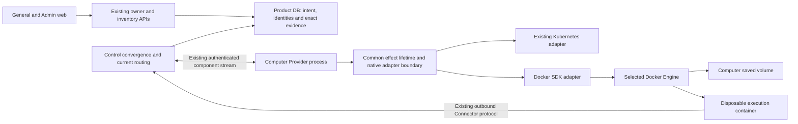

# Docker Server Computers Design

- Snapshot: `docker-261103`
- Requirements: [docker-261103/REQ](../requirements/docker-261103-server-computers.md), confirmed on 2026-11-03.
- Decisions: [docker-261103/ADR](../adr/docker-261103-server-computers.md).
- Design revision: `7`; revision6 authority/feasibility review retained with the requester's explicit M14 scope correction on 2026-11-03.
- This document specifies intended changes, not implemented behavior or live Docker evidence.

## Current Behavior and Gaps

The current server Computer Provider is Kubernetes-specific, not a generic
runtime with a Docker adapter missing. `rust/apps/chapchoo/src/provider.rs` accepts
`Arc<Kubernetes>`, constructs namespace/image/storage/ServiceAccount policy and
announces a namespace and Connector endpoint. SQLite and PostgreSQL migration 3
allow only `KUBERNETES` Providers and `POD`, `PVC`, `BOOTSTRAP_SECRET` resources.
Execution reservation, current-running evidence, retirement, peer command
validation and cleanup order assume those three kinds. The owner API and web
experience already describe Agent/Computer ownership and actions independently
of those objects.

Reuse the current authoritative User/Team admission, SYSTEM-owner credentials,
creation receipts, lifecycle Request IDs, preparation-admission fence, execution
and Connector session identity, current Provider/Control/Connection checks,
bounded convergence and independent residual cleanup. Extend native resource
representation rather than calling a Docker container a Pod or fabricating a
Kubernetes Secret for Docker.

## Design Authority

- Design revision: `7`
- Decision owner: requester, Collaborative mode.

| ID | Material design mechanism | Authority | Classification |
| --- | --- | --- | --- |
| M1 | Docker is a SYSTEM server Provider supplying dedicated CLOUD Computers under existing private ownership | REQ-1; computer-storage and computer-web Specs | required |
| M2 | CLI-selected connection by default, coherent explicit override, startup target fixed, no alternate-host fallback | REQ-2; ADR-D1 | decided |
| M3 | Bind native observations/effects and original saved storage to the actual daemon; reject target substitution | REQ-2, REQ-3, REQ-4; ADR-D1; current exact-resource authority | derived |
| M4 | Native container and saved-volume variants in reservation/evidence/cleanup; retain Kubernetes identities and data | REQ-1, REQ-3, REQ-4; current computer-storage/control-rpc contracts | derived |
| M5 | Retained saved volume and fresh execution container after retirement; no empty replacement or ambiguous mutation replay | REQ-3, REQ-4; computer-storage/kubernetes Specs | derived |
| M6 | Existing outbound Connector with container Control override and operator-prepared network, no automatic tunnels or published ports | REQ-5; ADR-D2 | decided |
| M7 | Scoped individual cleanup and exclusive management of Provider-reserved resources on a shared trusted daemon; weaker volume conditional deletion disclosed | REQ-3, REQ-4; ADR-D3 | decided |
| M8 | Current-source reports, ACK-before-next-effect, retained effect-task lifetime and conservative crash uncertainty | REQ-3, REQ-4; computer-directory/control-rpc/kubernetes Specs | existing |
| M9 | Preserve execution-scoped Connector bootstrap protocol and non-root workload security without forwarding daemon credentials | REQ-4; current Connector and Kubernetes contracts; ADR-D3 | derived |
| M10 | Forward migrations and coordinated component/generated-client update preserve Kubernetes records, receipts and saved environments | REQ-1, REQ-3; current explicit prepare and schema-readiness contract | derived |
| M11 | Separate native API observation from Connector readiness; expose only bounded nonsecret native inventory | REQ-1, REQ-4, REQ-5; computer-web/control-rpc Specs | derived |
| M12 | Minimal real-Docker lifecycle E2E and owner-layer fault/identity tests with explicit prerequisites | REQ-6; repository test-owned-contracts convention | required |
| M13 | Docker `always` native same-container restart within the current execution, separate from owner-requested retirement and successor creation | REQ-3; ADR-D4 | decided |
| M14 | Preserve host portability and ordinary selected Docker Desktop context for a later native Mac build; no Mac-only build/distribution work in this effort | corrected REQ-2/REQ-6; ADR-D5 implementation-scope correction | decided |
| M15 | Preserve the selected user's Docker transport/authentication/TLS-verification/SSH policy, including deliberately configured unencrypted or verification-disabled remote settings | amended REQ-2; ADR-D1 and ADR-D6 | decided |
| M16 | Docker retirement once-only phase admission with exact connection-local stage correlation and observation-only recovery after ambiguity or correlation loss | REQ-3/REQ-4; current cleanup correlation and non-replay contract; ADR-D4 retirement boundary | derived |

The proposal must not gain new authority merely by passing tests. Concrete
connection-support and native evidence conditions below are feasibility gates;
any material limitation that contradicts Requirements returns to the requester.
No new application revision/generation protocol, generic job ledger, scheduler,
user-owned Provider, adoption API or operator cleanup API is introduced.

## Requirement Traceability

### Material Decision Disposition

- **D4 accepted:** native same-container `always` restart, recorded as M13.
  The earlier `RestartPolicy=no` proposal is superseded. Exact native terminal
  evidence under the chosen policy still needs feasibility validation.
- **D5 clarified:** preserve portability and already-running Desktop context for
  a later Mac build, recorded as M14. Mac-only build/distribution work and a
  current real-Mac completion gate are excluded by the requester correction.
- **D6 accepted:** respect the selected user's connection security configuration,
  recorded as M15. The earlier secure-only allowlist proposal is superseded.

D1-D3 remain accepted. Declared SDK transport/platform compatibility and native
evidence feasibility must still be validated; unsupported configuration is a
technical blocker to report, not a silent policy change. None of these decisions
promises Windows native Providers, external volume plugins or every registry
helper.

| Requirement | Mechanisms | Observable verification |
| --- | --- | --- |
| REQ-1 server ownership and Kubernetes preservation | M1, M4, M10, M11 | both DBs preserve current K8s rows; private API admission unchanged; Docker kind registered by scoped SYSTEM owner |
| REQ-2 selected connected host | M2, M3, M14, M15 | CLI selection/override/security tests and portable host paths; changed daemon/context cannot relocate Computers |
| REQ-3 lifecycle and original saved environment | M4, M5, M7, M8, M13, M16 | real stop/start data preservation and normal cleanup; exact replay and unknown-outcome lower-layer checks |
| REQ-4 bounded resources/credentials | M3, M4, M7, M8, M9, M11, M16 | foreign identities rejected; late effects remain uncertain; no daemon keys/socket in workload or browser DTO |
| REQ-5 independent Connector path | M6, M11 | live daemon but blocked Connector path remains distinct; explicit address works from container |
| REQ-6 Docker-backed validation | M12 | selected real daemon journey, artifacts identify substrate and failures, no silent pass without prerequisites |

## Architecture and Sources of Truth

Both native Providers are external processes and may be run by trusted third
parties. SYSTEM denotes the existing server-admitted ownership category, not a
deployment requirement to run inside the backend installation. Providers never
load backend DB configuration, connect to the product database or receive the
installation encryption root. Native IO runs in the Provider; authenticated
Control RPC is the product boundary; DB authorization, daemon compare-and-bind,
reservation and evidence mutations run in server-side service/store transactions.
The requester's implementation-time clarification confirms this existing
boundary for both substrates; it does not authorize new self-enrollment or
credential-management mechanisms.

- DB remains authoritative for intended state, ownership, request deduplication,
  active execution, reserved object identity and accepted evidence. It does not
  infer running from directory connectivity.
- Docker Engine is the observation/effect authority for its native objects, not
  a second Agent or lifecycle database.
- One configured Provider manages one selected daemon. The daemon may also run
  unrelated workloads. Sharing a daemon does not grant access to those objects.
- Existing connection owners and DB-time expiry fence reports and dequeue. They
  do not retroactively cancel a Docker operation already submitted.
- The adapter owns Docker-specific creation, inspection, stop/removal and
  evidence classification. Common effect supervision owns started tasks across
  stream loss. Extract that behavior from the Kubernetes-owned module without
  changing its one-in-flight lifecycle permit or drain semantics.
- The existing Kubernetes command and settings remain Kubernetes-specific. Add a
  separate Docker Provider entry point in the existing binary; do not reinterpret
  absent Kubernetes flags as permission to auto-select Docker. Command/helper
  names are local details, not a new compatibility mode.

## Connection Selection and Daemon Binding

### Resolve once, connect explicitly

The default source is the executing account's Docker CLI configuration. Resolve
context selection and standard Docker environment precedence as documented by
Docker, then load that context's endpoint and TLS material as a coherent source.
Do not assume an SDK `connect_with_defaults` matches the CLI. Explicit Provider
connection input bypasses the default source entirely; invalid or incomplete
explicit input fails rather than borrowing a different context's keys.

Resolve once during process startup. Keep target and authentication source fixed
for the process lifetime, including component-key renewal and stream reconnect.
There is no retry against another context, another socket or another host.
Credentials may be reread only as part of an explicit process restart using the
same configured source; rereading must not bypass daemon/original-resource gates.

Use an established Rust Docker Engine SDK's public operations (Bollard is listed
by Docker and is the current candidate). Pin and validate a released dependency,
not a master-branch API. Configuration-file/context resolution is separate from
native Engine IO; it is not permission to implement handwritten API operations
that the SDK supports. Configure finite operation timeouts and disable automatic
mutation retries. An SDK reconnect or version negotiation must not replay a
possibly accepted create/start/stop/delete.

### Initial platform and transport feasibility

The existing Computer image is Linux and the first Docker design targets Linux
containers on Linux Engine or Docker Desktop's Linux-container daemon, with the
same published CPU architectures as the existing image. Native Windows
containers and alternate Docker-compatible engines are not inferred from a
successful API ping. Keep Provider code naturally portable for a later native
Mac build connecting to Docker Desktop through its normal context. This effort
does not build/package a Mac executable, add Mac-only CI, or design a macOS
backend/web distribution. Do not add unnecessary Linux-only host paths or
setup behavior to the Docker adapter. Existing Linux web-launch limitations
remain scoped to that command. Real Mac build/Desktop acceptance is future
evidence, not a current feature completion gate. When used with Desktop, the
operator already has it running; the Provider never installs, launches,
restarts or configures it. Match the selected daemon's Linux architecture
without silently relying on emulation as native acceptance.

Load the selected context's actual socket rather than hardcoding a Mac home
directory or requiring a system socket symlink. Docker Desktop stores Linux
volumes inside its managed environment; do not treat a volume path as a path in
the Provider's macOS filesystem. Container-to-Control address overrides and
operator reachability remain required where host/VM loopback differs. Desktop
restart/factory reset must go through the same daemon/original-volume checks:
no replacement saved storage or context fallback. When Desktop is stopped,
report the selected daemon as unavailable; do not launch Desktop, change the
user's context, create a socket symlink or invoke an automatic setup flow.

Target Unix sockets, SSH and Docker TCP/TLS connections using the security policy
actually selected by the user under ADR-D6. Preserve `SkipTLSVerify`,
certificate paths, authentication and SSH configuration rather than impose a
secure-only allowlist. Insecure settings are used only when selected, never as
automatic fallback after another connection fails. SDK/API incompatibility is
reported explicitly; do not claim context compatibility while silently dropping
its options. Validate released SDK and platform prerequisites for each supported
mode before claiming this draft ready for implementation.

For SSH, the current Bollard implementation uses a local OpenSSH process and a
remote `docker system dial-stdio` command. If that released transport is used,
these are explicit prerequisites; neither an SSH daemon URL nor Docker Desktop
implies a pure-Rust/no-CLI implementation. API effects still use public SDK
operations rather than application-generated `docker run/rm` commands.

### Released SDK configuration fidelity

Source review of released Bollard `0.21.1` establishes a public-API path but
also rules out using its convenience constructors as the whole resolver:

- `connect_with_defaults` reads DOCKER_HOST/platform defaults, not the complete
  CLI context and TLS bundle. Resolve Docker configuration explicitly first.
- Its built-in SSH transport injects OpenSSH `StrictHostKeyChecking=accept-new`
  and ignores a nondefault remote socket path in an SSH URI. That does not
  faithfully implement ADR-D6 for every selected SSH context.
- Its public `connect_with_custom_transport` accepts an SDK-generated HTTP
  request and returns a future yielding `http::Response<hyper::body::Incoming>`.
  Public Hyper HTTP/1 client handshake over the selected stream supplies that
  response type directly. No handwritten Engine routes or JSON codecs are
  necessary.

Use public SDK native operations throughout. For TLS settings unsupported by
the convenience constructor, a public rustls/hyper-rustls connector carries the
user's chosen trust roots, client certificate and verification policy. A
verification-disabled configuration is constructed only when the selected
source requests it; it is not an automatic error recovery path.

For SSH, a public custom SDK transport can use the user's ordinary OpenSSH
configuration, agent and known-host policy without injecting an alternative
StrictHostKeyChecking value. Carry any selected remote Unix socket path into
the remote Docker dial-stdio command using validated arguments, not a shell
string built from raw context input. Local OpenSSH and remote Docker CLI are
declared transport prerequisites. The SDK still creates and decodes all Engine
requests; the transport only supplies the byte stream.

Own connector/process/connection tasks through response-body completion or
definitive failure, not merely response headers. Bound connection acquisition,
shutdown and request lifetime, without transparently replaying SDK mutations.
Transport tests assert effective TLS/SSH policy, remote socket selection, auth
source coherence and failed-connection behavior using isolated fixtures; real
target validation is still required before claiming a support combination.
If these public APIs cannot preserve an actual selected configuration, report
that concrete compatibility failure without changing the accepted policy.

### Native daemon identity

Read the daemon's opaque Engine `/info` ID before registering a Docker source.
Persist the first accepted daemon identity for that SYSTEM Provider under the
existing scoped owner authority and short Provider lock. It is not an endpoint
hostname and not parsed as a stable-format application ID. A bound Provider
cannot silently change substrate kind or daemon ID while retaining its old
Computers/resources. There is no automatic reset/rebind administrative API in
this snapshot.

Every admitted Docker connection carries the bound daemon identity and every
resource belongs to it. Validate the actual target on reconnect and before
native mutations/identity-dependent observations. Different daemon, missing ID
or unverifiable identity withdraws eligibility for those operations, not an
empty inventory or a new allocation opportunity. An endpoint can retain its
string while being replaced, so URL pinning alone is insufficient. DNS/network
changes that expose a different daemon must fail closed. SDK connection/session
behavior and validation-to-effect races require a bounded transport-level
feasibility test.

The configured endpoint must designate one trusted daemon, not a load balancer
alternating unrelated Engines. Engine ID is a self-reported comparison value;
there is no Docker API transaction coupling `/info` to a later create. Do not
claim an atomic target-attestation fence that the SDK/Engine does not supply.
Operator endpoint stability and the transport protection actually selected by
the user provide the remaining boundary; ambiguous effects remain bound to the
original candidate. Under ADR-D6, plaintext or verification-disabled settings
do not provide authenticated target assurance. ID comparison cannot repair that
limitation and is not described as a cryptographic fence. The Provider neither
changes those settings nor opens a new daemon listener.

Daemon ID is evidence of the connected Engine, not cryptographic protection
against its trusted administrator or a guarantee of preserved storage after a
daemon reset. Original resource evidence is still independently required even
when the ID is unchanged. An intentional new daemon is a new Provider setup,
not migration of existing environments under an old Provider ID.

## Native Resources and Data Model

### Resource sets

A Kubernetes execution retains its existing Pod, bootstrap Secret and original
PVC requirements. A Docker Computer instead has:

- one independently reserved saved volume per Computer;
- one reserved container per execution, including any original never-started
  candidate; and
- no fabricated Docker Secret object or fake Kubernetes namespace.

Container image cache and operator-provided networks are not owned saved
resources and are not deleted with a Computer. No native object adoption is
introduced. A matching object can only recover an already reserved candidate
under the original request/effect/ownership rules.

### Representation

Add a persisted Provider substrate discriminator for Docker while retaining the
current KUBERNETES value and all historical resource identities. Extend the
native reservation/evidence model with typed Kubernetes-object,
Docker-container and Docker-volume identities. Domain logic operates on
execution-resource versus saved-environment roles; native adapters validate the
actual identity. An object role is derived from the typed native kind, not a
caller-controlled string that can relabel a container as durable storage.

- Kubernetes identity remains namespace/name/original UID and existing ownership
  annotations; do not rewrite historical UIDs or reserve new PVCs for them.
- Docker container identity is bound daemon + reserved name + returned full
  container ID, Provider/Computer/execution labels and verified configuration.
  Mutations use the full ID once known, never a same-name substitute.
- Docker volume identity is bound daemon + permanently reserved name + original
  ownership/configuration observations, including native creation metadata when
  available. Docker has no equivalent immutable local-volume UID. Do not encode
  an application nonce or timestamp as though it provided native UID deletion.
  Ownership labels use already-reserved opaque Provider/Computer identities;
  they are metadata, not bearer credentials. Reserved names are never reused for
  another Computer. Conflicting metadata or changed original observations fails
  closed under the accepted exclusive-management boundary.

DB constraints must still enforce resource uniqueness within Provider/native
scope, one saved environment per Computer, execution-resource identity within
its exact Computer, and allowed kind/role combinations. Current Kubernetes
namespace length rules apply only to Kubernetes, not opaque daemon IDs or Docker
IDs. Use explicit typed decoding and bounded lengths for all incoming native
identities. Reject unspecified/unsupported kinds rather than mapping an unknown
kind to bootstrap Secret.

Resource inventory and pagination gain native scope/identity support. Preserve
bounded twenty-item reads and typed canonical cursors; Docker daemon identity
must not be squeezed into a fake 63-character namespace. General owner views
keep ordinary Computer semantics; Admin receives only nonsecret native inventory,
not Docker endpoints, TLS/SSH material, environment variables or user file data.
Existing locale dictionaries need only precise labels for new native kinds or
safe failures, with all supported locales reviewed in context.

### Concrete storage and message shape

Equivalent implementation names are allowed; these relationships are not
optional:

| Record | Required shape and admission |
| --- | --- |
| Provider | stable ID/owner/capabilities, immutable substrate kind and Docker-only opaque daemon binding, set by authorized compare-and-bind before first Docker reservation |
| Execution | existing Computer FK, immutable initial-allocation classification, preparation/dequeue and retirement facts, exactly one authoritative current execution |
| Native reservation | Computer/Provider FK, native kind, typed scope, reserved name, optional execution FK and accepted identity/evidence; saved resources have no execution FK |
| Kubernetes native object | namespace/name/original UID and unchanged ownership annotations |
| Docker container | bound daemon/reserved name plus returned full ID once allocated; exact labels/configuration |
| Docker volume | bound daemon/permanent name and original typed creation/driver/scope/options/ownership observations; no synthetic native UID |
| Evidence | present/unknown/definitively absent, timestamp, exact current source, expected native identity and sticky accepted absence |

Observe the selected daemon outside DB transactions, then compare-and-bind
its ID under scoped SYSTEM-owner and Provider locks. Different concurrent first
bindings conflict; exact same-value retry recovers the binding. Component
admission and reservation require that accepted binding. Metadata updates/key
rotation cannot overwrite substrate or bound target. No automatic reset method
or new privileged recovery endpoint is introduced.

Replace the shared namespace-only model with typed native scope at store,
service and DTO boundaries; migrate old namespace strings losslessly into the
Kubernetes scope. Retain Provider/kind/scope/name uniqueness. Enforce one saved
resource across PVC and Docker-volume kinds for a Computer, exact execution/
Computer relationships and allowed Provider-kind/resource-kind combinations.
Bind accepted native identities rather than overwriting them on later reports;
unknown reports retain identity and confirmed disappearance stays sticky.
Docker volume metadata is decoded into a typed record, not unchecked JSON
treated as business authority.

Reservation/evidence messages use native discriminated variants with optional
allocated identity. Prepare has Kubernetes and Docker variants; retire targets
the exact execution-native resource. Existing protobuf field numbers retain
their old meaning, and new fields carry native variants. Normalize the current
K8s message shape into its native variant at ingress rather than maintaining
two competing authorities. Unknown fields cannot make an old component a valid
Docker peer; Docker admission requires the coordinated updated binary. Do not
add a product version-negotiation feature.

Inventory paging uses the canonical bounded kind/native-scope/name tuple;
native ID and creation observations are non-paging fields. An input scope change
cannot bypass Provider/Computer authorization. Names, UIDs, receipt links and
K8s execution references identify the same original objects after migration.

The concrete schema transformation uses `provider_kind` values KUBERNETES and
DOCKER, with a nullable `docker_daemon_id` allowed only for DOCKER and immutable
once bound. Resource records retain existing ownership, presence/timestamp/
source/absence columns and replace namespace-only identity with a checked
`native_scope_kind`/`native_scope` pair. Kubernetes rows map namespace losslessly;
Docker rows use the bound opaque daemon ID. Add native kinds DOCKER_CONTAINER
and DOCKER_VOLUME. Keep native full container ID separate from reserved name;
original K8s UID remains unchanged, while Docker volume identity uses its typed
original observations rather than a fake UID.

Enforce uniqueness over Provider/kind/scope/name and over execution/kind.
The saved-environment partial uniqueness covers PVC and DOCKER_VOLUME together,
with exactly those kinds requiring execution_id NULL. All other kinds require
an execution FK for the same Computer. Provider/scope-kind/daemon consistency
is rechecked under the same locked write as the evidence mutation, not merely
accepted from a report's fields. Original typed volume observations are stored
with the reservation and survive unknown/absence evidence; they cannot be
overwritten as a repair.

Forward migration widens checks using the closed-FK staging algorithm below on
SQLite and transactional checks/index changes on PostgreSQL. A Provider/resource-
only SQLite rebuild is unsafe: dropping the old Provider can cascade away keys,
key-request receipts and active connection routes. Verify all row identities,
deferred current-execution FKs, credential/receipt references and one-saved-
resource constraints. Down migration refuses where removal would discard Docker
binding/evidence; it never relabels Docker state as K8s.

#### SQLite closed-FK staging algorithm

Keep `PRAGMA foreign_keys=ON` throughout explicit preparation's immediate
transaction. `foreign_keys=OFF` inside that transaction is ineffective and is
not part of this Design. Deferred checking does not defer CASCADE.

1. The closed replaced-table set is `computer_providers`, `provider_keys`,
   `provider_key_requests`, `computers`, `agents`, `computer_executions`,
   `computer_resources`, `connector_sessions`, `connector_key_requests`,
   `provider_connections` and `connector_connections`. Introspect all incoming
   schema/FK references before changes; an unexpected incoming dependency aborts
   instead of silently escaping preservation. `users`, `teams`,
   `control_instances`, `agent_creation_receipts`, installation binding and
   migration bookkeeping remain original external tables and are never deleted.
   Receipts currently reference Users, not live Agents.
2. Create a staging table for every member with new CHECK/uniqueness rules and
   FKs pointing only to staging equivalents or retained external parents. Copy
   every stored column explicitly; regenerate `cloud_computer_id` from its
   unchanged inputs. Preserve Team association, request hashes, all current/
   previous Provider/Connector credential hashes, recovery nonce/ciphertext,
   expiry/revocation, key-request fingerprints, route owner/connection IDs,
   execution/resource identities, source timestamps, sticky absence, cleanup
   and dispatch/admission facts.
3. Handle the Computer/current-execution cycle with deferred FKs and validation
   in this one transaction. Compare retained staging columns byte-for-byte to
   source, including credential BLOBs and receipts/routes, with explicit lossless
   native-scope transformations. Row counts alone are insufficient. Verify the
   computed uniqueness and unchanged external user/Team/control/receipt
   relationships before removing old rows.
4. Only after the complete verified copy exists, clear the old graph inside the
   transaction. Null old `computers.current_execution_id` first to break its
   cycle; staging retains the original pointer. Delete old dependent connection,
   key-request, session, resource and Agent rows in FK-safe order, then old
   Computers/executions and Providers. CASCADE is confined to the copied old
   graph, never staging or retained external parents. Assert all old tables
   empty before DROP; DROP must not be the accidental data-migration mechanism.
5. Drop the empty old closed graph, rename staging tables to original names
   with FK rewriting enabled, and recreate named/partial indexes. Verify final
   FK targets and run `foreign_key_check`, exact retained-column comparisons
   and uniqueness checks again. No staging table/index may remain. Retained
   external receipt/installation/control/Team data must be unchanged. Any
   mismatch rolls back the entire prepare transaction.

Migration fixtures populate every replaced table, including revoked/current/
previous keys, protected recovery BLOBs, current-execution cycles, source routes,
removed-Agent receipts, terminal cleanup and unresolved preparation. Source SQL
planning does not replace both-engine preservation tests.

At the protobuf boundary keep current K8s field meanings/numbers, add typed
Docker payload fields, and reject mixed K8s-plus-Docker preparation/resource
input. Docker present evidence has a native container/volume identity variant;
the old string UID is exclusively Kubernetes evidence, not overloaded for a
Docker name. Normalize to one internal native ADT at ingress. Required decoding
rejects an unspecified kind, wrong scope or wrong evidence variant. Generated
Node clients/DTOs and inventory cursors change together. This preserves actual
K8s state without promising that an old component can process a Docker command.

### Protocol and Control changes

Extend generated Provider configuration/hello, reservation, preparation,
retirement, reporting and peer-validation messages with explicit substrate/native
variants. Keep existing protobuf field numbers/enum meanings; do not reuse a
Kubernetes field number for a Docker object. Kubernetes retains its existing
resource variant. Docker preparation carries the saved-volume/container pair
and the same execution-scoped Connector bootstrap material, not three pretend
Kubernetes resources.

Typed substrate policy comes from the authenticated server Provider and its
bound source, never a user create request. Unknown or mismatched kind/Provider
policy is rejected before allocation/effect forwarding. Resource-present and
absence evidence must carry the expected native identity and exact request and
current connection. Running completion validates the complete required native
resource set for that substrate: Docker container plus original saved volume;
Kubernetes Pod/Secret/PVC unchanged.

The shared Control selects lifecycle stages from durable intent and role-aware
resource sets. Native effect order and validation are delegated to the owning
adapter. Cleanup retires execution resources before removing the saved
resource. No generic effect queue or new command-history source replaces current
admission receipts and preparation fences.

## Docker Preparation and Security

1. Revalidate Provider source, daemon binding, current Computer request and
   candidate reservation before any native effect.
2. Resolve the configured supported Computer image without changing the existing
   request's resource reservation. Use public SDK image operations for a
   configured public image or a deliberately preloaded image. Provider-owned private
   registry credential loading/storage is not implicitly added by Docker
   connection-context support. Do not send registry or daemon credentials into
   the Computer. Image pulls are shared cache maintenance, not
   a saved-environment creation proof or permission to restart preparation.
3. On initial allocation only, create the reserved named volume or recover its
   exact owned result. Verify daemon/name/labels/driver and original metadata;
   commit and ACK owned-present evidence before proceeding. A previously bound
   missing volume is not recreated, including after an initial execution retry.
4. Create one execution container with the original saved volume, exact supported
   image/command/network/security profile and Connector session. A foreign
   same-name object or mismatched configuration is a conflict, not AlreadyExists
   success. Inspect the returned full ID and report/ACK it before a later start.
5. Revalidate command/source and original volume before submitting start once
   for this execution. Inspect actual running state and original mount identity;
   only then report running. Connector readiness remains separate.

Container creation and start are separate external effects. The existing
preparation-admission fence spans the complete operation; a lost create/start
result is not permission to repeat either effect. Candidate recovery may observe
accepted native results but must not infer permission to resubmit from absence.
Keep `initial_start_dispatch_at` at the existing Prepare dequeue boundary; it
does not become native Docker Start success time, and reconnect cannot reset
the existing dispatch delay.

Use the same Linux non-root UID/GID profile as the current image, read-only root,
dropped capabilities, no privilege escalation and daemon default constrained
seccomp; no privileged container, host PID/IPC sharing, device or Docker-socket
mount. Configure finite CPU/memory bounds with Docker-equivalent limits. Do not
pretend Kubernetes requests/scheduling or storage-request quotas are enforced by
Docker local volumes. Unsupported resource/security configurations fail
explicitly, not by dropping the constraint.

The initial Linux workload profile is UID:GID `10001:10001`,
`Privileged=false`, `ReadonlyRootfs=true`, `CapDrop=[ALL]`,
`no-new-privileges=true`, no unconfined seccomp override, default private
PID/IPC namespaces and no device/socket/host-path mounts. Permit only the
reserved saved volume at the configured mount; compare network selection
against trusted Provider policy, no published ports. The defaults correspond
to the existing CPU/memory limits: one CPU and 1 GiB, mapped to enforceable
Docker CPU/memory settings. Changed configured limits remain bounded and are
compared against the intended profile. Never count an ignored limit or an
unenforced rootless cgroup setting as meeting this profile.

Daemon configuration must provide effective seccomp/no-new-privileges and
resource-limit support. A rootless daemon may be used only where the same
required workload properties are proven; honoring its connection settings is
not permission to silently disable workload isolation. Rootless feasibility
failures are distinct from a connection-security allowlist.

Retain the current Connector environment interface for execution session ID,
initial key and container-reachable Control endpoint. Docker stores these in
container configuration, visible to trusted daemon administrators; this is
consistent with their native host authority, not secret isolation from them.
Never put keys in labels, names, command-line arguments, public DTOs or logs.
Match the exact existing execution bootstrap content on collision recovery.
Revocation/exchange still uses current execution/session authority; no Docker
socket or Provider owner/communication credentials enter the workload.

### Non-root saved-volume permissions

Docker does not provide Kubernetes `fsGroup`. The Computer image must expose a
saved mount whose initial directory ownership permits the configured non-root
UID/GID. For the standard image, stage the default saved directory with that
ownership during image construction; a newly attached empty named volume may
then use Docker's normal image-directory population. A custom saved mount/image
combination must meet the same observable write requirement. Never repair an
existing saved environment by recursive chown, clearing its contents, starting
an untracked privileged helper or replacing its volume. Permission failure is
an explicit blocked setup with the original volume retained.

The empty-volume population and ownership behavior must be verified with the
actual selected daemon/image, including a restarted successor. Image population
is allowed only during true initial allocation; it must not refill a previously
allocated empty volume on later starts. Use the native no-copy mount setting
for successors and prove it does not silently repopulate original storage.
This is an important real-daemon feasibility gate, not established by this draft.

Initial volume support is Docker's local driver with no plugin or
driver options. `Scope=local` alone does not prove safe options: local drivers
can use host bind/NFS/device options, which are not implied by the saved-volume
contract. Reject unexpected driver/options rather than silently accepting a
different storage authority. This is the ordinary local-volume implementation
of the approved saved-environment contract; respecting connection context does
not authorize a new external storage driver or arbitrary host mounts.

### Preparation stage and recovery table

| Stage | Accepted progress and required next boundary | Failure, lost response or crash handling |
| --- | --- | --- |
| Resolve image | complete the SDK pull stream if needed, verify supported image/architecture and capture actual digest for collision comparison | pull/inspect error is not native container-create rejection or owner RetryPreparation authority; retain request and original reservation |
| Initial volume allocation | create exactly reserved local volume; inspect ownership/metadata; current-source report and ACK binds original identity | unknown native result is not replay authority; exact present recovery may report it; 404 after lost result/crash remains unknown while old create could complete |
| Saved volume already allocated | inspect exact original name/metadata on bound daemon, no create/population | missing/changed/unknown storage blocks preparation; never create a replacement or refill an original empty volume |
| Create execution container | one SDK create with exact session/image/security/mount/network; retain returned full ID and report/ACK it before Start | explicit native rejection can support the existing safe-blocked preparation rule only when previous effects are settled; transport/inspect/ambiguous server failure cannot |
| Allocation report ACK | accepted report binds exact native allocation under source/current request | lost ACK halts subsequent Start even if the object exists; recover the original report/result, not a new native create |
| Start | revalidate exact current command, full ID, bound daemon and original volume; submit once | any possibly accepted Start stays under the admitted fence; an exited snapshot alone cannot prove a delayed Start will not run |
| Running report | coherent native running plus complete required Docker resource set, report under exact current source | lost report/result can recover observationally from exact present running facts; no duplicate Start, no connection-derived power claims |
| Connection loss during effect | original task retains permit and cannot issue further stages after failed authority/ACK | native completion may occur; old-source reports are refused; new-source observation does not authorize ambiguous mutation replay |
| Process loss | retain durable reservation, admitted fence and original identities | preserve uncertainty for possibly submitted create, Start, Stop and Remove, not merely create; no timer proves quiescence |

On initial preparation retry after a definitive pre-acceptance rejection,
`initial_allocation` retains its existing reservation meaning; it does not
permit creating an already bound missing volume. First-copy image population
must not be repeated on a successor or used to repair an emptied existing saved
environment. Exact bootstrap comparison refers to the execution's originally
issued Connector session/key/endpoint, not a new session requested to make a
collision match. Operational-key exchange does not change the original
container bootstrap configuration or permit issuing a successor execution.

## Lifecycle, Retirement and Cleanup

| Existing action | Docker behavior and authoritative completion |
| --- | --- |
| Create | Reserve original volume and execution container, create with ACK boundaries, start once, verify actual running; Connector connection remains independent |
| Stop | Retire current execution; graceful native stop if needed, confirm stopped process state and remove exact full-ID container without force; retain original saved volume |
| Start | Only after definitive old retirement and current original-volume proof, reserve new execution/session, create fresh container on same saved volume |
| Restart | Stop/retire then Start under the existing Request ID and predecessor checks |
| Unexpected exit | ADR-D4: Docker `always` restarts the process in the same container/execution; intermediate exited/restarting facts are not terminal retirement |
| Normal delete | Retire execution, remove exact owned container/candidate resources then saved volume individually, observe required definitive absence and confirm current cleanup |
| Force remove | Existing Agent visibility/removal action only; retain Computer/resource/receipt evidence and background cleanup responsibility, no claim of native deletion |

Automatic container removal is disabled so terminal evidence is not
automatically discarded. Use native Docker restart policy `always` under ADR-D4,
retaining the container/execution/Connector session after unexpected process
exit. This is the selected parity with Kubernetes Pod `restartPolicy=Always`,
not a claim of identical daemon-outage behavior. No retired execution may be
resurrected and the original saved volume remains preserved.
Do not use `docker start` on a retired old container to satisfy
a new owner-requested Computer Start. Only the designated saved volume, not the
container writable layer, is the preserved environment.

Use normal native stop semantics with a bounded grace period and inspect the
exact full ID. Docker's stop may escalate to kill after its grace period; this is
process interruption, not memory preservation. Removal itself uses no force and
never removes a running/restarting/paused or otherwise unverified execution.
Reject native disappearance as retirement proof unless the adapter has the
qualified exact native quiescence/absence evidence required below.

### Exact intentional-retirement sequence under `always`

The `always` policy applies while the execution is active. Intentional
Stop/Restart/Delete retires that exact execution and must inhibit daemon-driven
resurrection before it can be called stopped. This is derived from ADR-D4's
explicit retirement boundary, not a new user-visible restart mode:

1. Admit the exact retirement through the non-replay gate below and obtain the common effect
   permit. Establish that no prior possibly accepted create/Start can still
   materialize for this execution. Same-process task completion or previously
   accepted running-completion evidence may supply the required boundary;
   a new connection or elapsed timeout cannot.
2. Inspect on the bound daemon by full container ID. Verify exact ownership,
   session/configuration, mount and active/retiring identity. Do not adopt an
   object by name or infer authorization from an absent execution.
3. Through the SDK's public container-update operation, set restart policy
   `no` for this retiring full ID, once. Reinspect that the same ID's effective
   policy is `no`. This prevents a daemon restart between manual stop and
   removal from reviving the container. A lost update result is uncertain;
   read-only observation may establish the effective policy, but cannot justify
   repeating a possibly pending native update.
4. Revalidate current request/source before one graceful stop, unless exact
   owned state and effect-quiescence facts establish it already stopped.
   A known-never-started `created` container needs no Stop but still requires
   proof that Start cannot later arrive. No unpause/kill/force fallback.
5. Require coherent `exited` state, no running/paused/restarting/dead flags,
   PID zero, nonempty valid FinishedAt and effective restart policy `no`, or the
   qualified never-started case. A transient exit with policy `always` is not
   this proof. Positive state alone cannot settle a pending Start/Stop/Remove.
6. Submit one non-force full-ID removal with anonymous-volume removal disabled.
   Observe same-daemon exact-ID absence after the removal/quiescence boundary;
   retain native ID and current-source proof. Only then retire the execution,
   revoke its Connector authority and permit the next execution/storage cleanup.

The expected configuration validator is phase-aware: `always` is required for
an active execution, while only the exact admitted retirement permits policy
`no`. A general observation cannot normalize an externally changed active
policy into an authorized retirement. If the current request becomes obsolete,
do not submit another native stage; the old effect's result is not authority to
affect a successor.

### Retirement dispatch admission and exact progress

Prepare admission does not fence Retire, and the task permit alone does not
prevent replay after an ambiguous completed SDK task. Docker Retire uses the
existing durable phase and exact connection-local correlation, analogous to
cleanup batch correlation, without introducing a universal command ledger:

- **First dispatch:** under current source/credential and Computer/request/
  execution checks, CAS an eligible fresh `RETIRING` phase (owner Stop/Restart)
  or `DELETING` phase (Delete with a current execution) to `UNCERTAIN` before
  forwarding. Preserve the exact original phase in the live manifest for an
  authorized NotStarted release. The tuple includes expected old/native
  execution and action/intent. A qualified terminal-retirement path similarly
  claims its current non-uncertain phase under exact native terminal facts;
  ordinary Running intent alone is ineligible. Already `UNCERTAIN` is not a new
  claim. Docker Delete retires its container through this gate before creating
  the saved-volume cleanup batch; it does not pre-mark an unrelated generic
  cleanup phase that would hide the first retirement admission.
- **Before awaiting forwarding:** keep a bounded exact retirement manifest in
  the connection entry: Computer/request/execution, native resource/full ID,
  source connection, call identity, and definitively-not-started versus
  potentially-accepted dispatch. Record it before losing a response waiter is
  possible. Do not reconstruct the mutation as a retry.
- **Worker continuation:** one owned task carries update(no), policy inspection,
  Stop, terminal inspection, Remove and absence in order. Every later mutation
  needs a positively settled predecessor and fresh authority. Native timeout/
  lost result ends mutating continuation; ambiguity survives task completion.
  Retain task/permit through actual SDK completion without restarting stages.
- **Subsequent convergence:** a potentially accepted/in-flight manifest permits
  observation-only recovery for its exact tuple, never another Retire, Update,
  Stop or Remove. Qualified committed current-source absence can complete
  retirement without redispatch. Otherwise keep `UNCERTAIN`.
- **Definitive non-acceptance:** only an exact current result proving rejection
  before queue/dispatch acceptance may CAS-release back to fresh retiring.
  Possible forwarding, timeout/cancel/lost ACK, a native-stage rejection after
  earlier effects or a new stream cannot release admission.
- **Correlation lost:** reconnect, process death or memory eviction may lose
  the manifest. `UNCERTAIN` without exact live correlation is observation-only.
  Qualified committed absence may settle its exact execution; missing facts
  cannot authorize replay, phase clearing or a reconstructed first dispatch.

All Docker retirement paths, including STOPPED intent, Restart's old execution,
qualified terminal retirement and Delete's container stage, use this gate.
The current K8s-shaped early Retire-dispatch branch before the later UNCERTAIN
check must not bypass it. K8s keeps its existing branch behavior. Saved-volume
cleanup retains its existing once-only batch fence and cannot start while
retirement remains unresolved.

For **Delete**, use one coordinated native-retirement/cleanup manifest rather
than two unrelated admission markers. Its first fresh `DELETING` claim fixes
the bounded exact container batch and the known-never-submitted cleanup suffix
including the saved volume, before any forwarding await. Historical containers
bind their own reserved execution identity under this same deleting request;
they do not require or clear a different current execution pointer. Already
retired/absence-qualified historical resources need only current-source
observation refresh; this is not permission to invoke a fresh retirement.
Order the current execution container before historical overflow, and all
remaining execution-resource batches before the saved-volume suffix.

After exact current-container retirement, `retire_execution` may intentionally
leave the deleting lifecycle `UNCERTAIN`. Do **not** reset that phase generically
to make the next stage dispatchable. The same live manifest may advance to its
never-submitted suffix only after its accepted container batch has positively
settled, no native substage is outstanding, exact current-source absence is
committed for that batch, no live/current execution remains, and source/request/
terminal Delete intent are revalidated. Retain the consumed-prefix and
never-submitted-suffix boundary as in current cleanup batching. Each next
bounded batch is first-submitted once and recorded before awaiting it.

If any accepted container stage is ambiguous, only observe that stage; do not
advance or reconstruct its native task. If correlation is lost, `UNCERTAIN`
blocks new container or saved-volume effects even when a subset is absent.
Only complete qualified absence of every reserved resource can then finish
cleanup observationally. Reconnection cannot invent proof that the saved-volume
suffix was never submitted. Thus ordinary same-connection Delete progresses,
while lost-manifest recovery does not trade safety for progress.

Persisted running-completion facts plus exact same-process stage correlation can
establish that the original Start settled, but not a different late Start or
unknown native stage. Idempotent desired settings are not permission to repeat
an ambiguous mutation.

For a known exact container, prove stopped/terminated state and the absence of
pending or automatic resurrection under the accepted D4 policy, then remove by
full ID once and confirm exact-ID absence. Dead/unknown
states require demonstrable no-process/retirement evidence rather than a name
match; otherwise remain uncertain. Name reuse cannot target a replacement
container. A remove response alone is not all-resource cleanup completion.
Docker local-volume removal is by reserved name, with force disabled, after
fresh ownership validation and no current/live/potentially accepted container
creation that could still attach it. A volume-in-use response is not success.
Confirm removal on the same verified daemon under ADR-D3's exclusive-management
boundary; do not claim a UID compare-and-delete operation.

Native running evidence requires exact daemon/full ID/owned configuration and
original mount, `Status=running`, `Running=true`, `Paused=false`,
`Restarting=false`, `Dead=false` and coherent process/start facts. The API
documents that `Running=true` alone also occurs for paused containers.

The final terminal predicate must distinguish an intentionally stopped completed
exit from intermediate states while native restart remains possible, as well as
no live PID, coherent finish evidence, exact container identity and no pending
Start. A never-started `created` object is not an exited execution: safe removal
also needs proof that a prior Start cannot still materialize. Paused, restarting,
removing, dead or incomplete/contradictory observations are unknown unless a
stronger native boundary is proven. No automatic unpause or force removal is
introduced to force progress.

The existing ten-second command response budget is not a native completion
deadline. Bound SDK work and native observation independently, retaining the
effect permit until actual completion. Stop signal/grace follows the declared
image policy; Docker may escalate to kill after the grace period. Keep existing
K8s native timing unchanged. Docker adapter limits need finite, testable values,
not an accidental SDK default treated as the Control contract. Daemon
disconnection/restart alone is never stopped evidence: Docker live-restore can
keep containers running while the API is unavailable.

### Crash and uncertain native operations

The task supervisor survives stream reconnect and retains its lifecycle permit
until native work actually ends. Losing an RPC waiter is not cancellation. Late
results cannot report under a retired source connection. New current-source
observations can recover an accepted resource, but do not retroactively authorize
new effects.

A process crash loses in-memory knowledge of whether a native request is still
running in Docker. The durable prepare admission and native reservation remain.
A new Provider process must not turn inspect 404 into never-allocated proof,
clear the admitted flag, recreate the container/volume or confirm cleanup while
an earlier create could still materialize. It may recover the exact present
owned result; otherwise the operation stays uncertain with original identities
and cleanup responsibility retained. No new automatic abandonment/quarantine
expiry, ledger or operator reset API is created to force progress.

A positive qualified native terminal/remove observation can settle a known
container effect only when all relevant creates, updates, Starts, Stops and
Removes are known quiescent or bounded by the exact settled native-ID removal.
Inherited
DB committed-absence authority remains valid only for its exact native identity;
it is not a generic permission to treat every Docker 404 as definitive. Safe
preparation retry requires explicit definitive rejection at the mutating API
boundary and existing owner retry admission, not an image/inspect/transport error
misclassified as a create rejection. Unknown creates can remain unresolved
through daemon or Provider restart; that is an honest retained limitation, not
a reason to weaken request fencing.

## Networking and Runtime Policy

### Finite timing policy

These are proposed adapter bounds, not new owner-visible retry semantics:

| Boundary | Bound and meaning |
| --- | --- |
| Existing component auth/check/report and Control/peer response | retain 10 seconds; waiter expiry is not native failure or cancellation |
| Docker connection/ping/info | 5-second connect, 10-second read-only request; failure is unavailable/unknown, never another target |
| Docker create/start/update/inspect/remove/volume requests | finite 30-second native API request budget; mutation timeout is uncertain, not rejection |
| Image pull | bounded 300-second total stream with no automatic preparation replay; embedded stream errors must be consumed and classified |
| Native graceful stop | explicit supported-image stop signal, proposed 30-second grace; 45-second request budget accommodates escalation; timeout remains uncertain |
| Native retirement/cleanup observation | bounded 90-second proof window; polling is observation only, never repeated delete/stop submission |
| Existing Provider shutdown | retain 120-second drain policy; forced process loss does not settle Docker work that may outlive it |

Values can be tuned during implementation measurement without adding a retry,
new abandonment time or changed owner success condition. No SDK task permit is
released merely because a call waiter or proof window expires. A timed-out SDK
call may have a still-running daemon-side operation even after the client task
ends; the durable fence retains uncertainty. None of these durations authorizes
claiming that no late create/start/stop/remove can occur.

The Provider's Control address is used for its authenticated component stream.
Container Control address defaults to it but may be overridden independently
under trusted Provider policy. Preserve current trusted-network HTTP/2 endpoint
validation/authentication; do not broaden Control listener exposure or add a
new TLS/proxy mode as an incidental Docker change.

Attach to the configured existing Docker network (or the selected daemon's
ordinary bridge when no custom network is specified), without creating/deleting
operator networks. No automatic host-network fallback, published container
ports, SSH traffic forwarding or tunnel supervisor. A configured network must
exist on the selected daemon and permit the required outbound path. DNS names,
Docker Desktop host names and host-gateway setup must be reachable from the
container, not just resolvable on the Provider machine. Operator examples must
cover same-host development and a remote daemon without claiming localhost is
portable. Do not log private addresses in public errors merely to aid diagnosis.

## Migration, Rollout and Recovery

Use an explicit forward migration for both SQLite and PostgreSQL. Preserve
current Provider kind, original Kubernetes native identities/UIDs, resource
presence and sticky absence evidence, execution pointers/retirement,
preparation fences, Connector sessions/keys, cleanup timestamps and creation
receipts. No Docker resources or daemon bindings are synthesized for K8s rows.
The migration extends type/role constraints and adds Docker binding/evidence
fields; a SQLite rebuild must preserve FK behavior and unique/check constraints
rather than disable integrity and reconstruct a partial copy.

Update generated Rust and TypeScript protocol consumers, strict Node DTOs,
Admin inventory/cursors and translations together with typed native variants.
Remove K8s-only fallback mappings in shared code; keep K8s-specific validation
inside its typed branch. Normal service startup retains exact schema readiness,
never implicit migration. Do not edit implemented historical snapshots or
old applied migrations to make Docker appear to have always existed.

This is a coordinated repository release, not a new wire-version framework or a
mixed-old/new peer support promise. Prepare explicitly, then update Control,
Provider and other affected consumers together. Keep Kubernetes Providers
usable with the updated binaries. Old binaries must not be pointed at an
unsupported new schema; rollback is deployment rollback only where readiness
permits, otherwise a forward fix or separately approved recovery. No destructive
down migration discards native ownership or cleanup state. No automatic daemon
rebind, substrate conversion or environment migration is provided.

## Observability and Failure Reporting

Reuse structured English logger/error boundaries. Record safe operation/stage,
Provider/Computer/execution/request IDs and classified reason without native
request bodies, environment arrays, keys, certificate/SSH details or raw Docker
error payloads. Substrate observations carry timestamps and current source;
management unavailable, native power unknown and Connector disconnected remain
independently meaningful. A daemon replacement is an explicit source mismatch,
not an empty native list. Per-Computer unknown cleanup remains inspectable after
Agent force removal and is not aged out by a new TTL.

Do not log full SDK errors by default: responses can contain image auth,
private endpoint or environment details. The adapter owns a safe error class
and private diagnostics follow existing redaction policy. No direct monitoring
SDK integration or alternate service logger is introduced.

## Removal and Replacement

| Existing unit or behavior | Removal authority | Replacement or remaining authority | Removal boundary | Absence verification |
| --- | --- | --- | --- | --- |
| Shared Provider hardcoding `Arc<Kubernetes>` and Kubernetes-owned generic effect lifetime | REQ-1/2, M4/M8 | Native adapter dispatch plus behavior-preserving common task supervisor; K8s adapter stays | Docker feature delivery | K8s and Docker run same lifetime/fencing regressions; no shared daemon operation in K8s branch |
| K8s-only shared reservation/required-resource/retirement/cleanup shape | REQ-1/3/4, M4/M5 | Typed native resource variants and role-aware lifecycle; original K8s semantics preserved | Protocol/store/reconciler update | no unknown-kind-to-Secret mapping; both substrates' complete resource sets tested |
| Provider/resource CHECK constraints admitting only Kubernetes | REQ-1/2/4, M4/M10 | Forward schema with native scopes, preserved K8s rows/constraints | Explicit prepare on both DBs | migration fixtures retain every authority/receipt/evidence invariant |
| Shared namespace-only resource cursor/DTO assumptions | REQ-4, M4/M11 | Bounded native-identity inventory and canonical cursors | Generated-client/web boundary update | decode/length/privacy tests; no daemon ID truncated into K8s namespace |
| Standard image lacks a Docker-ready saved directory ownership contract | REQ-3/4, M9 | Owned initial saved directory; K8s fsGroup behavior retained | Image rebuild | real non-root write, restart and no-copy tests; no runtime chown helper |
| K8s-only fixtures presented as universal Provider behavior | REQ-6, M12 | shared authority tests plus substrate-owned native fixtures and real Docker E2E | Test update | every native claim names substrate; no wholesale fixture deletion |
| Generated clients/docs describing universal PVC/Pod assumptions | REQ-1/4, M4/M10/M11 | regenerate current protocol clients and update Living Specs at implementation | Feature completion | catalog, stale-reference and strict client tests |

No existing Kubernetes mode, user permission, saved data, public owner lifecycle
endpoint, credential recovery rule or implemented historical Design is removed.
Docker SDK/image caches and unrelated host resources have no cleanup authority.

## Test Strategy

### Primary E2E contract

Use one browser-free integration journey through public account/Computer RPC,
actual Control/Provider/Connector and a selected real Engine with isolated
PostgreSQL or the existing supported fixture database. Existing browser E2E owns
the unchanged owner/operator UI; do not duplicate it for Docker. Here end-to-end
means the actual backend/native components, not a browser dependency. Verify:

1. scoped SYSTEM Provider registers and owner creates a private Agent;
2. real container starts and Connector becomes connected independently;
3. a test-owned marker is written through the Computer's designated saved mount;
4. Stop retires the original container, Start creates a different native execution
   with the same original volume and the marker remains;
5. normal deletion confirms all reserved native objects absent and owner removal;
   unrelated canary container/volume remains untouched.

Use test-owned fixture control (for example a bounded SDK exec operation) only
to create/read the marker. It does not create a product exec API or mount daemon
credentials into the workload. Account/team/browser permutations remain their
current lower-layer/owner coverage; do not duplicate them for every transport.
Force removal's uncertain-native combinations are primarily storage/service
contract tests, with one focused real-host diagnosis only if needed.

### Owner-layer verification

- Both-engine migrations retain existing K8s Provider/Computer/execution/resource
  records, nonempty identities/UIDs, FK/check uniqueness, receipts, keys, terminal
  cleanup and uncertain preparation fences. Docker-native rows reject role,
  Provider, daemon and Computer/execution cross-binding.
- CLI resolver fixtures cover current/default/named context, documented
  DOCKER_CONTEXT/DOCKER_HOST precedence, config directory, endpoint/TLS coherence,
  explicit override, missing/unsupported input and process-lifetime pinning.
  Compare with a supported CLI's read-only selection when available; no native
  create is necessary for selection tests.
- Exercise real public SDK against synthetic HTTP/native fixtures for reservation
  collision, changed daemon, container full-ID replacement, volume labels/original
  metadata, start/stop/remove uncertainty, volume-in-use, no repeated mutation,
  ordered ACK and finite response handling. Do not retest SDK serialization.
- Task barriers prove dropped waiters/stream cancellation do not release a live
  effect permit; crash-recovery fixtures preserve admitted uncertainty when a
  possibly accepted create later appears. Never use fixed sleep to infer no
  future object.
- Retirement-specific convergence tests exercise first-claim CAS, exact
  NotStarted release, Update/Stop/Remove loss at each stage, subsequent ticks,
  response-waiter loss, connection replacement and lost manifests. No Docker
  Retire branch may bypass sticky `UNCERTAIN` admission or reconstruct a native
  effect. Observation-only qualified completion remains possible.
- Delete-specific tests start in fresh `DELETING`, cover current and historical
  execution containers, retain `UNCERTAIN` after retirement, and prove that only
  the same live cleanup manifest's settled prefix/never-submitted suffix permits
  saved-volume continuation. Lost correlation or ambiguous Update/Stop/Remove
  cannot be repaired by clearing the phase; all-resource committed absence may
  still complete cleanup without further mutation.
- Exact source/credential/request/previous execution reports cannot mutate a
  successor. Running validation uses complete substrate-specific native facts;
  Connector alone never proves running or stopped.
- Docker preparation inspects security, exact image/command/env/mount/network and
  restart/autoremove settings. Native selected-host tests verify non-root
  initial volume writes, successor no-copy and original-environment refusal.
- General/Admin tests only changed native inventory DTO/error/cursor/locale copy;
  no Docker secrets or endpoint configuration crosses their data boundary.
- Existing Kubernetes native adapter and minimal E2E contract remain green.

### Prerequisites and execution policy

`testenv/chapchoo` may supply reusable private DB/process/credential and selected
host fixture support, because those are shared assembly concerns. Product
scenarios stay in the browser or native integration app that owns the boundary,
not a second testenv acceptance framework.
Docker fixtures use SDK operations with unique owned IDs and labels, explicit
selected daemon, supported Linux image/architecture/network and no broad prune.
Require operator-authorized disposable resources; never infer that any available
socket permits mutation of an arbitrary user daemon.

Capture daemon/Engine/API/platform/architecture and image digest, resolver source
without credentials, network/Control path, exact nonsecret native identities,
commands/assertions, observed outcomes and owned cleanup. Do not archive
bootstrap environment, Docker config files or certificates. Fixture cleanup is
separately verified and never reports test success from failed native cleanup.

Add one required browser-free Docker integration job to ordinary CI. Reuse
that run's native binary build artifact for the actual backend/Provider and
Computer image with a disposable runner-owned Engine and isolated account
fixture. Do not rebuild product binaries, require web artifacts or Chromium,
or duplicate the owner UI/account/team browser matrix. Existing synthetic-
Kubernetes browser coverage remains unchanged. Missing required Docker/image/
network prerequisites fail the declared native path; they cannot silently skip.
The requester explicitly corrected the browser/native test-layer separation
on 2026-11-04; this preserves M12's real-component coverage without a browser.

No Mac-only compiler, startup, archive or Desktop lane is added in this effort.
Respect selected context/socket behavior and retain portability for a later
native Mac build. A future claim of a tested Mac combination needs its own
real build/Desktop evidence; current Linux results are not that claim. Missing
Mac infrastructure does not block this Docker feature, and never authorizes
installing or launching Desktop or adding a self-hosted service.

Remote SSH/TCP/TLS and selected security-mode acceptance is explicit opt-in with
unavailable versus failed versus passed outcomes, plus required resolver/
transport fixtures in normal CI. Linux socket E2E is not evidence that all
remote modes or Desktop combinations passed. Before claiming a combination
supported, record its real-daemon acceptance. There is no Docker/host mutation
as part of this design task.

## Feasibility and Open Validation

Repository research establishes reusable authority, existing native K8s
assumptions and exact affected interfaces. Official Docker API supports
container create/start/inspect/stop/remove, named volumes and daemon observation;
the D3 limitation is explicitly accepted. This is source-level feasibility,
not proof that container networking, non-root storage or all SDK transports work
in a deployed environment.

### Authority and source-design audit result

Requirements REQ-1 through REQ-6 and ADR-D1 through ADR-D6 are traced
bidirectionally against revision `7`, mechanisms M1 through M16. This retains
the independent revision6 authority/feasibility review and applies the requester's
explicit ADR-D5/M14 narrowing: context respect and portability, without current
Mac builds, distribution or a real-Mac gate. The browser-free test-owner
correction preserves M12 and does not add a material mechanism. Independent
read-only authority/feasibility review found no remaining concrete Design
blocking defect after correcting:

- initial Docker-native retirement dispatch correlation, all entry points and
  no-replay behavior, including Delete's exact same-manifest suffix progression;
- cascade-safe SQLite preservation of the entire current eleven-table native
  dependency graph, not a Provider/resource-only drop-and-recreate.

Neither review nor this document ran a Docker daemon, native Mac build, SQLite
migration probe or lifecycle acceptance. The result is source-level Design
coverage, with the following explicit implementation/delivery conditions:

| Requirement | Assessment | Evidence and outstanding condition |
| --- | --- | --- |
| REQ-1 | conditional | current owner/SYSTEM authority reusable; both-engine FK/credential/receipt and K8s preservation tests must pass |
| REQ-2 | conditional | released public SDK custom-transport path preserves selected settings; context/override/daemon mismatch fixtures and portable host-path handling must pass |
| REQ-3 | conditional | native `always` plus exact non-replay retirement and original-volume mechanisms coherent; native restart/stop/data/no-copy/crash regressions remain required |
| REQ-4 | conditional | scoped kinds/identities, workload isolation and accepted D3 trust boundary explicit; real security/resource enforcement and no-replay/migration fixtures remain required |
| REQ-5 | conditional | existing outbound Connector/default+override retained; declared Linux container reachability must pass without tunnels or host changes; untested combinations are not advertised |
| REQ-6 | feasible verification plan | minimal Linux required journey retained; Mac build/distribution and its real-host gate are outside this corrected effort |

No new requester-level policy choice remains. Revision7 records the requester's
explicit scope correction rather than treating Mac distribution as implied by
context portability. If implementation exposes a real contradiction, return the
exact requirement/material mechanism before changing authority.

D1-D6 are accepted. Authority and source-level feasibility review must check the
complete revision and exact M1-M16 set, including the intentional retirement
sequence and public SDK transport preserving the user's defaults. A technical
SDK gap is not permission to revert D6 to secure-only. No live Docker behavior
has been measured during this design task; native acceptance remains an
implementation/release gate and must not be presented as already passed.

A missing live acceptance result alone is not a material decision. A native
capability contradiction or unapproved new persistence/security/operational
mode is: return that specific gap before final approval. Do not solve it with
silent fallback, forced deletion, a privilege helper, host mounts or another
recovery authority.

## Design Approval

- Mode: Collaborative.
- Decision owner: requester.
- Approved on: 2026-11-03 at 15:45:15 KST, by the requester, explicitly approving
  the presented revision and requesting implementation.
- Approved Design revision: `7`, narrowed only by the requester's explicit
  implementation-scope correction on 2026-11-03 at 23:41–23:42 KST: no Mac build,
  archive, distribution or current Mac acceptance gate. The earlier revision6
  approval remains the authority for unchanged mechanisms.
- Approved authority IDs: M1, M2, M3, M4, M5, M6, M7, M8, M9, M10, M11, M12,
  M13, M14, M15, M16.
- Approved scope: unchanged revision6 mechanisms and removal obligations with
  the explicit revision7 M14 scope correction,
  including native Docker server resources, preserved Kubernetes data, CLI-selected
  connection and security defaults, original-volume preservation, exact once-only
  retirement, Linux Docker lifecycle and portable context behavior for a later
  Mac build. Implementation, tests, independent review and PR delivery are authorized;
  merge, deployment and production Docker/Kubernetes changes are not authorized.

## References

- Current [computer-storage](../spec/domain/computer-storage.md),
  [computer-directory](../spec/domain/computer-directory.md),
  [computer-control-rpc](../spec/domain/computer-control-rpc.md),
  [computer-kubernetes](../spec/domain/computer-kubernetes.md),
  [computer-web](../spec/domain/computer-web.md) and
  [account-delivery](../spec/domain/account-delivery.md).
- Docker [contexts](https://docs.docker.com/engine/manage-resources/contexts/),
  [CLI environment](https://docs.docker.com/reference/cli/docker/),
  [Engine SDKs](https://docs.docker.com/reference/api/engine/sdk/),
  [API](https://docs.docker.com/reference/api/engine/),
  [volumes](https://docs.docker.com/engine/storage/volumes/),
  [networking](https://docs.docker.com/engine/network/) and
  [daemon protection](https://docs.docker.com/engine/security/protect-access/).
- Released [Bollard 0.21.1 public client and custom transport](https://github.com/fussybeaver/bollard/blob/v0.21.1/src/docker.rs),
  [SSH implementation](https://github.com/fussybeaver/bollard/blob/v0.21.1/src/ssh.rs)
  and [Docker CLI SSH helper](https://github.com/docker/cli/blob/v29.3.0/cli/connhelper/connhelper.go).
