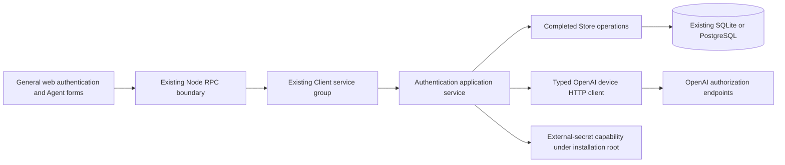
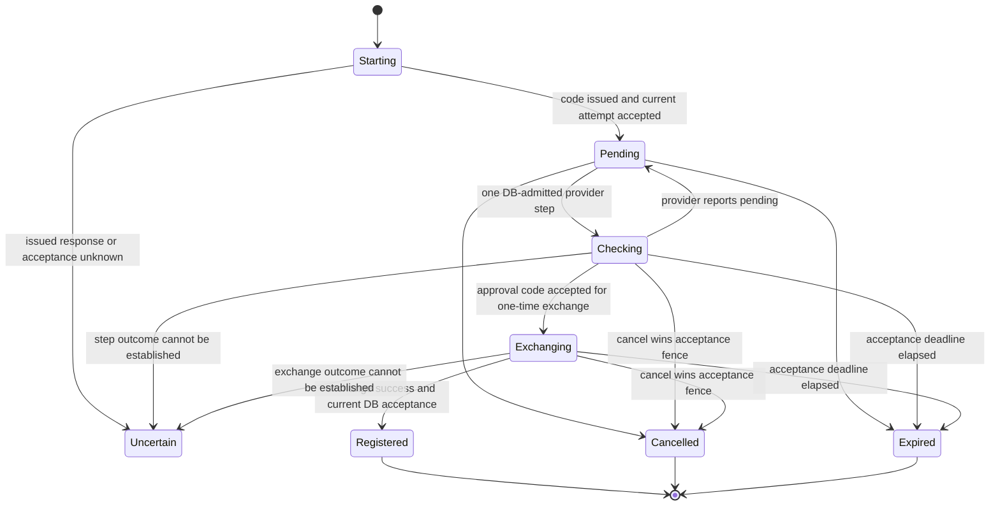

# Codex Authentication Setup Design

- Snapshot: `harness-261106`.
- Product authority: [harness-261106/REQ](../requirements/harness-261106-codex-authentication.md), including the 07:02 and 07:33 KST scope amendments on 2026-11-06.
- Technical authority: [harness-261106/ADR-D1 and ADR-D2](../adr/harness-261106-codex-authentication.md).
- This is an approved development Design awaiting complete implementation, not a current-system Spec.

## Scope and Observable Completion

Completion means a User/Team-owned authentication record is stored in the backend
and an authorized Agent can save a reference to it. Device Auth completion
registers directly after provider approval and token exchange. API-key save means
stored and usage-unverified. No account-review/second Register screen is present.

Nothing in this Design sends a credential to or receives a credential from a
Computer. There are no Connector authentication-application commands, Computer
credential files, application acknowledgements, application retries, model calls,
Codex process launches or runtime refresh service. No Control/PeerRelay/Provider
transport or TLS configuration is changed. Saved selection is not runtime readiness.

## Current Behavior and Gaps

Current [Agent admission](../spec/domain/agent-ownership.md),
[profile contracts](../spec/domain/agent-profile.md),
[account storage](../spec/domain/account-storage.md) and
[account transactions](../spec/domain/account-transactions.md) provide caller
identity, Team roles, Agent ownership checks, creation receipts and lifecycle
cleanup. No external-auth catalogue, device-attempt operation or saved auth
reference exists. Current owner-qualified queries do not create an additional
public/private Agent product type.

Current [`CredentialCipher`](../../../rust/crates/crypto/src/root.rs) encrypts
fixed session bearers and binds the installation root. External token bundles and
API keys need a distinct purpose and representation under D1; the historical
session recovery format remains unchanged.

The verified Azents reference performs device issuance, poll-once and token
exchange in the backend, keeping provider HTTP outside completed DB operations.
D2 adopts that integration boundary, not its Python runtime, Workspace schema,
model catalogue or inference behavior.

## Design Authority

- Design revision: `1`.
- Exact material authority ID set: `M1, M2, M3, M4, M5, M6, M7, M8, M9`.

| ID | Material mechanism | Authority | Classification |
| --- | --- | --- | --- |
| M1 | Backend-owned User/Team auth catalogue with current-role admission and secret-free projections | REQ-1, REQ-2, REQ-10; existing account/Agent authorization | required |
| M2 | External-secret protection derived from the existing root under distinct purposes, retaining session recovery unchanged | ADR-D1; REQ-11 | decided |
| M3 | In-process typed provider HTTP for device-code issuance, poll-once and code exchange; no acquisition worker or native runtime dependency | ADR-D2; REQ-3 | decided |
| M4 | DB-owned attempt/result identity, conditional single-step admission and late-result fencing around external I/O | M1, M3; REQ-3, REQ-9, REQ-10; completed-operation convention | derived |
| M5 | Direct registration on successful exchange, API-key saved/unverified, same-record recovery with identity checks and no secret readback | REQ-3, REQ-4, REQ-7; M1, M2 | required |
| M6 | Saved Agent-to-auth reference independent of secret material, atomic new-Agent selection and exact uncertain-result recovery | REQ-1, REQ-5, REQ-6, REQ-8, REQ-9; existing creation receipts | derived |
| M7 | In-use deletion guard and lifecycle-bound reference/catalogue cleanup without credential propagation | REQ-7, REQ-10; existing Team/Agent cleanup authority | derived |
| M8 | Existing UI shell with auth catalogue, computer-first creation, compact selection row and task-preserving auth dialogs | REQ-2 through REQ-6; approved product flow | required |
| M9 | Preserving schema preparation and regenerated typed contracts, retaining existing account/Computer semantics | REQ-5, REQ-6, REQ-10; current storage/preparation and RPC ownership | derived |

No material choice is hidden in a configurable alternate mode. Names, equivalent
local helper structures, file boundaries and fixture organization are agent-owned.
No version-history feature, increasing generation, root rotation, external vault,
worker queue, browser offline store or runtime key-delivery mechanism is introduced.

## Architecture and Ownership

- **General web** owns presentation and non-secret form continuation. It never
  stores or receives OAuth tokens. API keys are present only in the active input
  and mutation payload, not catalogue queries, query caches or replay receipts.
- **Client RPC** authenticates the current account and parses typed bounded
  input. It uses the current account-session admission, not a Provider key.
- **Service** owns bounded provider HTTP and preparation of protected results.
  It does not keep a DB transaction open while waiting on OpenAI.
- **Store** owns current roles, attempt admission, conditional acceptance,
  catalogue/ref changes and durable recovery results.
- **Crypto** provides purpose-specific authenticated protection, never business
  authorization. A decryptable value alone does not authorize registration.
- **ComputersService/Store** accept the selected reference during creation and
  independent selection changes. Providers/Connectors receive no credential ID
  as a new capability and no token bytes.
- **Admin** receives no secret-management or catalogue bypass. This is a bounded
  General User/Team feature; existing installation inventory remains unchanged.

### Lock and Transaction Discipline

Retain the current authenticated User and Team admission order. New operations
lock the owning User/selected Team as applicable, then affected authentication
rows in stable ID order, before existing sorted Provider and Computer locks when
combined creation/lifecycle work needs them. Agent selection belongs to the
Agent/Computer-locked operation. Team deletion collects its affected auth rows
and references before entering existing native-cleanup admission, preserving this
order. Do not lock a second User merely to inspect another Team member's record.

All catalogue publication and selection mutations are completed DB operations.
External HTTP, encryption preparation and response parsing occur outside those
transactions; acceptance rechecks current session/role, target and attempt.
Both database engines must implement the same logical predicates, including
conditional-update winners rather than a process-local mutex as authority.

## Durable Data and Contracts

Names below describe ownership and invariants; equivalent local layout is allowed.
New entity IDs follow the existing repository identity mechanism; caller Request
IDs retain the existing operation-identity contract.

### Authentication Record

Store one stable authentication identity with:

- exactly one User or Team owning scope;
- Codex authentication kind: ChatGPT account or OpenAI API key;
- display name and only available provider-confirmed account metadata;
- encrypted current secret and required cryptographic context;
- current successful mutation Request ID, timestamps and registration meaning;
- active reauthentication attempt identity when one exists.

OAuth tokens are separate from metadata returned to the browser. For ChatGPT,
retain access/refresh/optional ID token and provider expiry facts as acquired.
Do not export them as `auth.json`, invent a local Codex schema or perform refresh.
Email, plan and provider account ID are not Chapchoo User/Team IDs. Decode optional
provider claims for display only; unverified JWT decoding is not signature or
entitlement validation. The canonical provider account identifier used for
same-account reauth must come from the correct account claim, not email or `sub`
substitution. Unavailable required reauth identity rejects replacement without
modifying the old record.

Registration status means what this feature observed: ChatGPT acquisition
completed, or API key saved/usage-unverified. Expiring access-token metadata does
not itself prove permanent invalidation and does not initiate a refresh job.
Reauthentication can be started deliberately without a runtime failure detector.

### Device Attempt and Recovery Result

A durable attempt binds initiating User, owning scope, operation Request ID,
optional reauth target, initial target mutation identity, expiry, device material,
next allowed provider check and one active external-step identity. Provider device
identifier and verifier material are encrypted; only the intended user code/link
are returned to the authorized active interaction.

An operation/result record retains enough non-secret identity to recover an
accepted registration, cancellation or failure after a lost response. Completed
attempts do not retain duplicate OAuth token bundles. Expiry alone need not
physically delete recovery identity. Reuse existing DB retention/collection
boundaries where applicable; do not add a periodic worker as a hidden dependency.
Secret-bearing temporary fields are cleared when the owning operation becomes
terminal. No historical secret retrieval API exists.

A new logical reauth attempt explicitly supersedes the target's former active
attempt by exact identity. A late result from the former attempt cannot overwrite
the target. For independent new registrations, each explicit attempt is separate;
do not globally merge records by email, inferred account identity or another scope.
Exact request replay is not a new registration.

### Agent Selection

A saved selection is an optional reference from Agent to one authentication
record, with exact last accepted selection Request ID/result identity. It contains
no token copy and has no Computer-execution or Connector binding. Multiple Agents
can reference the same record. Concurrent removal and reference creation serialize
under the authentication row, so in-use checks cannot race a new selection.

Pre-feature Agents begin with no selection. There is no arbitrary backfill.
New-Agent acceptance requires an authorized selection and atomically stores the
Agent, Computer intent, selection and creation receipt. The selection participates
in new creation payload comparison. Historical accepted receipts retain their
original fingerprints and are recovered through the existing read-only
`agent_creation_result` path; they are not resubmitted as new creates with a
synthetic null credential. Do not add a permissive legacy create fallback.

Selection changes compare the expected current reference and preserve exact
Request ID recovery. Cancelling a browser dialog before submitting leaves the
saved reference unchanged; a submitted mutation with a lost reply is recovered
before another contradictory submission is attempted.

## External-Secret Protection

Extend the existing crypto owner with distinct fixed purposes for registered
external credentials and pending device material. Derive keys from the existing
root under D1; keep `protect_latest` and its fixed bearer envelope untouched.
Use the existing authenticated-encryption primitive with random nonce and full
tag. Associated data binds purpose, owning scope identity, record/attempt identity
and credential kind. Swapping ciphertext between owners, records, attempts or
kinds fails authentication.

Use explicit bounded secret value types and redacted Debug. Provider HTTP has
bounded time/body parsing; public key/name inputs obey bounded representation.
Input and token limits live at the owning typed ingress, not arbitrary JSON
storage. Exact equivalent limits/helpers are implementation details only while
they admit the documented provider shape and do not alter the approved product
contract. Malformed or oversized input yields a typed rejection, never truncation.

No root, OAuth token, API key, device verifier, authorization code, HTTP body or
raw provider exception crosses ordinary logs or browser catalogue DTOs. Do not
claim zeroization erases every library/OS copy. Root loss/compromise has the D1
blast radius; backup and restore retain the existing DB/root pairing contract.

## Device Authentication State and Concurrency

States are semantic alternatives in the owning attempt contract, not new global
Agent health or runtime readiness. Provider failure/rejection has a typed terminal
or retryable outcome; it is not converted into a generic empty catalogue.

1. **Start:** authenticate and admit an attempt under stable caller Request ID.
   Repeating that ID recovers its attempt/result, not another provider start.
   Perform issuance outside the transaction. Accept returned code only into the
   exact still-current unexpired attempt. A cancelled/expired issuance result is
   discarded from product registration; no global upstream revocation is claimed.
2. **Poll once:** status reads do not themselves imply an unbounded provider loop.
   A poll step is a bounded authenticated operation, admitted only when due and
   no other exact step owns the attempt. The browser follows the server's interval;
   terminal states stop polling. A second poller obtains current pending/in-progress
   state rather than exchanging the same authorization code concurrently.
3. **Exchange:** persist one-time exchange admission before dispatch. A successful
   provider response is prepared/protected, then final DB acceptance rechecks
   authority, exact active step/attempt, expiry, and reauth target. Registration
   or same-record replacement and the accepted result commit atomically.
4. **Cancel:** a conditional terminal transition prevents subsequent publication.
   Cancelling locally is not revoking the upstream account. If registration had
   already committed, report the committed result instead of claiming rollback.
5. **Restart/timeout:** pending attempts without uncertain issued work remain
   recoverable by authorized identity. Durable in-flight facts do not become
   unsent merely because a process disappeared or a timer elapsed. Read-only
   recovery can return a known accepted result; otherwise report uncertainty.
   Do not replay a possibly consumed authorization-code exchange. An explicitly
   requested fresh attempt supersedes the old one and uses a fresh provider flow;
   it does not pretend to complete or revoke the old external effect.
6. **Late success:** after supersession, expiry, cancellation, role loss or target
   mutation, the result cannot publish a new record or replace the target.
   Terminal responses preserve the original non-secret task and known prior record.

This retains process-owned capacity until started work actually ends, consistent
with current Rust async-effect ownership. A disconnected browser waiter does not
spawn an unowned retry or prove a provider effect stopped. No autonomous polling
service, queue consumer or timer-based exchange replay is introduced.

## Catalogue Operations and RPC Surface

Add typed Client-group operations for catalogue list/detail, API-key registration,
name changes, deletion, device start/poll/cancel/recovery, reauth start and Agent
selection mutation/result recovery. Method names and message layout are local
implementation choices; their authority and success meanings are not.

- Reads require current scope access and return bounded secret-free projections.
- Mutations use caller Request ID with canonical typed payload matching. Secret
  inputs must not enter plaintext receipts; any required secret input comparison
  uses a keyed context-bound fingerprint under the external-secret crypto owner,
  not a public raw hash of a caller's key.
- Mutation replay first checks current caller authority and its exact accepted
  result. A repeated completed call never generates another Agent or credential.
- Device poll is an explicit mutation/advance operation; a separate status read
  only reads retained state. Browser/network clients do not blindly auto-retry
  an advance operation after an uncertain reply.
- API-key registration saves protected nonempty bounded input; it calls no model
  and does not fetch an entitlement/funds catalogue. Its accepted result can be
  recovered without sending the raw key back.
- Reauth target ownership and kind must match before provider I/O and again at
  acceptance. Same-account replacement preserves ID and all Agent references.
  Different or unavailable account identity does not replace the old record.
- Key replacement explicitly retains the same record and references and discloses
  that the selected API billing project may change. Cancel/failure preserves old
  secret/configuration. It adds no propagation operation.
- Deletion checks live selections under the same transactional lock as reference
  admission. A referenced record returns an in-use outcome, not cascading Agent
  deletion or silent deselection.

Use the existing Protobuf authority and generated Node client; regenerate changed
contracts instead of hand-editing generated output. Retain the existing account
Origin, cookie, invalid-session withdrawal and safe error boundaries.

## UI and Task Continuation

General User settings and Team settings expose the appropriate AI connection
catalogue. Keep the approved first-connect empty state, account cards, compact
Agent execution/auth row and existing navigation icon style. Team context changes
visibility of catalogue scope, not an Agent public/private mode. Current Agent
read/action authorization still applies.

Creation is registered environment -> authentication -> existing profile. Preserve
image choices, name/handle/color, cloud section/card and back/next values. Register
in place without navigating away from the owning form; successful Device Auth
returns directly with the new eligible reference selected. Existing-Agent selection
uses the same catalogue picker but only submits that Agent's reference.

API-key input is masked with a temporary reveal toggle, official issuance link
and separate API billing notice. Do not keep raw input in query caches or browser
persistent storage. Clear it on cancel/success; retain only the accepted result ID.
Device codes are visible only in their intended active interaction. No intermediate
account confirmation is restored. Naming an acquired record and later editing its
display alias use normal catalogue management, not a mandatory second registration.

SSR loads required list/detail/selection snapshots through the current server
rendering boundary. Hydration starts from that same snapshot; in-place dialogs
own transient draft/progress. On successful mutations invalidate related catalogue
and Agent queries. Preserve explicit stale/error recovery rather than interpreting
an unavailable read as an empty list. Loading a different scope cannot reuse
another scope's catalogue as placeholder data.

The UI displays unselected or the saved record identity. It does not add applied,
application-pending, application-failed, per-Computer retry or partial-propagation
controls. Existing Computer controls and chat-local presentation remain unchanged.
Frozen visual snapshots retain their historical meaning; their superseded review
and propagation illustrations are not current product authority.

## Lifecycle and Cleanup

User-owned credential management uses the owning User; Team-owned management uses
current Owner/Manager. All current Team members may select an eligible Team record
for an Agent they may manage. Lists/details never grant secret retrieval.

Agent removal deletes its selection link, not an otherwise reusable credential.
Team departure/kick reuses existing Agent cleanup admission and detaches affected
selection references under the same logical authority boundary; it transfers
neither Agent nor authentication ownership. User-owned authentication remains with
its User. Team deletion invalidates pending Team attempts, clears selection links
for the deleting Team's Agents, removes Team-owned catalogue material and proceeds
through the existing lifecycle cleanup gates. Authentication dependencies must not
keep an otherwise collectible Team tombstone alive after cleanup.

A reference does not authorize use after membership loss. Pending registration,
reauth and selection acceptance all recheck current authority. No external revoke
endpoint is invoked by record deletion or cancellation. Removing stored credentials
from the product is not a claim that OpenAI revoked their grant.

## Migration, Rollout and Rollback

Add the new catalogue/attempt/result/selection structures through explicit
preparation for SQLite and PostgreSQL. Retain existing DB/root binding. New IDs
use current compact persistence representations; ownership and selection FKs/indexes
must match actual deletion semantics. Enforce exactly one User/Team owning scope,
unique operation Request identity and FK integrity on both engines.

Preserve every existing Agent, Computer, execution, Provider, native resource,
credential session, creation receipt and accepted fingerprint. New selection rows
are absent for existing Agents. Only new create requests require the selected
credential. Existing read-only creation-result lookup remains available for old
uncertain accepted requests; it does not run new creation admission.

No startup auto-migration, compatibility flag, alternate legacy creation mode or
silent network fallback is added. Deploying code does not authorize preparing a
production DB. Coordinated backup/preparation and matching application/contracts
are rollout obligations. A down migration must refuse destructive erasure of
registered secrets or references. After data is written, rollback requires the
existing paired backup/restore or a preserving forward correction, not running old
code against an unsupported new schema and claiming recovery.

## Removal and Replacement

| Existing unit or behavior | Removal authority | Replacement or remaining authority | Boundary | Absence verification |
| --- | --- | --- | --- | --- |
| Current single creation composition without the authentication step | REQ-5 | Approved three-step composition, existing profile components and Provider eligibility | New creation UI only | Component flow and E2E prove all existing fields retained in order |
| New-create request/receipt comparison without auth selection | REQ-5, REQ-9, M6 | Auth-bound new request; preserve historical receipts and read-only result recovery | RPC/Store/generated client cutover | Both-engine populated fixtures prove old accepted identities remain recoverable |
| Agent projection without a saved authentication reference | REQ-6, REQ-8 | Optional secret-free selected-record identity | General Agent views and generated contracts | Pre-feature no-selection and mutation-recovery fixtures |
| Intermediate account-review/second Register proposal | REQ-3 amendment | Direct completion after exchange | New feature UI only; no production implementation currently exists | Stories/component/E2E contain no second required registration step |
| Computer-delivery and partial-propagation proposal | REQ-8/REQ-11 scope amendment | None in this snapshot | Design and new feature UI | No Control/Connector/Provider command or application status introduced |

There is no production external-authentication implementation to remove. Do not
replace existing account sessions, root binding, Team authority, Computer lifecycle,
chat execution or Provider authentication. Remove only obsolete proposal-owned
fixtures if introduced during implementation; historical HTML archives are not
maintained production code or rewritten as current designs.

## Observability and Operations

Use typed outcomes for provider-pending, due-later/in-progress, rejected/unavailable,
expired/cancelled/superseded, committed result and uncertain external completion.
Logs may carry operation name, non-secret internal correlation IDs and bounded
error category. They never carry provider payloads, authorization codes, tokens,
user codes outside their UI interaction or provider request headers. Unexpected
errors retain private sources at the existing owning logging boundary; do not
convert them into successful empty responses.

No new operator key, secret worker, Codex runtime or Computer endpoint is required.
Provider calls use certificate-verified HTTPS and existing backend outbound
configuration. Test transport injection is a test fixture boundary, not a public
arbitrary issuer URL or production SSRF-capable configuration. No TLS bypass.

## Test Strategy

### E2E Primary Matrix

Retain a minimal real-browser product matrix, with deterministic provider fixture
and real Chapchoo services/database/client boundaries:

1. Start Device Auth from an empty scoped catalogue, approve through fixture,
   return directly to a registered card without account review; cancel/expiry
   retains the originating task without registration.
2. Three-step creation registers/selects in place and preserves profile input;
   accepted creation and chosen reference survive a lost response without a second Agent.
3. Existing-Agent selection changes only that reference; same-account reauth and
   API-key replacement preserve record identity/references; in-use deletion is blocked.
4. Team Owner/Manager management and Member use follow the confirmed role contract;
   role withdrawal during pending auth prevents a new commit.

Exact copy, masking, official-link target, icon and responsive combinations stay
in app-owned component tests, not an exhaustive E2E multiplication. Selection
and stored credentials require no Computer credential transport fixture.

### Lower-Layer Verification

Crypto tests cover purpose/owner/record/kind swaps, tampering, wrong root, bounded
input and redacted formatting without rewriting tests of dependency primitives.
Both-engine Store tests cover simultaneous poll admission, cancellation versus
acceptance, target supersession, membership loss, exchange response loss, repeated
Request IDs, in-use-delete races, Team cleanup and preserving migration of existing
accepted creation receipts. Use barriers/owned result handshakes, not fixed sleeps.
RPC tests cover typed ingress, absent secret fields and invalid-session authority.
Provider HTTP tests replay captured protocol shapes with synthetic credentials,
pending status, rate limits, rejected/malformed/oversized bodies and injected
transport uncertainty. Assert owned behavior rather than provider implementation.

### Fixtures, Evidence and CI

`testenv/chapchoo` supplies isolated services, SQLite/PostgreSQL and narrow fake
provider lifecycle/seed support only where required by the E2E runner. Browser
scenarios remain in the E2E app. The fake authorization server returns deterministic
synthetic codes/tokens and explicit synchronization points. It must not require a
real OpenAI account, mutate default local auth files or contact a paid model.

Evidence includes exact source SHA, command, fixture prerequisite identities,
test outcome and bounded redacted failure artifacts. Synthetic E2E is not live
provider compatibility or deployment evidence. CI runs required deterministic
checks using the existing quality and E2E entrypoints; it does not treat a skipped
live check as passed. An optional human-authorized live acquisition smoke test
must record installation/provider prerequisites and avoid model inference; absent
credentials or permission is an explicit skip, while an opted-in failed login is
a failure. No actual tokens or signed URLs go into CI artifacts.

## Authority and Feasibility Audit

Each M1-M9 traces to confirmed Requirements, accepted D1/D2 and unchanged repository
contracts. No mechanism carries Computer credentials. No out-of-scope native input
or refresh feasibility question remains a completion gate for this snapshot.

| Requirement | Mechanism | Repository/evidence basis | Design feasibility |
| --- | --- | --- | --- |
| REQ-1 | M1, M6 | Current User/Team and Agent admission, new reference FK | feasible |
| REQ-2 | M1, M5, M8 | Current roles/SSR; explicit new catalogue projections | feasible |
| REQ-3 | M3, M4, M5, M8 | Existing Azents issuance/poll/exchange; D2; current completed Store operations | conditional on external provider/installation availability; no missing internal architecture |
| REQ-4 | M2, M5, M8 | Existing crypto building blocks and no-provider-call storage path | feasible |
| REQ-5 | M6, M8, M9 | Existing atomic create and historical result lookup | feasible with preserving receipt tests |
| REQ-6 | M6, M8 | Existing owned-Agent mutation admission | feasible |
| REQ-7 | M1, M4, M5, M7 | Conditional acceptance and locked catalogue/ref mutations | feasible; account identity parser must use correct claims |
| REQ-8 | M6, M8 | Backend reference projection only; no runtime interaction | feasible |
| REQ-9 | M4, M6 | Existing uncertain-effect discipline and durable Request recovery | feasible; unknown exchange cannot be represented as definitely unsent |
| REQ-10 | M1, M7, M9 | Existing Team/Agent cleanup and preserving schema authority | feasible with both-engine race/cleanup tests |
| REQ-11 | M2, M3, M9 | D1/D2; current root binding and no extra runtime/key dependency | feasible technically; provider applicability remains installation-specific |

These are design-time feasibility conclusions from source inspection and the
specified deterministic verification plan. The feature tests have not been
implemented or run. Existing Azents code and public protocol source establish a
credible integration, not guaranteed provider availability or permission for every
hosted/commercial deployment. Record applicable provider restrictions in installation
guidance; do not infer a universal grant or silently make SIWC mandatory.

## Non-Blocking Risks and Alternatives

Provider protocol or policy changes can require an adapter update. Missing account
metadata must remain absent, not invented. A one-time exchange result lost between
provider completion and durable acceptance may require a fresh authorized device
attempt; no architecture can infer a missing response from a timeout alone.
These boundaries are exposed explicitly rather than hidden by automatic retries.

D1 rejected a second root; D2 selected bounded backend HTTP rather than a native
runtime dependency. There is no second retained mode to configure or fall back to.
Computer credential consumption and runtime refresh require separate future scope;
this document neither solves nor implements them.

## Design Approval

- Mode: Collaborative.
- Decision owner: requester.
- Approved on: 2026-11-06 at 07:41 KST.
- Approved Design revision: `1`.
- Approved authority IDs: `M1, M2, M3, M4, M5, M6, M7, M8, M9`.
- Submitted revision: `1`.
- Submitted exact authority IDs: `M1, M2, M3, M4, M5, M6, M7, M8, M9`.
- Submitted scope: backend authentication catalogue and acquisition/management,
  secret protection, saved Agent selection, preserving migration and verification.
- The requester also explicitly authorized implementation on the approval date.
  Merge and deployment remain unauthorized. A material change requires renewed
  authority/feasibility checks and revision-bound approval.
