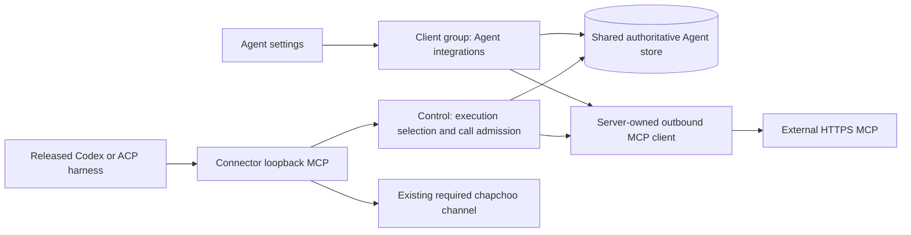

# Agent Integrations: First MCP Connection Design

- Snapshot: `mcp-261126`
- Document reference: `mcp-261126/DESIGN`
- Authority: [mcp-261126/REQ](../requirements/mcp-261126-agent-external-connections.md) and [mcp-261126/ADR](../adr/mcp-261126-agent-external-connections.md).
- Baseline: `875f69c`. This is an unimplemented design.

## Current behavior and gap

Agent details already combine owner-scoped settings, model connection and Computer presentation. [Agent ownership](../spec/domain/agent-ownership.md) supplies private ownership and current Team membership. The [native preparation path](../spec/domain/native-harness.md#actual-start-server-tools) currently sends one required Connector-local MCP declaration and checks that the released harness discovered `send`. The [built-in server-tool channel](../spec/domain/server-tools.md) is scoped to a live route and a conversation; its invocation semantics are not generic external dispatch. [Configuration refresh](../spec/domain/agent-instructions.md#common-refresh-and-continuing-input) preserves the same conversation, retains accepted input, and safely resumes when a selected configuration changes. No external Agent integration catalogue or outbound MCP path exists in this baseline.

## Architecture and authority

- The Agent integration store owns saved configuration, not native registration or tool outcome. The Client group manages it using the existing authenticated owner boundary. The Control group resolves selected data and admits calls under the current component route. Group topology, not the web process or the Connector, determines which server process performs a given operation.
- The same outbound client policy is used wherever server-side testing, discovery or invocation runs. No new service deployment, inbound Internet-facing MCP endpoint, or new universal native plugin system is required. Connector-local MCP is only a projection of integrations that provide tools, not the integration domain model.
- Keep the existing `chapchoo` handler, its required readiness, publication fence, and scoped Codex approval exception. External work uses independent bounded resources on the shared loopback listener and authenticated component connectivity. It cannot consume all capacity that the built-in path requires.

## Management, data, and contracts

Use one stable, repository-owned integration identity with its Agent association, display name and typed kind. The common record carries no endpoint or credential mandate. MCP settings own the endpoint and the tagged authentication form (none or protected Bearer). Identify exact settings privately for cache and call selection; there is no product-facing revision history, enable flag, transfer, or shared catalogue. A future API-backed kind can occupy the same management collection with its own typed settings and service code, without rewriting existing MCP records or registering a harness tool server unless that kind actually provides tools.

Extend the existing owner Client boundary with list, create, update, delete and test operations. Their inputs and results are typed, not an opaque provider-defined settings map. Owner/Team membership is rechecked at mutation and at test admission. Use repository transaction and request-outcome patterns for mutations: a repeated request recovers the committed metadata rather than duplicating an add or guessing whether a lost response committed. No external operation is performed by save or delete. Settings reads expose display name, permitted URL and authentication kind, never the saved token. An edit on the same endpoint can keep the existing Bearer by omission or replace it explicitly; changing the endpoint does not silently send the old credential to a different destination. Selecting no authentication removes the saved Bearer for that record. Use scoped encrypted storage and redact secret-bearing paths; credentials enter neither local route declarations nor logs or ordinary diagnostics.

Place **MCP servers** on Agent details between execution and Computer settings. Render the authorized saved list through the existing web request/session boundary, keep edit input in the dialog, and reconcile against authoritative mutation results. Add and Edit use the same fields, with a masked token only for Bearer and no prefill of the stored value. Delete lives in Edit. Show the server-confirmed outcome; a lost reply remains uncertain until reconciled, independent of tool activity. Show the optional test's list count or failure beside the test control. Do not apply a test result to a changed draft. Test requires no Computer or harness and never sends `tools/call`.

## Outbound MCP profile

Use supported `rmcp` Streamable HTTP client APIs in strict `server/discover` mode for only `2026-07-28`, with a policy-configured HTTP client and no legacy fallback. The client verifies public HTTPS at the actual dial, preserves certificate hostname verification, and prevents redirects or inherited proxy routing from escaping this policy. Apply it to both initial and subsequent connections. Use the integration's own credentials, not authority from upstream metadata, Connector headers, tool names or tool arguments. No SDK retry may duplicate a possibly dispatched `tools/call`. Socket/request timeouts and API limits also bound discovery and response retention; cancellation is not external rollback.

List through the complete cursor sequence, rejecting cycles, excess size/page count and incomplete results without publishing a partial list. Handle JSON and supported Streamable HTTP SSE response forms via the SDK. Test can use the current form values or an exactly matching stored credential from an authorized record. Runtime discovery instead uses a server-selected saved configuration. Neither reports a general connection failure as a confirmed protocol mismatch; distinguish confirmed version incompatibility, authentication failure, missing capabilities, unavailable network and valid empty catalogue. External method set is tools discovery and invocation, not subscription, resource access, prompts, follow-up input, or server-provided authentication workflows. Transport-owned or credential headers are never overwritten by tool data.

## Catalogue selection and native application

1. Before the next execution, resolve current saved integrations for the exact Agent and route. Reuse a complete fresh tool list only for its matching connection settings and credential. The earliest expiry across a paginated result governs reuse; a zero TTL requires rediscovery on the next execution, not on every local list read. Cache entries are load reduction, not authority, and losing the cache is a miss; cross-Agent sharing is not needed. In-flight read results cannot publish against superseded settings.
2. Refresh misses/expired entries in parallel under one bounded optional discovery budget. At the deadline, select usable lists and typed unavailability for the others. Do not wait on independent external work to make the built-in tool ready. A successfully empty catalogue and an unavailable integration have different observations. Preserve a redacted per-integration reason for the execution; present a known problem through the existing failure/activity reporting boundary when it affects the task, rather than adding an activation warning or a fake callable tool.
3. The existing configuration owner compares effective native supply, not timestamps, tokens or unsorted catalogue responses. Consider additions, edits, removal and changed tool content at the next execution even if the same native thread persists. Bind the selected external declarations and catalogues to that actual preparation/execution; a late preparation cannot overwrite a newer selection. Reuse unchanged supply. For changed supply, reuse the existing safe exact-context resume path. A separate live refresh mechanism is outside this design. Do not start a new conversation or interrupt running work to apply settings. Unrelated messages and `send` remain available when an external list is missing or a local optional declaration fails.
4. Give each selected external integration one distinct optional loopback declaration with stable identity independent of user display name. Resolve names under harness constraints without shadowing `chapchoo` or independently configured servers. The endpoint is bound to an admitted native lifetime and integration; the local capability and exact component route both matter. Connector supplies the prepared list locally, with no upstream wait at harness `tools/list`. Codex uses its supported App Server configuration and ACP its complete New/Resume list. A transport the adapter does not advertise is not substituted by a fork or a fallback. Monitor actual optional adoption separately from the existing built-in readiness check.
5. Preserve the harness's native approval decisions. For Codex, enroll managed optional server identities in the existing approval observation/response handling where the currently narrowed `chapchoo` parser would otherwise miss a legitimate approval request. Verify the exact thread/turn and declaration identity, and retain the built-in exception only for its existing `send`. Do not forward arbitrary upstream elicitation as a new Chapchoo confirmation. ACP retains its native permission request path.

## Call and deletion lifecycle

The component request identifies the integration, the applied execution context and the selected tool; it supplies JSON arguments, not a destination or credential. Decode a typed envelope, reserve bounded external execution capacity, and obtain fresh authoritative admission immediately before handing the operation to the outbound owner. At admission, revalidate the component route, actual Agent/execution, selected declaration/tool and current integration record with matching settings. A bounded local queue, if used, cannot authorize a call before this point. Capture the authorized settings in the admitted operation; never rebind it to a replacement token, endpoint or re-created integration.

Admission and deletion serialize on the authoritative Agent integration in the shared store, with equivalent ordering in PostgreSQL and SQLite. Neither holds a transaction open for upstream I/O. A successful delete commit immediately removes the saved item in settings and ends new admissions across instances. Stale local declarations no longer provide admission and are removed from the next native selection. An already admitted call proceeds independently, potentially sending or finishing after the delete commit. Deletion does not inspect or cancel it, add a drain state, or wait for the result. The outbound task is bounded by its own transport and local work lifecycle; an uncertain remote result cannot on its own prove local resources drained or hold an integration deletion open.

Translate complete supported results into the native tool result path: text, structured JSON including structured-only, and tool-reported failure remain distinct. The representation must preserve the JSON value; when a supported native protocol cannot carry that shape directly, verify lossless JSON text presentation via the tool result surface. Report unsupported content or follow-up requests without claiming successful work. Report positively blocked or unadmitted work separately from possible dispatch with unknown outcome. Route/observer loss after possible dispatch does not authorize replay. Chat Stop retains existing local control behavior and does not promise external rollback. Do not introduce durable external result retrieval or a replay queue.

## Operations, migration, and rollout

Additive same-sequence SQLite and PostgreSQL migrations add Agent-owned integration storage on the existing preparation path; preexisting Agents start with no external integrations. Keep credential protection tied to installation key rules. Upgrade the backend, web and Connector boundaries coherently using the existing deployment process; missing component contract support must not be advertised as usable external tools and must not regress `send` for legacy Computers. No upstream profile fallback or special deployment sidecar. Rollback stops the external feature before executing old binaries; retain persisted data for forward recovery under the repository's existing version/backup policies rather than claiming downgrade of the database or erasing records. Update the applicable living spec pages only after the behavior exists and is verified.

Use finite independent budgets for HTTP connections, response and tool payload bytes, optional catalogue preparation, and external invocation capacity. Record bounded outcome categories, timing and counts for discovery, application and invocation. Do not record authorization headers, upstream secrets, tool payloads, or full endpoints as metric labels. Local teardown remains distinct from external outcome; only verified owned local work can gate native physical retirement, and existing built-in effect evidence remains unchanged.

## Test Strategy

| Evidence | Scope and main assertions |
| --- | --- |
| Browser E2E: one primary flow | In `@chapchoo/e2e`, an Agent owner tests and saves a Bearer MCP fixture connection, then completes representative tool work in the same Chat on released Codex using a structured-only result. Fixture counters prove the settings test never invoked the tool. Keep other combinations out of the browser journey. |
| Targeted native and component verification | Reuse `testenv/chapchoo` for isolated real backend/Connector and released Codex/ACP start, native approvals, exact resume, no-auth and Bearer use, pagination, text and structured-only results, same-name tools on two healthy connections plus a stalled third, cache TTL, add/edit/delete between executions, and safe physical retirement with unknown remote outcome. An editor component test verifies the confirmed deletion presentation independently of tool activity. Stub the model provider behind the released client for deterministic native behavior; do not patch the harness. |
| Storage and transport verification | On both database engines, use explicit barriers for delete-versus-admission, including Client/Control on distinct processes; assert exactly the commit winner, no post-delete admission, and no deletion dependence on the pre-admitted call. Check encryption context and redacted projections, role boundaries, forbidden media/header cases, DNS/address policy through the actual dial, redirects, proxy settings, reconnect, protocol mismatch, stream bounds and non-replay. |

Seed a disposable private Agent and another unauthorized actor; use distinct synthetic token values and deterministic tool names/results. A fixture may exercise an isolated test trust root and controlled DNS/network provided by testenv; production address and certificate checks are not weakened or bypassed by a deployment flag. Pin the actual harness artifact versions and record the authentic native paths exercised. Record fixture request counts and ordering, selected/applied identities, output evidence and redacted logs. Extend the existing browser-E2E CI lane and relevant lower-layer tests; missing required prerequisites or failed assertions fail the relevant acceptance lane. Can run optional live provider checks only with explicit disposable credentials and prerequisites; record a skip when absent, and never treat a skip as proof of compatibility. Official vendor accounts or production services are not needed for deterministic release verification.

## Feasibility and authority review

| Requirement | Assessment at the baseline |
| --- | --- |
| REQ-1 and REQ-6 | Feasible at design level: Agent ownership, request/session wiring and Agent detail surface exist; the common kind boundary can add an API-backed kind without changing MCP ownership. Schema and UI are new. |
| REQ-2 and REQ-3 | Conditional: the pinned `rmcp` client exposes strict discovery, paginated tool listing and an HTTP-client injection point; existing credential protection can be purpose-bound to Agent records. Verify actual address enforcement, retry semantics, response forms and post-replacement correctness end to end. |
| REQ-4 | Conditional: existing generated Codex and ACP paths support HTTP declaration and exact resume, but currently provision the built-in catalogue. The Codex approval parser is presently narrowed to `chapchoo`. Multi-registration, adoption, error observation, JSON encoding and native permission handling require positive evidence on the supported releases. |
| REQ-5 | Feasible at the transaction boundary using the existing shared store; conditional on bounded isolated external work and delivery of distinct outcomes through the supported native path. The deleted setting need not track an upstream effect. |

Each requirement maps to the authority table below. Source-level feasibility and expected tests are not implementation or live interoperability evidence. If standard harness interfaces cannot meet same-conversation application, approval or failure isolation, or the supported transport cannot enforce D3, stop that lane and revisit the affected authority rather than adding a fork, a permissive fallback, or silently narrowing the product contract.

## Design Authority

- Design revision: `1`

| ID | Material design mechanism | Authority | Classification |
| --- | --- | --- | --- |
| M1 | Agent-owned integration identity and shared owner management with typed MCP settings | `mcp-261126/REQ-1`, `mcp-261126/REQ-6`, `mcp-261126/ADR-D1` | decided |
| M2 | Agent detail management and optional test with redacted results | `mcp-261126/REQ-1`, `mcp-261126/REQ-3` | required |
| M3 | Per-integration optional Connector-local declaration and authenticated component relay; unchanged built-in path | `mcp-261126/ADR-D2`, [Built-in server tools](../spec/domain/server-tools.md) | decided |
| M4 | Encrypted credential binding and common public HTTPS, external revision and no automatic fallback | `mcp-261126/REQ-2`, `mcp-261126/ADR-D3` | decided |
| M5 | Bounded backend selection and TTL refresh; next-execution application through supported native configuration ownership | `mcp-261126/ADR-D4`, [Configuration refresh](../spec/domain/agent-instructions.md#common-refresh-and-continuing-input) | decided |
| M6 | Preserve native approvals and represent supported results and explicit failure states | `mcp-261126/REQ-4`, `mcp-261126/REQ-5`, `mcp-261126/ADR-D2` | required |
| M7 | Shared authoritative delete/call admission ordering; delete success independent of existing work | `mcp-261126/REQ-5`, `mcp-261126/ADR-D5` | decided |
| M8 | Bounded independent external resources and no replay of possible effects | `mcp-261126/REQ-5`, `mcp-261126/ADR-D2`, `mcp-261126/ADR-D3`, `mcp-261126/ADR-D5` | derived |

## Removal and Replacement

No persisted external-integration feature exists at the baseline; there are no old records, activation controls, outbound gateways or feature tests to remove. Keep the built-in provider, route, approval exception, catalogue and tests. Extend the preparation representation, which currently supplies only the built-in declaration, to include the selected set of optional declarations. D2 and D4 authorize this adaptation in the Codex/ACP declaration materialization and application evidence. Verify zero-external compatibility and supported New/Resume adoption of the exact selected set, including absence of a removed registration. The superseded pre-send deletion fence was a proposal, not implemented behavior to migrate.

## Design Approval

- Mode: `Collaborative`
- Decision owner: requester
- Approved on: 2026-11-26
- Approved Design revision: `1`
- Approved authority IDs: `M1`, `M2`, `M3`, `M4`, `M5`, `M6`, `M7`, `M8`
- Approved scope: Agent integration management, the first external MCP type and its server-owned transport, Connector and released harness integration, and commit-time deletion independent of already admitted calls.
