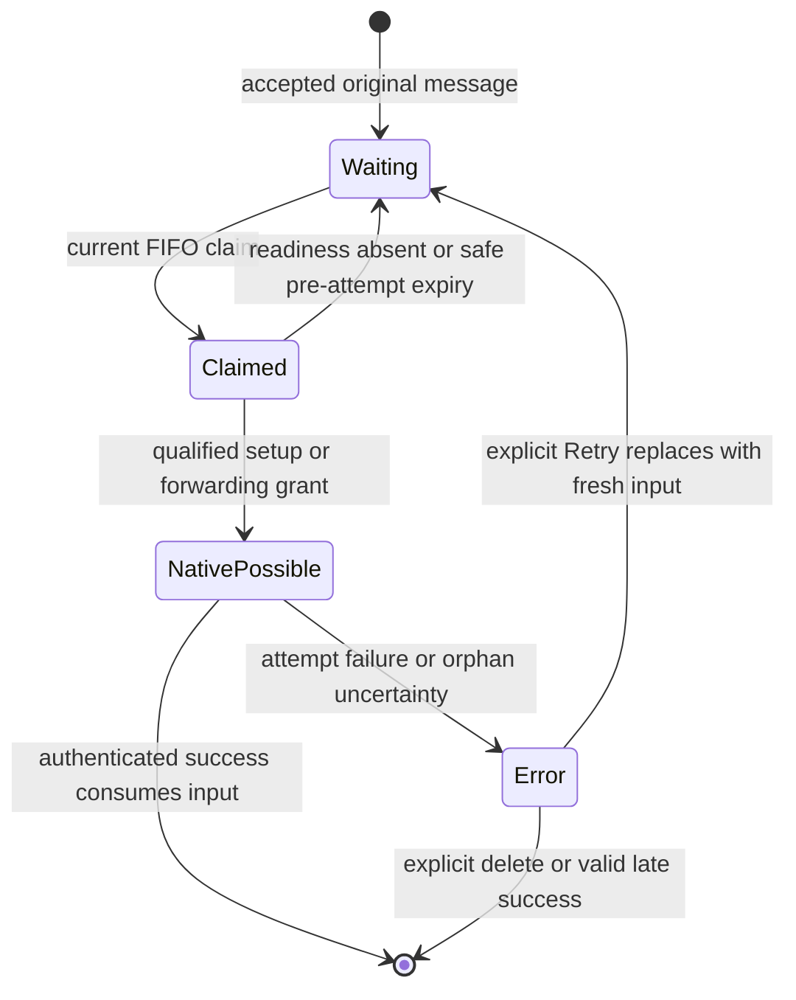

# Messages Before Computer Readiness Design

Authority: [Requirements](../requirements/messaging-261116-deferred-computer-input.md) and [ADR](../adr/messaging-261116-deferred-computer-input.md). No external product-design document is involved. Delivery is one focused implementation PR after the independent UI PR #137.

## Current Behavior and Gaps

Input acceptance currently starts a process-owned attempt and a consumer lease immediately. A missing Connector makes the processor return and turns the retained row into Error; orphan expiry does likewise. No durable readiness dispatcher claims work after restart. Source-loading admission also prevents several ordinary messages during preparation. The browser requires running/connected readiness for Send.

The existing input row already owns original text, request recovery, failed-item handling and successful consumption. Native setup and forwarding have separate durable POSSIBLE facts. Computer lifecycle admission independently owns Provider locks, current request, saved environment and native uncertainty. Reuse these boundaries; do not put physical effects in an acceptance transaction.

## Architecture and Ownership

### M1: One durable waiting message

All fresh product inputs enter readiness waiting under the existing outgoing input identity. Preserve the PENDING/ERROR attempt representation and add explicit readiness-waiting, nonsecret submitting-session binding, queue order, applicable wake predecessor and processing-claim metadata. Waiting is not an attempt error and owns no process task/body permit indefinitely.

Allocate queue order under the existing locked conversation/Computer admission boundary. It is an ordering value, not a versioning API. Exact request recovery returns the existing row without another insertion, wake permission or dispatch. Explicit Retry remains atomic replacement with a fresh identity and ordering position. Existing Error rows are not automatically retried and do not block later eligible waiting inputs; a current PENDING predecessor does block later dispatch. No queue-specific composition mode is introduced.

### M2: Bounded server-owned rediscovery

The existing ConversationInputService lifecycle owns a bounded dispatcher alongside its consumer/reaper and InputWork. Short submission persists acceptance and releases its memory/task reservation. The dispatcher scans bounded metadata pages, including after backend restart, and reserves existing processing task/body budgets before loading an original body. No browser request or poll owns dispatch. Shutdown closes admission, stops rediscovery and drains owned work/reaper failures explicitly.

Wake examination is independent of delivery FIFO: a newly submitted message behind older waiting text must still be able to wake a Computer after an explicit Stop. Delivery claim is conversation-local FIFO among PENDING rows. Multiple servers may observe metadata, but completed Store claims serialize ownership; no in-memory-only deduplication is authoritative.

### M3: Claims and the native boundary

Each claim receives an opaque fresh identity and a database-time expiry. Renew, release and finalization compare that exact identity. Before input-owned setup mutation or a new text-forwarding grant, the same completed Store operation checks the expected claim, active non-waiting PENDING state and unexpired DB-time lease under the existing authority locks. A stale worker cannot borrow a successor's renewed lease.

Expiry with no input-owned possible-native setup or forwarding returns qualified work to readiness waiting. Expiry after either possible-native boundary retains Error/uncertainty and cannot create another grant. Startup-owned preparation observed by an input is separate from an input-owned setup grant. A still-valid late authenticated native result keeps its existing authority and may consume an errored row. Known native success still atomically creates ordinary Chat and removes the outgoing row and dependent metadata.

Processor return before a possible-native boundary can release its exact claim back to waiting when readiness is absent. Actual errors and committed attempt uncertainty retain existing explicit recovery. Return after a committed boundary is never interpreted as proof of nonexecution. Claim tokens qualify processing ownership, not new user or native authority.

### M4: Queue-owned Cloud Start

Acceptance captures wake context only from the canonical Cloud Computer and the exact current lifecycle predecessor, atomically with the message. A stable wake request identity belongs to that accepted work. Local never gains wake authority. A server-owned queue pass revalidates current submitting-session/private-owner/Team context and admits Start through the existing completed lifecycle contract, including Provider capability, current-source management/original-storage evidence and execution/uncertainty gates. Physical Start/Restore remains existing reconciliation.

A crash between Start admission and queue wake settlement recovers that same lifecycle request, including Start target update on the exact active Stop; it does not create another operation or replace Stop's native identity. An intervening newer explicit Stop withdraws older wake permission. A worker cannot replace the captured predecessor with the latest value. Waiting text remains; a later manual Start or genuinely new accepted message can resume it. Missing eligibility preserves qualified waiting; actual startup failure remains independently visible and does not authorize physical replay.

### M5: Deferred authorization

Persist a reference to the existing submitting account session, never a bearer or copied secret. Deferred work must revalidate that session's current expiry/revocation and current private owner/Team/Agent/Computer authority. Internal service composition may use the existing valid stored session credential digest after that lookup; it never manufactures a digest from an asserted identity or exposes it on wire/logs. Each final authority-producing operation still revalidates ordinary account admission after locks. Session rotation follows the actual current session binding, not an expired browser-supplied token snapshot. Revocation/expiry cannot become an unconditional long-lived effect capability; retained failures remain subject to authenticated owner reads/recovery.

### M6: Source continuity

Admit matching loading-source messages into waiting, including multiple NotStarted inputs joining the same initial startup. Preserve each original submitted target for exact request recovery. First native binding preserves initial waiting inputs; input reads keep their existing initial-binding scope behavior. Actual unrelated source replacement retains its existing terminal boundary and never reinterprets attempted or stale-source input as fresh work. Restoring the same source resumes waiting through the current authenticated Connector and preparation facts. No second native context or automatic retry is inferred from missing ownership or observations.

### M7: Ordinary composition

The browser separates submission authority from native-effect readiness. Stopped/starting/restoring or loading-native-source state alone does not disable ordinary text submission; deletion, account/private-owner/Team denial and current reader authority still gate it. Native Stop/answer controls retain running/connected and exact-work restrictions. Use the normal Agent/message placeholder regardless of internal waiting. Preserve #137's focus/text-entry contract and acceptance-only draft clearing. Cloud/Local power qualification stays server-owned; no extra browser kind projection is required merely to perform Start.

## Interfaces and State

Existing upload bounds, request identity, acceptance response, retained-input reads and native reporting remain the public surface. Queue metadata is internal. Add only internal claim context at native setup/forwarding admission and service-owned dispatch APIs; regenerate protocol code only if an actually necessary wire change is found. No external broker, optional runtime mode, additional configuration, generic versioning or legacy fallback is introduced.

## Migration, Rollout and Rollback

Use an additive preserving migration for SQLite and PostgreSQL. Historical bodies, IDs, source/preparation/delivery evidence, Error and unresolved rows remain unchanged and are not granted new waiting authority. New nullable session/wake/claim metadata distinguishes new qualified accepted work. Do not rebuild the existing PENDING/ERROR CHECK solely to name waiting. Index bounded candidate/FIFO queries. A downgrade must refuse to discard live new waiting/claim/wake state; it must not silently strand accepted inputs under the old process-only behavior. Standard service deployment composes the dispatcher; no live database or cluster mutation is authorized by this implementation task.

## Removal and Replacement

| Existing behavior                                              | Authority                        | Replacement/boundary                                                                          | Absence verification                              |
| -------------------------------------------------------------- | -------------------------------- | --------------------------------------------------------------------------------------------- | ------------------------------------------------- |
| Fresh acceptance immediately owns a bounded processing attempt | REQ-1, REQ-3, D1                 | Short durable acceptance followed by explicit queue claim                                     | Fresh/recovered admission tests and restart drain |
| Every orphan PENDING becomes Error                             | REQ-3, M3 derived from no-replay | Only possible-native work retains terminal uncertainty; pre-attempt work returns to waiting   | Expiry/claim/grant races on both DBs              |
| Readiness-only Send and loading-source rejection               | REQ-1, REQ-4                     | Current owner submission authority and matching-source waiting admission                      | Browser/component and source tests                |
| A process-only wake follow-up would leave acceptance unowned   | REQ-2, REQ-5, D2                 | Prevent that replacement path; use persisted wake context and queue-owned lifecycle admission | Crash after Start and Stop-race tests             |

Existing native grants, failed-item explicit Retry/Delete, upload bounds, ordinary Chat receipts, genuine failure/status controls, lifecycle safety gates and unrelated source replacement remain authoritative.

## Test Strategy

Primary user journey: the real browser/Docker core flow submits ordinary messages while a Cloud Computer is stopped, observes automatic startup and eventual original-order delivery without another Send. Extend the existing model-free conversation fixture to hold readiness explicitly and verify restoration/restart drain where the process fixture permits deterministic control. Use one focused core browser/Docker scenario rather than multiplying all combinations into E2E.

Lower-layer deterministic Store/service tests cover multiple waiting messages, exact recovery, FIFO, capacity, two claimers, expiry before/after grants, stale renew/finalize/grants, session expiry/revocation, Local no-Start, wake behind older backlog, Start-accepted/settlement-loss recovery, explicit Stop races, initial binding/loading, deletion/owner/Team/source withdrawal and valid late native success. Persistence behavior and migrations run against SQLite and PostgreSQL. Existing unit tests for native attempt/report contracts obtain an explicit claim rather than preserving a second immediate product-admission bypass.

Component tests cover stopped/starting/restoring writable composition, normal placeholder, rejected-draft retention and native-control restrictions. Use authoritative barriers/observed state, not sleeps. Testenv/seed support is needed only for actual account/Computer/provider/session fixtures and model-free native execution. Local has no product creation path, so its canonical exclusion is covered at domain/store/service/wire fixtures without claiming a live Local acceptance journey.

Prerequisites: isolated test databases and the repository's built Docker/browser/model-free fixture. No real model credential, private runtime state or production Computer is used. Root format/lint/typecheck/build, Rust fmt/clippy/tests, docs validation, generated-contract checks if affected and full exact-head CI are required. Missing optional live-cluster/model prerequisites are reported as skipped, never as product proof; mandatory local/model-free gates fail if prerequisites or assertions fail. Keep command/result and exact-head evidence outside source or in the PR report.

## Feasibility and Operational Risks

Conditionally feasible before implementation validation: existing completed lifecycle admission and input/native grant boundaries provide the required fences; additive columns avoid a queue-table rebuild. Implementation must demonstrate claim fencing at both native admission boundaries, full session qualification, bounded owned dispatch and preserving migrations. A process-memory-only queue, native replay, unlocked FIFO or background wake using a newly read Stop predecessor is not an acceptable substitute. Logging reports operational failure without message text, tokens or session digests.

## Design Authority

- Design revision: `1`

| ID  | Material mechanism                                                                        | Authority                                                                    | Classification |
| --- | ----------------------------------------------------------------------------------------- | ---------------------------------------------------------------------------- | -------------- |
| M1  | Single durable input waiting/order/recovery lifecycle                                     | REQ-1, REQ-3, ADR-D1                                                         | decided        |
| M2  | Bounded service-owned rediscovery and shutdown                                            | REQ-1, REQ-3, ADR-D1, existing bounded InputWork/service lifetime            | derived        |
| M3  | Exact claim/native admission fence; only safe pre-attempt reclaim                         | REQ-3, ADR-D1, existing sealed native no-replay boundary                     | derived        |
| M4  | Persisted wake context and queue-owned Cloud-only qualified Start; Stop precedence        | REQ-2, REQ-5, ADR-D2, existing lifecycle admission                           | decided        |
| M5  | Nonsecret session binding with current account/private-owner/Team qualification           | fixed Requirements authority constraints, existing account/session admission | existing       |
| M6  | Matching loading-source and initial-binding waiting; preserve actual replacement boundary | REQ-1, REQ-3, existing conversation source authority                         | derived        |
| M7  | Ordinary readiness-independent submission and placeholder; native controls stay fenced    | REQ-1, REQ-4, existing web/effect admission                                  | required       |
| M8  | Preserving two-engine migration without promoting old uncertain work                      | ADR-D1, M3, repository durable-evolution constraint                          | derived        |

## Design Approval

- Mode: Autonomous within requester-confirmed scope.
- Decision owner: `/root/deferred-input-decisions`.
- Approved on: 2026-11-16.
- Approved Design revision: `1`.
- Approved authority IDs: `M1, M2, M3, M4, M5, M6, M7, M8`.
- Approved scope: single durable waiting input authority, bounded owned rediscovery, exact claim-fenced native grants, queue-owned Cloud wake with Stop precedence, current session/private ownership, source continuity, ordinary composer and preserving two-engine migration.
- Authority and design-level feasibility audit passed; implementation validation remains mandatory. Two non-material baseline wording corrections were applied after review.

Names, helper/file layout and equivalent internal representations remain agent-owned details; any new material mechanism requires this record and its approval to be revised before implementation.
