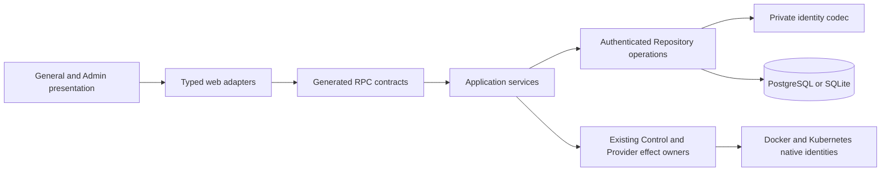

# Agent Profiles, Handles and Identity Transition Design

This primary Design implements [profile-261104/REQ](../requirements/profile-261104-agent-identity.md)
and [profile-261104/ADR](../adr/profile-261104-agent-identity.md). The requester
instructed implementation on 2026-11-04 after the complete candidate and the
coordinated preserving-transition consequences were presented. That instruction
accepts this implementation baseline; it authorizes code work, not a deployed
maintenance event, production migration, merge or rollout.

## System framing

Evidence baseline: commit `7ba03553eeea7a9fd631a3bd931dfffdbcd6c067`.

- `Store` owns complete authenticated database operations. Service currently
  supplies string IDs in `NewAccount`, `CloudAgentDraft`, `ExecutionDraft` and
  directory operations. Public directory projections also double as database rows.
- Accounts and computers use separately embedded PostgreSQL/SQLite migrations.
  Explicit preparation owns a transaction and installation-key binding; runtime
  startup checks readiness without performing migrations.
- Agent wire records currently contain ID, name, Computer and Team ID. There is
  no profile catalogue, palette, handle, handle lookup or profile update contract.
- Team handle is currently non-null, mutable for collaborative-Team managers and
  only validated as nonempty in the repository. Personal handles contain long IDs.
- Current web selections use `/agents?team=ID`, `/agents/ID?team=ID` and `/teams/ID`.
  Browser query keys and remembered workspace preferences also carry stable IDs.
- Current owner reads and mutations revalidate membership and individual ownership;
  a Team manager is not an Agent owner. Current Computer projections preserve
  independent power, management, Connector, saved-environment and action facts.

## Design Authority

- Design revision: `1`
- Approved authority ID set: `M1, M2, M3, M4, M5, M6, M7, M8, M9, M10, M11, M12`

| ID | Material mechanism | Authority | Classification |
| --- | --- | --- | --- |
| M1 | Saved profile, catalogue, palette and single-screen creation | REQ-1..4, ADR-D5..6 | required |
| M2 | Permanent canonical handles, client candidate generation and final uniqueness | REQ-5..6, ADR-D3 | decided |
| M3 | Team-qualified route resolution and authenticated personal alias | REQ-7..8, ADR-D4, ADR-D8 | decided |
| M4 | Repository-only UUIDv7 issuance and complete DTO codec | REQ-10, ADR-D1..2 | decided |
| M5 | PostgreSQL UUID / SQLite BLOB16 storage and row separation | ADR-D7 | decided |
| M6 | Authenticated profile/catalogue/handle contracts and extended fingerprints | REQ-2..10, ADR-D3 | derived |
| M7 | One-time defaults and handle backfill preserving relations | REQ-4,9, ADR-D5 | required |
| M8 | Explicit coordinated maintenance preparation and old-ID reference conversion | REQ-9..10, ADR-D7 | decided |
| M9 | Original native allocation witness and saved-environment continuity | REQ-9..10, ADR-D7 | decided |
| M10 | Cipher rewrap, preserved historical hashes and read-only creation result recovery | REQ-9..10, ADR-D7 | decided |
| M11 | Stable external Provider registration key separate from canonical internal identity | REQ-10, ADR-D7 | decided |
| M12 | Existing private authority, lifecycle, SSR, observation and focused verification | REQ-10, current Specs | existing |

The following mechanisms are determined by confirmed Requirements and accepted
constraints. They are not waiting for a new product preference.

| Mechanism | Authority | Ownership |
| --- | --- | --- |
| Consistent saved image/name/palette/handle across screens | REQ-1..4 | Repository data, shared UI presentation |
| Single-screen creation, existing Provider selection only | REQ-2, ADR-D6 | General web |
| Draft/save/cancel profile editing | REQ-3 | General web state plus authenticated repository update |
| Catalogue reference and product palette keys | REQ-4, ADR-D5 | Catalogue/Profile persistence and asset mapping |
| Permanent validated handles and client candidate generation | REQ-5..6, ADR-D3 | Client proposal; Repository final acceptance |
| Team-qualified handle navigation and personal null handle | REQ-7..8, ADR-D4 | Server route admission and Repository lookup |
| One-time defaults and existing Agent handles | REQ-9 | Explicit preparation, not normal read paths |
| Compact opaque DTO identity owned only by Repository | REQ-10, ADR-D1..2 | Private persistence identity codec |
| Current access, lifecycle and uncertainty contracts | REQ-10 and current Specs | Existing transaction and effect owners |

Database representation, operational cutover, native identity evidence and
historical-request preservation are accepted under ADR-D7. The implementation
plan decomposes these mechanisms without creating new transition authority.

## Architecture and data ownership

Only Repository can translate an entity ID. A Service never imports the codec,
parses a prefix, constructs a prefix or receives a bare UUID from Repository.
Handle syntax is a distinct public value contract, not the ID codec. Client
handle generation can therefore validate a handle without learning any ID rule.

The Repository generates new persisted entity IDs inside the accepting operation.
Creation drafts describe the requested resource, not proposed Agent/Computer IDs.
Pure preparation such as hashing passwords remains outside database transactions.
A fallible local UUID generation failure aborts acceptance; it causes no native
allocation. Directory registration and execution reservation likewise return their
assigned complete IDs. Split public projections from private QueryableByName rows.

Operation request IDs remain separate caller-owned correlation values where
already required. They are not entity IDs merely because their spelling resembles
a UUID. Provider credential request IDs retain their existing time/nonce contract.
Fixed singleton keys and source-system identifiers remain their own concepts.

### Private identity codec

Selected storage: PostgreSQL native `uuid`; SQLite 16-byte `BLOB` constrained
to length 16. UUIDs use RFC/network byte order in both backends. Private database
adapters own backend-specific Diesel binding/row types; no public DTO exposes
`uuid::Uuid`, byte arrays or backend row wrappers. Add supported UUID-library and
Diesel UUID integration rather than constructing UUID bit layouts manually.

External form is `prefix || base64url_no_pad(uuid_bytes)`. Body length is always
22; full length is 23 or 24. Decode the last 22 characters and treat the preceding
1..2 characters as prefix, rather than scanning uppercase characters in the body.
This permits one-letter prefixes even when another prefix begins with that letter.

Repository ingress performs all of:

1. Exact complete length and expected entity prefix.
2. Base64URL alphabet without padding; exact 16 decoded bytes.
3. Re-encoding equality to reject alternate spellings through unused trailing bits.
4. UUIDv7 version and RFC variant validation.
5. Typed failure: malformed input is invalid input; a well-formed absent or
   unauthorized target retains the operation's normal not-found semantics.

Suggested initial map for IDs actually crossing the Repository boundary:
User U, Team T, Agent A, Computer C, Provider P, Auth session S, Grant G,
Invitation I, Login challenge L, Execution E, Connector session CS,
Control instance CT, Connection CN, Profile image PI. Apply a prefix only after
checking an actual public DTO use. Purely internal composite keys need none.
These prefix names fall within the already delegated 1..2-letter choice.

Sort/keyset pagination uses database identity order. Base64URL string order is
not the UUID binary order and must not be used as a surrogate comparison rule.
A cursor's complete ID is decoded at Repository ingress; the browser treats a
returned cursor as opaque, as it does today.

### Native allocation names

Do not interpolate completed DTO IDs into Kubernetes DNS names. Base64URL may
contain uppercase letters or underscores. Generate a separate DNS-safe opaque
allocation suffix for Pod/Secret/container/volume names; retain the existing
explicit reservation and exact UID/evidence contracts. This suffix is a native
allocation name, not a new product entity ID or a user-visible alias. No native
adapter needs the Repository codec. Existing native names are not renamed.

## Profile model and catalogue

Candidate persistence fields:

- Agent: `handle`, `profile_image_id`, `palette_key`, alongside existing name,
  owner, Team and Computer association.
- Image catalogue: internal ID, item type, English internal name, image-source
  kind and stable logical image-asset key. Only the approved builtin source is
  accepted in this delivery. A distinct source type is not a hidden external URL
  capability.
- Catalogue image ID is a foreign key; names and asset keys do not stand in for it.
  Product asset mapping resolves the logical key to bundled artwork under the
  configured web mount. Do not persist installation URLs or file paths.
- Palette key has an equivalent closed accepted set in both database backends.
  Shared presentation maps it to surface/foreground/accent tokens in the current
  light/dark theme. It is not an installation-managed color catalogue.

Seed the six builtin items idempotently during explicit preparation, resolving
existing item names rather than creating duplicates. Seed identity/order is fixed
for backfill, separate from later display sorting. A future catalogue extension
must not change already-saved Agent references.

For existing defaults, calculate SHA-256 over separately domain-qualified inputs
such as `agent-image:` and `agent-color:` plus the exact pre-transition Agent ID
UTF-8 bytes, then reduce the digest modulo six using a specified byte order.
Run before old IDs are removed. Save the selected reference/key once. New random
selection remains client form initialization; the server validates the final
selection rather than rerandomizing it.

## Handle values, candidates and acceptance

Canonical grammar is `[a-z0-9][a-z0-9-]{1,14}[a-z0-9]`. It permits consecutive
hyphens; no additional restriction was selected. Manual uppercase, whitespace or
Unicode input is rejected with actionable validation rather than rewritten.
Display-name trimming follows the existing name contract independently.

Client candidate pipeline:

1. AnyAscii over the display name; lowercase and map runs of nonalphanumeric
   ASCII to one hyphen; trim boundary hyphens.
2. For an empty base use `agent` or `team`. For 1..2 characters retain that base.
3. Fit a normal candidate to 16 characters; trim any resulting boundary hyphen.
   Add a suffix when the base is shorter than three characters or absent.
4. Use a cryptographically sourced lowercase-alphanumeric suffix. A five-character
   suffix is the recommended local detail; reserve its hyphen/length before
   truncating a base. A random suffix is not a uniqueness guarantee.
5. Query the scoped availability endpoint. On occupied automatic candidates,
   choose a new suffix and query again. Bound automatic attempts; retain the
   candidate and expose a retry/manual edit if exhausted or unavailable.
6. A manual edit changes the candidate source to manual. Later name changes do
   not replace it. Client-only generation sequence tracking prevents an old
   availability response from validating a newer candidate.

The server parses syntax and checks uniqueness in the accepting transaction.
Availability reads expose only a boolean, not another resource's owner, name or
membership. Team availability requires authentication, not membership of a
candidate's existing Team. Agent availability requires current membership in the
creation Team but checks the current global Agent namespace. Retain a generic
occupied result rather than leaking target details.

A final uniqueness race is a normal rejection. Automatic-mode clients may create
a new candidate after a definitive rejection. They must not replace handle or
request payload after an uncertain create response. First recover the original
operation's result under its existing receipt contract. A definite pre-acceptance
rejection permits editing and a new acceptance attempt.

### Repository invariants

- Collaborative Team: non-null canonical handle and unique among live Teams.
- Personal Team: null handle; required personal association still identifies it.
- Agent: non-null canonical globally unique handle, for as long as its row exists.
- Creation receipts do not act as a permanent handle reservation after Agent
  deletion. They keep the original stable assigned identity and removed result.
- Team/Agent update contracts do not include a mutable handle field. Old Team
  handle mutation is removed from normal API and UI, not silently ignored.
- Database checks enforce kind/null and grammar equivalence; unique indexes are
  authoritative under concurrency. PostgreSQL and SQLite must accept/reject the
  same cases.

## RPC and Repository operation changes

Names below describe owned contracts rather than frozen generated symbol names.

| Operation | Input | Result and authority |
| --- | --- | --- |
| List profile images | Authenticated caller, bounded page | Public catalogue references/metadata with logical keys |
| Check Team handle | Candidate | Available boolean; syntax/identity validation |
| Check Agent handle | Creation Team ID, candidate | Available boolean with current global uniqueness |
| Create Agent | Existing request/Provider/Team/name plus handle/image/palette | Same accepted/removed outcome semantics |
| Read creation result | Authenticated owner and original Request ID | Existing accepted/removed receipt only; no allocation or payload rewrite |
| Resolve Agent handle | Resolved Team ID, handle | Individually owned Agent in that exact Team |
| Update Agent profile | Stable Agent ID and complete image/name/palette selection | Saved Agent projection; immutable handle |
| Resolve Team handle | Collaborative handle | Current accessible live Team or not found |
| Create Team | Name and final handle | Ordinary caller-owned collaborative Team |
| Update Team | Stable Team ID and existing allowed mutable fields | Name update; no handle mutation |

Extend Agent records consistently across list/detail/create/update results. Team
handle becomes optional on the wire and null in browser DTOs; an absent value on
a collaborative Team or a present value on a personal Team is an integrity error,
not a string fallback. Regenerate the authoritative Protobuf clients and update
General and Admin validation/consumers together. The app must not hand-edit a
generated client or create a second data authority.

Profile update is one authenticated complete database operation: authenticate,
resolve owned Agent and membership, validate image reference/palette/name, update
only profile fields, return saved projection. It performs no Computer or Provider
effect. Repeated identical profile submission is state-idempotent; basic error
handling retains the draft and refreshes saved state after confirmed success.
No revision field, ETag, edit lock or merge mode is introduced.

New Agent creation fingerprints include every immutable creation payload field:
Team/Provider/name/handle/image/palette with existing typed length delimiting.
A duplicate Request ID with a changed field rejects. Current profile mutations
cannot alter a creation receipt's original accepted payload semantics.

## Web routing and render ownership

Canonical paths:

- Collaborative Team settings: `/teams/{teamHandle}`.
- Team Agent list: `/teams/{teamHandle}/agents`.
- Team Agent creation: `/teams/{teamHandle}/new-agent`.
- Agent detail: `/teams/{teamHandle}/agents/{agentHandle}`.
- Personal equivalents use `/teams/my/...`.

`my` has two characters, so it cannot collide with a valid 3..16-character Team
handle. Creation is outside the Agent-handle child segment, so `new` can remain a
valid Agent handle without route-specific reservations. Reserve no broad list of
future words. URI encoding remains a general route-builder responsibility, not
Repository ID encoding.

Server request admission authenticates first, resolves `my` through the user's
personal context or the collaborative handle through accessible membership,
then performs the exact Team+Agent handle lookup. Foreign private Agent and wrong
Team are not-found. A global handle lookup cannot bypass this sequence.

Route-specific resolved data and the root workspace selector agree on stable
Team ID. Seed the existing client query with the same server snapshot. Query
cache keys and remembered workspace preference still use complete stable IDs,
not mutable display names. Handle-based paths select primary content; switching
Team/Agent pushes history, minor UI changes do not create duplicate content URLs.

Profile and invitations may retain existing non-ID route entrypoints. Invitations
and profile continue to use validated recent context where no Team path exists.
Admin-to-General workspace navigation uses the same canonical General path
builder and optional configured peer-web destination, without codec knowledge.

Selected compatibility policy: remove obsolete General ID-based routes and
`?team=ID` content selection with the coordinated release; preserve the app root
as the existing authenticated resume entry. Do not add hidden legacy-ID lookup,
redirect tables or indefinite dual formats. Old links cease resolving under the accepted coordinated transition (ADR-D7);
this is not an indefinite legacy-ID lookup/redirect requirement.

## Data transition and operational feasibility

### Proven blockers to a column-only migration

1. `crypto/root.rs` authenticates recovery ciphertext with session ID and token
   hash. Account sessions and component credentials use this primitive. Current
   provider registration contexts also include Provider and owner identities.
   Re-keying without authenticated rewrapping breaks recovery.
2. `agent_creation_receipts` retains Team/owner/request/hash/assigned ID but not
   every original input field. The assigned ID survives deletion. Hashes cannot
   be magically recomputed from removed rows or from a subsequently renamed Agent.
3. Kubernetes ownership annotations and Docker labels bind native resources to
   exact Computer/execution strings. Docker volume identity includes original
   labels/options/created-at. These are existing authority, not incidental names.
4. Connector hello/renewal includes an issued session ID; a running old Connector
   cannot switch protocols or its embedded identity because the DB was changed.
5. Provider IDs may originate from operator configuration, not the entity helper.
   Treating that configuration key as an implicit UUID would be a contract change.

### Accepted coordinated transition

The implementation instruction accepts this transition baseline (ADR-D7).
It must not run as an unannounced startup migration or an automatic deployment task.

1. Publish one coordinated backend/web/Provider/Connector release boundary and a
   maintenance procedure. Stop new user mutations and background dispatch; settle
   or explicitly block unresolved physical operations using existing evidence.
2. Inventory old identity references, ciphertext contexts, accepted receipts and
   native binding records under the old schema. Do not assume installed data is
   empty. Fail preflight on unowned/ambiguous allocation evidence.
3. Preserve saved environments. Retire old execution processes through existing
   safe lifecycle contracts before changing their active protocol identity.
   Starting replacement execution later is a visible maintenance interruption,
   not a claim that waiter cancellation stopped an old physical effect.
4. During explicit preparation, build private old-to-new maps including IDs that
   survive only in receipts/evidence, allocate UUIDv7 values, copy/rewrite all
   references atomically, and verify both engines' constraints before commit.
   Do not derive a 128-bit value by truncating a 256-bit ID.
5. Rewrap recovery envelopes under the original installation root and the new
   canonical private identity context without changing bearer tokens, expiry,
   previous-token grace or secret hashes. A failed decrypt is a hard preparation
   failure, never automatic credential reset.
6. Initialize Agent handles/profiles and normalize collaborative Team handles.
   Existing valid handles win over transformed candidates; process the remaining
   set in deterministic stable-ID order and regenerate collisions. Personal null
   values are set before enforcing kind-specific constraints. Invalid legacy
   syntax/short values require the same canonicalization/fallback rather than
   only cutting long strings.
7. Preserve exact native ownership evidence as source-qualified allocation
   metadata, distinct from the new canonical entity ID. Do not relabel an
   immutable saved volume or weaken its daemon/name/labels/created-at checks.
   The native adapter compares the exact persisted expected allocation witness;
   it never decodes a Repository prefix or accepts an unverified raw legacy ID.
8. Preserve historical accepted hashes without fabricating original payloads.
   Provide an authenticated read-only creation-result operation by owner and
   original Request ID for accepted/removed receipts, including historical ones.
   It cannot allocate or change a payload, so it does not bypass the mutation's
   changed-payload conflict check. New Create requests use the complete new
   fingerprint. Old clients cannot replay old-format mutation payloads after the
   coordinated release; their accepted outcome remains recoverable as a read.
   The accepted old-client release boundary introduces no hidden hash version
   or legacy mutation fallback.
9. Keep externally configured Provider registration keys separate from their
   new internal UUID identities if configuration continuity is required. Expose
   canonical Provider IDs in entity DTOs; accept registration keys only through
   the narrow operator registration contract. Revalidate the existing verified
   owner/key boundary rather than using key equality as an adoption grant.
10. Readiness rejects incomplete migration, unresolved proof rewrap or invalid
    catalogue/handle data. Resume only matching new processes and canonical
    web routes after explicit checks. Verify a preserved saved environment before
    normal execution resumes.

The old-to-new map is preparation-local, not a runtime alternate-ID registry.
Persisted native allocation witnesses and accepted historical request evidence
are necessary old data, not general legacy API/ID fallbacks. These accepted distinctions are explicit persisted contracts, never a generic
compatibility flag.

### Failure, retry and rollback

- Preserve the existing preparation lock, original root binding and atomic
  database transaction. SQLite rebuilds cyclic groups with foreign keys enabled;
  PostgreSQL uses native UUID columns and deferred constraints as appropriate.
- All needed random assignments and rewrites commit with the new schema. A
  failed invocation rolls back its DB work and can be retried explicitly.
- A database rollback does not undo already retired native processes. Maintenance
  steps need individual evidence and a re-entry plan under the still-authoritative
  schema; never automatically repeat an uncertain native effect.
- Do not claim old-binary downgrade after successful new-format writes. A
  destructive down migration must reject. Operator-controlled restoration is a
  separate approved operational action; no automatic backups or DB clones are
  created by this design task.
- Under no policy is dropping data, rotating every secret, or recreating saved
  environments a silent substitute for a preserving migration.

## Removal and Replacement

| Existing behavior/unit | Authority | Replacement/boundary | Verification |
| --- | --- | --- | --- |
| Name-only Agent creation payload | REQ-2,5 | Extended final profile/handle payload and receipt | Changed payload rejects on duplicate request |
| Mutable collaborative Team handle | REQ-5 | Creation-only field, name-only normal edit | Public clients/UI no longer offer handle mutation |
| Synthetic personal Team handle | REQ-5,7,9 | Null handle plus auth-scoped route alias | Both-engine kind/null and client validation |
| Service-generated entity IDs | ADR-D2 | Repository-assigned complete IDs | No codec imports/UUID generation in DTO consumers |
| Public database row projections | ADR-D2 | Private DB rows and explicit DTO conversion | Export/import inspection and typed tests |
| Random hex entity helper usage | ADR-D1 | UUIDv7 under accepted transition scope | Enumerated issuer call sites, no secret/hash changes |
| General ID-based navigation | REQ-7; ADR-D7..8 | Team/Agent-handle routes | Route/SSR/history tests, no old-format fallback |
| Direct ID-based native name construction | ADR-D2 plus native constraints | Separate DNS-safe reservation name | K8s/Docker allocation tests |
| Existing primary snapshot fixtures | REQ-1..10 | Saved profile/handle/null-aware fixtures | Executed coverage replacement, not deleted-feature assertions |
| Generated wire clients and validators | Accepted contract changes | Regenerated matching clients | Actual Node/Rust integration and General/Admin types |
| Current Spec claims | Verified implementation only | Owning pages updated with shipped behavior | Semantic links/authority review in implementation PR |

## Test Strategy

E2E-first means a small number of real primary journeys, not a matrix of every
input combination in browser tests.

### Primary browser journeys

1. Login, enter personal context, create an Agent with current Provider and an
   automatic handle, reach its Team-scoped address, refresh, edit profile, cancel
   then save, and observe stable handle and saved values in list/detail.
2. Create collaborative Team with automatic handle, reach its empty Agent list,
   reopen selector and switch back to personal context. Personal Team has no
   displayed/synthetic handle and the server resolves it to the logged-in user.
3. Retain one current lifecycle/recovery journey, reusing existing fixtures rather
   than multiplying provider/state combinations for this visual change.

Use existing testenv fixture support for isolated database/backend/Provider setup,
not as a second browser runner. Do not require real user credentials, production
resources or live infrastructure in ordinary CI.

### Component and client-state checks

- Approved responsive ordering, text containment, palette/theme contrast,
  keyboard/focus, dialog/sheet scrolling, current values and draft cancellation.
- Pure candidate grammar/length/fallback, manual override preservation, collision
  loop bounds, stale availability response, transport failure and final race.
- Profile-update error retains input; auth withdrawal does not redisplay stale
  private data. Existing uncertain creation locks exact accepted payload.
- Workspace picker personal/null and collaborative handle, no post-create edit.

### Repository and both-engine integration checks

- Exact UUID codec lengths/version/variant/prefix/canonical trailing-bit rejection;
  wrong entity and wrong-owner outcomes; binary database order/keyset correctness.
- Catalogue/palette references, one-time deterministic backfill, idempotent seed,
  image/name/color independence and preservation of later edits.
- Handle grammar parity, live-Team/global-Agent unique races, immutable updates,
  null personal semantics and exact Team+handle resolution.
- Creation fingerprint covers all final fields; uncertain exact replay remains
  stable and removed receipts never allocate a replacement.
- Populated-schema transitions include cyclic FKs, deleted-Agent receipts,
  personal contexts, invitations, sessions, component keys, native saved resources
  and failed migration rollback/retry. Compare every preserved relationship.
- Recover account and component tokens with old envelopes before transition and
  new envelopes afterward, retaining hashes/expiry/grace. Original root mismatch
  and decrypt failure fail closed.
- Exact native saved-resource witness remains authoritative after canonical ID
  change. Unknown effect outcome vetoes unsafe retirement/replacement.

### Contract and execution evidence

Run supported UUID/Diesel adapter compilation, Rust checks with SQLite/private
PostgreSQL, generated RPC checks and actual Node/Rust calls, plus General/Admin
format/lint/type/build and component checks in the implementation phase. Ordinary
CI executes the minimal browser flows. Live Docker/Kubernetes tests retain their
existing optional prerequisites and explicit skip/fail semantics; a skipped live
test is not execution evidence. Record SHA, DB engine, fixture version, commands,
executed cases and failures. No production benchmark claim is made by this design.

## Feasibility findings

- Profile/catalogue/handle and scoped route work: feasible from the existing
  ownership/SSR/transaction boundaries; implementation tests remain necessary.
- Repository-only codec and compact storage: conditional on explicit private
  PostgreSQL/SQLite adapter integration and all issuer/projection call sites;
  no new dependency or implementation has been compiled in this design task.
- Preserving global re-keying: conditionally feasible through the accepted
  maintenance and explicit historical/native evidence boundary. Actual populated
  SQLite/PostgreSQL and native-adapter tests gate activation, not merely docs.
- Existing UI mock checks establish visual/local interaction behavior only;
  they do not prove server storage, routing, permissions or preserving migration.

## Executed design probes

A scratch Runtime probe passed 16 checks for the proposed owned contracts:
fixed 22-character body with 1/2-character prefixes, wrong-entity/padding/v4
rejection, noncanonical trailing-bit rejection, the agreed handle grammar,
`my` noncollision, nullable personal handles, SQLite 16-byte FK joins and unique
Agent handles. SQLite version was 3.46.1. It used an in-memory illustrative schema,
not the product schema or a preserving migration. It does not establish PostgreSQL
adapter compilation, actual crypto migration, native continuity or production
performance. The probe did not access credentials or deployed databases.

Document metadata and snapshot validation are separate from these semantic probes.
Approval is recorded separately below; probes do not establish implementation.

## Design Approval

- Mode: Collaborative.
- Decision owner: requester.
- Approved on: 2026-11-04.
- Approved Design revision: `1`.
- Approved authority IDs: `M1, M2, M3, M4, M5, M6, M7, M8, M9, M10, M11, M12`.
- Approved scope: this complete candidate baseline, including coordinated
  preserving migration, old-client/URL cutover, historical proof retention and
  the operational interruption consequences, followed by an explicit instruction
  to implement. Production maintenance, migration execution, merge and deployment
  remain separately unauthorized.
- Evidence: the implementation instruction immediately followed presentation of
  the candidate and its material transition consequences. No further product
  behaviors or unrestricted autonomous design authority are inferred.

Authority audit: all ten Requirements have mechanisms and verification in this
Design; every new persistence/operational mechanism has accepted ADR or direct
Requirements authority. Conditional adapter/migration feasibility is an execution
gate, not permission to weaken a contract. No mechanism ID is silently replaced
by an implementation plan. Stop only an affected lane if a new material blocker
requires changing this baseline; continue independent approved work.
