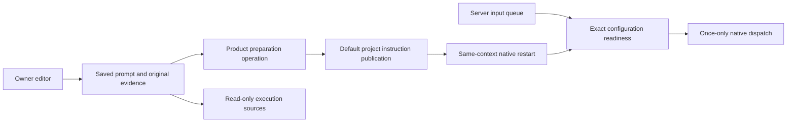

# Default Agent Project and Session Configuration Refresh

- Requirements: [prompt-261115/REQ](../requirements/prompt-261115-system-prompt-management.md)
- Decisions: [prompt-261115/ADR](../adr/prompt-261115-system-prompt-management.md)
- Scope: system prompt management, general-purpose default project, common session refresh, retained instruction evidence. The current Codex integration is the only implemented harness.

## Design Authority

- Design revision: `4`

| ID | Material mechanism | Authority | Classification |
| --- | --- | --- | --- |
| M1 | Server-owned Agent system-prompt read/save/clear with direct overwrite and current private ownership checks | REQ-1, REQ-5, REQ-8, ADR-D2 | decided |
| M2 | Existing persistent workspace is the general-purpose default project; Codex maps selected sources to atomically published AGENTS.md | REQ-2, REQ-10, ADR-D4 | decided |
| M3 | Explicit immutable selected instruction sources and tool contract at preparation; content comparison drives convergence without setting versions | REQ-4, REQ-7, REQ-9, ADR-D1, ADR-D3, ADR-D4 | derived |
| M4 | Product-owned proactive preparation waits for tracked existing work, then retires/restarts the actual owner and restores the exact retained context before declaring readiness | REQ-4, REQ-9, ADR-D1, ADR-D4, current native ownership | decided |
| M5 | Server input acceptance continues during refresh; the existing consumer retains waiting inputs and forwards eligible requests once after readiness | REQ-5, REQ-9, ADR-D5 | decided |
| M6 | Durable server instruction-source evidence survives input consumption; actual preparation/dispatch results bind exact operation, execution and native target | REQ-6, REQ-7, REQ-8, ADR-D3 | decided |
| M7 | Shared Agent-detail row, desktop modal/mobile full-screen Save-only editor and read-only execution source inspection | REQ-3, REQ-6, REQ-8 | required |
| M8 | Preserve an existing root AGENTS.md once outside instruction discovery before managed ownership; preserve all other workspace files and existing source data | REQ-10, fixed data-preservation constraints, delegated technical decision | decided |

## Current System and Gaps

Agent profiles currently store presentation only. The initial connection reconciler can prepare a native session without an input. Exact live Setup returns the current native session before acquiring new tools. The current Connector freezes a catalogue for its physical owner and rejects changed declarations. The input processor has a preparation budget, and processor return or consumer expiry fails remaining PENDING input.

The current persistent `NativeStorage::workspace()` already exists beneath the saved root and supplies native cwd. It remains the default Agent project; no project registry or second working directory is introduced. Captures, native state, installation cache and temporary data remain separate classes.

## Architecture and Ownership

The server owns desired settings, product/function text, original evidence and current private-Agent authority. The native actor owns file publication, process lifetime, capture identity and readiness. Native filenames and protocol translations are backend-local. Future harnesses consume the selected sources and project path; they do not need to implement Codex protocol fields or use the same instruction filename.

## M1: Settings and API

Add a distinct system-prompt setting associated with the existing Agent. Keep the presentation profile API independent. Reading and saving enforce private ownership and current Team membership in the Store transaction, matching existing owner operations. Empty text clears the owner-authored content. Successful saves directly replace the prior value; no editing baseline or conflict token is required.

Bound submitted UTF-8 bytes so the complete generated project document fits the supported native project-instruction limit and existing bounded transport. Validate at domain/server ingress; the editor reports a real validation or persistence failure and retains the draft. Never return a default empty setting after a failed read.

Owner APIs expose the saved value and execution evidence. Component APIs expose only operation-qualified prepared content to the currently authorized Connector; component route possession alone must not disclose another Agent's prompt.

## M2/M8: Default Project and Managed Instructions

Use the existing workspace/cwd for ordinary files and future project work. Provider-common, function and owner sources remain distinct structured text in the selected bundle. Execution-only additions, if present, are attributed to their execution and are not saved as owner settings. Render deterministic sections into the single native instruction document, preserving original source bytes separately.

Codex maps that document to root `AGENTS.md`. Its standard project-instruction loading behavior is the application mechanism. It supplies project instructions in its native role; the product does not claim that these are the complete internal system/developer prompt.

File publication follows the existing private-storage pattern: validate the owned root and ordinary file type, open no-follow descriptors, write a private temporary file, sync, atomically rename and sync the directory. Retain finite blocking publication through physical completion even if a waiter disappears. Publish only after the exact selected content has been preserved server-side.

On first managed publication, preserve an existing ordinary AGENTS.md in one private sibling source-preservation location outside project instruction search. Use exclusive creation and verify an existing preserved original on reentry. After preservation succeeds, managed ownership uses direct atomic replacement. This is a one-time migration safeguard, not a history/rollback product. Other files and cwd remain untouched. Redirected/special/hard-linked files fail storage admission rather than modifying another target.

## M3/M6: Selected Configuration and Original Evidence

A selected configuration contains exact source role/text values and the tool contract for one preparation. The preparation operation selects these before native effects. Persist the selected original bundle as immutable evidence separate from the input and delivery rows that are consumed after successful pickup. Attribute it to Agent, conversation, Computer execution and exact preparation/input operation. Native target is added by the exact preparation result when initially unavailable.

Carry the selection explicitly across the component preparation boundary. Connector publication must verify it is applying the retained selection, not reread settings and substitute newer content under the old operation. Authentication headers, endpoint bearers and other capabilities do not enter the source bundle.

The resulting applied content remains distinct from desired settings. Before new input dispatch, compare current desired content with the prepared selection. If a later save changed it, product-owned preparation converges again. Compare content directly; no setting revisions, epochs, history browser or stale-edit preconditions.

Historical inspection retrieves the preserved sources for the selected execution/operation, with current private ownership/membership authorization. Preserve genuine absence, missing evidence and read failure as different outcomes. Native result acknowledgement adds preparation/dispatch facts; it is not model compliance.

The conversation retains a nullable current-preparation operation reference. Each new actual preparation admission reserves its exact existing operation ID in the same authority-revalidated Store transaction. A reserved operation without sealed evidence is pending, not execution permission. First seal requires this exact current reference and inserts the immutable bundle without moving the reference; a superseded operation cannot seal. New component dispatch reads require both the current reference and sealed evidence. Existing-operation lookup, idempotent recovery and late completion never move the reference; completion records only that operation's own historical evidence. New admission retains existing uncertain-setup fences and cannot supersede possible effects merely by replacing this reference. Input forwarding requires the referenced bundle's known applied result, current execution/native target and current desired content. Reserved, pending or failed current preparation never falls back to an older Ready bundle. This reserve → seal → effect → exact-result sequence avoids timestamp or UUID-order inference when startup and input-owned recovery occur in the same clock tick. It is not a setting version, editing precondition or settings history. Existing null references are populated by the next legitimate actual admission, never guessed from historical rows. The reference is not a foreign key to consumable input/preparation rows: input consumption preserves both the causal identity and sealed evidence.

## M4/M5: Common Refresh and Input Lifetime

The common flow covers prompt document changes and session-visible MCP contract changes. Transport credentials or implementation changes behind an unchanged tool contract do not alone require session reconfiguration.

1. A relevant known change schedules preparation proactively through the current product reconciliation ownership.
2. Continue accepting otherwise admissible inputs into the existing server queue. Keep the input editor usable; readiness gates native dispatch, not product submission.
3. While the old native work is running, retain its physical owner and effect capacity. Use standard ACPv2 child routing and retain every started tool call until actual completion. Terminal-bearing commands require a numeric physical exit or equivalent authoritative completion; a synthesized failed call or null terminal exit never releases them. Child completion requires observed live running followed by an actual successful end-turn, not an idle metadata snapshot, cancellation, disconnection or failure. Unknown state is not refresh-ready.
4. Once tracked work is complete and local/server started effects have their required completion boundary, retire the exact old physical owner through explicit fallible cleanup.
5. Publish the selected project instructions, reacquire actual-start authentication and MCP provision under the new start operation, and Resume the original retained native context. First preparation also assigns a native title through the supported metadata API so an unused context is durable.
6. Verify native initialization and the expected catalogue. Publish the exact preparation result and selected-source binding.
7. Release only the exact still-eligible queue input under current authority and existing possible-forwarding fences. Use the existing native input operation identity; never infer replay permission from a lost response or changed process.

A repeated unchanged lookup retains current Setup behavior. A changed selection must not take that early return. The selected contract and actual tools must be coherent for the launch. Old publication tickets cannot be reused by a new physical owner.

The released adapter's AIR background inventory is asynchronous at turn end and its AIR child path can defer materialization without an externally visible completeness barrier. Those capabilities do not establish complete work inventory. The Codex integration therefore uses the standard child path and tool lifecycles, retaining unresolved command ownership across root idle. A background command without a later authoritative physical completion remains unknown and takes the finite preparation-failure path while the existing owner and original input are preserved. Fresh empty-scope proof is permitted only for a genuinely new pre-work context or an exact locally verified safe-retirement transition; arbitrary restored context is not an empty inventory. No delay, successful negotiation or timeout supplies this proof.

Root capture remains a single-session original journal. Root standard child-association notifications are captured unchanged. At the same serialized live ingress, only associated child lineage updates feed an execution-local work tracker without a fabricated root occurrence or rewritten session ID. They do not expand root history, server normalization or the answer UI. Unassociated sessions and lost/restarted child observations invalidate completeness rather than borrowing authority from historical capture. Child permission/form requests are explicitly unsupported before root request registration or occurrence lookup; root requests retain their existing capture and single-responder path.

The input consumer must remain owned while temporarily waiting; returning merely because preparation is busy would currently mark the pending row ERROR. Wake-up is tied to preparation progress and bounded observation, not a browser lifetime. Existing admission/body capacity remains bounded.

### State and Failure Matrix

| Observation | Legal behavior |
| --- | --- |
| Desired equals applied, native source ready | Admit exact eligible native input |
| Desired differs, existing foreground/background/child work active | Keep old work owned, retain queued input, await progress |
| Required work state unknown | Keep input; finite preparation observation ends with truthful preparation failure if readiness cannot be established |
| Instructions cannot be preserved/published | Fail before new native work; preserve source and entered input |
| Known preparation success, later read fails | Keep known success; report supplementary read failure separately |
| Possible native forwarding/result acknowledgement lost | Recover retained exact facts, never repeat the effect as a new operation |
| Context restore fails | Preserve original context/evidence and report preparation failure |
| Target or membership lost | Stop new dispatch under lost authority and preserve truthful failed-input behavior |
| Cleanup incomplete | Retain old resources/failure evidence; no successor launch from uncertainty |

Use existing preparation/transport budgets rather than introducing new product timing controls. A response observation bound is not a cancellation deadline for started work. Repeated legitimate saves can require further safe preparation; failure does not create infinite automatic retry.

## Security

Reuse private Agent and membership checks for every setting/evidence operation. Source bodies are private payloads and use field-free Debug/body-safe errors. Component content reads are operation/source-qualified. File capabilities and provider credentials remain outside source text, diagnostics and UI. No privileged installation Admin access is added.

## Migration, Release and Operations

Add preserving SQLite and PostgreSQL migrations for saved settings and execution evidence. Existing Agents have an absent owner setting, not invented text. Existing capture records and native IDs remain untouched. The one-time project original preservation precedes managed replacement. Existing workspaces stay in place.

Normal schema preparation is required before rollout. A binary/schema mismatch follows existing readiness rejection. No downgrade path may discard evidence or reconstruct old content from settings. Diagnostics distinguish saved value, file publication, native readiness and actual input delivery, without new application-policy controls.

## Removal and Replacement

| Existing behavior/unit | Removal authority | Replacement | Boundary | Verification |
| --- | --- | --- | --- | --- |
| Live exact Setup returns without considering selected configuration | REQ-4/9, ADR-D4 | Content-qualified unchanged lookup or owned refresh | Native actor setup | Same selection reuses; changed prompt/tools reprepare |
| Frozen owner catalogue mismatch as only response to legitimate update | REQ-9, ADR-D4 | New actual-start owner after safe refresh | Old owner retirement/new provision | Changed schema adopted; old started effect not replayed |
| Shared UI writable state makes refresh disable input | REQ-9, ADR-D5 | Separate product submission eligibility and native-action readiness | Chat container | Input/Send usable while native refresh pending |
| Consumable input rows used as prospective evidence | REQ-6/7, ADR-D3 | Independent preserved source record | DB preparation/dispatch | Evidence still readable after input consumption |
| Unmanaged root instruction file | Data-preservation constraint, M8 | Once-preserved original and managed project document | First publication | Original retained; other files unchanged; reentry safe |
| Earlier direct-systemPrompt/protocol-bridge candidates | ADR-D4 | Standard project instruction reload | This snapshot's unimplemented investigations | Production remains stock ACP/native project path |

## Test Strategy

### Primary E2E

One minimal browser journey: existing owner edits the system prompt, existing work continues, another message is accepted into the server queue while refresh waits, preparation completes, the message continues once, and the owner inspects exact preserved sources after a later edit. Use deterministic native fixture/process support from testenv for setup and completion control. Keep responsive/copy/failure combinations in lower-layer tests.

### Lower Layers

- Store/service tests for both SQLite and PostgreSQL: owner/membership, direct overwrite, clear, source roles, exact source preservation, grant/result qualification, historical reads after input consumption, genuine missing evidence, target loss, queue/wakeup ownership and changed desired content.
- Native/storage tests: atomic document publication, first-original preservation, reentry, symlink/special-file rejection, failed write, empty owner section, preserved ordinary project files.
- Protocol/actor tests: initial title before ready, prompt/tool refresh, background/child work gating, associated live child updates without root-journal mutation, explicit unsupported child interactions, unknown lineage/state, queued input, lost result, failed restore/cleanup and actual native owner boundaries.
- Component tests: shared row, desktop modal/mobile full-screen textarea, Save-only flow, draft preservation, enabled input during refresh, read-only source evidence.

### Real Runtime Evidence

The design research used released adapter 2.6.0/Codex 0.165.0 with a loopback fixed-SSE response fixture. A→B project edit generated the native replacement instruction message in the next request; empty document generated the native removal message. This verifies project-instruction delivery, not model obedience. Preserve exact package versions, request summaries and failed fixture attempts in the implementation validation record.

Integrate a model-free/fixed-response acceptance test for this contract using explicit disposable state. Missing required local prerequisites fail the designated check; optional credentialed live tests are separately identified and never silently substituted for fixture evidence. No credentials are copied from operator state.

### CI and Evidence

Run documentation validation, Rust format/Clippy/tests across both databases, RPC generation/roundtrip checks, web format/lint/typecheck/unit/component checks, the minimal core E2E and the relevant native fixture. Report exact head and prerequisites. Store request/effect counts, exact operation/native attribution and source-content expectations; timing sleeps are not ordering proof.

## Authority and Feasibility Review

REQ-1–10 map to M1–M8 above; every material mechanism has confirmed or delegated authority. Independent review must check implementation against these IDs and the removal table. File names, helper layout and equivalent DTO decomposition are local details.

Core instruction change/clear is feasible through verified native behavior. Work-preserving refresh and component coordination remain implementation verification gates and must pass the state matrix before completion is claimed. No absent native capability is assumed available.

## Design Approval

- Mode: `Autonomous`
- Decision owner: dedicated delegated technical interviewee
- Approved on: `2026-11-16`
- Approved Design revision: `4`
- Approved authority IDs: `M1, M2, M3, M4, M5, M6, M7, M8`
- Approved scope: existing default workspace, standard managed instruction publication, same-context work-preserving refresh, continuous input acceptance, retained source evidence and Save-only owner UI.
- Approval evidence: exact-document bidirectional authority and feasibility review by the delegated technical interviewee, including the revision-2 standard-lifecycle correction for M4, revision-3 causal preparation identity for M3/M6 and revision-4 live-child/root-journal boundary. Work-state and queue coordination tests remain mandatory implementation completion gates.

Implementation validation: [Agent project instructions validation](project-instructions-validation-2026-11-16.md).
