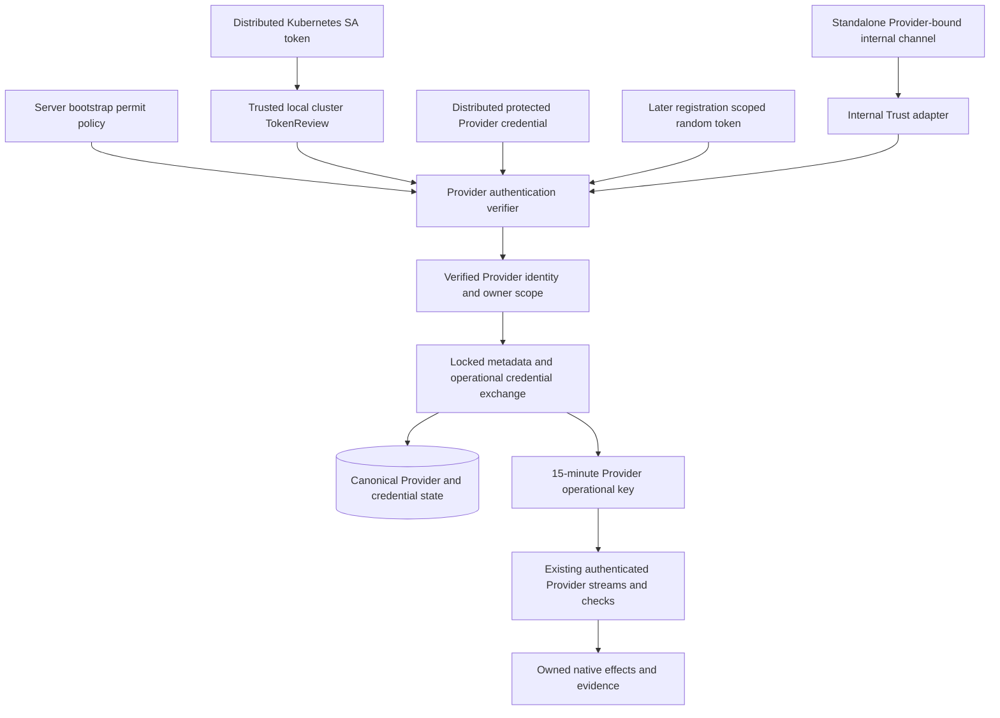

# Provider Authentication Design

- Snapshot: `provider-261104`
- Requirements: [provider-261104/REQ](../requirements/provider-261104-authentication.md)
- Decisions: [provider-261104/ADR](../adr/provider-261104-authentication.md)
- Inspected implementation: `4c20865baa8c84d9d5c14182101840f960afca2d`.
- This records the approved implementation design; current behavior belongs to
  the connected Spec Wiki. Disposable verification is recorded in the
  [implementation evidence](provider-authentication-evidence-2026-11-04.md);
  no production rollout is implied.

## System Outcome and Scope

Replace the externally supplied common system-owner bearer with explicit Provider
authentication strategies. Bootstrap works in distributed and Standalone contexts;
authentication establishes one authoritative Provider identity and exchanges for
short-lived operational credentials. Native execution remains behind the existing
current-source/current-request authority checks.

The default distributed Kubernetes chart needs an explicit Kubernetes enable
switch but no additional Provider token or required identity values. Standalone
Trust is exclusively process-internal. Protected bootstrap credentials remain
available for distributed arrangements and have an automated Helm issuance path.
Docker Provider deployment templates are out of scope. Later server/user/team
registration has testable credential/ownership capability, not new onboarding UIs
or an entire management API product.

## Current Behavior and Gaps

- `config.rs` composes a `SystemOwnerVerifier` from three external system-owner
  settings. Provider commands hold `CHAPCHOO_PROVIDER_OWNER_TOKEN`, configure
  metadata, then owner-authorize communication-key rotation.
- `ComponentKeyPolicy` currently supplies both Provider and Connector paths.
  Changing its defaults globally would alter Connector behavior unintentionally.
- Operational key persistence already provides target-scoped receipts, encrypted
  current-result recovery, current/previous digests and explicit route withdrawal.
  These are useful primitives, not bootstrap authentication strategies.
- Provider kind/daemon/resource identity is durable and compare-and-bound.
  SYSTEM and USER ownership exist; TEAM Provider ownership and later registration
  products do not. Admin Provider inventory is read-only.
- Memory transport currently serves trusted local peer delivery. The public
  Control service union also registers Provider authentication/connection RPCs.
  Neither fact establishes a process-internal-only Provider Trust boundary.
- The chart requires explicit Provider IDs, managed namespace and an existing
  owner Secret. The redesign replaces these requirements with safe defaults and
  selected authentication wiring, not additional common owner secrets.

## Design Authority

- Design revision: `1`

| ID | Material mechanism | Authority | Classification |
| --- | --- | --- | --- |
| M1 | Distinct registration context and authoritative SYSTEM/USER/TEAM Provider scope | REQ-1, REQ-7, REQ-10 | required |
| M2 | Explicit authentication/exchange boundary produces non-forgeable scoped evidence; operational keys cannot enroll or self-renew | REQ-3, ADR-D1 | decided |
| M3 | Provider-only 15-minute keys, proactive re-authentication at five minutes; existing Connector policy retained | ADR-D1, REQ-8, current key lifecycle | derived |
| M4 | Local-cluster TokenReview with permitted namespace/SA name and explicit audience; chart supplies verification wiring | ADR-D2 | decided |
| M5 | Standalone default Trust on per-Provider process-internal transport only | ADR-D4, REQ-10 | decided |
| M6 | Root-key-protected, purpose/Provider-bound bootstrap credential and bootstrap allowed-ID admission | REQ-5 | required |
| M7 | Explicit server-side mint/install command, automated by Helm for selected protected authentication; no same-host automatic exporter | ADR-D3, REQ-10 | decided |
| M8 | Explicit Kubernetes-specific chart opt-in with complete coherent defaults and isolated managed namespace | REQ-9, ADR-D2 | required |
| M9 | Independent random per-Provider later-registration tokens, root-protected DB storage and scoped exchange capability only | REQ-7 | required |
| M10 | Preserve canonical identities while extending ownership/token storage in both supported databases | REQ-1, REQ-7, REQ-8; durable-evolution convention | derived |
| M11 | Coordinated old-process stop, old Provider-key/route invalidation, new authentication reconnect; no legacy acceptance window | ADR-D5 | decided |
| M12 | Keep Connector authority, retained native effect ownership, exact correlation and uncertain-outcome fences | REQ-8, current lifecycle/provider/directory contracts | existing |
| M13 | Bootstrap trust is deployment-owned; ordinary affected product settings are DB-owned; no startup overwrite of those settings | REQ-2 | required |
| M14 | Redacted credentials, authenticated encryption, bounded verification and trusted source configuration | REQ-4, REQ-5, REQ-8; existing crypto and RPC boundaries | derived |

References to REQ-N and ADR-DN in this document mean the corresponding entries in
the linked snapshot. Exact identifiers and equivalent local helper structures
are implementation details; adding another authentication mode, trust source,
credential authority or state lifetime requires a new decision.

## Requirement Traceability

| Requirement | Mechanisms | Observable verification |
| --- | --- | --- |
| REQ-1 | M1, M2, M10 | Owner mismatch, wrong Provider and native binding takeover reject |
| REQ-2 | M7, M8, M13 | No manual owner token in standard enabled chart; DB settings not reset |
| REQ-3 | M2, M3, M12 | Exchange/renewal, expiry, outage and no-fallback tests |
| REQ-4 | M4, M14 | Real TokenReview success/denial; explicit audience and trusted identity |
| REQ-5 | M6, M7 | Protected credential round-trip, tamper/identity/allowlist rejection |
| REQ-6 | M5 | Internal Trust succeeds; TCP and prohibited Trust reject |
| REQ-7 | M1, M9, M10 | Controlled server/user/team fixtures exchange; cross-scope rejection |
| REQ-8 | M3, M10, M11, M12, M14 | Populated migrations, exact records and Connector authority preserved |
| REQ-9 | M4, M8 | Minimal values plus Kubernetes opt-in render complete installation |
| REQ-10 | M5, M7, M8 | Standalone has no network Trust; no Docker chart deployment |

## Architecture and Authority Flow

There is no public RPC that turns an asserted owner, a Provider ID, or a string
claiming `trust` into a verified identity. External verification happens outside
DB transactions; the resulting bounded, request-local evidence is consumed by the
complete owning database operation. The transaction rechecks Provider ownership,
immutable substrate/daemon identity, current stored registration-credential
status where applicable, and exchange receipt consistency.

### Ownership and Source of Truth

- Bootstrap policy contains allowed protected-credential Provider IDs, permitted
  SA bindings and Standalone composition bindings. It is immutable per server
  configuration snapshot and is applied consistently to all Control processes.
- Bootstrap context does not create a fourth tenant owner. SYSTEM is the local
  installation's server scope; USER and TEAM identify exactly one durable owner.
- Existing SYSTEM owner labels are preserved for existing rows rather than
  rewritten from deployment names. Request input cannot select or overwrite
  these labels. Existing USER or TEAM rows cannot be adopted by bootstrap.
- New bootstrap SYSTEM records receive the server's internal installation-local
  owner label, with no new operator-supplied owner credential or label required.
  Provider ID remains the durable lookup identity, not the Helm Deployment UID.
- Ordinary metadata/capability settings remain database-owned. First bootstrap
  creates missing permitted metadata and native binding; subsequent successful
  authentication validates identity/binding without resetting Admin-owned
  settings. Metadata management and authentication are no longer conflated.
- Canonical Provider ownership is stored in one place. No sidecar authentication
  table can silently override canonical USER/TEAM/SYSTEM ownership.

## Authentication and Exchange Contracts

### External Entry Point

Replace the owner-bearer registration/key-rotation interface with a bounded
Provider authentication exchange. A typed request carries the target Provider
identity, stable exchange Request ID, initial native substrate facts when needed,
and exactly one explicit authentication variant:

- Kubernetes SA token;
- protected bootstrap credential;
- later-registration random credential.

Use typed protobuf fields/oneofs rather than an unvalidated JSON method bag.
Authentication evidence is redacted in Debug. A method selection is not a
permission: the server verifies the corresponding configured/stored authority.
External Trust requests are rejected; internal Trust is an adapter capability,
not a publicly accepted proof variant.

The successful verifier produces a non-publicly constructible subject bound to
Provider ID, owner scope, authentication source and the evidence needed for fresh
transactional checks. Do not persist an unverified caller's asserted owner, JWT
issuer, audience or arbitrary verifier address as trust configuration.

A first exchange creates a missing permitted bootstrap Provider atomically with
operational-key issuance. An existing Provider keeps ownership and accepted
substrate/daemon binding. Key renewal does not rerun metadata configuration as a
startup synchronization mechanism.

### Request Recovery and Concurrency

Retain target-scoped Request ID/fingerprint receipts and encrypted recovery of the
current exact result. Fresh authentication is required before returning a stored
result, including after a lost exchange response. Exact recovery returns the
original key and original issued/expiry timestamps; it never grants a fresh
15-minute window. Changed payload conflicts. Superseded/revoked/expired results
cannot be recovered.

Fingerprint the verified identity, selected authentication source and canonical
exchange intent, not the transient raw JWT or its serialization. A projected
token changing during valid retry does not turn the same business request into a
different intent. Every retry still authenticates its current evidence; a stored
receipt does not bypass current permits or credential revocation.

No Kubernetes TokenReview or native IO runs while a DB transaction is held.
Database-owned random-credential status is checked again in the exchange
transaction so concurrent revoke/delete cannot be bypassed by a stale precheck.
Bootstrap policy is the captured immutable server snapshot; a coordinated policy
update must reach all relevant Controls for the accepted maximum withdrawal bound.

### Operational Lifetime

Split Provider issuance policy from Connector issuance policy. Provider validity
is 15 minutes from issuance, proactive re-authentication starts at five minutes,
and original expiry never extends on failed verification or retry. Connector
validity/refresh behavior is unchanged.

Retain the existing immediately-previous-key overlap of at most five minutes,
capped by that previous key's original expiry. Explicit revocation clears overlap
and protected recovery and withdraws Provider routes. Rotation never creates
multiple historical credential generations or an indefinite key archive.

For SA, each re-authentication reads the current projected token. A proof must be
valid at verification/admission; the separately issued operational token then has
the approved bounded lifetime. SA deletion or expiry does not itself revoke an
already-issued Chapchoo key. A failed re-authentication issues nothing, and after
bootstrap policy withdrawal existing authority has at most 15 minutes left.

A transient review outage can be retried with bounded backoff within remaining
operational lifetime. A retry neither changes the exchange Request ID after an
uncertain response nor extends a key. Authentication denial and unavailable
verification remain different outcomes. No fallback to Trust or another method
occurs. The Provider never uses its operational key to request another key.

Existing stream/source checks and heartbeat expiry withdrawal remain authoritative;
work frames do not renew credential expiry. Timers must stop new authority by the
stored expiry even if a renewal waiter is unavailable. Started native work retains
its owner and is drained/observed under existing contracts, not blindly cancelled
or replayed when a connection closes.

## Kubernetes ServiceAccount Authentication

### Identity Binding

A bootstrap binding identifies the configured local cluster verifier, namespace,
SA name, expected audience and resulting Provider ID. It does not pin a historical
SA UID. Same-name SA recreation is eligible only with a newly valid token accepted
by Kubernetes. Deployment authority to recreate/use that SA is part of the trusted
namespace administration boundary.

The verifier uses the local in-cluster API/CA configuration selected by the server,
not token-provided URLs or arbitrary issuer discovery. Enable the verifier only
when such bootstrap bindings exist. Non-Kubernetes/Standalone execution must not
fail merely because ambient kubeconfig or an API token is absent.

Submit TokenReview with the exact expected audience. Require an authenticated
result, matching audience and exact reviewed SA username. Kubernetes performs
its token/object UID and deletion checks. JWT decoding alone never constructs the
verified subject. Review authorization failures, API errors, timeouts and invalid
responses cannot produce successful authentication.

Use the supported Kubernetes SDK and typed TokenReview resource, with bounded
request size, concurrency and timeout. No raw token appears in an error message,
trace field, returned inventory or request log. There is no authentication-success
cache surviving an authentication exchange or bypassing a required fresh review.

### Chart Wiring

Use `kubernetesProvider.enabled`, default `false`, as the explicit substrate opt-in.
Once true, derive coherent defaults from the release fullname and namespace:

- stable Provider ID and readable name;
- Provider SA in the product namespace;
- one dedicated projected token with a fixed Provider-authentication audience;
- the matching server-side permit binding;
- existing native API credentials with their API audience for resource work;
- a Control SA with only the extra cluster-scoped `tokenreviews.create` authority;
- namespaced execution resource permissions as before;
- a separate managed execution namespace and token-free Computer SA;
- Provider/Connector images inherited from the selected backend image unless
  deliberately overridden; existing chart resource defaults and default cluster
  StorageClass, with explicit failure if no usable storage is available.

Only workloads containing Control receive the review token/permission. A combined
Client/Admin/Control Pod necessarily shares its process trust boundary; separate
Client/Admin/web Pods receive no review permission. The Provider SA does not get
review permission, DB configuration or the root key.

Default managed namespace is chart-owned and stable, separate from backend
credentials; use Helm keep plus Argo pruning protection for that data-bearing
namespace. Removing/changing it or uninstalling the release is not an ordinary
configuration update that safely deletes saved Computer data. An explicit
advanced preexisting namespace override does not make the chart adopt unrelated
resources or install owner credentials there. Document retain/cleanup ownership.

When the chart's Control is disabled, an external Control is an advanced topology:
explicit endpoint and independently installed matching trust are necessary. The
one-switch guarantee applies to the standard chart-owned same-cluster Control,
not an unrelated server that the chart cannot configure.

An operator can explicitly select protected bootstrap authentication instead of
SA for an advanced distributed arrangement. The chart then uses the issuance
path below and does not silently fall back after failed SA review. Network Trust
is not a chart authentication choice in this snapshot.

## Protected Bootstrap Credentials and Issuance

### Cryptographic Meaning

Add a purpose-specific cryptographic capability derived from the existing
server-side root through HKDF domain separation. Reuse established authenticated
encryption support (currently XChaCha20-Poly1305), not hand-written cryptography.
Protect a bounded payload containing Provider ID and cryptographically random
salt. Bind the authentication purpose and installation context as authenticated
data; never accept a recovery envelope or another credential class as this proof.

The Provider receives only its opaque protected credential and ID. The server
requires both cryptographic validation and bootstrap allowed-ID membership.
No separate enabling boolean or independent operator-supplied shared token is
added. The credential is reusable and has no per-artifact revocation registry.
Salt makes issued artifacts distinct; it is not replay prevention. Reissuing for
the same ID does not invalidate older valid artifacts. Removing that ID disables
further exchange; existing operational authority follows ADR-D1.

This work does not introduce root-key rotation. Existing installation-key binding
continues to reject an inconsistent root. A root/ID mismatch or corrupted stored
artifact fails explicitly rather than causing silent key replacement.

### Server-Side Operation and Helm Automation

Provide an explicit server-side credential-issuance command with a private output
file or narrow Kubernetes Secret installation target. It loads the already
provided root-key authority, not Provider runtime configuration, and does not need
to load the product DB to mint a bootstrap proof. It refuses credential output on
stdout, secret command arguments or overwrite of unrelated files.

For chart-selected protected authentication, a finite bootstrap Job runs the
server-side command. It references the existing root Secret only inside this
trusted server-side issuance boundary and creates/validates one dedicated
Provider credential Secret. The Provider receives that output Secret, never the
root Secret. No Docker Deployment is rendered.

The Job is conditional on the enabled Kubernetes Provider explicitly selecting
protected authentication. Default SA deployment renders no issuer Job, bootstrap
credential Secret or new common-owner Secret. Disabled Providers do not cause
hidden credential minting.

Reuse a valid existing artifact for the same ID/root/purpose. On mismatch, fail
without overwriting or rotating it. Creation is exclusive/idempotent: on a create
race, read and validate the exact winner rather than replacing it. Keep this
bootstrap artifact outside disposable hook ownership; uninstall/prune behavior
must not silently rotate it. Do not continuously regenerate on server startup.

Use existing hook conventions: trusted issuer RBAC before issuer Job, completion
before Provider start; root Secret already exists as an installation prerequisite.
Grant only named Secret get and namespace Secret create needed by the issuer.
Kubernetes cannot constrain create by resource name: this finite server-trusted
Job's namespace create authority is an explicit risk, not described as perfect
name-limited authorization. It receives no unnecessary Pod/DB permissions.

No unauthenticated network mint/download endpoint is introduced. Cross-host
advanced delivery remains operator deployment responsibility. There is no default
same-host automatic credential-export directory for Standalone.

## Standalone Composition and Trust

Standalone owns its selected server components and explicitly selected in-process
Provider adapters in one process lifetime. Add/reuse a runtime composition path
that passes a `Channel` to the Provider connection loop rather than forcing an
external URL and owner bearer. Native adapters remain DB/root-free; being in the
same process does not inject the backend configuration object into the adapter.
This is a trusted code-composition boundary, not memory isolation: malicious code
running inside the server process is not sandboxed away from server secrets.
Third-party/untrusted Provider implementations remain external processes and do
not inherit Standalone Trust merely by running on the same machine.

For each internally selected Provider, construct a private memory transport and
an authentication adapter bound to that Provider's server-owned identity. Keep
the incoming task and channel private to the composition root. The same generated
operational protocol and persistence paths are used after exchange, not a direct
bypass of source checks.

The internal Trust decision comes from construction of this private adapter, not
an `is_local` flag in a public request or the endpoint URL string. A request for a
different Provider ID rejects. The public Provider authentication service does not
register a Trust handler capable of constructing that subject. Existing internal
peer transport remains separate and is not repurposed as a general enrollment
listener.

Default Standalone Trust may be prohibited by bootstrap policy. An explicitly
prohibited internal exchange fails rather than creating a network listener or
choosing another method. Do not start Kubernetes merely because Standalone or
server capability is enabled. No new remote-access, Docker Helm packaging or
full process-supervisor product is added.

The owned shutdown closes admission and transport, drains Provider native effect
owners and Control workers, and retains current uncertainty semantics. A single
process restart does not prove a previous Docker/native operation was never
submitted. The existing native binding and reconciliation rules remain in force.

## Later Registration Capability and Persistence

### Minimal Durable Extension

Keep canonical ownership on `computer_providers`. Extend its strict owner model
to TEAM with an exact Team reference and exclusive owner-field constraints;
preserve all existing SYSTEM/USER identity fields and accepted native bindings.
Do not create a second shadow owner authority in an authentication table. Existing
substrate restrictions remain unless needed and separately approved for a future
registration product; TEAM capability can be tested using supported Kubernetes
records without prematurely expanding Docker ownership.

Add a Provider registration-credential record keyed by Provider ID for the later
random-token method. It contains a credential digest for validation, root-protected
current token material for the required storage capability and explicit revoked
status. Purpose/Provider/owner context binds encryption and lookup. This is
separate from `provider_keys`, which stores operational authority and recovery.
No unlimited token history, credential generation counter or new versioning
feature is added.

Generate these registration credentials independently from cryptographic random
bytes. They are not Provider-ID/root-derived protected bootstrap proofs. Store
access resolves canonical owner scope and validates that the supplied registration
credential still belongs to that Provider and is not revoked inside the exchange
transaction.

Capability-only creation/seed helpers require trusted service authority and are
not exposed as new production onboarding handlers or Admin/User forms. Tests
exercise server, user and team scope, wrong Provider/owner denial and token
exchange. No future decision about which Team role may issue registration tokens
is preempted; that account-facing management workflow is not implemented here.
Existing supported User-owner key operations retain their current authority checks.

### Data-Preserving Migration

Add one forward schema migration per supported database; do not edit applied
migrations. PostgreSQL adds explicit owner/token constraints and indexes. SQLite
must rebuild the closed Provider-related foreign-key dependency graph where
needed, following the existing migration-6 staged-copy/compare pattern with
foreign keys enabled and rollback on mismatch. A nominal successful migration is
not enough: compare identity rows, native metadata, FKs and credential bytes that
are supposed to survive.

The same preparation transaction invalidates old Provider operational authority:
clear current/previous usable key/recovery material according to table constraints
and remove Provider connection routes. Keep receipts as receipts, not usable
credential recovery. Do not delete Provider/Computer/execution/resource/Agent
records. Preserve Connector sessions/keys/routes and their existing policy.

The exact DDL must satisfy existing CHECK/FK constraints; deleting a Provider key
row or marking it revoked are equivalent only if receipts and no-old-key-acceptance
invariants still hold. Implement one atomic representation with tests, not two
fallback interpretations. Update schema versions/readiness and first-key-binding
product-table accounting for the new registration-credential table.

A down path must reject data-destructive reversal of populated TEAM/new credential
state; it does not silently erase owners to satisfy the old schema. No unrelated
historical data or native resource is migrated to an arbitrary owner.

## Coordinated Cutover, Rollout and Recovery

1. Prepare the new configuration and images without applying them. Preserve the
   root key, DB backup and existing native resource records. Confirm how every
   old Provider ID maps to a permitted new bootstrap path; no release-name-based
   replacement of existing IDs.
2. With explicit deployment approval, stop/drain every old Control and Provider
   owner. A rolling overlap is not the agreed migration strategy. Observe live
   Control directory/owned-process state rather than sleeping a guessed interval.
3. Run the approved schema preparation/cutover. It invalidates only old Provider
   operational authority while preserving data and Connector authority.
4. Start compatible new Controls and Providers with the agreed authentication
   configuration. Each allowed Provider reuses its stable ID and native binding,
   then exchanges for a new 15-minute key and reconnects.
5. Verify current Provider and Connector authority, native identity continuity,
   saved storage and normal lifecycle admission. Unknown native work remains
   uncertain; reconnect does not authorize automatic re-execution.

Preserving Connector authority means preserving sessions and credentials, not
pretending a transport connection survives a stopped Control. Ephemeral
Connector routes follow normal Control withdrawal and authenticated reconnect;
the migration does not revoke their keys to force re-enrollment.

The chart's normal prepare hook does not by itself stop old Controllers. This
breaking authentication upgrade requires the coordinated maintenance procedure;
automatic GitOps sync must not be treated as proof that prerequisites were met.
Do not add broad scale/delete RBAC to an authentication hook merely to pretend the
maintenance is transparent. Product readiness rejects incompatible schema; old
processes must not be allowed to resume against the migrated authority store.

Failure before preparation leaves old storage unchanged. Failure during migration
rolls back atomically. After successful migration, do not promise image-only
rollback or resurrect old credentials. Recovery is forward repair with the new
authentication path; schema/data restore requires separate operational authority
and cannot assert that external native effects were rolled back.

Private Home GitOps follow-up is separate from this public design. The previously
prepared owner-token deployment PR must not be merged unchanged as if it implements
this design. No production changes are performed by creating these documents.

## Failure, Retry and Observation

- Invalid evidence, forbidden identity and verifier unavailability have distinct
  internal typed outcomes but never reveal tokens or key material.
- TokenReview is external IO outside DB transactions; review failure cannot
  create metadata or issue credentials. Missing bootstrap dependencies fail
  explicitly, not with inferred ambient credentials.
- Native adapter verification remains necessary independently of successful
  authentication. A valid SA/token is not proof of Docker daemon identity, image
  pull readiness, storage health or native effect completion.
- Uncertain exchange response uses the same Request ID and original evidence
  method for current-result recovery, not an invented successful response.
- Startup is idempotent for matching identity/binding. Concurrent bootstrap with
  differing ownership or native binding conflicts without overwriting a winner.
- Safe diagnostics include authentication method, non-secret Provider identity,
  failure class, review latency and exchange outcome. They exclude raw JWT,
  encrypted credential blobs, random token, root key and recovery ciphertext.
- Reuse existing tracing/logger paths; no separate telemetry service, credential
  audit history product or new message-delivery mechanism is introduced.

## Removal and Replacement

| Existing unit/behavior | Removal authority | Replacement or retained authority | Boundary | Absence verification |
| --- | --- | --- | --- | --- |
| Configured common `SystemOwnerVerifier` bearer path | REQ-2, ADR-D5 | Method-specific verified subjects | Coordinated cutover | Config/parser/RPC and child-process tests reject old settings/path |
| `CHAPCHOO_SYSTEM_OWNER_ID`, `CHAPCHOO_SYSTEM_OWNER_PROVIDER_IDS`, `CHAPCHOO_SYSTEM_OWNER_TOKEN`, `CHAPCHOO_PROVIDER_OWNER_TOKEN` as old shared-bearer inputs | REQ-2, REQ-5, ADR-D5 | Explicit bootstrap policy plus selected credential source | New server/Provider configuration | Source search, CLI/config fixtures, chart render contain no old dependency/fallback |
| Provider startup metadata overwrite plus owner-bearer RotateKey contract | REQ-2, REQ-3, ADR-D5 | Atomic permitted bootstrap/exchange and separate metadata ownership | New generated protocol | RPC/client interop and startup concurrency tests |
| Shared Provider/Connector key policy use for Provider issuance | ADR-D1, REQ-8 | Separate Provider policy; Connector unchanged | Service composition | Both policy suites, Connector expiry regression |
| Chart `computerProvider` generic toggle and required `systemOwner` secret scope | REQ-9, ADR-D2, ADR-D5 | Explicit `kubernetesProvider` configuration and default SA trust wiring | Breaking chart upgrade | Minimal render/schema contracts, no legacy alias |
| Preexisting-only default managed namespace requirement | REQ-9 | Isolated default chart-owned retained namespace; deliberate advanced override | Namespace/template rendering | Default/override and uninstall/prune protection tests |
| Old Provider operational credentials/recovery/routes | ADR-D5 | New exchange under preserved Provider identity | Preparation transaction | Both-engine populated migration and old-key rejection |
| SYSTEM/USER-only owner representation | REQ-7, REQ-8 | Canonical exclusive SYSTEM/USER/TEAM ownership | Forward schema/model migration | Owner constraints, FK integrity and scope tests |
| Old bearer-based testenv seeds, Provider CLI fixtures and chart examples | REQ-3 through REQ-10 | Method-specific minimal fixtures | Test support/guidance | No retained obsolete-bearer compatibility tests |
| Generated Node/Rust protocol surfaces and Spec claims about current owner-bearer admission | REQ-3, ADR-D5 | Regenerated selected contracts; Wiki updated only with implementation | Implementation PRs | Generation diff, live interop, semantic Wiki review |

Retain account sessions, Connector authentication/keys, native SDK effect owners,
Control directory/heartbeat checks and resource evidence semantics. No obsolete
behavior is kept solely to make old tests pass.

## Test Strategy

### E2E Primary Verification

Use the existing minimal Agent/Computer assembled product flow, not a new browser
scenario for every auth failure combination. The default distributed Kubernetes
lane must use a disposable real cluster, chart-produced SA identity/token and
actual TokenReview to connect a Provider, then exercise the existing core
Computer/Agent flow and read-only Admin inventory. Observe Provider identity and
Connector/resource continuity rather than treating Pod Running as authentication.

A Standalone lane launches the real composition with its internal Provider channel,
confirms Trust exchange and the existing core lifecycle, and proves that the
external public endpoint cannot obtain Trust authority. Do not claim this lane
passes merely because an internal peer call succeeds.

Full user/team onboarding E2E is not required because onboarding is not in scope.
Use backend scoped capability tests for those cases. Reuse existing UI coverage;
do not add auth combinatorics or repeated browser assertions to inflate E2E.

### Lower-Layer Owned Contracts

- Crypto: protected credential ID/purpose/root/tamper checks, random-token
  independence, redaction, allowlist inclusion/exclusion and no old artifact
  revocation claim on reissue.
- Service/RPC: all supported methods exchange to the same scoped operational
  contract; method failure cannot select Trust; external Trust rejects; per-channel
  internal identity cannot enroll another Provider.
- TokenReview: validate this product's request audience, interpreted status,
  authenticated username matching, unavailable/denied classification, expiry and
  bounded response; real cluster covers Kubernetes's actual invalidation rather
  than reimplementing Kubernetes internals in unit assertions.
- Persistence on SQLite and PostgreSQL: exact Request ID recovery, changed payload
  conflict, canonical owner mismatch, TEAM FK/scope, concurrent revoke/exchange,
  current/previous overlap and independent Provider/Connector policies.
- Deterministic clock tests cover 15-minute Provider expiry, renewal eligibility
  at five minutes, failed-verifier no-extension, old overlap cap and explicit
  revoke. Use authoritative synchronization/fakes, not fixed sleeps.
- Migration: populated copies preserve all required IDs/resource identities and
  Connector credential bytes, reject old Provider keys and stale receipts, verify
  FK integrity, and roll back completely on induced failure.
- Helm: Kubernetes disabled by default; minimal enable render; identity/audience
  match; combined/separate Control RBAC; no review authority on Provider/web;
  inherited backend pins; managed namespace retention; external-Control errors;
  protected-auth issuer create race/reuse/mismatch; no root mount on Provider;
  no Docker Deployment or implicit network Trust.
- Provider boundary: external commands have no DB/root dependency; Standalone
  adapter receives only its channel/identity and native configuration, not backend
  secrets. Run real child-process and generated Node/Rust interop where relevant.

### Fixture, Credential and Evidence Requirements

Disposable test cluster/provider namespace and image/storage prerequisites are
explicit. Synthetic credentials are generated per test. Live token values, DB
URLs and kubeconfig are not copied into reports. The credential prerequisite
snapshot records names, identities, audience, selected method and readiness only,
never raw material. Migration fixtures contain known synthetic encrypted data.

Reports record exact code SHA, environment, commands, selected test scope, outcome,
logs with secrets removed and native resource identity observations where used.
A local render/unit pass is not live TokenReview, network isolation, end-to-end
TLS or original-data preservation evidence.

### CI and Skip/Fail Policy

Run project-owned Rust/RPC/chart checks with the existing authoritative scripts
and generated-client tooling, not ad hoc equivalents. The disposable-cluster SA
acceptance lane is required for this change's completion. If CI cannot supply the
cluster, explicitly report that gate as unverified and obtain the needed test
execution before claiming delivery; do not silently skip SA and call the whole
feature verified. Production Home credentials/cluster are not test fixtures.
Optional separately approved external-cluster/network-security acceptance can be
reported as skipped with reason, without claiming federation/TLS support beyond
the existing transport contract.

## Authority and Feasibility Review

Static investigation supports the architecture but is not execution evidence.

- **Feasible, M2/M3/M12:** current key receipts, recovery, source checks and
  Provider connection loops offer reuse boundaries. Provider policy must be split
  because both Provider and Connector currently share `policy.keys`.
- **Feasible with required composition work, M5:** `memory_transport` supplies
  bounded in-process generated RPC, but only peer delivery uses it today. Add a
  Provider-bound internal factory; never infer existing Trust support.
- **Feasible with adapter integration, M4/M14:** the repository already uses the
  supported Kubernetes client and strict external IO boundaries. TokenReview
  integration and actual cluster invalidation still require implementation/tests.
- **Feasible with crypto extension, M6/M7:** HKDF and authenticated encryption are
  available. Existing recovery protection handles bearer-secret contexts, not the
  proposed structured bootstrap proof. Add a dedicated crypto capability rather
  than abusing the recovery envelope API.
- **Feasible with migration coverage, M1/M9/M10/M11:** current owner/store schemas
  and migration-6 provide a preservation pattern. TEAM state, registration-token
  protection and atomic old-key invalidation are not implemented yet.
- **Conditional operational verification, M8/M11:** real chart install/upgrade,
  API/RBAC behavior and maintenance cutover require disposable integration evidence.
  This is a verification prerequisite, not authority to modify production.

Every M1-M14 mechanism traces to confirmed Requirements, accepted decisions or an
unchanged current contract. There is no requested new root-key rotation, runtime
versioning, external Trust listener, user/team management product or Docker chart.
No known evidence contradicts the accepted outcome; end-to-end feasibility remains
conditional on the explicitly required implementation verification gates.

## Delivery Boundaries

Implementation can be delivered in reviewable slices: core crypto/identity and
scope persistence; exchange/policies and external Provider loops; internal
Standalone composition; Kubernetes chart/issuance wiring; migration/integration
verification and Wiki replacement. This is not a shipping plan or permission to
begin implementation. Keep runtime, protocol, generated clients, migrations and
testenv compatible at each eventual deliverable boundary.

The design artifacts themselves need metadata/link/authority checks. They do not
require a live Provider deployment and do not establish that any feature exists.

## Design Approval

- Mode: Collaborative.
- Decision owner: requester.
- Approved on: `2026-11-04` (KST), by the request to implement this design.
- Approved Design revision: `1`.
- Approved authority IDs: `M1, M2, M3, M4, M5, M6, M7, M8, M9, M10, M11, M12, M13, M14`.
- Approved scope: bootstrap authentication redesign, capability-only later
  ownership/random-token exchange, explicit Kubernetes Helm enablement and
  coordinated data-preserving credential cutover. No Docker Helm deployment or
  production execution.
