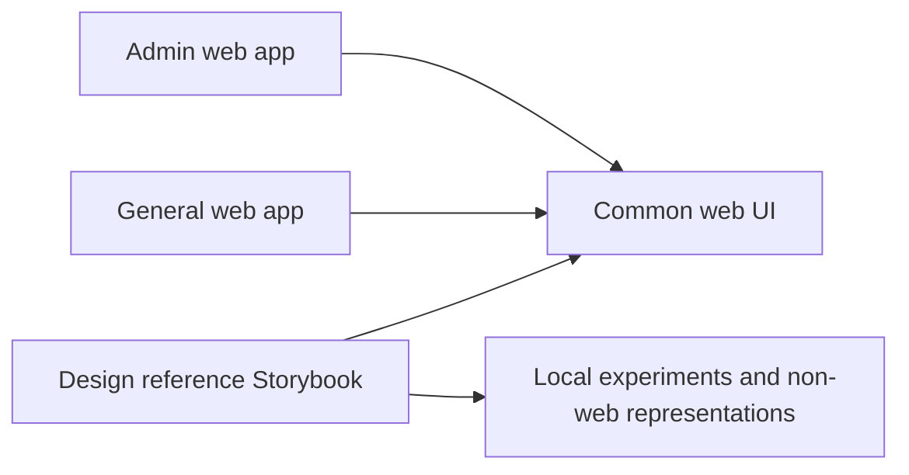

# Independent Design Reference Workspace

## Current behavior and scope

[reference-261030/REQ](../requirements/reference-261030-design-workspace.md)
defines the outcome;
[reference-261030/ADR](../adr/reference-261030-design-workspace.md) records the
already selected ownership model. Current General/Admin Storybooks use
Next.js-specific providers and app fixtures. `@chapchoo/ui` exposes shared
presentation through explicit subpaths and has no application dependency.
Neither existing surface is an independent cross-platform reference workspace.

## Architecture and ownership

Add private `@chapchoo/design-reference` under `typescript/packages/`.
Use React/Vite Storybook with only this package's story glob, no Next.js adapter
or application imports. Existing Storybook versions and workspace tooling are
reused. The package exports no production API.

Three minimal onboarding stories demonstrate workspace purpose, provisional
common-UI reuse, and reference-local non-web representation. Neutral browser
primitives and a small local reference frame explain structure without selecting
Chapchoo tokens. The common-UI example alone uses its existing Mantine provider.
The local frame remains a reference implementation, not a production component.

Common UI may specialize a concept for web use while reference retains a more
general design representation (ADR-D3). Import common UI for equivalent roles;
retain a distinct general reference when web constraints differ. Document the
relationship in the story instead of forcing an import or keeping an unexplained
same-role copy.

## Documentation and Agent entry points

The package README describes authoring, review evidence and promotion. Root and
TypeScript Agent instructions link to it; scoped instructions in reference and
common UI make ownership explicit. Development commands and a Living Spec record
the runnable behavior. These are package/domain instructions, not a new global
convention or replacement Agent workflow.

## Dependency and quality verification

A root TypeScript boundary check inspects workspace dependency declarations and
source imports, including relative and TypeScript-resolved aliases. It rejects
dependencies into reference from other workspaces, and reference imports of apps.
It is part of root lint and has isolated positive/negative fixtures. Ordinary
TypeScript and ESLint remain authoritative for resolving and checking source.

Root format/lint/typecheck discover the new package via existing Turbo tasks.
CI additionally builds its static Storybook. App Storybooks and product tests
are retained. No backend state, API, persistence, migration, credential,
automatic retry, fallback, or production runtime mode is introduced.

## Design Authority

- Design revision: `3`

| ID | Material mechanism | Authority | Classification |
| --- | --- | --- | --- |
| M1 | Independent cross-platform Storybook with static local examples | REQ-1, ADR-D1 | required |
| M2 | One-way common-UI reuse, selective promotion and distinct general representations | REQ-2, ADR-D1, ADR-D3 | required |
| M3 | Provisional styling, scoped shared provider, no design-system extraction | REQ-3, ADR-D2 | required |
| M4 | Authoring documentation and scoped Agent entry points | REQ-4 | required |
| M5 | Dependency checks, CI build and real render validation | REQ-5, M2 | derived |
| M6 | Isolated document for provisional common-UI CSS/provider effects | REQ-3, M3 | derived |

Identifiers, package paths, helper layout, story titles and equivalent checker
implementation choices are local implementation details.

## Removal and Replacement

None: inspection of the app Storybooks, UI exports, workspace scripts and CI
found no obsolete product surface required to be removed. Existing stories and
theme remain owned by their current packages. This change adds reference
scaffolding and clarifies its separation. Future promotion removes equivalent-role
copies; a general representation may remain alongside a web-specific implementation.

## Feasibility and authority audit

- REQ-1/M1: existing pnpm package glob and Storybook React/Vite dependencies
  support an independent package without adding a service. Feasible.
- REQ-2/M2: existing UI subpath exports accept props and callbacks. Source and
  manifest boundary checks can enforce the requested direction. Feasible.
- REQ-3/M3: no global inherited provider is required; only the explicit reuse
  example wraps it. No production styling edits are needed. Feasible.
- REQ-4/M4: root/TypeScript Agent entry points and package-local instructions
  are supported, with normal hooks creating CLAUDE.md imports. Feasible.
- REQ-5/M5: root Turbo quality tasks and CI already build Storybooks. A local
  static build and browser require no real login or backend fixture. Feasible.
- Every mechanism maps to the requested outcome; there is no unapproved native
  runtime, visual identity, token authority or publishing platform.

## Test Strategy

Primary end-to-end evidence is a real browser loading all initial reference
stories from the built static Storybook, checking legibility and no rendering
errors, including neutral → common reuse → neutral navigation without CSS or
document-root theme leakage. The reuse story lazy-loads Mantine in a nested
Storybook document; it never loads that module in the parent canvas.
Record story URLs and screenshots. This is tooling smoke verification,
not a new product E2E suite or native functionality claim.

Boundary unit fixtures cover allowed reference-to-UI imports and rejected
reverse/app imports through named, relative, dynamic and aliased paths and
manifest declarations. Root frontend format/lint/typecheck, existing unit tests,
product build and all Storybook builds guard integration. CI executes the
deterministic checks/builds. No testenv, seeded backend, live service, credentials
or optional live test is needed; failed required checks are failures, not skips.

## Operations and risks

Use the documented local port or a CLI override. Static output is ignored by
Git. Rollback removes the added package and its command/CI/doc integration without
changing product data. A build failure stops delivery rather than falling back
to an app Storybook. Imported provisional UI can still visually influence
readers; local notices and a provider limited to the reuse example mitigate this.
Browser rendering cannot validate native layout engines or platform controls.

## Design Approval

- Mode: Collaborative.
- Decision owner: requester.
- Authorization date: 2026-10-30.
- Execution scope mapped by revision `3`: M1, M2, M3, M4, M5, M6.
- The requester selected the ownership model and explicitly directed execution
  without further approval after the Requirements brief. This document records
  that bounded implementation authorization; it does not claim a separate
  line-by-line review of this document or approval of any visual design.
