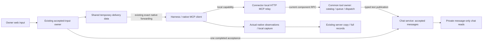
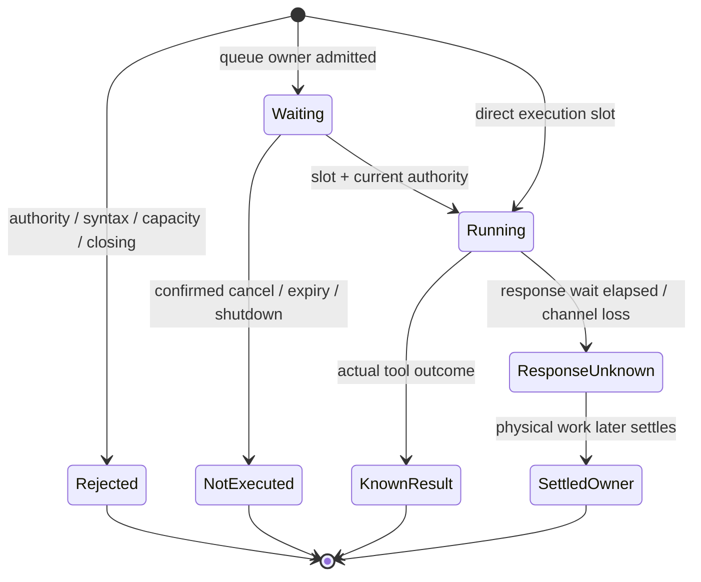

# Server-Provided Tools Design

- Reference: `tools-261112/DESIGN`.
- Requirements: [tools-261112/REQ](../requirements/tools-261112-server-provided-tools.md).
- Decisions: [tools-261112/ADR](../adr/tools-261112-server-provided-tools.md), D1–D14.
- Design revision: **2**. Collaborative mode; the requester owns material choices.
- This is the approved development-time Design, not a current-system Spec.
  The requester explicitly requested implementation and PR delivery after the
  rendered option-1 refinements. This does not authorize live model calls,
  operating-database migration, merge or deployment. Revision 2 incorporates the rendered option-1
  selection and subsequent refinements under REQ-13/D14. The earlier broad assent
  alone was not detailed visual approval. Unchanged mechanisms retain their IDs.

## Outcome and Scope

Provide Chapchoo-owned server tools through a Connector-managed local HTTP MCP
relay and authenticated component RPC. The first production tool intentionally
publishes text to the originating product conversation. Chat messages and native
session records are independently managed; temporary delivery data is shared.

User chat receipt occurs at server input acceptance. Publication receipt occurs
when the chat service completes its accepted-message write. Both speakers share
stable server chat receipt order. Native default/final text remains recorded but
is not automatically published or used as a fallback. Existing retained original
user inputs move into chat during application; native history does not rebuild
chat. Full records retain actual native observations, including publication as
one tool-call item rather than a fabricated assistant utterance.

No attachments, binary/file exchange, arbitrary targets, work-state declarations,
continuation, new native turns, generic result archive, durable invocation queue,
publication resend key, automatic tool replay, app versioning or hot reload is
introduced. Exact existing text delivery, steering, permissions and native
restoration remain authoritative.

## Current System and Gaps

Baseline inspected: `83a41877867f3602f741da0a9de819fa52f76929`.
[Research](../notes/server-tools-261112-current-system-research.md) records the
source paths, pinned external references and evidence limitations.

| Current behavior | Required change |
| --- | --- |
| Strict ACP v2 setup opens a new or exact retained native session; no Chapchoo MCP declaration exists | Install and verify the selected local endpoint in actual process setup/resume |
| Connector retains a native owner across operational reconnect/key refresh | Attach local access to that owner without rebinding another conversation |
| Local capture copies supported incoming ACP before SDK decoding; Connector replicates raw/normalized observations | Reuse the path for real tool observations; add no session writer |
| Accepted inputs retain their original body until native consumption; success removes the input and dependent handoff facts | Add independent chat receipt without changing forwarding authority or chat lifetime on consumption |
| Main transcript reads native records and filters visible kinds after general field reads | Read message-only chat data; keep existing native reads for full records/activity |
| Captured records have source ordinals; source replacement clears copied records and pending inputs | Give chat its own conversation-bound stable receipt order and lifetime |
| Existing backend has bounded owners and finite graceful/forced cleanup | Compose the new queue and execution owner into those boundaries |

An already-live exact native lookup does not resend setup configuration. An
operational reconnect is not a new native opening. A failed restore cannot make
a fresh context. There is no implemented server-tool RPC, relay or chat-message
store in this baseline.

## Design Authority

- Design revision: `2`.
- Authority set: `M1`–`M20` (all twenty IDs, no omitted or optional mechanism).
- Numbers, names, equivalent helper placement and fixture composition below
  implement these mechanisms; they do not create additional operating modes.

| ID | Material mechanism | Authority | Classification |
| --- | --- | --- | --- |
| M1 | Connector-owned local Streamable HTTP MCP provision with initial 2025-06-18 profile | ADR-D1, D2, D11; REQ-1, REQ-3 | decided |
| M2 | Common server-tool service over component RPC, separate from Control command tunneling | ADR-D3 | decided |
| M3 | Immutable native-owner local capability plus independent current server/domain authorization | ADR-D4; REQ-2; current source authority | decided |
| M4 | Bounded process-owned waiting, Agent partitions and fair dispatch | ADR-D5, D6; REQ-6 | decided |
| M5 | One bounded invocation with real queue/start/final observations | ADR-D7; REQ-4 | decided |
| M6 | Request-local cancellation signal; queue-owner arbitration and retained started work | REQ-4, REQ-6; ADR-D3, D5, D7; async-effect-ownership | derived |
| M7 | Actual harness response records and existing raw/normalized server copying, without another writer | REQ-5; current native-harness/conversation-storage Specs | existing |
| M8 | Intentional bound-conversation text publication into independently managed chat data | REQ-8; ADR-D9 | decided |
| M9 | Completed server input acceptance establishes user chat receipt plus delivery responsibility | REQ-10; ADR-D10; completed-persistence-operations | derived |
| M10 | Stable conversation chat receipt order independent of capture and sender clocks | REQ-11; ADR-D12 | decided |
| M11 | Preserve original non-deleted retained inputs at controlled application without native replay | REQ-12; ADR-D13 | decided |
| M12 | Message-only chat and expandable actual full records with publication as one tool item | REQ-13; ADR-D14 | decided |
| M13 | Private message-only metadata/body reads, distinct from native record reads | REQ-2, REQ-9; ADR-D9, D12; existing bounded-read and web SSR rules | derived |
| M14 | Product-conversation chat lifetime, independent of input/source cleanup but subject to owner deletion | REQ-2, REQ-10; ADR-D9; current conversation-storage/Agent deletion | derived |
| M15 | Finite encoded payload, memory, queue, response and local-session budgets with honest overflow | REQ-6; ADR-D5, D6, D7; bounded-admission | derived |
| M16 | Close admission, retire waiting work, retain started owners and join finite backend cleanup | REQ-4, REQ-6; ADR-D5, D7; current runtime cleanup | derived |
| M17 | Preserving schema/application boundary and verified actual new-process native provision | REQ-3, REQ-5, REQ-12; ADR-D4, D11, D13; exact restore | derived |
| M18 | No session-history-to-chat reconstruction/import | ADR-D8 | decided |
| M19 | Default/final native text preservation without automatic main-chat publication/fallback or work-state inference | REQ-8, REQ-9; ADR-D14 | required |
| M20 | Minimal E2E acceptance plus deterministic failure/concurrency/DB coverage and actual native compatibility gate | REQ-7; REQ-10 through REQ-13 | required |

The existing Specs used above are [native harness](../spec/domain/native-harness.md),
[conversation storage](../spec/domain/conversation-storage.md),
[conversation web](../spec/domain/conversation-web.md),
[Connector process](../spec/domain/connector-process.md) and
[Control](../spec/domain/computer-control-rpc.md).

## Architecture and Ownership

The relay translates protocol and retains call ownership; it does not implement
publication business logic. Server tools own their domain effects. The harness
continues to author native records, which the server copies. Chat data is a
separate original domain record, not a projection derived from tool history.

Sharing temporary delivery data does not require one physical allocation or
identical record lifetimes. Keep the existing input body until its native
handoff completes; chat owns its accepted copy. Do not create another independent
pending-delivery system for chat, and do not make the accepted chat a child of
that temporary input. Generic tool waiting remains process-owned memory, not a
new durable message queue.

## Local Provision, Scope and Security (M1–M3)

Use an established MCP SDK's public Streamable HTTP server APIs. Do not hand-code
an alternate MCP/OAuth protocol or depend on private SDK APIs. Lock the selected
implementation dependency normally during implementation; no Git-package or
new native feature exception is granted by this Design.

The Connector owns the listener and a bounded registry of native-owner access
bindings. Bind only to loopback, obtain an available local port, and retain the
endpoint for its actual owner lifetime. Treat listener layout as a local resource
detail, not authority. Validate Host/Origin according to the selected MCP HTTP
security contract; requests without browser Origin still require capability
authentication. Reject untrusted browser origins. Do not put access values in URLs.

A cryptographically random local bearer is held in Connector memory and bound to
the trusted Agent, product conversation, execution and actual native owner. Supply
it through MCP HTTP headers in native setup, never as a model argument, ordinary
message, general native environment credential or log field. Supply no Connector
operating bearer to native. Native IDs are exact-restoration/provenance facts,
not an additional permission grant or a prerequisite for choosing caller scope.

SDK MCP session IDs correlate protocol requests, never grant authority. Authenticate
all HTTP requests, and bind each protocol session to the same local capability.
Do not allow a later request to change the session's scope. Retain only bounded,
process-owned protocol state; add no event replay store or durable cursor.

Operational reconnect/key refresh does not rebind the local capability or replace
the actual native owner. New server calls use current component authority. Actual
owner retirement invalidates its local access and releases its protocol state.
A replacement owner receives its own access while restoring the exact retained
session. Same-OS-privilege bearer-holding code can use that scope; this is not a
sandbox against arbitrary code running with native's own privileges.

On discovery, dispatch, domain commit and protected result disclosure, enforce
current Connector execution/route/key, Agent/conversation ownership and current
Team authority. A previous catalog, local bearer or stale route cannot resurrect
revoked server authority. Denied result disclosure must not leak protected
content or imply that an already committed effect was rolled back.

### Effective catalog

Initially expose the text-publication tool only. Representative second tool
behaviors are test fixtures, not an artificial production catalog. Use a reserved
integration name (local spelling `chapchoo`) and unambiguous tool names; reject
sanitized-name collisions or a different existing endpoint instead of silently
overwriting or using it. Verify the actual endpoint and definitions, not only
successful configuration submission.

Keep the initial declared contracts stable during a live owner's lifetime. No
live catalog feature, schema fingerprint, app catalog generation or retained
old-handler platform is added. An unavailable/invalid definition fails explicitly;
an old name cannot silently become another operation. Per-call authorization
remains current even when the visible catalog was obtained earlier.

Actual new-process setup and exact retained-session reopen supply declarations
and validate effective provision. An already-live lookup cannot perform that
application. Do not automatically restart native, start a model turn, downgrade
protocol or create a fresh conversation to repair provision failure.

## Common Component RPC and Invocation State (M2, M4–M6)

The new component service provides bounded catalog discovery and invocation.
Generated Protobuf and Node/Rust adapters remain contract authority. It does not
reuse short Control command frames or the ten-second unary helper for the whole
invocation lifetime.

Use one request-local invocation stream. Its first frame contains one Submit
with a sealed caller scope, tool name and encoded arguments. The only later
control frame is cancellation of that same invocation. There is no target-changing
control, second Submit, durable handle, result query, caller resend key or stream
resume. A bounded bidirectional component call carries this signal and ADR-D7's
single ordered response stream; it is not the Control command stream.

The relay seals scope from the capability binding, not JSON identity fields.
The service authenticates the stream, decodes operation-specific arguments and
owns admission. Discovery alone is not invocation permission. Control fields
cannot select or cancel another invocation.

Waiting is process-owned and bounded by count, bytes and elapsed time. Partition
waiting budgets by trusted Agent and select waiting Agents fairly; preserve order
inside an Agent's waiting partition. Multiple conversations keep their distinct
targets but share that Agent budget. Reserve no execution slots per Agent and
promise no preemption, equal completion times or cluster-wide fairness.

Responses contain at most one actual Waiting observation, one Started observation
and one Final. Direct execution has no fabricated Waiting event. Terminal
pre-dispatch rejection/cancellation has no Started event. Buffering is bounded;
a response receiver is never the work owner. Intermediate RPC observations do
not create native history, assistant narration, a new UI work state or automatic
MCP progress publication.

Final distinguishes known non-execution, an actual MCP tool result/error, and
uncertain effect/result availability. Invalid envelope/unknown tool, recognized
tool validation/execution errors, transport failure and unsupported/oversized
representation remain distinct. Preserve the selected revision's text,
structured-object, schema and `isError` semantics. Do not narrow integers or
rewrite omission as explicit null. A result too large to represent after an
effect must not be described as proof that the effect did not occur.

### Cancellation and deadlines

Map an actual MCP cancellation notification to cancellation of its existing
RPC invocation. Use the SDK's public typed notification hook (the inspected
`ServerHandler::on_cancelled` shape), not a generic future-drop or connection
cancellation token as a substitute for that observation. Bound protocol sessions
through the public `SessionManager` create/close boundary. In the selected
protocol, local HTTP disconnection alone is not an explicit notification. A
broken RPC stream alone also cannot establish non-execution.
Retain work ownership until its actual terminal transition or the finite response
wait boundary, without reissuing the call.

The queue owner arbitrates explicit cancellation/expiry against dispatch. If a
confirmed terminal transition wins while waiting, the request cannot execute
later. If dispatch wins, keep the physical owner and permits; apply the tool's
actual cancellation guarantee. The initial chat write has no recall/undo promise.
Cancellation does not delete a committed message or authorize another call.

An elapsed response wait after dispatch ends the observation as uncertain, not
successful completion or known rejection. The execution owner can still finish
its database operation and releases execution capacity only when processing
settles. Do not backfill a fabricated successful native response afterward.

## Publication and Bidirectional Data (M7–M11, M14, M18, M19)

### Initial tool contract

Local tool spelling: `publish_text`. Input is an object with required `text`,
validated as complete conversation text, with no arbitrary Agent/conversation,
channel, finish/wait/progress or retry fields. Preserve submitted content; apply
existing text validation plus the encoded invocation budget before execution.

The server's typed publication operation revalidates current authority and commits
one Agent chat message to the bound conversation. Final success means completed
chat receipt, not queue admission, browser rendering/read confirmation or MCP
response arrival. The successful structured result is an object containing the
repository-issued `message_id`; its text representation states acceptance. Do
not echo secrets or require returning the entire message body.

A lost result can coexist with accepted chat. The original harness observes its
actual response/error and existing capture copying preserves that observation.
Neither layer fabricates the missing success, republishes automatically, infers
completion/input wait or falls back to ordinary assistant output.

### User input receipt

Extend the existing completed server input-acceptance operation to establish both
chat receipt and the existing temporary-delivery responsibility before returning
success. Keep external native work outside the transaction. A failed chat write
cannot produce successful new-input acceptance or native dispatch.

The existing original request/target/body recovery remains limited to its retained
input operation. Recovering an existing pending receipt neither appends another
chat message nor dispatches another native input. This adds no permanent resend
API or content-based deduplication. Intentionally separate submissions remain
separate messages even if their text is equal.

Native insertion/steering and their current result reporting continue unchanged.
Consumed-input cleanup removes only temporary delivery data; failed/unresolved
facts retain their existing meaning. Existing failed-input body removal does not
implicitly delete accepted chat. Ordinary native user observations may arrive
later or not at all, independently of the accepted chat message.

### Data shape and stable order

Add conversation-owned chat messages and a conversation-local allocation head.
A message has a repository-issued typed identity, conversation identity, USER or
AGENT role, immutable text, chat receipt time and stable positive receipt order.
A user message can retain its originating input-operation identity as provenance.
That value is not an owning foreign key to the ephemeral input, a model-supplied
retry key or a new durable delivery receipt API.

Allocate order and insert the message in the same completed database transaction,
serializing the conversation's allocation head until commit. Do not order by a
UUID issued before a lock wait, a caller clock, a browser response or capture
ordinal. Rollback exposes no accepted message; later accepted messages cannot
appear ahead of previously accepted messages. Use exact integer representations
at RPC/TypeScript boundaries rather than lossy JavaScript number conversion.

Chat tables reference the product conversation, not a captured source or pending
input. Capture source replacement, input consumption and failed-input removal do
not cascade into chat. Existing authorized Agent/conversation deletion cleans its
private child data. Add no retention timer, orphan archive or new chat-delete UI.

### Original-input preservation

At controlled application, copy only server-retained original user inputs whose
body is present and not logically deleted. Preserve original acceptance metadata
and input identity where available. Use a unique source-input association to
avoid duplicating migration copies, not as a public publication idempotency key.

Create a deterministic conversation-local prefix from those retained inputs before
new chat admissions. Their chat receipt is established during this transfer;
do not assert an unrecorded exact historical commit order. Do not reconstruct
consumed/absent inputs or import native assistant history. Keep native forwarding,
uncertainty and deletion facts unchanged; moving content is not native replay.

## Chat Reads and Full-Record Presentation (M12, M13, M19)

Add private owner message metadata pages and bounded body reads under the existing
Agent/conversation and Team authorization. Message metadata includes its stable
order, role, body extent and receipt information. Use exact stable anchors and a
finite page boundary; append catch-up does not reuse capture ordinals. Revalidate
scope on each body continuation. A disappearing authorized record is explicit,
not an invented complete body or another message substituted under its ID.

Reuse the existing metadata/body-chunk pattern so the established user-input text
limit is not reduced to the smaller new tool-invocation payload budget. Preserve
full original content retrieval without loading tool payloads for the chat.
Native full-record/activity reads continue separately under their source contract.

Server-render the primary initial message region and hydrate that same state;
client continuation owns later updates. Retain existing route/auth, pagination,
locale, theme, keyboard and responsive component boundaries. Do not turn protected
chat into a client-only loading shell or expose credentials in page props.

Confirmed item mapping:

| Surface/item | Representation |
| --- | --- |
| Main chat | Accepted user messages and intentionally published Agent messages only |
| Full-record user input | Actual native input record; no fake native row for never-delivered chat |
| Full-record default/final output | Distinct expandable output item, retained even if its text resembles published chat |
| Full-record publication | One tool item; expanded readable sent text and actually observed result, plus retained original fields |
| Thought/other tool/request observations | Existing inspectable items; retain live permission/form controls in their current authorized surface and read-only history copies |

Reuse `ConversationRecordDisclosure` and `ToolRecordDetails` seams. Specialize
publication's readable details without replacing its original tool input/output.
Use the selected uniform-row treatment in both collapsed and expanded states:

- User message: user icon. Intentionally published Agent message: paper-plane
  icon. Native/model text: ordinary text icon. Keep thought and other tool icons.
- Message rows use a left rail resolved from the current primary theme color,
  including the scoped Agent theme. Do not bind it to a fixed yellow swatch.
  Remove message-name labels and their highlight; role is visually conveyed by
  the icon, with equivalent accessible role information retained.
- Model output is labeled as output without the Agent name.
- Collapsed message rows show the normalized body beginning with the existing
  single-line truncation behavior. Apply the same preview normalization to user
  messages and Agent publication; never replace the latter with a generic
  publication action/tool title. Read the body from its normalized text fields,
  while keeping captured original tool input/result available in expanded details.
- Classify publication by its actual normalized tool identity, not body-text
  resemblance or the generic `other` tool category. No new native record is
  fabricated. This is a presentation projection over one captured tool item.

Do not synthesize an assistant record for accepted chat, merge records by equal
text, infer physical publication from missing output or mark an unknown send as
known non-delivery. This is not a new notification or product-work state system.

Component renders verified this treatment at desktop and mobile widths, with
zero/four expanded records, user/paper-plane/text SVG distinctions, no message
sender labels, normalized publication previews and two different scoped primary
colors. These static renders establish visual feasibility, not authenticated
native acceptance or implemented production normalization. Focused component
checks must cover the same states and actual normalized publication identity;
the minimal E2E journey remains the product-level acceptance gate.

## Resource and Operational Parameters (M15, M16)

These initial parameters are retained from revision 1, not measured throughput claims.
They implement selected finite ownership rather than introducing configuration
modes or independent product policies. Validate exact encoding and races before
implementation acceptance; material relaxation returns to Design approval.

| Resource | Initial limit / behavior |
| --- | --- |
| Internal component message | 64 KiB encoded, matching the inspected bounded adapters |
| Encoded invocation arguments / complete result | 48 KiB each; include structured/text content and check actual envelope size |
| Complete catalog | At most 32 definitions within the same 48-KiB application budget; oversize is unavailable, not partial success |
| Global executing calls per service owner | 16 |
| Global waiting | 128 calls and 8 MiB retained input |
| Waiting per Agent | 8 calls and 512 KiB; no Agent-reserved execution slots |
| Waiting lifetime | 10 seconds, measured by the actual queue owner |
| Total response wait | At most 50 seconds including waiting; does not preempt a started effect |
| RPC observation buffering | At most the actual queue/start/final observations; no unbounded progress backlog |
| Local relay HTTP admission and forwarded work | At most 128 accepted connections and 128 active requests / 8 MiB retained payload, reserved before header/body parsing (including unauthenticated requests); 64-KiB body, 16-KiB headers and 10-second header/body read deadlines; reject at capacity, with no second waiting scheduler |
| Local protocol sessions | At most 4 per native-owner capability; retire on explicit protocol-session closure or actual owner exit, with no durable replay |
| Chat metadata pages / body chunks | 25 metadata items / at most 32-KiB body pieces, with existing bounded region/continuation rules |
| Existing user input | Preserve its current 16-MiB input contract and existing upload bounds |

Bound local HTTP payload parsing, authenticated in-flight work and SDK session
allocation before unbounded buffering. Account resources through actual task
ownership, not only future/stream handles. Keep failed cleanup causes and emit
honest forced-failure status. Use the existing backend graceful 20-second and
forced five-second cleanup boundaries; add no separate infinite drain.

## Migration, Application and Rollback (M11, M14, M17)

Add preserving SQLite and PostgreSQL migrations. Keep applied historical migrations
immutable. Create chat storage/order structures, preserve non-deleted retained
original inputs and their existing delivery facts, and verify referential/order
invariants before enabling new acceptance.

Use a controlled application boundary: withdraw/drain admission writers that can
still accept input without chat receipt, run the preserving migration, then start
new admission-capable owners and the matching chat reader. Migration 22's terminal
input guards remain effective; do not accidentally cascade newly accepted chat
from those old input-removal paths. Do not claim mixed old/new writers satisfy the
new receipt contract merely because the schema is additive.

Do not read native history to backfill old chat and do not retain a legacy
main-transcript fallback. Preserve original capture/state volumes and exact native
identity. A real replacement process can reopen the retained native session and
receive MCP provision; a still-live owner/reconnect is not upgraded by declaration
alone. Planned application does not authorize the Agent to restart Computers or
native owners during this design task.

Downgrade must refuse destructive schema removal while accepted chat exists. An
older application cannot be treated as supporting this new receipt/read contract;
rollback is a controlled supported procedure, not silent mixed-version operation.
Do not delete accepted messages to make downgrade pass. Any restore/discard action
requires explicit operator authority and a data-preserving plan, not this Design.

## Observability and Failure Meaning

Record bounded counts, durations and rejection causes for provision, authorization,
queue admission/expiry, dispatch, representation, cancellation and cleanup. Correlate
using existing trusted scope and request-local IDs without creating a durable
invocation journal. Never log local or operational bearers, request headers or
message bodies. SDK/native diagnostic logging must not expose supplied secrets.

Keep provision failure separate from an empty authorized catalog. Queue admission
is not chat receipt. Native idle is not product completion. A response timeout,
cancel or disconnected caller is not evidence of non-publication. Chat remains
available even when captured native output is delayed or missing; raw history
remains truthful about what native actually observed.

## Test Strategy

### Primary E2E verification

Keep one minimal browser journey using real owner RPC, persistence, Connector and
an isolated native fixture: submit a user message, observe accepted chat before
native delivery, complete native receipt, publish text through the relay, then
inspect chat and full records. Verify only one published Agent message, no automatic
native-output message, stable order and the approved expanded tool details. Repeat
the essential provision step after an exact process/session reopen; do not create
a second conversation or replay input.

Use the existing `typescript/apps/e2e` runner; `testenv/chapchoo` supplies process,
database, native executable and deterministic fault prerequisites only. Configure
the synthetic executable/supply before connection startup so the fixture cannot
accidentally launch a real managed model. Do not build a second E2E platform.

### Lower-layer matrix

| Subject | Required coverage |
| --- | --- |
| Local MCP / component boundary | Selected profile initialization, real headers/scope, collision, malformed/unknown tool, typed validation, structured/text/error and oversize refusal |
| Current authorization | Different Agent/conversation, stale route/key/execution, revoked membership, protocol-session scope mismatch and result-disclosure revocation |
| Queue/execution owner | Mixed-Agent count/byte bounds, fair selection, direct execution, cancellation/expiry/dispatch races, backpressure and lost receiver |
| Publication | Commit success, rejection before effect, commit with lost response, unknown observation without automatic replay or fabricated history |
| Input/chat receipt | Atomic new acceptance, existing pending receipt recovery without a second chat message, native failure/uncertainty and consumed-input cleanup preserving chat |
| Order/reads | Concurrent user/Agent acceptance, delayed capture, rollback, stable pages and exact body continuation, including large original user content |
| Both databases/migrations | Existing input/tombstone/source fixtures, deterministic preserved prefix, original-body exactness, old-writer guard/application fencing and unsafe downgrade refusal |
| Native/full-record UI | Actual input only, retained default/final text, one publication tool item, original fields, no extra assistant row, existing form/permission interaction |
| Shutdown | Admission closed, waiting work retired without dispatch, started ownership retained, graceful completion and forced failure with no false success |

Use explicit synchronization and controllable clocks rather than sleeps. Keep
record-level copy/localized copy, disclosure, keyboard, overflow and mobile checks
in app-owned component tests/Storybook fixtures. Test the subject's contract rather
than dependency defaults. General/Admin shared rendering conventions remain in
force; this Design does not invent an Admin chat or tool-management surface.

### Actual native compatibility gate and evidence

Before claiming actual harness compatibility, exercise the chosen installed
Codex/ACP/SDK combination for new and exact resumed sessions: negotiated profile,
effective endpoint/catalog and text/structured/error delivery through actual
capture/server reads. Source declaration support is insufficient.

Record repository SHA, exact native/adapter/SDK builds, database backend, fixture
configuration, redacted prerequisite availability and command results. Capture
request-local transition evidence and browser screenshots/traces for the minimal
journey without secrets or raw private text. Deterministic tests run in ordinary
CI on both database contracts. An explicitly authorized credentialed/model check
is separately gated: absent credentials/permission means NOT RUN, never PASS;
missing prerequisites for the mandatory model-free journey are a failure. No
live credential/model or infrastructure operation is authorized by this Design.

## Removal and Replacement

| Existing unit or behavior | Removal authority | Replacement / remaining authority | Boundary | Absence verification |
| --- | --- | --- | --- | --- |
| Main transcript sourcing Agent speech from native assistant records | REQ-9, REQ-13; ADR-D9, D14 | Private chat message reads and intentional publication; full native history remains | Matching server/chat reader activation | No native assistant/final fallback or tool-field fetch needed for main chat |
| General native field reads used solely to feed main chat filtering | REQ-9; ADR-D9; M13 | Message-only pages/body reads; retain full-record/activity consumers | Chat reader integration | Browser journey traces show message reads for chat and native reads only for their actual consumers |
| Native-success cleanup as the sole lifetime of received user text | REQ-10; ADR-D10 | Accepted chat persists independently; input cleanup remains for delivery | Receipt migration and acceptance write | Consume/delete/source-replace fixture cannot remove accepted chat |
| Old acceptance path able to commit new input without chat receipt | REQ-10, REQ-12; ADR-D10, D13 | Completed combined input/chat acceptance and controlled old-writer drain | Before enabling new acceptance | Mixed-writer/application fixture and failure injection establish no acceptance-only success |
| Tests/fixtures assuming automatic raw assistant publication | REQ-9, REQ-13 | Tool-publication chat acceptance plus retained full-record fixtures | Behavior replacement | Replace obsolete expectations rather than retaining assertions of removed behavior |
| Full-record sender labels, robot output icon and generic publication action preview | REQ-13; ADR-D14 rendered selection | Uniform rows with role icons, current-primary message rail and normalized body previews; original tool fields remain | M12 presentation integration | Focused closed/open component checks exclude stale names/highlights/action previews and verify scoped color changes |
| Generated RPC/read surfaces for changed chat use | M2, M13 and existing generation rules | Regenerated typed clients; existing native record services retained | Contract/code generation | No hand-edited generated output or abandoned duplicate chat API |
| Current Spec statements equating main chat with native transcript filtering | REQ-9, REQ-13 | Update owning Spec pages only with verified implementation | Feature verification | Semantic review of conversation-web/storage/native-harness connections |

No removal of native capture, source identity, local retained context, steering,
Stop, permission responders, supported user-input size or original evidence is
authorized. No speculative legacy handler, result archive, app catalog version or
file-transfer subsystem is being replaced because none exists in this baseline.

## Requirement Coverage and Feasibility

| Requirement | Mechanisms | Evidence and feasibility conclusion |
| --- | --- | --- |
| REQ-1 common tools | M1, M2, M4, M5, M20 | Existing component streaming plus pinned SDK/harness shapes; conditional on new boundary implementation/fixture verification |
| REQ-2 isolation | M3, M13, M14 | Existing current component and private owner/Team admission traced; feasible with revalidation preserved |
| REQ-3 native lifecycle | M1, M3, M17, M20 | Exact new/resume and live-owner behavior inspected; conditional on actual provision in selected builds |
| REQ-4 honest outcomes | M5, M6, M15, M16 | Native cancellation source and existing effect owners traced; feasible design, new race matrix unexecuted |
| REQ-5 session ownership | M7, M14 | Existing raw input/output normalization and 33 earlier model-free tests; feasible without another writer |
| REQ-6 bounds | M4, M5, M15, M16 | Existing bounded transport/owner/shutdown patterns; conditional numerical/SDK validation, no throughput claim |
| REQ-7 verification | M20 | Existing E2E/testenv and DB fixtures provide a credible plan; new acceptance tests are not yet implemented |
| REQ-8 publication | M8, M3, M5 | Database-only domain receipt fits current Store boundary; feasible, new tool unimplemented |
| REQ-9 output separation | M12, M13, M19 | Current renderer/reader seams inspected; feasible replacement without deleting native observations |
| REQ-10 user receipt | M9, M14 | Completed input admission and later consumption traced; feasible additive chat receipt transaction |
| REQ-11 order | M10, M13 | Database-local serialized allocation/read anchors are implementable on both backends; new concurrency tests required |
| REQ-12 original inputs | M11, M17 | Retained input/body/tombstone and migration-22 guard paths inspected; feasible controlled migration, not a full history recovery |
| REQ-13 full records | M12, M7, M19 | Actual disclosure/content/tool-detail component renders verified desktop/mobile, role icons, closed/open states, normalized body preview and scoped primary colors; actual native normalization and authenticated product integration remain conditional |

Design-level conclusion: **conditional, with no currently identified contradiction
or unsupported required outcome**. Implementation acceptance is not established.
The conditions above are explicit verification obligations, not permission for
fallback behavior. A failed actual SDK/native boundary or a necessary new state,
mode, interface authority or recovery policy returns to Requirements/ADR/Design
before implementation proceeds.

## Authority Audit

Forward review: REQ-1–REQ-13 each have mechanisms and verification coverage in
the table above. Reverse review: M1–M20 each cite confirmed Requirements, accepted
ADR or retained current contracts; no mechanism relies on feasibility or approval
alone. Derived mechanisms preserve the selected ownership/lifetime boundaries
without adding a second writer, generic journal, resend procedure or app mode.

Removal review: each authoritative removal is tied to the confirmed output,
receipt or read-source change; retained native/input/source contracts are explicit.
Local identifiers, payload field spelling, helper/module placement, exact SQL
head implementation and fixture layout introduce no new authority. Resource
numbers are disclosed bounded parameters for the selected mechanism, not an
unapproved promise of execution/throughput or a public configuration feature.

Final Design audit must also verify the generated contract actually preserves
these distinctions and the chosen SDK's public APIs support the bounded
request-local mechanism. This document cannot waive a discovered feasibility or
authority blocker.

## Delivery Shape and Remaining Risks

Implementation is separate. A later shipping plan can split common provision/
authority/queue, independent chat storage/read migration, initial publication/UI,
and end-to-end acceptance into reviewable delivery phases, each citing this
Design's mechanism IDs and introducing no new Design authority. No implementation
plan or branch changes are created by this document.

Remaining non-blocking Design risks: native/SDK effective-version drift,
configuration collisions, numerical tuning after deterministic/load evidence,
large-text reader cost, old admission writers during application and forced-stop
uncertainty. None permits silent downgrade, missing chat receipt, discarded
accepted content, automatic replay or fresh-context restoration.

## Design Approval

- Mode: `Collaborative`.
- Decision owner: requester.
- Approved on: **2026-11-12 KST**.
- Approved Design revision: **2**.
- Approved authority IDs: **M1–M20**, the complete exact set in Design Authority.
- Approved scope: the consolidated server-tools, independently managed chat,
  preserving application and selected full-record presentation. After the
  rendered UI refinements the requester explicitly instructed implementation
  and PR delivery. Implementation proceeds within this baseline; live model
  calls, operating-database changes, merge and deployment remain separate.
