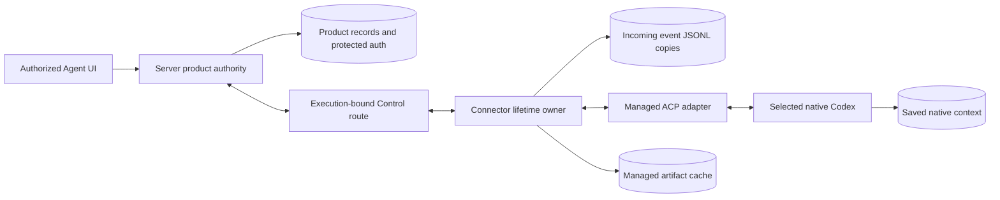
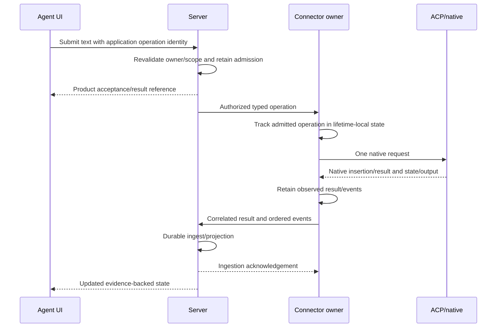

# Codex Conversation Integrated Contract Proposal

Scope: [chat-261108/REQ](../requirements/chat-261108-text-conversation.md),
revision 24, and [chat-261108/ADR](../adr/chat-261108-text-conversation.md)
D1 through D33, within each decision's stated acceptance boundary.

This supporting proposal record is superseded for implementation planning by
the [primary Design](../design/chat-261108-text-conversation.md).
Complete revision-bound approval is recorded in that Design, not in this
supporting proposal. Implementation still requires a separate requester instruction.
Unaccepted alternatives here remain proposals; accepted choices are defined by
the Requirements and ADR rather than by individual fields/helpers in this note.

### Subsequent Decision Boundaries

D33 preserves saved-reference authentication deletion protection without a new
runtime-only blocker. Deleted/out-of-scope records receive no new renewal or
delivery; already-forwarded credentials are not immediately revoked.

D31 selects managed preparation when no Agent supply setting is saved. Actual
input, not a screen read, triggers preparation; explicit existing CLI selection
retains its no-silent-fallback boundary. D32 separately selects collecting only
inactive superseded owned installation cache after complete replacement, while
protecting active/preparing/latest combinations and their shared components.
Conversation sources, native context, credentials, workspace and external CLI
installations are outside that deletion authority.

D16 accepts server-maintained product records. D18 selects paired raw and
service-normalized event retention, with normalized data used for rendering and
raw used for debugging/re-normalization. D17 accepts local
Connector JSONL copies of incoming ACP session events, first-load replay by
default and assignment of missing event-occurrence IDs. Native-side missed-event
recovery and independently launched external harness activity are excluded.
The hypothetical full-replay/replacement reload is not an approved product action.

On server connection, D18 uses the server's latest snapshot/event cursor to
replay missed captured events from the Connector copy. A missing snapshot fails
explicitly and triggers server rebuild from the available snapshot. Rebuild
fully replaces the session's server conversation data under D19, including
independently admitted inputs, form/permission answers and delivery evidence.
Facts absent from the new snapshot have no separate preservation exception.

D22 excludes a separate persistent outgoing dispatch journal. D23 limits special
recording-failure input gating/shutdown to small reuse of existing paths; omit
it if substantial extra work is needed. D29 keeps the entire current incoming
snapshot through server ACK without automatic prefix pruning/rotation.
Acknowledgement implementation remains Design work. D20 selects recent/older
normalized reads, live screen updates and current-region re-reading on browser
reconnection, without a separate durable browser change feed.
Any native-gap repair/repeated replay interpretation is superseded by D17, and
a normalized-only canonical-store recommendation is superseded by D18's pairs.

## Current-System Gap

The current chat container holds local user messages and sample activity. Its
Send and Stop callbacks do not submit native work. Current Agent/Computer APIs
and migrations have no product transcript, native-session binding, durable
conversation-command result or event catch-up contract.

Control has authenticated execution ownership and exact connection/call
correlation, but its pending map and result waiters are connection-local and
bounded to short calls. A timeout after queue/forward admission is uncertain.
This transport is not a durable prompt ledger or native-execution waiter.

Connector credential refresh replaces the stream by returning from the current
connection loop. D1 therefore requires the new native harness owner outside that
loop, surviving ordinary stream replacement within the Connector process.

Backend authentication currently supports protected storage, acquisition and
saved Agent selection. It does not implement execution-secret delivery,
native application, ChatGPT refresh coordination or external provider revocation.

## Fixed Boundaries

- Initial Codex and ACP v2 only; no silent v1 or credential fallback.
- Private Agent ownership, current Team admission and selected-authentication
  scope remain independent checks.
- Connector owns the live native connection and observed state. Server-link
  replacement is not harness retirement; Connector replacement is not live
  harness adoption.
- Managed preparation, compatible newest-release selection, official metadata
  digest verification, per-Computer saved cache and existing-CLI selection follow
  D2 through D9.
- Owner supply settings are server-authoritative. Live settings saves do not
  restart work; a genuinely new harness start applies saved settings.
- Startup is on actual user text submission when needed in an available Computer.
  Reading the UI is not startup or automatic Computer power-on.
- Normal task completion retains the harness. Initial scope has no idle timer.
- Lifetime shutdown uses bounded cooperation/drain and escalation, with actual
  retirement evidence. Uncertain predecessors cannot overlap successors.
- Current-work Stop, session closure, process retirement and Computer power are
  distinct operations.

## Three Integrated Proposals Requiring Authority

### U1. Separate Product Records From Native Context

Accepted direction: the server owns paired raw/normalized captured events and
renders normalized data; the Computer owns saved native Codex context. D19
replaces the entire server conversation data on unavailable-snapshot rebuild.
Detailed record/operation mechanisms still need design.

The server can then serve retained records while the Computer is off. Native
resume restores supported model context; D17 limits history replay by default to
the first session load and excludes native-gap recovery.

D18 retains raw data for renewed normalization, so this is not the earlier
normalized-only recommendation. General event sourcing and separate asynchronous
projection workers have not been selected. D20 excludes a separate durable
browser change feed initially.

### U2. Separate Command Acceptance From Event/Outcome Recovery

D21 accepts short server product acceptance after retaining the input, with an
application operation reference and separately reported preparation/native
acceptance/execution evidence. Browser loss alone does not cancel or resubmit
work. Dispatch/recovery mechanisms below remain proposals.

Recommended: reuse authenticated Control routing with typed conversation
commands/events, keeping short transport calls separate from native work.

D22 selects server-retained/captured evidence plus bounded surviving-Connector
command state, without a separate persistent dispatch journal. Unproven outcomes
after Connector replacement remain uncertain; missing state does not permit
native-effect replay. The old pre-effect journal proposal is not selected.

Incoming event-pair persistence/acknowledgement remains to implement. D29 selects
full current-snapshot retention on existing storage, not automatic compaction.
D23 conditionally permits simple recording-failure gating/shutdown, not a
dedicated storage-failure framework. Unlimited capacity or lossless recovery
through arbitrary outages is not proposed.

### U3. Make Execution Credential Application and Withdrawal Explicit

Recommended authority: the server's protected selected-authentication record
remains canonical. Native execution receives only the admitted selection for its
exact Agent/Computer execution, not ambient login or Connector/server credentials.

API keys have a source-backed explicit ACP login path. D24 selects server-owned
ChatGPT refresh with required short-lived tokens delivered to Computers, not
native-managed refresh-token copies. Native external-token file loading is a
source-backed candidate; live adoption/renewal through stock ACP remains
conditional. This direction does not approve a fork or new bridge.

D25 defers changed saved authentication selection to the next actual harness
start, leaving the applied authentication in use without selection-triggered
retirement. D26 publishes same-record credential changes by automatic file
replacement without harness intervention; publication is not proof of adoption.
Authority withdrawal, refresh-result fencing, disconnected execution and secret
residue still need design. U3 must not
silently reduce supported authentication to API keys, introduce an adapter fork
or claim immediate offline revocation without an enforcing mechanism.

## Proposed Ownership and Identity

The diagram includes unaccepted U1/U2/U3 mechanisms. It does not represent current
implemented topology.

Keep these identities distinct:

- Agent and its currently authorized owner/Team context;
- product conversation and product message/activity identity;
- Computer and Computer execution;
- Connector session and current stream connection;
- managed harness process instance and native session;
- application operation and its transient transport call;
- native typed entity `(native session, entity type, native entity ID)`;
- captured event-occurrence identity and proposed acknowledged ingestion position.

Initial use exposes one ongoing conversation without imposing a permanent unique
Agent-to-conversation product restriction. New product identities use the
repository identity contract; a stream ID or JSON-RPC ID is not a conversation ID.
Ordering positions are delivery cursors, not a user-facing version-history system.

## Candidate Server Record Responsibilities

Exact table/DTO names are provisional Design details, not accepted schema.

### Conversation and native binding

Retain the owning Agent reference, current native binding and source context
needed to distinguish an existing conversation from a new native process.
Native context restoration failure does not silently create fresh context.

### Product messages and activity

Store user submissions, assistant messages and typed activity with stable product
identity. Preserve native message identity for same-message updates. Tool, plan,
thought and requested-action records are not manufactured assistant utterances.

Apply source-bound updates in order. Historical replay cannot silently overwrite
a newer current observation or move an old execution into the active slot.
Supported formal content updates remain possible; terminal UI appearance does not
make a native message immune to its authorized content-update contract.

### Operations and request responses

Retain the operation purpose, authorized scope, protected payload fingerprint,
admission result, known dispatch/insertion/result facts and exact target binding.
Repeated submission of the same operation must not create another effective
response or native dispatch. Changed payload under the same operation identity is
not a retry of the same work.

Forms and execution permissions retain original content/options, typed responses,
chosen scope and validity. A browser button lock is not the authoritative response
fence. Request closure/cancellation/supersession rejects late responses.

### Recorded observations

D17 gives captured events an occurrence identity. D18 selects snapshot-scoped
server catch-up and raw/normalized pairs; exact ingestion ordering, idempotency
and acknowledgement remain to be designed. They do not imply upstream native-gap
detection. Local and server copies must respect the secret boundaries.

Server record retention/deletion respects current privacy/Agent deletion
boundaries and D19's complete conversation-data replacement. This proposal does
not promise unlimited retention or restoration after authorized deletion.

## Candidate Application Contract

Reuse repository owner-admission and generated RPC patterns. Do not expose owner
session bearers to components or repurpose Provider/Connector credentials as
user authority.

The proposed owner operations cover:

- initial conversation snapshot and bounded older-record retrieval;
- live normalized record/state observation, with current-region re-reading on
  browser reconnection under D20;
- text submission and operation-result lookup;
- current-work Stop;
- form/permission response;
- saved supply configuration read/update.

Each read and mutation validates private ownership and current Team membership.
Target IDs in the payload are not authorization. Secret resolution additionally
validates selected-authentication scope and current execution authority.

The proposed Connector operations cover typed prepare/submit/steer/stop/respond,
inspect, ingestion acknowledgement and credential application under exact
admission. Existing `ObserveConnector.ready` retains its connectivity meaning.

These are responsibility groups, not permission to implement arbitrary commands
or a second public execution channel.

## Text Submission and Uncertainty

The proposed server acceptance is not native insertion. Native insertion is not
model consumption or work completion. Output arrival is not a completion signal.
The UI may receive some observations before a transport response; facts must not
be forced into a fictitious single total ordering.

The Connector retains bounded operation state while alive under D22; it has no
separate persistent pre-effect journal. After a crash, only already-retained or
currently provable evidence can settle an operation. A new Connector does not
resubmit it merely because state or a response is missing. A native observation
may settle only a correlation it actually proves. Equal text, arrival order or a
newly assigned native message ID is not such proof.

A confirmed not-admitted/not-dispatched outcome can permit a new explicit attempt.
Timeout, connection loss and future cancellation do not prove that outcome.
Current request/result lookup does not itself perform the native effect again.

Startup delay retains the original admitted input. It does not convert running
steering into a future-task scheduling product or permit invisible repeated sends.

## Running Input Uses the Actual Producer Contract

In inspected Codex ACP 2.5.0, overlapping standard v2 `session/prompt` calls can
wait on a reservation held until the previous prompt work ends. Using only that
method would not establish REQ-4's steering behavior.

The same producer registers `_session/steering` on v2. Its supported
`idleBehavior: promptRequired` path returns a no-running-turn outcome without
starting a fallback turn. The proposed Codex-specific binding is:

- use the advertised/supported steering extension for a running input;
- move to a normal prompt only after its explicit no-consumption
  `promptRequired/noRunningTurn` outcome;
- do not make that transition after a timeout or unknown injection result;
- distinguish injection acknowledgement from native insertion/consumption.

The producer generates native message IDs. Steering responses carry no message
ID, so application operation IDs cannot simply be reused as native IDs and
steering input cannot be correlated to a native user-message update by content.
This is a real verification limit, not an exactly-once guarantee.

Capability/behavior acceptance must be bound to the actual supported producer
profile. Do not add v1 fallback or expose unrelated producer extensions.

## Reconnect, Refresh and Connector Replacement

Ordinary stream replacement, including Connector operational-key refresh, leaves
the native owner and bounded command state in the Connector lifetime; incoming
event JSONL remains the captured-event copy.
After admission of the new stream:

1. identify the exact Computer/harness/native-session binding;
2. inspect current foreground state and still-valid requests;
3. send retained events/results after the server's acknowledged position;
4. ingest idempotently and acknowledge only after the server transaction;
5. expose unresolved delivery/operation outcomes rather than inventing them.

Steps 1, 2, 4 and operation-outcome details remain proposals. D18 selects
snapshot/event cursor catch-up for step 3 and requires rebuild if the snapshot
is unavailable. Native-side missed-event detection/recovery is outside scope.

D29 retains all current-snapshot JSONL events until source replacement or
authorized deletion, including server-acknowledged events. D23 limits special
recording-failure handling and D22 excludes an outgoing journal. Event copies
must respect credential boundaries; full retention is not unlimited capacity.

Connector replacement follows D1: the previous managed harness is retired rather
than adopted. The new owner can deliver retained historical evidence without
replaying historical native commands. Native-context restoration is a separate
supported operation, not continuation of a killed instruction.

Current source fencing must prevent an old connection from mutating active
execution/request state. Already-ingested historical records remain readable.
A late historical result never restarts cancelled or replaced work.

## Execution Environment and Retirement Work

Keep non-root, read-only rootfs, capability-drop and original saved-storage
identity. Explicitly bind cwd, HOME/native state, temporary files and child env to
the allowed execution environment. Do not inherit server/Connector secrets,
ambient model-provider settings or user login merely because an existing CLI was
selected.

The managed Node/adapter/native closure needs ELF/ABI and sandbox/tool acceptance
on the actual Computer profile. The current backend image does not explicitly
install the libstdc++ dependency used by the official Node distribution. Image
runtime-dependency work is not permission to weaken seccomp or add root install.

For normal lifetime shutdown, apply D14 within the outer Computer stop budget.
Direct-child reaping and pipe drain do not establish complete detached-descendant
retirement. A process group is useful but not an escape-proof boundary.

For supported Linux Computers, exact Connector entrypoint/private namespace
conditions provide a candidate owner-death fence: Linux terminates a PID
namespace when its init process exits. Actual PID1/namespace conditions and final
native retirement still need proof. In particular, the current Kubernetes
collision predicate does not explicitly reject shared process namespaces; source
entrypoint alone is insufficient. Do not generalize this to future noncontainer
backends or authorize automatic Computer restart to hide uncertain cleanup.

## Authentication Application: Supported Evidence and Unclosed Contract

### API key

The inspected producer's v2 `auth/login` reaches `authenticateWithApiKey`, consumes
an explicitly supplied `_meta["api-key"].apiKey` and calls native
`account/login/start`. Missing metadata permits environment fallback upstream;
Chapchoo must supply the selected key explicitly and control the child environment.

Native application success is not proof of model entitlement, quota or the next
remote request's success. Credential data is excluded from transcript, command
fingerprints/diagnostic bodies, argv and raw wire logging.

### Stored ChatGPT authentication

Official native documentation describes `CODEX_HOME/auth.json`, headless copying
and native refresh persistence. Exact native 0.165.0 source implements this file
reader and token updates. This provides a conditional stock-producer integration
candidate without pretending ACP exposes external-token injection.

The Chapchoo stored bundle is not the native file schema. The native file has a
`tokens` wrapper, JWT string parsing for `id_token` and account/storage metadata.
Missing stored identity fields must not be fabricated. Exact translation and
eligibility must be tested with synthetic data before any live credential use.

D24 keeps the refresh token server-side. Do not use the full native-managed
refresh bundle simply because the file schema permits it. The native file reader
supports external-token mode, but file replacement alone does not establish
cached-token adoption or complete live refresh. Validate the actual path.

D27 selects native credential files on the Computer's existing saved volume/PVC,
without an extra ephemeral mount. API keys and required short-lived tokens can
remain in plaintext after power-off or environment replacement; refresh tokens
remain server-only. Restrict file access, but do not claim same-UID isolation,
native file encryption or crash-proof erasure. An adapter fork or reduced
authentication scope remains a material decision, not a workaround.

### Replacement, rotation and withdrawal

D25 explicitly selects deferred application for saved-reference changes;
it does not inherit every credential-rotation behavior from supply-setting D11.
Keep these cases distinct:

- changing the selected record: D25 preserves the live applied authentication,
  shows the saved/running difference and applies the saved record at next start;
- ReplaceKey or same-account reauthentication: D26 automatically replaces the
  applied record's credential file without harness restart/re-login/forced reload;
- server-owned refresh and renewed-token application to shared consumers;
- Team departure/current authority loss;
- local secret removal/native logout;
- external provider revoke, which current catalogue deletion does not perform.

A refresh result needs exact source/selection/token-lineage admission so a late
result cannot overwrite a newer owner replacement or another account. Rejecting a
stale write-back alone does not prove successful use of the new credential by all
running consumers.

A disconnected Connector cannot observe arbitrary server-side revocation
instantly. Existing D1 continuation, any credential authority expiry and the bound
on withdrawal enforcement must be stated together. No immediate-offline-revocation
or indefinite-offline-authority claim is made here.

Current Control endpoints are explicitly trusted-network HTTP/2. Operational
bearer authentication is not itself confidential credential delivery. D28
selects this existing boundary for execution credentials without adding a new
encryption protocol or public secret channel.

## Verification and Replacement

Replace the local/sample Send/Stop/message/activity implementation with the
approved owner APIs and observed projections. Preserve current navigation,
composer, activity/history and responsive roles. Retain current Computer
connectivity/power semantics and authentication catalogue ownership.

Use the existing minimal E2E budget for the short representative assembled
send/stream path. Do not accumulate restart, error, permission and race matrices
into one long browser scenario. Deterministic lower-layer tests cover:

- both-dialect preserving persistence, pagination and source-bound projections;
- duplicate operation/answer admission, late/invalid requests and wrong bindings;
- dispatch/result-loss windows, reconnect/refresh and no uncertain-effect replay;
- producer steering versus standard-prompt FIFO and no-consumption fallback;
- artifact closure/platform alias, safe extraction, partial publication, cache
  integrity/concurrency/no-space and active-artifact protection;
- wrapper/descendant/owner death and bounded retirement uncertainty;
- synthetic credential markers across argv/log/error/DTO/transcript boundaries,
  stale refresh/replacement and foreign execution admission.

Actual Codex acceptance remains separate: exact artifacts/digests, native ABI,
restricted Computer profile, selected isolated authentication, new/resume,
steering, requests/tools and physical shutdown evidence. Fixture or source success
is not live-model or infrastructure acceptance.

## Authority and Feasibility Review

### Already required, decided or existing

- Owner/Team/selected-auth scope: REQ-1, REQ-14, REQ-15 and existing Agent/auth specs.
- Faithful typed messages/activity/requests and retained outcomes: REQ-2 through
  REQ-12; exact persistence/delivery mechanisms still require U1/U2.
- Supply and lifetime policies: accepted ADR D1 through D15.
- Server/native/current-state separation direction: D16.
- Local ACP event capture, first-load replay and native-gap exclusions: D17.
- Snapshot-scoped Connector/server catch-up, rebuild on missing snapshot and
  paired raw/normalized events: D18.
- Complete conversation-data replacement, including independent product facts:
  D19.
- Browser current-region re-reading without a durable browser change feed: D20.
- Short product acceptance and separate native processing evidence: D21.
- No separate persistent dispatch journal; evidence-limited command recovery:
  D22.
- Recording-failure handling limited to small reuse; omit costly specialization:
  D23.
- Server-owned ChatGPT refresh and short-lived native token delivery: D24;
  native application remains conditional.
- Saved authentication changes apply at next actual start without
  selection-triggered retirement: D25.
- Same-record key/reauthentication changes replace native credential files
  without manipulating the harness: D26; live adoption remains native behavior.
- Native credential files use existing saved storage with explicit plaintext
  residue limits and no extra ephemeral mount: D27.
- Execution credentials use existing trusted-network HTTP with no network
  confidentiality claim or new public distribution API: D28.
- Full current-snapshot JSONL retention through server ACK without automatic
  pruning, rotation, compression or expiry: D29.
- Clear old session data before refill, with ordinary conversation loading/error
  UI and no staged-swap dataset: D30.
- Managed preparation for an absent Agent supply selection, actual-input startup
  and no silent fallback from explicit existing CLI: D31.
- Inactive superseded owned installation-cache collection after complete eligible
  replacement, with active/preparing/latest/shared protection: D32.
- Saved-reference authentication deletion protection without applied-only runtime
  blocking, and denied deleted/out-of-scope renewal/delivery: D33.
- No replay, false readiness, new response expiry or ambient authentication:
  confirmed Requirements and accepted lifetime decisions.

### Not yet authorized by documenting this proposal

- U1 exact record schema/native binding and implementation validation. D19
  selects full product-fact replacement; D30 selects clear-before-refill and
  incomplete-source/loading behavior rather than staged publication.
- U2 concrete operation/delivery schema, acknowledgement and exhaustion behavior.
  D21/D22 select acceptance and recovery boundaries, not those additional
  contracts; a separate persistent dispatch journal is excluded.
- U3 concrete refresh synchronization and delivery validation. D24 selects server
  refresh authority, D25–D27 select application/storage policy, D28 selects the
  transport trust boundary, and D33 closes applied-only deletion/renewal authority.

### Feasibility findings

- Existing authority/routing primitives are reusable, but new conversation
  persistence and long-running contracts are needed.
- Managed artifact preparation is source-supported; actual ABI/sandbox/runtime
  acceptance is conditional.
- API-key explicit ACP application is source-supported; secure delivery is new.
- ChatGPT external-token file loading is source-supported and conditional;
  live renewed-token adoption, central refresh synchronization, storage and
  withdrawal are not closed.
- Standard v2 prompt alone does not establish running steering. The producer
  extension is a source-backed candidate requiring exact behavioral acceptance.
- Whole-tree retirement is not established by current app cleanup or adapter EOF.

The next primary Design can be completed only after U1/U2/U3 authority and these
feasibility conditions are reconciled. Local names, helper layout, equivalent
locking and fixture arrangement do not require separate product interviews.

## Selected References

- [Private Agent ownership](../spec/domain/agent-ownership.md)
- [Control streams and calls](../spec/domain/computer-control-rpc.md)
- [Connector process](../spec/domain/connector-process.md)
- [Backend authentication](../spec/domain/backend-authentication.md)
- [Docker execution boundary](../spec/domain/computer-docker.md)
- [Kubernetes execution boundary](../spec/domain/computer-kubernetes.md)
- [ACP v2 prompt lifecycle](https://agentclientprotocol.com/protocol/v2/prompt-lifecycle)
- [ACP v2 session setup](https://agentclientprotocol.com/protocol/v2/session-setup)
- [Producer prompt/steering implementation](https://github.com/agentclientprotocol/codex-acp/blob/34e0897/src/CodexAcpServer.ts)
- [Producer steering contract](https://github.com/agentclientprotocol/codex-acp/blob/34e0897/src/AcpExtensions.ts)
- [Official native authentication documentation](https://developers.openai.com/codex/auth)
- [Exact native credential storage](https://github.com/openai/codex/blob/360319d8dee62d87e2d59fc0c21805d79519cfed/codex-rs/login/src/auth/storage.rs)
- [Exact native refresh manager](https://github.com/openai/codex/blob/360319d8dee62d87e2d59fc0c21805d79519cfed/codex-rs/login/src/auth/manager.rs)
