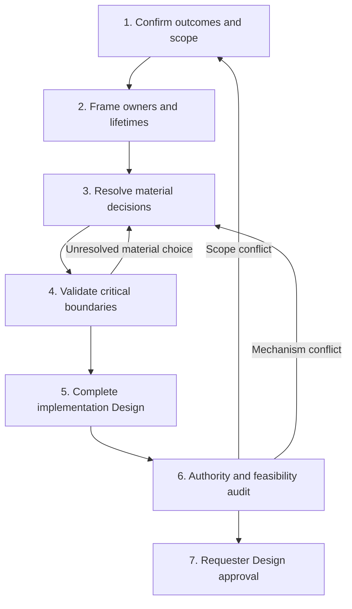

# Server-Provided Tools Design Roadmap

Current presentation decision: the requester selected option 1 (uniform record
rows), with the following refinements accumulated from the same discussion:

- User messages use the user icon. Only intentionally published Agent messages
  use the paper-plane icon. Native/model text uses the ordinary text icon.
- Message rows have no visible sender-name/message labels or label highlight.
  Sender role is visually distinguished by the icons.
- The left message rail follows the current primary color, including an Agent
  theme override; it is not tied to a fixed yellow color.
- Native/model text is titled `Model output`, without an Agent-name prefix.
- Collapsed Agent publication uses the normalized message-body beginning, with
  the same preview treatment as user messages, rather than a generic tool title.
- Both collapsed and body-expanded records must be shown in review. Expanded
  publication retains the sent body and inspectable original input/result.

These decisions refine REQ-13/D14 without changing session-history ownership or
creating another native assistant record. The requester then explicitly requested
implementation and PR delivery of the consolidated revision-2 direction. The selected
treatment was rendered and checked in both states, at desktop/mobile widths and
under two primary colors. These are review component renders, not product
implementation. Revision-2 approval now covers M1–M20; tracked implementation
plans decompose that baseline without new Design authority.

This is a design-discussion roadmap, not an implementation plan or an approved
architecture. [Requirements](../requirements/tools-261112-server-provided-tools.md)
were confirmed after correcting persistence responsibility.
The [snapshot ADR](../adr/tools-261112-server-provided-tools.md) records accepted
ADR-D1 (Connector-side MCP relay), ADR-D2 (Connector-managed local HTTP MCP),
ADR-D3 (existing component RPC), ADR-D4 (Connector-owned local capability),
ADR-D5 (bounded in-memory invocation waiting),
ADR-D6 (Agent-partitioned waiting and fair dispatch),
ADR-D7 (bounded invocation response streaming),
ADR-D8 (no initial session-based chat reconstruction),
ADR-D9 (shared temporary delivery data, independent accepted session/chat data),
ADR-D10 (user chat receipt at server input acceptance),
ADR-D11 (initial MCP 2025-06-18 with native default initialization),
ADR-D12 (stable bidirectional chat order by completed server receipt),
ADR-D13 (preserve retained original user inputs in chat at application),
ADR-D14 (message-only chat and expandable actual full records),
and the retained implementation-verification obligations.
The complete [Design revision 1](../design/tools-261112-server-provided-tools.md)
is now drafted; whole-Design approval is pending.
Mode: collaborative; the requester owns new material decisions and final approval.

Earlier exploration below is discussion history. Confirmed Requirements, the
accepted ADR decisions and the complete Design are the current synthesis.

## Scope and Evidence Baseline

The objective is generalized Chapchoo-owned server tools and their first real
text-publication consumer, preserving harness-owned session history and existing
server copying. Persistence beyond
those records is tool-dependent and owned
by the relevant domain service, including separate query tools where needed.
No universal result archive or recovery mechanism is assumed.
File transfer remains deferred. Bound-conversation text publication and default
native-output treatment are now confirmed as REQ-8/REQ-9. Publication-only initial
scope is confirmed; completion/input-wait controls and automatic continuation
are deferred. Exact full-record
UI presentation is reserved for the final agreement.

Current-system evidence at `83a41877867f3602f741da0a9de819fa52f76929`:

- [Native harness](../spec/domain/native-harness.md): strict ACP v2 and exact
  restoration; setup currently supplies no Chapchoo MCP tools.
- [Control](../spec/domain/computer-control-rpc.md): execution-bound authority,
  bounded transient calls, not a durable tool-operation journal.
- [Conversation storage](../spec/domain/conversation-storage.md): source-bound
  captured observations and projections, including independent tool input/output
  fields; the server copies the harness's records.
- [Connector](../spec/domain/connector-process.md): owned workers, current
  authentication, publication of observations, and no implicit native replay.

Published MCP revisions and deployed harness capabilities differ. A library
method or transport name is not evidence of effective compatibility. The
inspected Codex ACP 2.6.0 source reports MCP result/error through `rawOutput`,
which the existing Chapchoo path preserves. Verify the selected combination
rather than redesigning session authorship. See the
[source-grounded research](server-tools-261112-current-system-research.md).

## Design Sequence

### 1. Confirm outcomes and scope

Discuss results rather than endpoints, database tables, or transport first.

- Confirm the Requirements draft and explicit non-goals.
- Preserve harness-owned session history and existing server copying,
  separately from domain-service state.
- Bound common invocation reporting; keep restart/recovery and cancellation
  guarantees tool-specific.

Exit: a requester-confirmed Requirements snapshot; no hidden binary/file
capability or particular storage/transport choice.

### 2. Frame owners and lifetimes

Map the complete affected path and distinguish:

- Agent/conversation authorization and execution-bound Connector authority.
- Native session and MCP connection/request correlation.
- Server business operation and actual external effect.
- Session response records, harness-facing representation, native observations,
  and the owning service's domain state/query tools.
- Process shutdown, connection replacement, session-record deletion, and each
  domain service's separate state lifecycle.

Exit: explicit source-of-truth, owner, lifecycle and reuse/removal boundaries.
Current behavior is evidence, not permission to choose a new mechanism.

### 3. Resolve material decisions

Brief the complete map before discussing decisions individually. Create the
same-basename ADR only after Requirements confirmation. Record each accepted
decision before moving to the next.

| Topic | Consequence to decide | Main dependencies |
| --- | --- | --- |
| Initial production tools/output | REQ-8/REQ-9 confirmed: explicit publication, native text retained without automatic publication/fallback | Exact tool/recovery contract still needs Design |
| Initial work-state scope | Confirmed: publication only; progress/input-wait/completion/quiet-completion controls and continuation are deferred | Native turn end does not gain a new product-work interpretation |
| Full-record UI | Final requester agreement, after other behavior/mechanisms | Do not preselect grouping, duplication presentation, rows or layout |
| Provision and authority | ADR-D1 through ADR-D4 fix caller scope; ADR-D11 selects the inspected native default MCP 2025-06-18 profile. Native identity is not another permission grant | Confirmed caller scope, effective harness capabilities |
| Invocation lifetime | ADR-D7 selects bounded queue/start/final response streaming; cancellation/disconnect and tool-specific recovery remain distinct | ADR-D3·D5·D6·D7 and physical effect ownership |
| Session history and service ownership | Fixed: harness authors records and server copies them. Verify supported result reporting through existing capture/replication; no P3a writer choice remains | Existing session/source lifecycle and confirmed domain-state ownership |
| Representation and limits | Required MCP text/structured/error meanings and typed tool ingress are framed; actual protocol combination and numerical bounds still need evidence | Existing session ownership, selected protocol, file-transfer exclusion |
| Catalog evolution | Names, schemas, discovery completeness, changes/removals and stale definitions | Effective harness support, authorization |
| Operational boundary | ADR-D5·D6 select bounded process-owned waiting, Agent waiting limits and fair dispatch. RPC waiting contract, numerical limits, shutdown/drain and preserving rollout remain | REQ-6 and physical effect ownership; no common durable journal |

These are decision topics, not six predetermined implementation components.
Requirements or existing invariants may fix some outcomes without a new choice.
Equivalent helper layout and identifiers are agent-owned details, not ADR
questions.

### 4. Validate critical boundaries

Use the cheapest evidence that answers each actual uncertainty:

- Model-free MCP client/server round trip through the selected boundary.
- New/resumed harness configuration, effective tool list and name collisions.
- Response-only and persistent-state fixtures; domain-owned query behavior and
  tool-specific duplicate/recovery guarantees.
- Response loss before/after dispatch, session recording and domain commit,
  without treating them as one atomic boundary.
- Process/connection replacement and credential revocation.
- Mixed structured/text/error response recording and explicit oversized refusal,
  without binary-file exchange or mandatory generic result retrieval.
- Cancellation and honest unknown outcomes without automatic replay.

Library builds and fixture success are not authenticated model acceptance.
Live/model checks require appropriate authorization and prerequisites. Do not
manufacture credentials or claim performance evidence from source inspection.

Exit: feasible/conditional/blocked evidence for approved requirements and chosen
mechanisms, with precise limitations. A probe is not authorization for a new
product behavior or production mutation.

### 5. Complete implementation Design

After material decisions, write one coherent same-basename Design:

- Architecture, ownership, interfaces and data lifetimes.
- Dispatch, existing session-copy and domain-effect boundaries, with recovery
  responsibilities defined per tool rather than universally.
- Authorization, result representation, limits and cleanup.
- Preservation migration, rollout/rollback and obsolete-surface removal.
- Requirement-to-mechanism authority mapping.
- Minimal core end-to-end verification plus lower-layer failure/concurrency
  coverage; existing testenv supplies only needed fixtures/prerequisites.

Do not create a feature implementation plan under `plans/` at this stage.

### 6. Audit and approve

Audit each requirement to its mechanism and each material mechanism back to
allowed authority. Recheck feasibility against the selected actual combination.
Present unresolved risks, removals, operational guarantees and exact Design
revision for requester approval.

Exit: approved Requirements, append-only ADR decisions, authority-consistent
Design and bounded validation evidence. Implementation starts only on request.

## First Discussion Unit

The corrected Requirements have been confirmed. The requester has already
clarified that an MCP response in session history may suffice, while persistent
state and separate query tools belong to the relevant service. Do not ask for
a universal result archive or restart-recovery promise again.

Connector-side relay and its local HTTP MCP surface have been accepted as
ADR-D1 and ADR-D2. ADR-D3 selects existing component RPC for the server-facing
tool service. ADR-D4 selects Connector-owned local access capability, with
independent server invocation authorization. Caller scope is fixed by the local
capability binding before MCP access; native session identity is not an
additional permission grant. The unaccepted setup-readiness A/B comparison is
withdrawn. Derived lifecycle boundaries preserve the existing native owner
through operational reconnect/key refresh while new calls use current authority.
The P3a server-writer/Connector-writer comparison is also withdrawn: session
authorship is already owned by the harness. Source-grounded research now
precedes further decisions. Invocation response mapping, effective catalog
provision and bounded operation remain to design, while existing session
replication/lifetime and domain-owned behavior stay intact. Required input/result/
error semantics now follow the MCP contract and typed-ingress conventions rather
than a new response format choice. ADR-D5 selects finite process-owned waiting
when execution slots are occupied. Full waiting capacity remains explicit
rejection, and waiting admission is not domain execution. ADR-D6 selects bounded
Agent waiting partitions and fair dispatch under shared total limits. ADR-D7
selects a bounded response stream with queue/start observations and a final
outcome, not polling, replay or another session writer. P2c was resolved as
ADR-D11: initial interoperability with the native default `2025-06-18` profile,
without explicit enablement of the under-development `2026-07-28` profile.
P5 live-catalog continuity remains unresolved; no revision,
fingerprint, hot reload or implicit native protocol upgrade is selected.
Do not require a uniform result retention decision before discussing provision.

The roadmap does not reopen file transfer, already-established ACP v2, existing
steering/Stop/permission behavior, or the one-channel/one-session constraint.

## First Real Tool and Default Native Output

The first real tool outcome, explicit text publication to the originating product
conversation, and preservation of native text without automatic publication or
fallback were confirmed on 2026-11-12 as REQ-8/REQ-9. Exact full-record UI
presentation is reserved for final agreement.
REQ-7's two representative behaviors are a verification matrix,
not a requirement to publish two artificial production tools.

The publication target comes from trusted caller
scope rather than arbitrary Agent/channel arguments. The original product
direction calls for intentional user communication, while native observations
remain detailed history; generic echo/time/self-inspection tools should not
replace that purpose merely to demonstrate MCP.

The Requirements now include this first publication consumer and default-output
policy. Its actual tool arguments/results follow harness-owned history and
server copying. Separate chat-message storage is an open implementation option,
not a requirement or a prohibited mechanism. Generic domain-state ownership
permits a service-owned message source if that option is selected; it does not
make the server a second author of the harness session.

Selecting this outcome does not silently choose tool names, separate versus
combined publish/wait/finish actions, continuation behavior, cross-channel
routing, attachments, silent-work completion or a new UI. Those existing
product outcomes and any unresolved contract must be distinguished explicitly.
The initial delivery is publication only. No work completion/input-wait control
or automatic continuation is added, and there is still no permission to implement.

### Current behavior and confirmed policy

Current `ConversationBody` includes native assistant records on the main
transcript as well as in history. Activity also previews native records. The
proposed publication tool is not implemented, so retaining that filter unchanged
would not produce a tool-only user conversation.

Confirmed policy, not yet implemented:

- Native assistant text, including a final native utterance, remains captured
  and copied unchanged. It remains inspectable, but is
  not automatically published as a main-conversation message or notification.
- Only an explicitly published product message appears as Agent speech on the
  main conversation. Native tool call/result records remain preserved; the exact
  full-record presentation is deferred rather than assigned a final row/group.
- No automatic promotion of raw assistant text when the tool was not called or
  publication failed. Publication failure remains explicit through its owned
  outcome; absence of a published message is not itself a successful completion.
- Native idle/turn end and product-work completion/input waiting are independent.
  This output proposal does not introduce automatic continuation or silently
  equate no publication with quiet successful completion.
- Existing user input, permission/form interaction and execution/error status
  retain their current contracts. This is not a blanket hiding of every
  non-publication record or failure signal.

REQ-8/REQ-9 contain this confirmed product package. Resolve the publication
contract without adding the deferred work-state controls. Do not rewrite the current Spec
before implementation. Full-record UI is the final discussion/approval step:
preservation and separate main publication do not settle grouping, repeated
content presentation, row layout or disclosure interactions.

## Initial Delivery Scope: Publication Only

The original product direction distinguishes meaningful communication, waiting
for user input, completion and quiet completion from native turn boundaries.
The requester selected Option A on 2026-11-12: first deliver text publication and
the confirmed default-output policy, leaving those work declarations for later.

- Selected Option A: first deliver text publication plus the confirmed output policy.
  Product-work completion/input-wait declarations remain a later feature. Do
  not invent their meaning from native idle or missing publication in the meantime.
- Unselected Option B: include explicit ongoing-work, user-input-wait and
  completed-work declarations in the first delivery. Ongoing work can publish
  an intermediate message without finishing; input waiting is an intentional
  question/wait condition; completion can accompany a final message or be
  explicitly quiet. Absence of a message alone never substitutes for a declaration.

Do not add a combined publication/work-state action, another completion tool,
product-work state storage, automatic continuation or new native turns to this
delivery. Only the publication tool's input, publication success/failure,
source-backed message interpretation and existing common foundation remain to specify.
The full-record UI stays reserved for final agreement.

## Publication-Success Proposal Correction

The unaccepted proposal to define success by a separate durable server-message
commit is withdrawn as a premature selection, not as a prohibition of storage.
It introduced an independent message entity/store before comparing alternatives.
No storage location or table for such an entity was selected or implemented.

Existing native MCP reporting already carries `{server, tool, arguments}` and
`{result, error}` into captured ACP tool records, normalized `TOOL_INPUT` and
`TOOL_OUTPUT`, and authorized record reads. This is the source to analyze before
introducing another persistence owner. The existing server copy is not a new
message-delivery store.

The initial message's recognition, actual tool result meaning and the observation
boundary for main-conversation display still need a source-backed contract.
Do not infer success from queue admission, forge a captured event, reconstruct a
missing native result, or automatically replay. This correction also does not
claim browser rendering/read confirmation. Exact full-record UI is still the
last agreement; no new display or persistence mechanism is accepted here.

## Current Decision: Chat Message Source and Read Separation

The chat needs conversation messages, not native tool-record UI. Both candidates
can provide chat-only data; neither requires the browser to load all tools and
filter them. Exact full-history rows remain deferred. The initial source decision
now covers user-to-Agent as well as Agent-to-user messages. Existing user-input
acceptance/handoff guarantees remain constraints; a new chat source must not
silently equate server acceptance with native consumption.

Current source evidence:

- `readConversationRegion` pages general native record metadata and reads all
  fields for changed records, including tool input/output, before the transcript
  renderer filters visible kinds. Known-record hints avoid some unchanged body
  reads but do not make this a chat-only read contract.
- Existing server projection reads page the general record kinds. Source
  replacement clears/rebuilds the copied native fields/events. There is no
  independent current chat-message source.

### Option A: Harness-derived chat projection

Recognize intentional text from actual publication-tool records during captured
event ingestion and produce a separately queryable chat-message view. That view
may be materialized for efficient chat reads; a new physical projection does not
become a new original publication source.

- Harness history remains the origin of the published Agent text.
- Chat reads retrieve only the message view, while detailed history remains in
  the existing raw/normalized copy.
- A message appears after the relevant native record is captured and ingested.
  Missing/delayed native output cannot be replaced with invented success.
- The projection needs explicit source replacement/rebuild, duplicate occurrence
  and successful-tool interpretation rules.

### Option B: Server-authored chat-message state

The authenticated text-publication tool creates the conversation message in a
server-owned message store; chat reads that store independently of native tool
history. Native still owns its tool-call/result record, which is copied normally.

- User-facing publication can be accepted and shown without waiting for ACP
  output/capture catch-up.
- A committed message can exist even if its tool reply/native record is lost;
  absence of a copied tool result cannot erase or republish that message.
- Introduces real message-domain state, requiring explicit conversation lifetime,
  reads, identity, correlation, deletion and publication retry contracts.
- It is a chat-message authority, not a second native-session writer or a
  generic archive of all server-tool results.

Recommend B if independent publication availability is desired for the chat.
Option A remains viable if native-history-backed publication and its catch-up
boundary are preferred. Storage and chat-only reads alone do not distinguish
them; the material choice is which event establishes the message's existence.
This comparison preceded ADR-D9, which selects independent session/chat data
management with shared temporary delivery data. Physical schema, receipt
boundaries, retention and publication-success semantics remain undecided.

## Bidirectional Source and Session Reconstruction: Current Decision

ADR-D9 now selects shared temporary delivery data with independent management
of accepted session data and chat data, covering both message directions.
ADR-D8 excludes initial session-based chat reconstruction. These are data
responsibilities, not a server-versus-harness split by message direction.
Accepted ADR-D1 through ADR-D7 remain unchanged.

### Selected data responsibilities across both directions

- Temporary delivery data is shared. Accepted session records and accepted chat
  messages are then managed independently; shared delivery is not an atomic
  commit or identical lifetime promise.
- User-to-Agent: distinguish input receipt, possible forwarding, native
  injection/insertion and observed native history. The exact chat receipt
  boundary and cleanup prerequisites remain pending.
- Agent-to-user: intentional chat publication and the harness-observed tool
  record are separate data. A lost response cannot erase an already accepted
  message or authorize automatic repeat publication.
- Chat reads use message data in both directions. Session history
  remains harness-owned and independently copied. No work-state declaration,
  automatic continuation, read receipt or new native turn is implied.

### Three recovery operations with different evidence

1. Exact native resume reopens the existing context. Current setup uses
   `AlreadyCaptured`, not a full historical replay request.
2. Recopying retained capture and rebuilding projections restores derived
   observations only as far as the retained source is complete. It cannot
   recover missing authoritative server messages.
3. Importing messages from native session history would be a separate,
   explicitly authorized product feature. It could use actual user records
   and evidenced successful publication records, but not default assistant
   text, tool arguments alone or assumed successful effects.

Current pending-input deletion, steering without an operation-linked message ID,
and publication response-loss windows prevent a universal completeness claim.
Native record order is not necessarily server acceptance/publication order.
Equal text is not a safe identity or duplicate test. These constraints apply
even if the adapter can replay retained native history.

### Compared policies and selected reconstruction boundary

The requester selected no session-based chat reconstruction in the initial
delivery (ADR-D8), followed by independent accepted session/chat data with
shared temporary delivery data (ADR-D9). The following alternatives are prior
comparison context, not remaining initial reconstruction modes.

- **B without session-to-chat reconstruction in the initial delivery
  (recommended):** authoritative chat messages depend on retained server message
  data; resuming native work and existing capture copying continue separately.
  Native history does not recreate missing chat authority. Ordinary restoration
  of the original server data is a different operation; this proposal does not
  add a backup feature.
- **B with explicitly bounded historical import:** preserve evidence and
  provenance, declare missing/uncertain entries, and select identity, ordering,
  deduplication, deletion and trigger rules before claiming support. Import
  cannot promise the original full chat or re-execute publication.
- **A with a rebuildable chat projection:** chat is deliberately the
  evidence-backed subset derived from retained session records. Rebuilding that
  subset does not recover every server-accepted input or uncaptured effect.

The reconstruction and data-ownership boundaries are settled by ADR-D8/ADR-D9.
Historical import and session-to-chat rebuild are outside this delivery.
Next define receipt/publication success, shared temporary-data release,
message identity, ordering, deletion, source replacement and duplicate/failure
behavior. Do not infer physical schema or automatic retry from the selected
responsibility split. Full-record UI remains the final agreement.

### Accepted user chat receipt

Production tracing confirms that input acceptance returns before native
processing, native Inserted/Steered reporting ends the existing delivery body,
and capture-copy completion is independent. Known-result reporting and release
are not new tool execution. No Agent re-invocation or publication retry key is
assumed.

The requester selected initial server input acceptance as user chat receipt,
recorded as REQ-10/ADR-D10. A received user chat message remains independently
of pending, failed or uncertain native delivery. Partial/rejected input is not
accepted chat. This does not preselect full-record UI presentation.

Next frame Agent publication receipt and success separately from common queue
admission, MCP response delivery and captured-history copying. Preserve the
selected shared temporary data and independent accepted records; do not introduce
Agent re-invocation or publication retry keys.

### Derived receipt/release framing and next common decision

The research note's section 12 connects the accepted boundaries: server input
acceptance establishes user chat receipt plus delivery responsibility; native
acceptance can end delivery without deleting accepted chat. Agent publication's
actual effect is completed chat receipt, not common waiting admission. Actual
responses return to the harness without a second session-record barrier or
browser delivery/read confirmation.

These consequences do not add a retry, archive or new work-state mechanism.
Physical schema and the complete Design remain unfinished. P2c is now accepted
as ADR-D11: initially target MCP 2025-06-18 using the inspected native default
initialization mode, without explicit modern feature activation or additional
fallback. Effective new/resume compatibility still requires verification.
Catalog, finite operational contracts and preserving rollout follow; full-record
UI remains the final agreement.

### Initial catalog scope and chat order

The selected initial scope does not add live catalog refresh. The inspected
native's actual refresh path is feature-gated separately from ADR-D11, and an
already-live Chapchoo native owner does not resend setup on lookup. Verify real
provision and use a preserving apply boundary; no implicit restart, app catalog
versioning or hot reload follows from the protocol choice.

REQ-11/ADR-D12 now select stable completed server chat receipt order across both
speakers, independently of delayed capture or sender clocks. Concurrent
publications follow chat receipt, not native invocation-start order. The final
full-record UI agreement remains separate from this selected data-order contract.

### Lifetime and cutover framing

Delivery consumption, failed-input body cleanup and capture source replacement
do not delete accepted chat under ADR-D9/ADR-D10. Existing authorized removal of
the owning Agent/product conversation remains the private child-data deletion
boundary. Do not add a retention timer, new chat-delete UI or an orphan archive
merely to complete this feature.

REQ-12/ADR-D13 select transfer of original non-deleted pending/failed server
inputs into chat when applying the feature. This preserves retained originals
without native replay or ADR-D8's excluded session-history reconstruction.
Account for migration 22's old-writer terminal guards and fence the activation
boundary so new accepted input cannot skip chat receipt. Concrete migration,
limits and cancellation/shutdown behavior are the next design work.

## Technical Synthesis Before the Final Record-UI Agreement

These are constraints and draft parameters for the complete Design, not new
accepted ADRs or implementation permission.

### Invocation, cancellation and shutdown

- Preserve one invocation lifetime and ADR-D7's bounded queue/start/final
  response stream. Correlate cancellation to that same authenticated invocation;
  do not add a durable handle, lookup endpoint, resend key or another tool action.
- The selected MCP profile's explicit cancellation and HTTP connection loss
  are different. An actual request-local cancellation signal may race dispatch;
  only a queue-owner-confirmed pre-dispatch terminal state establishes no effect.
- Once execution has started, retain the task and capacity until actual
  processing settles. Losing the waiter, a deadline or a cancellation signal
  does not establish rollback. Accepted chat is not recalled.
- Close new admission and retire waiting work under that owner at shutdown.
  Join started work within the existing finite backend cleanup tree; a forced
  stop leaves honest failure/uncertainty rather than successful quiet completion.
- Recheck current server/domain authority at dispatch and protected result
  disclosure. Model identities, MCP session IDs and localhost never grant scope.

### Bounded representation draft

- Use the selected MCP revision's text/structured-object/error meanings and
  typed domain ingress. A recognized tool error is not a malformed/unknown-tool
  protocol error, and neither proves absence of an already completed effect.
- Keep complete invocation/result payloads bounded within the existing
  64-KiB component-message envelope. A conservative draft application-payload
  budget is 48 KiB of encoded JSON, including its declared content/structure.
  Check actual encoded envelope size; reject oversize explicitly instead of
  truncating, adding file transfer or a new multipart/result-archive platform.
- Those are new tool-invocation payload budgets, not a reduction of the existing
  user-input contract. Preserve its current text limit and reuse bounded
  metadata pagination/body-chunk reads for chat, with full original content
  retrievable under current owner authority. Chat reads retrieve message data,
  not all native tool fields; no MCP result archive or file exchange is implied.
- Initial queue parameters to expose in the complete Design: 16 executing
  calls, 128 waiting calls/8 MiB globally, and 8 waiting calls/512 KiB per Agent.
  These implement already selected waiting/fairness policy, not priority tiers
  or Agent-reserved execution slots.
- Draft queue wait is 10 seconds; total response wait is 50 seconds. Expiry
  before dispatch and an elapsed wait after dispatch have different effect
  meanings. Physical work remains owned beyond an elapsed response wait.
- These are conservative proposed resource parameters, not measured throughput
  claims or previously approved numbers. Validate exact encoding, virtual-clock
  deadline races, mixed-Agent capacity and cleanup before completing the Design.
  No new public configuration mode is implied.

### Preserving application and data ownership

- New server acceptance must establish accepted input/chat data in a completed
  database operation before returning success; native work remains outside it.
- Accepted chat belongs to product conversation lifetime, not an input-delivery
  or capture-source child. Existing delivery and failed-input cleanup cannot
  remove accepted chat; authorized owner removal still cleans private children.
- Apply REQ-12/ADR-D13 to actual retained original input only. Establish its
  deterministic ordered prefix before new chat admissions.
- Do not activate new receipt behavior while old admission writers can bypass
  it. Preserve migration guards and both database backends. Refuse an unsafe
  downgrade that would discard accepted chat; do not add a legacy read fallback.
- Real new native-process setup/resume must verify the actual MCP provision.
  Existing live-owner lookup/reconnect is not configuration application, and
  no automatic native restart or fresh-context replacement is introduced.

### Accepted final presentation mapping

Keep the main chat's server messages distinct from full native records.
Propose preserving existing expandable history rows: native user input,
default/final output, thoughts, other tools and read-only request records.
Represent publication as one tool row with readable sent text and observed
result inside its details, retaining original fields. Do not add a second
assistant row merely because server chat contains that publication.

The requester confirmed this final mapping as REQ-13/ADR-D14.
Write the same-basename complete Design with stable mechanism IDs,
requirement/ADR traceability, removal boundaries, E2E-first verification,
authority/feasibility audits and revision-bound approval. Implementation remains
a separate request.
