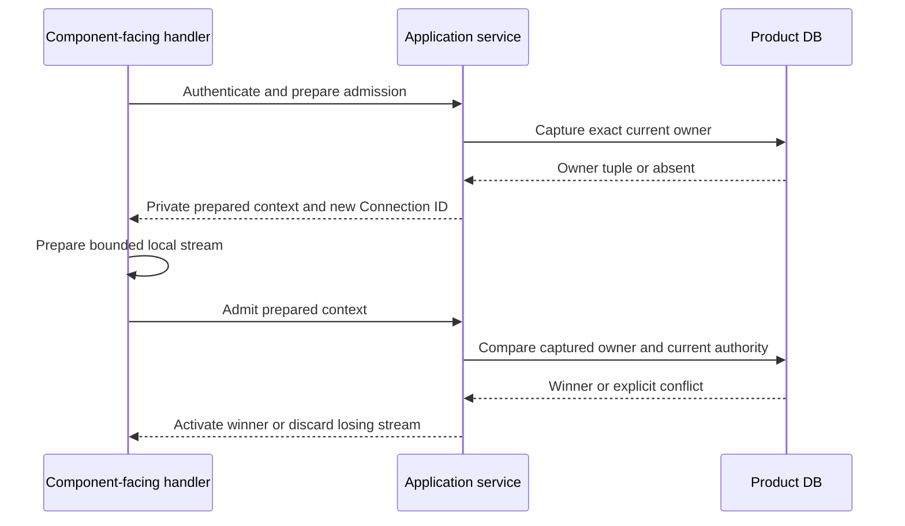

# Computer Control Directory Authority

These are application/storage operations, not evidence of an active component
listener, peer server, Kubernetes adapter or deployed Control. Runtime activation
and generated transport remain separate work. Table relationships, credential
recovery, explicit preparation and cleanup ownership are described in
[Computer storage](computer-storage.md).

## Registration and Current Ownership

The application service generates an opaque process ID for each Control
registration. Reusing an endpoint does not reuse process identity. The persisted
registration includes the reachable endpoint, draining flag and renewal/expiry.
The service rejects wildcard advertised addresses, credentials, query/fragment,
non-root paths and unsupported schemes. The caller must make the listener ready
before registration; registration does not start or verify a listener.

Control registration is insert-only. Renewal refuses an expired or draining
registration rather than reviving an old process. Directory defaults are 60-second
Control and component validity; actual renewal scheduling belongs to runtime.
Draining is monotonic. After the drain transaction commits, separate withdrawal
removes only that exact process's Provider/Connector route rows. It does not
require component credentials to remain valid during owned shutdown, and cannot
remove a successor owned by a different Control. Registration and route expiry
already deny authority independently of physical row removal.

Every component admission captures its current owner tuple before preparing the
local stream. `PreparedComponentConnection` contains a service-generated new
Connection ID, captured expected owner and authenticated target/credential digest;
its fields cannot be constructed from request assertions. Only after the local
stream is ready does admission compare that exact captured tuple under the target
lock. Missing-row insertion is conditional too. A concurrent winner makes the
other attempt conflict; there is no internal re-read/overwrite loop. A genuinely
new reconnect is a new admission attempt.

## Credentials, Renewal and Frame Checks

Kubernetes and Docker Providers are external trusted processes, including
third-party-operated processes. SYSTEM is an owner-admission category, not a
requirement to colocate with the backend. Neither Provider receives the product
database configuration or installation encryption root. Native IO belongs to
the Provider; route, immutable substrate/daemon binding, reservation, evidence
and retirement transactions belong to the server behind authenticated Control.

Provider Hello declares its exact substrate and native scope. Kubernetes scope
is its managed namespace; Docker scope must match its immutable bound daemon.
Unknown/mixed kinds or scopes fail admission rather than being interpreted as
Kubernetes identities. This check does not attest the remote daemon atomically
or authorize another connection to reuse a prior successful source check.

Computer Provider operations lock Provider then route then shared Control.
Computer Connector operations use the existing Computer/session lock, then route
and shared Control; they do not lock or require a live Computer Provider. Both
check the exact current Control/Connection ID, route credential, non-draining live
Control, live route and currently authorized component credential using DB time.
The shared Control lock fences drain/renewal without serializing unrelated
components. No network IO runs inside these transactions.

Provider keys use current or still-valid immediately previous authority.
Connector admission requires an operational key, not its reusable bootstrap key,
and a current nonretired execution/session outside terminal deletion. The schema
binds route, session, execution and Computer consistently. Refresh permits the
original previous-key stream only within its fixed overlap. A new current key
needs a new connection to replace that route's stored credential. Bootstrap
re-exchange and session revocation withdraw old routes immediately.

Heartbeat renewal cannot revive an expired connection. Exact close checks cannot
clear another connection, session or Control's replacement. Frame/dequeue
verification performs current authority checks without extending heartbeat
expiry; a previous successful verification is not a reusable effect permit.
Application services expose prepared-context admit/verify/renew/close operations
without forwarding user/owner credentials to components.

Internal route resolution returns only an eligible current route and Control
endpoint; no expired, drained or revoked route is returned as permission to
dispatch. It is still a snapshot: the receiving boundary must verify exact
current identities before forwarding or accepting each frame. These operations
do not promise atomicity between DB authorization and an external effect.

## Validation Boundary

Shared real SQLite/PostgreSQL fixtures exercise concurrent admissions against a
captured existing Provider owner and an absent Connector owner. Exactly one wins.
They cover delayed heartbeat/close, replacement, drain of an old Control,
connection/Control expiry, non-resurrection, route credential overlap/re-exchange,
revocation and Connector operation while the Provider key is revoked. Service
fixtures cover generated opaque IDs, private prepared admission, losing-context
conflict, endpoint validation and verification without implicit lease renewal.
This does not establish two-Control network routing, component streams, memory
transport equivalence, Kubernetes effects or browser lifecycle behavior.
