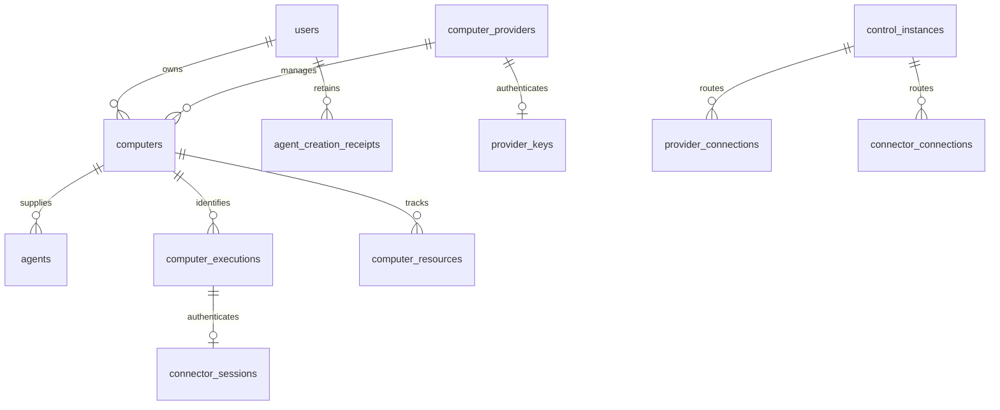

# Computer Data and Authority Foundations

This describes the implemented data/domain foundation, not a working Computer
runtime or a completed management UI. Current direct storage operations cover
configured system Provider metadata, available choices, atomic cloud Agent
creation, owner-scoped reads, current-request lifecycle admission, force removal,
Provider key rotation/revocation/recovery and execution-bound Connector session
issuance/exchange/refresh/revocation, current-connection execution/resource
reservation and evidence, exact retirement, cleanup confirmation and retained
inventory collection. External lifecycle effects, Control routing
and Kubernetes execution are not implied by
schema records. Runtime/transport exposure is separate.

## Identities and Relationships

Opaque IDs and exact request/connection identities are used; no increasing
application generation is stored. The common schema supports future same-owner
local sharing without implementing local Mac enrollment or execution.

- `computer_providers`: stable ID, SYSTEM/USER owner discriminant and exactly one
  corresponding owner reference, name, Kubernetes kind and capabilities. The USER
  relation references the existing account. Reconnection/key change does not
  allocate a different identity. There is no web enablement flag.
- `computers`: owning User FK, kind/provider, durable desired state and only the
  current lifecycle Request ID/fingerprint/action/phase. Current execution points
  to an execution belonging to that same Computer through a deferred composite FK.
  Dispatch time, old execution identity, current power/storage evidence and
  terminal cleanup timestamps are separate facts, not a stored UI state machine.
  Minimal cloud removal inventory retains a unique removed Agent ID (not a
  live-Agent FK) until completion collection, to bind removal retries to the
  residual Computer's current deletion Request ID.
  Power/storage evidence keeps its source connection and applicable execution
  identity without a live-directory FK: historical evidence is not authority.
- `agents`: owner and Computer-kind composite FK must match the Computer. A stored
  generated cloud-only Computer key is unique: cloud dedication is 1:1; LOCAL
  associations do not acquire that uniqueness restriction. Names are not identity.
- `agent_creation_receipts`: `(owner, Request ID)` PK, payload fingerprint and
  a unique assigned Agent ID. Assigned Agent ID deliberately has no live-Agent FK, so
  removal cannot erase deduplication. Owner account deletion cascades the receipt
  under the existing account policy; this adds no account-deletion feature.
- `computer_executions`: ID, Computer FK, immutable initial-allocation
  classification, first confirmed-running time, creation and retirement evidence.
  Classification is fixed when reserving the candidate from lifecycle/history
  facts; receiving a PVC UID does not turn initial creation into restoration.
  First confirmed-running evidence survives blocked/uncertain issue phases.
  Its composite identity prevents another Computer adopting the execution pointer.
- `computer_resources`: exact kind/namespace/name/optional UID and matching
  Computer/Provider composite FK. Provider/kind/namespace/name is unique across
  Computers, so two Computers cannot reserve the same managed object. A partial
  unique index permits one saved PVC identity per Computer. PVC is independent
  of executions; Pod/bootstrap Secret requires its matching execution FK and has
  one identity per execution/kind. Resource evidence retains observation time,
  exact source connection and sticky confirmed-absence time. Resources/executions
  cascade only with actual Computer removal, not with Agent removal.
- `provider_keys`: one current key record per Provider, current/previous digest,
  fixed overlap/expiry, revocation and protected current recovery material.
- `connector_sessions`: unique execution binding with a composite
  execution/Computer FK, original issuance Request ID
  and immutable binding fingerprint; reusable initial digest and
  protected bootstrap result, current/previous operational digest, expiry,
  revocation and protected current result. Execution removal cascades the session.
- `provider_key_requests` / `connector_key_requests`: scoped non-secret request
  fingerprints/result digests identify stale credential mutations without an old
  secret archive. They cascade with their Provider/session scope, not as a
  universal command-message history.
- `control_instances`: endpoint and exact process identity, draining/renewal/expiry.
  `provider_connections` and `connector_connections` hold current Control and
  opaque connection identity, credential digest and expiry. Logical component
  FKs cascade on removal; Control FK prevents deleting a referenced registration.
  Connector route has a unique session and composite session/Computer FK, so the
  route cannot belong to a different Computer or share one session across
  Computers. Session deletion cascades that route.

Creation and cleanup receipts have intentionally different retention: the former
survives Agent removal for owner lifetime, while current residual Computer/resource
records keep cleanup independent of a visible Agent. The storage layer does not
infer completed cleanup or delete resources merely because a connection expired.
Deleting a live Agent cannot cascade its Computer/PVC/session. Confirmed cleanup
and retention collection must be driven by the owning verified lifecycle path;
no automatic database-age deletion or operator cleanup endpoint is supplied here.

## Operations and Permission Boundary

Every owner read/mutation executes within the existing complete DB operation and
revalidates the account session after its User lock. Foreign private Agents return
not-found. Provider registration accepts a `VerifiedSystemOwner`, which can only
be constructed by a configured verifier checking both credential digest and an
explicit allowed Provider identity. An asserted owner name or Provider key is not
that proof. Existing Provider ownership cannot be overwritten by another owner.
This verifier neither generates configuration credentials nor treats the
installation encryption root as authentication.

Cloud creation locks the current owner, checks its owner-scoped creation receipt,
then validates an authorized currently connected creation-capable Provider and
writes the receipt, Computer/running intent and Agent atomically. Exact replay
returns its assigned Agent/current state even if Provider connectivity has since
changed. Reuse with changed canonical name/Provider payload rejects. Replay after
Agent removal returns removed, never a fresh allocation. External provisioning is
outside this transaction.

Available Provider queries require eligible current Control/component connection,
current or still-authorized immediately previous credential, nonrevoked/nonexpired
Provider key and creation capability. Keys/endpoint/resource UIDs are not in
choice results. Queries and Agent lists use bounded keyset pagination. No request
queues or Kubernetes calls execute in these DB operations.

Canonical payload fingerprints include operation and length-delimited typed field
boundaries. They do not serialize arbitrary JSON or retain Agent content in the
creation receipt. Stored credential digests and payload hashes are not bearers;
Debug for owner verifier/proof, private rows, drafts and projections is redacted.

## Current Lifecycle Admission and Provider Credentials

Power requests compare the expected current Request ID under User, Provider and
Computer locks. An exact current request/fingerprint returns current progress;
changed payload or a stale predecessor rejects. Running/stopped evidence must
come from the current eligible Provider connection and match the current execution.
An older connection's facts remain last-known information but yield unknown
current power. Start additionally requires verified saved environment from the
current Provider connection and no current execution; stop/restart require the
confirmed current execution. Pending or uncertain operations block competing power
work. Acceptance records intent/phase, not external execution success.

Delete can supersede preparation and persists terminal intent. In the same
transaction it revokes that Computer's Connector sessions, discards encrypted
bootstrap/operational recovery material and removes Connector routes. Force
removal requires the current deletion request and removes only the Agent; residual
Computer/cleanup authority and creation receipt survive. An owned removed Agent
can be recognized while residual inventory remains, but only with that Computer's
exact current deletion Request ID. Wrong IDs reject, including retries racing
normal or forced removal. After inventory collection, removal retry returns
not-found rather than treating a creation receipt as proof of a deletion request.
Creation replay still returns removed without recreating it.

Provider key rotation/issuance requires verified system-owner scope or the current
owning User session, never the Provider communication key. Each credential mutation
has a target-scoped Request ID/fingerprint receipt. Exact current-result retry
recovers the same encrypted key and original expiry; superseded/revoked/expired
results cannot be recovered. Fresh rotation retains only the immediately previous
digest for at most five minutes, capped by its original expiry. Communication
admission checks current/previous digest, key expiry and revocation each time.

Explicit revocation has no overlap, discards protected recovery and withdraws the
Provider route. Its receipt makes retry safe; replay of an old revocation after a
new owner-authorized issuance cannot revoke the new key. Owner-authorized fresh
issuance can restore communication authority after revocation, but a new component
connection is still needed. Key defaults are 24h validity, proactive owner rotation
from 12h, and at most 5m prior-key overlap. No root or old-secret archive is exposed.

## Execution-Bound Connector Credentials

The assigned currently authenticated Provider can issue/recover the unique session
for a Computer's current, nonretired execution while terminal deletion has not
been accepted. The immutable binding fingerprint is checked and the original
accepted issuance Request ID is returned. Retries with newly prepared server-side
session IDs/keys recover that same binding and bootstrap result; they do not
allocate another session or invalidate operational keys. Revoked bindings cannot
be silently replaced. Bootstrap and operational recovery use distinct domain-
qualified encryption contexts, separate from Provider/account sessions.

Bootstrap exchange authenticates the reusable initial key and current execution.
A genuinely new exchange clears all previous operational-key authority and its
route immediately. Exact still-current request retry only recovers its original
result. Ordinary refresh authenticates the current or immediately previous key;
only the current key may create a successor. The previous key may recover the
exact current refresh response within its original fixed overlap. Request
fingerprints, scope and latest-result identity reject stale exchanges, changed
purpose and attempts to create another successor from a previous key.

Every operation locks/rechecks the Computer/session binding, current execution,
retirement, terminal intent and revocation. Connector exchange/refresh/identity
does not require a live Provider stream or a valid Provider communication key,
and does not acquire a global Provider lock. Provider-authorized issuance and
explicit revocation acquire Provider then Computer authority. Revocation discards
both bootstrap and operational recovery and withdraws only that session's route;
old-session revocation cannot clear another session's connection.

Identity methods return admission snapshots, not reusable permission to accept
future frames. Later messages/reports/heartbeats must recheck current credential
and exact connection authority. Reconnecting with a valid key remains the same
session; replacing an execution requires another authorized binding.

## Current-Connection Execution and Resource Evidence

Managed operations authenticate the Computer Provider key and exact current
Provider/Control/Connection ID plus the route's credential digest. Provider,
route and Computer mutations use short DB-only locks; PostgreSQL shares the
Control lock to fence draining without serializing unrelated Providers.
Directory/key expiry uses DB time after locks, never a component-supplied
timestamp. Expired/draining Control, expired route, key revocation, a superseded
route or a different credential cannot authorize a report. After the Computer
lock, exact current Request ID and current authority are rechecked.

`reserve_execution` commits the candidate execution and exact Pod, bootstrap
Secret and initial PVC resource names before any external creation. A recovered
current candidate is returned even if the service prepared different draft IDs
and names. Uncertain/blocked preparation does not replace that candidate.
Resource reservation collisions roll back the entire operation. A successor
requires prior-execution retirement and current-connection evidence of the
original saved PVC with its actual UID. First allocation may resume only with
definitive never-allocated evidence; it cannot replace previously allocated
missing storage. Initial creation uses create capability; saved-environment
starts/restoration use start capability.
Reservation recovery returns the same initial-allocation classification. Dispatch
checks this execution fact even after the initial PVC has been confirmed, so a
create-capable/start-incapable Provider can finish its initial preparation.

Resource reports identify the exact reserved object and execution. Owned-present
evidence binds the original UID; a different same-name UID is rejected. Unknown
presence does not clear identity. Definitive absence must match the stored UID,
or explicitly concern a never-observed candidate after all possibly accepted
creates are quiescent. A timeout, disconnection or bare GET 404 is unknown, not
that evidence. Confirmed absence of an allocated object is sticky even after an
unknown report: later present reports cannot adopt/recreate it. The external
Computer Provider is responsible for verifying ownership/content and the
supported substrate retirement boundary; this module performs no Kubernetes IO.

Running completion requires a separately reported actual running execution plus
current-connection present/UID evidence for its Pod/bootstrap Secret and original
PVC. Pod existence alone is not running. Stop/restart cannot complete while the
old execution remains current, even if a blocked/uncertain phase obscures the
retiring display phase. `retire_execution` requires definitive current-source
Pod absence, retires the exact execution, revokes and wipes its Connector session
authority and withdraws its route before clearing the current pointer.
Restart advances to ordinary start under the same Request ID; late old-execution
reports cannot stop or complete a successor. Automatic restoration uses the same
old-absence, intact-storage, current-capability and conflicting-intent gates.
Original dispatch time is set once per start operation; reconnect/retry does not
reset it. Unexpected disappearance after completed running starts a fresh
restoration dispatch interval.
The reset uses the retired execution's confirmed-running fact rather than its
mutable current issue phase; reporting uncertainty before definitive retirement
cannot make recovery inherit a previous execution's dispatch timer.

Managed inventory is Provider-scoped and independent of an Agent association.
Terminal Computers accept exact safe cleanup reports without resurrecting an
Agent. Normal cleanup confirmation requires no current/live execution and
definitive absence of every reserved resource from the current source; it then
removes the Agent and records confirmed completion once. Force removal does not
imply any of those facts. Explicit collection removes only confirmed completed
Computers at least 24 hours after completion, with no live execution or unresolved
resource. Unresolved cleanup has no TTL. Creation receipts survive collection.
These are internal lifecycle operations, not public adoption/cleanup controls.

## Application Service

`ComputersService` generates Agent, Computer, execution and session IDs and all
new component credentials server-side. Caller Request IDs remain stable for
deduplication. Its system-owner verifier is supplied by trusted composition, not
constructed from request owner assertions. System metadata/key methods verify
configured credential and Provider scope; component keys cannot self-rotate.
User-owner methods use current account authority. Store validation and locked
admission remain authoritative for every generated draft.

Credential methods use execution-scoped sessions and distinct bootstrap versus
operational roles. Key recovery returns the exact current result and expiry,
not a new generated draft. The service also exposes typed owner reads/lifecycle
admission and internal current-source inventory/evidence methods. It does not
activate component listeners, configure deployment credentials, create a
reconciler or perform external resource effects.

## Preparation and Verification Boundary

Both SQLite and PostgreSQL receive equivalent `00000000000003_computers` schema
through explicit prepare. Normal startup still checks the exact migration set
and original root binding without migrating. The pre-migration guard works on
old account tables; after migrations the first-binding guard additionally counts
every new product table. A system Provider alone is sufficient to prevent root
rebinding when the installation binding is missing.

The Computer down migration refuses execution rather than removing authority or
cleanup data. A compatible forward fix or explicitly approved operator recovery
is required; startup never performs an implicit downgrade.

Real SQLite/PostgreSQL schema tests verify permanent cloud uniqueness, same-owner
local sharing, owner/kind FKs, retained creation receipt after Agent deletion,
current-execution/resource scope, saved-PVC uniqueness and provider-only root
binding protection. The PostgreSQL catalog check confirms the deferred current
execution ownership FK. Domain tests cover power admission, unresolved-operation
conflicts, immediate force availability, the original five-minute delay and all
independent restoration predicates. The same operation exercise on both engines
checks owner isolation, creation replay/races and removed replay, current-request
power conflicts, stale-connection observations, deletion credential withdrawal,
Provider lost-result recovery, previous-key expiry cap, immediate revocation and
stale mutation/revocation refusal. Connector exercises check unique session recovery,
bootstrap/operational role separation, exact lost-response recovery, one successor
under concurrent same-request refresh, rejection of a competing different-request
successor from that previous key, previous-key restrictions, re-exchange
invalidation, Provider-independent refresh and irrevocable session withdrawal.
The managed-execution exercise on both engines checks candidate recovery/races,
cross-Computer resource reservation conflicts/rollback, stale route/control/key
admission, restart retirement gates despite uncertain phase, obsolete-session
withdrawal, original PVC reuse, current-source restoration, missing-storage
refusal, force-removal residuals, normal confirmation and completion-based 24h
retention with creation-receipt preservation.
Connector schema fixtures additionally reject mismatched session/Computer
execution ownership and route ownership. Removal tests reject wrong deletion IDs
before/after normal/forced removal and in a concurrent wrong-ID removal race.
Service tests verify configured
owner scope, independent communication authority and generated-key recovery.
These tests do not establish working component streams, external power actions
or UI/E2E.
