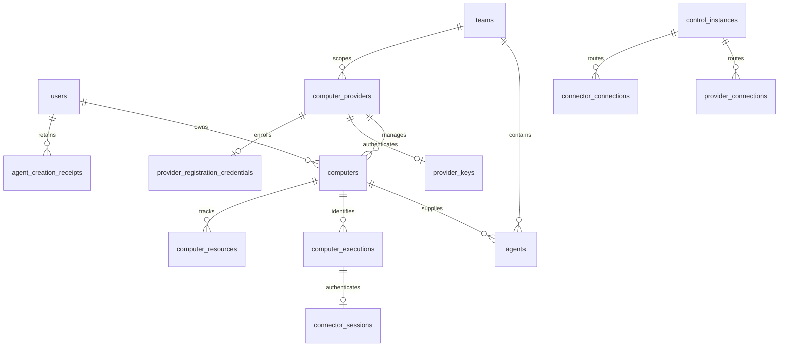

# Computer schema and native identities

Durable Computer state records authority, exact resource identity and cleanup obligations; schema records do not themselves perform external effects.

## Native domain values

`chapchoo-domain` owns the strict resource-kind vocabulary and derives execution
versus saved-environment roles and Provider substrate from each kind. Persistence
reexports that kind rather than maintaining a second declaration. Unknown kind
strings are rejected instead of becoming bootstrap Secrets.

Protocol/database-independent native values describe Kubernetes namespace/name/
original UID, Docker daemon/name/full container ID, and original local-volume
creation/label observations. Reservation construction rejects cross-substrate
scope and invalid/bounded addresses. Allocated identity variants must match the
reserved kind. Docker daemon IDs are opaque bounded tokens, not 63-character
namespaces. Volume identity accepts only local driver/scope with no driver
options; it has no synthetic native UID. Equality preserves original metadata
and the distinction between unavailable creation time and an observed value.

Storage, wire admission and executable adapters use these typed values for both
substrates. The separate DB-free Docker Provider uses native SDK operations and
the [Docker runtime contract](computer-docker.md), without encoding Docker
objects as Kubernetes objects. Current-source authorization, immutable accepted
allocation and sticky absence remain enforced at owning store/adapter boundaries.

## Native schema and preservation

Forward migration 6 preserves existing Kubernetes rows and adds immutable
`KUBERNETES`/`DOCKER` Provider kind plus nullable Docker daemon binding. Docker
binding is compare-and-bind under the Provider lock: the first accepted daemon
is retained, concurrent different first bindings conflict, and later metadata
configuration cannot replace the kind or daemon. Provider processes obtain no
database configuration or installation encryption root; binding, reservations
and evidence changes occur only inside authenticated server service operations.

Resources use kind, native scope kind/value and name as their unique address.
Kubernetes keeps its namespace and original UID. Docker keeps daemon/name,
full 64-character container ID or the original local-volume creation/label
identity. Native identity columns are mutually exclusive and ingress checks
their agreement with resource kind and Provider binding. Names and daemon IDs
are separate values; a daemon is not a namespace. Saved-environment and execution
completeness derive from typed resource roles, not a fixed three-object list.

SQLite rebuilds the closed eleven-table dependency graph: `computer_providers`,
`provider_keys`, `provider_key_requests`, `computers`, `agents`,
`computer_executions`, `computer_resources`, `connector_sessions`,
`connector_key_requests`, `provider_connections` and `connector_connections`.
Preparation keeps foreign keys enabled, refuses unexpected incoming dependencies,
stages/copies/compares every row and identity, empties the cyclic old graph before
replacement, restores indexes and verifies counts/foreign-key integrity atomically.
Only the old snapshot's nullable execution cycle is cleared during removal.
Credential BLOBs, key receipts, routes and external dependents are preserved.
PostgreSQL alters the corresponding constrained native columns in place. Both
engines test populated migration and rollback; schema down-migration refuses
destructive native-data erasure.

Migration 7 adds canonical TEAM Provider ownership with an exact Team FK and
independent registration-credential storage. It preserves existing identity and
native rows while invalidating old Provider operational current/previous keys,
recovery and routes; Connector credentials remain separate. SQLite uses the same
FK-enabled closed-graph preservation discipline. The
[authentication contract](provider-authentication.md) defines scopes, token
protection, Team tombstone collection and the breaking configuration boundary.

## Identities and Relationships

Opaque IDs and exact request/connection identities are used; no increasing
application generation is stored. The common schema supports future same-owner
local sharing without implementing local Mac enrollment or execution.

- `computer_providers`: stable ID, SYSTEM/USER/TEAM owner discriminant and exactly one
  corresponding owner reference, name, immutable Kubernetes/Docker kind, optional
  bound Docker daemon and capabilities. The USER
  relation references the existing account; TEAM references `owner_team_id`.
  Reconnection/key change does not
  allocate a different identity. There is no web enablement flag.
- `computers`: owning User FK, kind/provider, durable desired state and only the
  current lifecycle Request ID/fingerprint/action/phase. Current execution points
  to an execution belonging to that same Computer through a deferred composite FK.
  Dispatch time, old execution identity, current power/storage evidence and
  terminal cleanup timestamps are separate facts, not a stored UI state machine.
  Minimal cloud removal inventory retains a unique removed Agent ID (not a
  live-Agent FK) until completion collection, to bind removal retries to the
  residual Computer's current deletion Request ID.
  Power/storage evidence keeps its source connection and applicable execution
  identity without a live-directory FK: historical evidence is not authority.
- `agents`: owner and Computer-kind composite FK must match the Computer. A stored
  generated cloud-only Computer key is unique: cloud dedication is 1:1; LOCAL
  associations do not acquire that uniqueness restriction. Every Agent also has
  one non-null `team_id` FK with `NO ACTION` deletion. The `(team_id,owner_user_id,id)`
  index supports private per-team pagination. Team membership does not grant
  another member access to this owner's Agent. Names are not identity.
- `agent_creation_receipts`: `(owner, Request ID)` PK, payload fingerprint and
  a unique assigned Agent ID. Assigned Agent ID deliberately has no live-Agent FK, so
  removal cannot erase deduplication. Owner account deletion cascades the receipt
  under the existing account policy; this adds no account-deletion feature.
  The required original `team_id` is historical request context, deliberately
  without a Team FK: cleanup of the original Team cannot erase the receipt.
- `computer_executions`: ID, Computer FK, immutable initial-allocation
  classification, first confirmed-running time, creation and retirement evidence.
  Classification is fixed when reserving the candidate from lifecycle/history
  facts; receiving a PVC UID does not turn initial creation into restoration.
  First confirmed-running evidence survives blocked/uncertain issue phases.
  Its composite identity prevents another Computer adopting the execution pointer.
- `computer_resources`: exact kind/native scope/name and matching
  Computer/Provider composite FK. Provider/kind/native-scope/name is unique across
  Computers, so two Computers cannot reserve the same managed object. Scope kind
  derives from resource kind; Kubernetes retains namespace/UID, while Docker
  retains daemon and container ID or volume metadata. A partial unique index
  permits one saved environment (PVC or Docker volume) per Computer. Saved
  resources are independent of executions; Pod/bootstrap Secret/container
  resources require their matching execution FK and one identity per execution/kind. Resource evidence retains observation time,
  exact source connection and sticky confirmed-absence time. Resources/executions
  cascade only with actual Computer removal, not with Agent removal.
- `provider_keys`: one current key record per Provider, current/previous digest,
  fixed overlap/expiry, revocation and protected current recovery material.
- `provider_registration_credentials`: independent later-registration random
  credential digest, root-protected current token material and revocation, bound
  to canonical Provider ownership. It is not a second operational key table or
  a complete user/team registration product.
- `connector_sessions`: unique execution binding with a composite
  execution/Computer FK, original issuance Request ID
  and immutable binding fingerprint; reusable initial digest and
  protected bootstrap result, current/previous operational digest, expiry,
  revocation and protected current result. Execution removal cascades the session.
- `provider_key_requests` / `connector_key_requests`: scoped non-secret request
  fingerprints/result digests identify stale credential mutations without an old
  secret archive. They cascade with their Provider/session scope, not as a
  universal command-message history.
- `control_instances`: endpoint and exact process identity, draining/renewal/expiry.
  `provider_connections` and `connector_connections` hold current Control and
  opaque connection identity, credential digest and expiry. Logical component
  FKs cascade on removal; Control FK prevents deleting a referenced registration.
  Connector route has a unique session and composite session/Computer FK, so the
  route cannot belong to a different Computer or share one session across
  Computers. Session deletion cascades that route.

Creation and cleanup receipts have intentionally different retention: the former
survives Agent removal for owner lifetime, while current residual Computer/resource
records keep cleanup independent of a visible Agent. The storage layer does not
infer completed cleanup or delete resources merely because a connection expired.
Deleting a live Agent cannot cascade its Computer/PVC/session. Confirmed cleanup
and retention collection must be driven by the owning verified lifecycle path;
no automatic database-age deletion or operator cleanup endpoint is supplied here.

## Preparation and Verification Boundary

Both SQLite and PostgreSQL receive equivalent `00000000000003_computers` schema
through explicit prepare. Normal startup still checks the exact migration set
and original root binding without migrating. The pre-migration guard works on
old account tables; after migrations the first-binding guard additionally counts
every new product table. A system Provider alone is sufficient to prevent root
rebinding when the installation binding is missing.

The Computer down migration refuses execution rather than removing authority or
cleanup data. A compatible forward fix or explicitly approved operator recovery
is required; startup never performs an implicit downgrade.

Real SQLite/PostgreSQL schema tests verify permanent cloud uniqueness, same-owner
local sharing, owner/kind FKs, retained creation receipt after Agent deletion,
current-execution/resource scope, saved-PVC uniqueness and provider-only root
binding protection. The PostgreSQL catalog check confirms the deferred current
execution ownership FK. Domain tests cover power admission, unresolved-operation
conflicts, immediate force availability, the original five-minute delay and all
independent restoration predicates. The same operation exercise on both engines
checks owner isolation, creation replay/races and removed replay, current-request
power conflicts, stale-connection observations, deletion credential withdrawal,
Provider lost-result recovery, previous-key expiry cap, immediate revocation and
stale mutation/revocation refusal. Connector exercises check unique session recovery,
bootstrap/operational role separation, exact lost-response recovery, one successor
under concurrent same-request refresh, rejection of a competing different-request
successor from that previous key, previous-key restrictions, re-exchange
invalidation, Provider-independent refresh and irrevocable session withdrawal.
The managed-execution exercise on both engines checks candidate recovery/races,
cross-Computer resource reservation conflicts/rollback, stale route/control/key
admission, restart retirement gates despite uncertain phase, obsolete-session
withdrawal, original PVC reuse, current-source restoration, missing-storage
refusal, force-removal residuals, normal confirmation and completion-based 24h
retention with creation-receipt preservation.
Connector schema fixtures additionally reject mismatched session/Computer
execution ownership and route ownership. Removal tests reject wrong deletion IDs
before/after normal/forced removal and in a concurrent wrong-ID removal race.
Service tests verify configured
owner scope, independent communication authority and generated-key recovery.
These tests do not establish working component streams, external power actions
or UI/E2E.

## Connections

- [Private Agent ownership and Team deletion](agent-ownership.md) — Team membership selects context while individual ownership remains the private Agent boundary. Context deletion accepts cleanup intent, not completed native deletion.
- [Computer lifecycle admission and Provider keys](computer-lifecycle.md) — Owner requests commit durable intent under current authority. Component evidence and external completion determine what may happen next.
- [Execution reservation, evidence and cleanup](execution-evidence.md) — Reservations precede effects; current-source observations qualify power, retirement and resource absence without granting ambiguous replay.
- [Execution-bound Connector credentials](connector-credentials.md) — A Connector session belongs to one execution. Bootstrap recovery, operational refresh and revocation have different permissions and retained results.
- [Control directory authority](computer-directory.md) — The durable directory chooses current component owners and excludes expired, revoked or draining authority. Listener and native effect lifetime are separate owners.

## References

- [`rust/crates/domain/src/computer_resource.rs`](../../../../rust/crates/domain/src/computer_resource.rs)
- [`rust/crates/persistence/migrations`](../../../../rust/crates/persistence/migrations)
- [`rust/crates/persistence/src/preparation.rs`](../../../../rust/crates/persistence/src/preparation.rs)
- [`rust/crates/persistence/src/native_resources.rs`](../../../../rust/crates/persistence/src/native_resources.rs)
