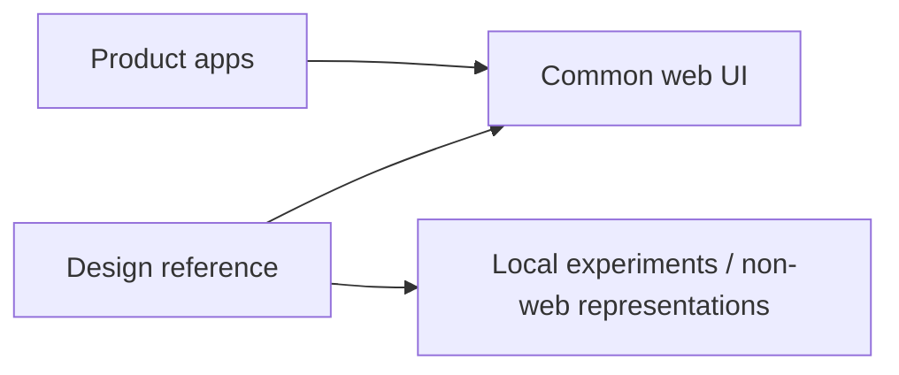

# Design reference workspace

An independent Storybook for general-purpose design references across platforms.
It is not the product functional-test suite or an app UI QA catalog.

Visual design context and principles live only in root
[DESIGN.md](../../../DESIGN.md). The `Chapchoo` stories implement the selected
tone; the ownership examples demonstrate the same common-UI import boundary.
Fictional screen examples are not product feature requirements.

## Catalog

- `Chapchoo/Foundations`: overview, basic controls, feedback, mascots, iOS type.
- `Chapchoo/Mascot motion`: actor/accessory comparison and six-character motion
  family, including 64px artwork. Reviewed shared React gesture used in current
  General/Admin authentication headings and desktop sidebar companions.
- `Chapchoo/Products`: fictional reading shelf, weekly planner, workspace settings,
  and a content/identity composition; desktop and narrow views share the same stories.
- `Ownership examples`: existing common-UI reuse and non-web ownership examples.

Story IDs start with `chapchoo-foundations--` and `chapchoo-products--`.
The selected theme renders in an isolated document to avoid leaking Mantine CSS
and document-root variables into the neutral ownership stories. Fields, feedback
and confirmation reuse existing `@chapchoo/ui` contracts. Web tokens, theme,
fonts and mascots are owned by common UI; fictional compositions and the iOS
typography representation remain reference-local. Apple typography is a web representation,
not native execution or proof of installed Apple fonts.

## Run

From the repository root, after `pnpm install --frozen-lockfile`:

```sh
pnpm run storybook --filter=@chapchoo/design-reference
pnpm run build-storybook --filter=@chapchoo/design-reference
pnpm run check:design-boundaries
pnpm --filter @chapchoo/design-reference check:design
```

Development uses port **6008**. To override it, run
`pnpm --filter @chapchoo/design-reference storybook --port 6010`.
Static output is `storybook-static/` inside this package. No backend, login,
product app, private configuration, or live business API is needed.

Root format, lint and typecheck include this package. CI builds this Storybook
alongside the app Storybooks. Boundary fixtures run with the root boundary check.

## Ownership



- **Existing shared web components:** import an explicit `@chapchoo/ui` subpath.
  Change or extend the component in common UI, then show its result here.
- **Experiments without a shared equivalent:** define a local component here.
  A design review does not promise production-web reuse.
- **General references of web-specialized components:** a more general local
  representation may coexist with common UI's web-specific implementation.
  Document which design intent it expresses and which web constraints differ.
  Import common UI when it serves the equivalent role.
- **Mobile/native/non-web representations:** define them here and retain them
  here after design approval. They express design intent with web rendering;
  native execution and platform behavior require separate implementation checks.
- **Product states and functional behavior:** keep those stories and tests with
  their app. Do not import app implementations into this package.

Common UI and product apps must not import this package. It has no production
exports. Root lint checks workspace manifests and source dependency edges,
including relative, dynamic and TypeScript-resolved aliased imports, plus CSS
`@import` and CSS Modules composition edges.

## Author and review

1. State the design question and intended platform in the story description.
2. Reuse common UI when appropriate; otherwise define a reference-local component.
3. Use static fixtures and props/callbacks. Small local interactions may explain
   the design; do not introduce business transport or real authentication.
4. Keep related alternatives and meaningful visual states adjacent. Include only
   stories useful for design discussion, not a mirrored product QA matrix.
5. State whether the work is exploratory or reviewed, and what was actually
   approved. Rendering, a merge, or existing code alone is not design approval.
6. Review the real rendered story at relevant dimensions. Supply story IDs,
   screenshots, intended behavior and remaining questions in the PR.

The initial `ReferenceFrame` is neutral documentation scaffolding, not a shared
design primitive. Its CSS is local presentation, not portable design tokens.
The common-UI reuse example loads its global Mantine stylesheet and provider in
a nested Storybook document, not the parent reference canvas. This prevents
stylesheet resets and document-root color-scheme effects from leaking into
neutral references during story navigation. There is no inherited workspace-wide
theme provider. Each represented design opts into its own isolated provider.

## Promote for production-web reuse

The reviewed `AgentMascotMotion` is imported from common UI after selection for
General/Admin authentication headings and sidebar companions. Its `playing` prop enables automatic
1200ms gestures followed by six seconds of rest. Click/touch or native button
keyboard activation starts a gesture immediately while resting, including when
automatic playback is paused. Input during the active gesture is ignored without
restart or queuing, and hover has no playback effect. The required `replayLabel`
names the action accessibly. Offscreen, hidden-document and reduced-motion gating
stop all playback. A stable optional
`delayMs` staggers the first cycle. `character`, `basePath` and `size` select
existing WebP artwork without tying its URL to a deployment mount. Common UI's
`Mascot` renders the same square-canvas image statically. Artwork itself
is decorative; the motion wrapper is a replay button, not an Agent status control.
The surrounding interaction owns accessible identity and status.
Use criteria and the approved gesture are defined in root `DESIGN.md`.
Common UI owns motion, playback policy, contact metadata and regression checks;
the reference keeps only its comparison fixtures. Product apps never import the
reference workspace.

When a reviewed component is explicitly selected for shared web use:

1. Move the shared-web implementation and reusable styling to `@chapchoo/ui`.
2. Define its public props/callbacks and an explicit UI subpath export.
3. Import it in references with the same role. Retain a distinct general
   representation when the common implementation is web-specific, documenting
   their relationship and intentional differences.
4. Add shared component checks and integrate actual app callers as needed.
5. Remove unnecessary equivalent-role copies and verify no reverse dependency.

Design approval and promotion are separate decisions. Non-web representations
stay here; do not move them to common UI simply because their design was approved.
